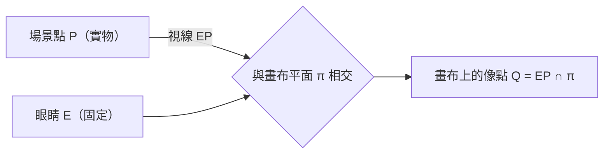
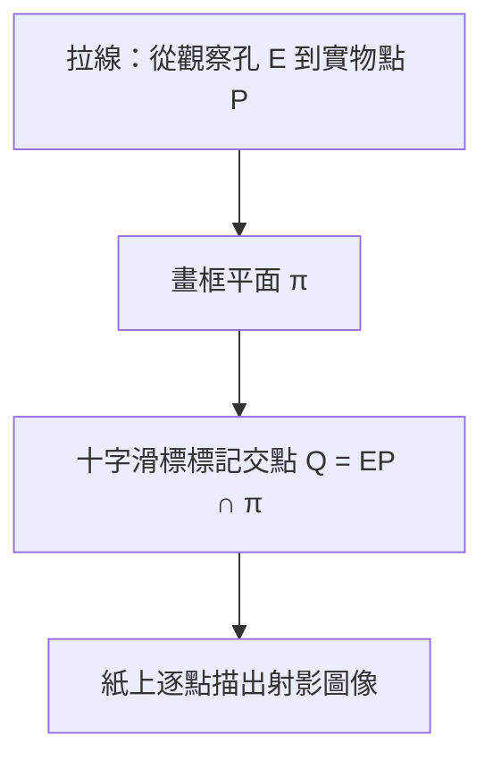
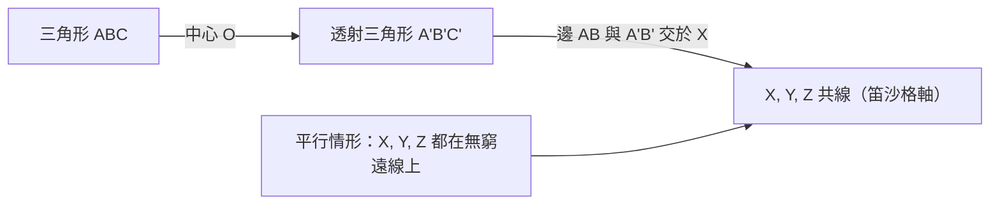

# 5.1 文藝復興透視法與笛沙格定理（1639 年）

## 學習動機

你在第 3、4 章已經熟悉了笛卡兒座標的世界：每個點都有一個確定的座標，兩條相異直線若不平行就恰交於一點、若平行就「無解」。但當一位畫家站在畫架前描繪一條筆直延伸到地平線的道路時，兩道平行的路緣在畫布上卻**相交**了——交在地平線上的同一點！這是幾何與繪畫之間一個持續了近三百年的矛盾，而它的解決直接催生了一門全新的幾何：**射影幾何**。

本章的故事分兩幕。第一幕在十五世紀的佛羅倫斯：布魯內萊斯基、阿爾伯蒂與杜勒如何在畫布上「重新發明」空間；第二幕在 1639 年的巴黎：石刻建築師笛沙格出版《草圖》（*Brouillon Project*），把透視法中那些畫家的直覺昇華成全新幾何概念——**無窮遠點**、**平行線交於無窮遠**、**中心射影**與**笛沙格定理**。我們將全程用 SymPy 把這些定理一件件驗證清楚。

---

## 5.1.1 布魯內萊斯基與線性透視的發明

### 畫布上的空間

歐幾里得幾何統治繪畫一千多年，卻從來沒有真正用來「畫畫」。古羅馬壁畫已有粗略的遠近縮小，中世紀聖像畫則乾脆放棄了空間，人物按宗教重要性排大小。直到文藝復興的佛羅倫斯，建築師 **布魯內萊斯基**（Filippo Brunelleschi, 1377–1446）才第一次系統性地解決一個問題：

> 給定一個在三維空間中的場景、給定畫家的眼睛位置 $`E`$ 與一塊平面畫布，每個場景點 $`P`$ 應被畫在畫布上的哪一點？

布魯內萊斯基的抽象化可以寫成一句話：**連接眼睛與場景點的視線，與畫布平面的交點就是所畫之點**。



這就是**中心射影**（central projection）：從一個點把空間「壓」到一個平面上。數學上，這是一個**非線性**變換——它會把直線變成直線，卻不保長度、不保角度、也不保平行。

### 驗證傳說：佛羅倫斯洗禮堂

傳說布魯內萊斯基約在 1413 年做過一個著名實驗：他畫了一幅聖喬凡尼洗禮堂的透視圖，在畫板上鑽一個小孔，讓觀者從畫背透過小孔看向真正的洗禮堂，再用一面鏡子疊合畫與景——畫面與實景完全吻合。我們無法重演實驗，但可以用 SymPy 模擬其數學核心：單點透視中，平行於畫廊 $`x`$ 軸的直線，其到達點收斂於**一個消失點**。

```python
from sympy import Point, Line, Symbol, oo

# 眼睛 E 的水平切面座標（z 軸指向實物方向，畫布為平面 x = d）
d = Symbol('d', positive=True)   # 眼睛到畫布的距離
E = Point(0, 0)                  # 俯視圖中眼睛在原點
# 畫布是直線 x = d；場景中兩條平行道路緣（俯視圖）分別是
# y = 1 與 y = -1，沿 x 方向無限延伸 —— 平行！
roadL = Line(Point(0, 1), Point(10, 1))   # 水平切面：y = 1
roadR = Line(Point(0, -1), Point(10, -1)) # 水平切面：y = -1

def project_onto_canvas(P):
    """俯視圖中把場景點 P=(px,py) 沿視線 EP 投到畫布 x=d 上。"""
    px, py = P.x, P.y
    # 視線是參數式 E + t(P - E)，令 x 分量 = d 解 t = d/px
    t = d / px
    return Point(d, t * py)

P1 = Point(10, 1)     # 遠處道路左緣
P2 = Point(10, -1)    # 遠處道路右緣
Q1 = project_onto_canvas(P1)
Q2 = project_onto_canvas(P2)
print(Q1, Q2)
print(Line(Q1, Q2).slope)          # 畫布上「道路遠緣」的斜率
print(project_onto_canvas(Point(50, 1)))   # 越遠的點越靠近 y=0
```

預期輸出：

```
Point2D(d, d/10) Point2D(d, -d/10)     # px=10 時像高只有原高的 1/10
oo                                     # 畫布上「道路遠緣」是鉛直線
Point2D(d, d/50)                       # px=50 → 像高 1/50，越遠越貼近 y=0
```

趨近的極限點 $`(d, 0)`$ 就是**消失點**（vanishing point）：俯視圖中一整族水平平行線，在畫上都朝同一點收斂。但 $`(d,0)`$ 並不對應實世界中任何一個「有限遠的道路點」——它對應的是 $`y`$ 方向無窮遠處。**畫布上存在著實際空間中沒有的點。** 這是無窮遠點概念的最初胚芽。

---

## 5.1.2 阿爾伯蒂與杜勒：透視法變成公開技術

### 阿爾伯蒂的「窗戶」

布魯內萊斯基沒有留下文字。把這套方法系統化寫下來的是建築師兼學者 **阿爾伯蒂**（Leon Battista Alberti, 1404–1472）。他在 1435 年的《論繪畫》（*Della Pittura*）中提出名言：畫布應被視為**一扇透明的窗戶**，畫家在窗上標出所見之物。他給出了可操作的幾何程序：

1. 在畫布上先畫**地平線**（horizon）；
2. 自眼睛位置垂直落下的對應點畫主消失點；
3. 把地面網格（正方形瓷磚）按比例投影上去，畫面深度的分割線用對角線法交出。

阿爾伯蒂的深刻之處在於他把透視當成**數學定理**而非工匠秘方：「繪畫中的截面」，即畫布是一個**數學平面**，光是心中視線錐的交線。這正如度量離散坐標在第 3 章扮演的角色：把空間代數化之前，先把空間「幾何化」。

### 杜勒的機器與蝕刻版畫

德國畫家 **杜勒**（Albrecht Dürer, 1471–1528）於 1525 年在《圓規直尺測量法》（*Underweysung der Messung*）中刊登了著名的**透視投影機器**木刻版畫：一位畫家面對一個畫框、一根拉線（代表視線）、一副可滑動的十字標記。畫家助手把線的一端抵住實物上的點，另一端穿過畫框到達固定的觀察孔——拉緊的線與畫框平面的交點就是該點應畫的位置。



| 畫家 | 貢獻 | 年代 | 性質 |
|---|---|---|---|
| 布魯內萊斯基 | 首創線性透視、鏡面驗證 | 約 1413 | 示範（無遺稿） |
| 阿爾伯蒂 | 《論繪畫》系統方法論 | 1435 | 理論總結 |
| 杜勒 | 投影機器、木刻版畫 | 1525 | 機械化、可教學 |

### 一個有用的推論：畫布上「平行」已被破壞

從幾何性質看，中心射影具有下面這些**被保**的量：

- **直線射成直線**（共線性）：保了；
- **交點保交點**：兩條線的交，射影後仍是兩條像線的交；
- **三點共線**：保了；
- 但**長度、比例、角度、平行性**：一概不再保證。

前三項正是射影幾何願意研究的「好不變量」；後四項是歐氏幾何的珍寶、在射影不過是附加品。這個「不變量的階層」在 7.1 節愛爾蘭根綱領會升級成群論語言。

---

## 5.1.3 笛沙格：1639 年《草圖》）與無窮遠點

### 石匠的幾何革命

一百多年之後，建築與軍事工事師 **笛沙格**（Girard Desargues, 1591–1661）在 1639 年出版了《錐線與平面相交問題草圖》（*Brouillon project d'une atteinte aux événements des rencontres du cône avec un plan*）。這本書文風晦澀（他自己造了一整套術語，例如把射影平面叫 *traverse*，把無窮遠點叫 *buts*），當時幾乎無人讀懂，原書甚至一度失傳，靠後人手抄副本才恢復。但它的思想極端野蠻：

> 為了讓「平行」與「相交」不再是兩種情況，笛沙格**追加**了一類新點：所有互相平行的直線共同交於一個**無窮遠點**（point at infinity），一個方向一個；一個平面上所有無窮遠點共同組成一條**無窮遠線**（line at infinity）。

這樣一來，在**射影平面** $`\mathbb{P}^2`$ 中：

- 任意兩條相異直線**恰好交於一點**（有限點或無窮點皆然，且各不同方向）；
- 任意兩點**恰好決定一線**；
- 與有限點一視同仁——座標上行之（下節將以齊次座標具體化）。

「平行」由此降格為「交於無窮遠點」的特例。對偶性也隨之誕生（點與線對稱），這是 5.3 節實作的主題。

### 平行線交於無窮遠點：SymPy 模擬

我們不能直接叫 SymPy 畫無窮遠，但可以用「取極限」來演示其意義：一族互相平行的直線，各自的有限交點隨平面退離而收斂到同一點。更直接的做法是採用**齊次座標**（第 5.2 節正式講）：把 $`(x, y)`$ 寫成 $`[x : y : 1]`$ ，無窮遠點就是第三個分量為 $`0`$ 的點 $`[1 : m : 0]`$ （斜率 $`m`$ 方向）。

```python
from sympy import Matrix, Rational

def cross2(u, v):
    """三維齊次座標下兩 '點' 的叉積 = 通過它們的 '線'."""
    return Matrix([
        u[1]*v[2] - u[2]*v[1],
        u[2]*v[0] - u[0]*v[2],
        u[0]*v[1] - u[1]*v[0],
    ])

# 兩條平行線 y = 1 與 y = 3，用齊次座標 [a,b,c] 代表 ax+by+c=0
L1 = Matrix([0, 1, -1])   # 0*x + 1*y - 1 = 0  ->  y = 1
L2 = Matrix([0, 1, -3])   # 0*x + 1*y - 3 = 0  ->  y = 3
C = cross2(L1, L2)        # 交點（齊次座標）
print(C)                  # 攤開來算是 [1*(-3) - (-1)*1, (-1)*0 - 0*(-3), 0*1 - 1*0] = [-2, 0, 0]
```

甚至不需要「特別處理平行」：叉積結果是 $`[-2, 0, 0]`$ ，第三個分量為 $`0`$ ，也就是齊次座標中的 $`[-1 : 0 : 0]`$ —— $`x`$ 方向的**無窮遠點**，正是水平方向的「無限遠」！它在普通的 $`(x, y)`$ 座標下無法表示（分母為 0），但在齊次座標中只是一個「正常點」。

| 齊次座標叉積的兩種結果 | 意義 |
|---|---|
| 非零向量 $`[a : b : c]`$ | 交點唯一，可以是有限點或無窮遠點 |
| 全零向量 | 兩條「線」其實是同一條（退化情形） |

驗證程式：

```python
from sympy import Matrix

def cross2(u, v):
    return Matrix([
        u[1]*v[2] - u[2]*v[1],
        u[2]*v[0] - u[0]*v[2],
        u[0]*v[1] - u[1]*v[0],
    ])

L1 = Matrix([0, 1, -1])   # y = 1
L2 = Matrix([0, 1, -3])   # y = 3
C = cross2(L1, L2)
print(C)                          # -> Matrix([[-2],[0],[0]])
print('歐氏座標下的分母 z 分量:', C[2])     # 0 → 無窮遠
print('方向（斜率）:', C[1]/C[0])            # 0 → 水平方向，正確！
```

預期輸出：

```
Matrix([[-2], [0], [0]])
歐氏座標下的分母 z 分量: 0
方向（斜率）: 0
```

小小的叉積一行代碼，就把「平行線交於無窮遠點」寫成**純代數**、沒有例外分支。這是 1639 年思想超越當時兩個世紀的鐵證——直到齊次座標與電腦圖學問世，它才被完全泛用（10.1 節將看到齊次座標已成 OpenGL 的核心）。

---

## 5.1.4 笛沙格定理：三角形的射影靈魂

**定理（笛沙格）**：兩個三角形（在射影平面中）如果三條對應頂點連線 $`AA‘`$ 、 $`BB’`$ 、 $`CC'`$ 共過一點（稱為**透射三角形**），則三條對應邊的交點

$`X = AB \cap A'B', \qquad Y = BC \cap B'C', \qquad Z = CA \cap C'A'`$

必定**共線**（這條線叫**軸**，axis of perspectivity）。

它的**逆定理**同樣成立，且在某種意義下，它**在射影平面中是自對偶的**：把「點 ↔ 線」對調敘述，正逆兩敘述互換。也正是笛沙格定理首次讓「對偶性」成為定理而不是口號。

### 用 SymPy 驗證

下面用 `sympy.geometry` 的 `Point`、`Line` 直接驗證有限情形，並隨機取三角形（用整數座標避免浮點不精）。

```python
from sympy import Point, Line

def desargues_axis(A, B, C, A2, B2, C2):
    """若兩三角形透射，回傳三對應邊交點（必共線）."""
    assert Line(A, A2).intersection(Line(B, B2)) is not None  # 一般位置檢查
    # 中心 O 應為三條連線之公共交點
    lAA = Line(A, A2); lBB = Line(B, B2); lCC = Line(C, C2)
    O = lAA.intersection(lBB)[0]
    assert O in lCC            # 三條連線共點 = 透射
    X = Line(A, B).intersection(Line(A2, B2))[0]
    Y = Line(B, C).intersection(Line(B2, C2))[0]
    Z = Line(C, A).intersection(Line(C2, A2))[0]
    return X, Y, Z, O

A  = Point(1, 0);  B  = Point(0, 1);  C  = Point(1, 1)
# 中心 O = 原點：把 A、B、C 沿各自的射線拉不同的倍數（2 倍、5 倍、3 倍）
A2 = Point(2, 0);  B2 = Point(0, 5);  C2 = Point(3, 3)
X, Y, Z, O = desargues_axis(A, B, C, A2, B2, C2)
print(f"O = {O}")
print(f"X = {X}")
print(f"Y = {Y}")
print(f"Z = {Z}")

# 檢查 X, Y, Z 共線：兩兩連線斜率相同
line_XY = Line(X, Y); line_XZ = Line(X, Z)
print('共線? 斜率', line_XY.slope, line_XZ.slope, line_XY.slope == line_XZ.slope)
```

預期輸出：

```
O = Point2D(0, 0)
X = Point2D(8/3, -5/3)
Y = Point2D(6, 1)
Z = Point2D(1, -3)
共線? 斜率 4/5 4/5 True
```

三個邊交點的確共線（軸是斜率 $`4/5`$ 的直線）——這就是射影幾何的第一個核心定理：**不需要度量、不需要角度、不需要平行**，只用「點、線、共點、共線」四個概念便充足。它因此成為第 2.2 節討論的公理化方法之外，另一套完整公理體系（射影幾何公理）的「主定理」候選。

### 中心射影把「平行」和「共線」顛倒過來

下表回顧**為何透射會誘發共線**——這其實是中心射影的幾何「影子理論」：把 $`O`$ 視作視線中心，把整個平面沿不過 $`O`$ 的一條直線 $`\pi`$ 「壓扁」……

- 三個頂點連線過 $`O`$ ⟺ 三個像頂點連線過 $`O`$ ；
- 對應邊平行（皆交於無窮遠點 $`X_\infty, Y_\infty, Z_\infty`$ 同一直線——無窮遠線）→ 笛沙格軸。



## 5.1.5 小結與後續

| 人物 | 年代 | 核心觀念 | 後續章節 |
|---|---|---|---|
| 布魯內萊斯基 | 約 1413 | 中心射影、消失點 | 本節 |
| 阿爾伯蒂 | 1435 | 畫布=數學平面，系統方法 | 本節 |
| 杜勒 | 1525 | 機械投影裝置的普及 | 本節 |
| 笛沙格 | 1639 | 無窮遠點、射影平面、自對偶 | 本節 + 5.2 |
| 彭賽列 | 1822 | 射影變換與交比不變量 | 5.2 |

笛沙格的工作在 17 世紀被讀懂的人不多；直到 19 世紀一群以彭賽列為首的法國數學家把射影幾何重建為一門主幹學科，其「公理系統—變換群—齊次座標」三件套才完整成型。下一節走進 1822 年俄國戰俘營的構想。

---

## 習題

**習題 5.1.1** 消失點。在俯視圖模型（眼睛在原點、畫布為直線 $`x=d`$ ）中，把道路上兩點 $`(10,1)`$ 、 $`(20,1)`$ 投影到畫布上，用 SymPy 計算它們的 $`y`$ 座標，並推導隨 $`x\to\infty`$ 收斂到哪個點。

**習題 5.1.2** 平行線的齊次交。用本節 `cross2` 函數，計算兩條平行線 $`2x + 3y = 1`$ 與 $`2x + 3y = 7`$ 的交點（齊次座標），用 `sympy.Rational` 保持精確。它們的交點落在哪個方向上？

**習題 5.1.3** 笛沙格軸。取 $`A=(0,0), B=(3,0), C=(0,4)`$ 與 $`A'=(6,0), B'=(12,0), C'=(0,16)`$ （以原點為中心的放大），做 `desargues_axis` 驗證。此時 $`X,Y,Z`$ 共線，這條線是什麼？（提示：三對邊兩兩平行。）

**習題 5.1.4** 非透射的反例。構造兩個三角形使三條頂點連線**不**共點，並用 SymPy 驗證此時邊交點 $`X, Y, Z`$ 不必共線。

**習題 5.1.5** 杜勒機器的離散模擬。寫一個函數 `duerer_draw(points, E, d)`，把傳入的場景點列表整批投影到畫布 $`x=d`$ 並回傳 `Point` 列表；用三個點（一個桌角）測試並列印。
