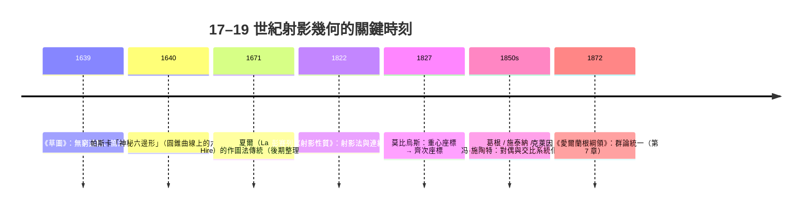

# 5.2 射影變換與齊次座標（彭賽列，1822 年）

## 學習動機

上一節我們看到 1639 年的笛沙格提出「平行線交於無窮遠點」，把透視畫家的直覺變成純幾何。但整個 17 世紀，這門新幾何只有幾件孤立的定理，主流仍是歐氏與解析幾何（第 3 章）。射影幾何真正變成**一門有方法的學科**，靠的是一個教科書史上最戲劇化的場景之一：法國軍官彭賽列在俄國戰俘營裡沒有書、沒有紙筆工具箱，靠記憶與演算，在 1812–1814 年間孕育出把中心射影當成**方法**來用的一整套思想，於 1822 年出版《圖形的射影性質分析》（*Traité des propriétés projectives des figures*）。

同時期，**齊次座標**（homogeneous coordinates）由莫比烏斯（1827 年）與彭賽列、熱爾岡（Gergonne）、普呂克（Plücker）等人逐步發展成熟，把「無窮遠點」「射影變換」「交比」從幾何敘述變成了**可計算的座標代數**——這正是本節的主題。而一百多年後，正是齊次座標的「能一次表達平移、旋轉、投影」的特性，使它被**電腦圖學**（1970 年代的 Sutherland、Newell 等）採納為整個三維繪圖管線的標準語言（10.1 節詳細談）。可以說：1822 年戰俘營裡的一支筆，最終寫進了你的顯示卡。

本節目標：

1. 理解彭賽列「射影性質」的定義與**連續性原理**；
2. 定義**射影變換**與它的不變量，證明**交比**是唯一的不變量（在共線圖形意義下）；
3. **齊次座標**：把射影平面變成向量空間的商空間，把射影變換變成 $`3\times 3`$ 矩陣；
4. 建立「齊次座標 ⟺ 透視投影」的本質聯繫。

與本章下一節的分工：本節是**理論**，5.3 節是**SymPy 實作**。

---

## 5.2.1 彭賽列與 1822 年《圖形的射影性質分析》

### 戰俘營裡的構想

彭賽列（Jean-Victor Poncelet, 1788–1867）隨拿破崙大軍攻俄，1812 年 11 月在克拉斯諾伊之戰被俘、又隨敗軍徒步走過俄國寒冬，最後被拘於薩拉托夫（Saratov）戰俘營約兩年。在營中他沒有教科書，靠回憶蒙日的描述幾何與伽希雄的學問，發展出一套新方法——他把在瓦西里耶夫營房裡的筆記題名為 *Analyse des* ...（後人稱「薩拉托夫筆記」）。1814 年回法國後，他花八年整理成 1822 年的《圖形的射影性質分析》。

他的核心口號可以這樣總結：

> 有些圖形性質在中心射影下不改變（射影性質）；因此**要證明某性質，可以先把圖形射影到最方便的位置，在「像」上證明，再反推回原圖**。

這就是"method of projection"（射影法）。它的效力來自一件事：中心射影破壞了長度、角度、平行，卻**保留**共線、共點、以及曲線的「類型」（圓錐曲線還是圓錐曲線，但圓可能變成橢圓）。所以與長度/角度無關的定理（例如有關切線、交比、圓錐曲線上的交點配置）常常可以移到最方便的位置證明。

### 連續性原理（Principle of Continuity）

彭賽列還主張一條後來被批評過、但歷史影響極大的「連續性原理」：若一性質對圖形的某一般位置成立，則當圖形**退化**到極限位置（例如交點移到無窮遠、兩點重合、兩線平行）時，性質「以極限形式」仍成立。這是射影幾何允許「虛點」「無窮遠點」「複數點」自由進出的方法論基礎。嚴格化要到 19 世紀末拓撲與代數方法成熟後（凱萊、克萊因、希爾伯特），但思想是彭賽列種下的。



---

## 5.2.2 射影變換與交比：唯一的不變量

### 定義

一個**射影變換**（homography）是在射影平面 $`\mathbb{P}^2`$ 上保持「點映點、線映線、共線性」的變換 $`H`$ ；用齊次座標說，它是由一個 $`3 \times 3`$ 可逆矩陣 $`M`$ 給出的

$$
[X : Y : Z] \;\longmapsto\; [aX + bY + cZ \; : \; dX + eY + fZ \; : \; gX + hY + iZ],
$$

並且兩個矩陣差一個常數倍 $`M`$ 與 $`\lambda M`$ 給出同一變換（所以自由度是 $`9 - 1 = 8`$ ，四個一般位置的點對就足以唯一決定 $`H`$ ）。

### 為何「距離」不可救，而「交比」可救？

在中心射影下，直線上的點 $`A,B,C,D`$ 的單純比例 $`\dfrac{AB}{BC}`$ 都會被扭曲——畫家沿著道路逐段等間距的路緣石，畫布上間距會越來越密。但有一個複合量奇蹟般存留。取共線四點 $`A, B, C, D`$ ，定義**交比**（cross-ratio）：

$$
(A,B;C,D) \;=\; \frac{\dfrac{CA}{CB}}{\dfrac{DA}{DB}}
\;=\; \frac{(c-a)(d-b)}{(c-b)(d-a)}
\quad (\text{實座標代數形式})
$$

**定理**：交比在任意射影變換下不變。

直覺：把共線四點看作被兩條過 $`P`$ 點的線「切」，交比就是切片的『不變指紋』。它是射影意義下唯一的不變量：**若兩組共線四點的交比相等，必存在一個射影變換把一組送到另一組**。所以：

| 量 | 在射影變換下 |
|---|---|
| 距離、比例長、角度 | 不保 |
| 平行性 | 不保（被送到交於一射影點） |
| 三點共線、三線共點 | 保 |
| **交比** | **保（唯一基本不變量）** |
| 圓錐曲線之「圓錐性」（二次曲線） | 保（圓可變橢圓等） |

### 交比的 SymPy 驗證

中心射影在兩條直線之間的限制，用參數 $`t`$ 寫出來正是一個 **Möbius 型分式線性映射** $`t \mapsto \dfrac{\alpha t + \beta}{\gamma t + \delta}`$ （這也就是「一次射影 = 一次齊次矩陣」在一維上的樣子）。所以「交比不變」可以一步到 algebra：計算

$$
\bigl( t_0, t_1; t_2, t_3 \bigr) \mapsto \frac{(f(t_2)-f(t_0))\,(f(t_3)-f(t_1))}{(f(t_2)-f(t_1))\,(f(t_3)-f(t_0))}
$$

後化簡，看它是否與原交比相等：

```python
from sympy import symbols, cancel, simplify, Rational

alpha, beta, gamma, delta = symbols('alpha beta gamma delta')
t0, t1, t2, t3 = symbols('t0 t1 t2 t3')
f = lambda t: (alpha*t + beta)/(gamma*t + delta)   # 一般 Möbius 型射影

def cr(p, q, r, s):
    """實線座標下四點的交比 (p,q;r,s)."""
    return cancel(((r - p)*(s - q)) / ((r - q)*(s - p)))

diff = simplify(cr(f(t0), f(t1), f(t2), f(t3)) - cr(t0, t1, t2, t3))
print("抽象差值 =", diff)

# 具體數值再驗一次：t = 0, 1, 2, 3 與 f(t) = (2t+1)/(t+1)
pts = (Rational(0), Rational(1), Rational(2), Rational(3))
g = lambda t: (2*t + 1)/(t + 1)
print("before:", cr(*pts))
print("after :", cr(g(pts[0]), g(pts[1]), g(pts[2]), g(pts[3])))
```

預期輸出：

```
抽象差值 = 0
before: 4/3
after : 4/3
```

抽象符號化簡「差值 $`=0`$ 」一錘定音：**交比在一切射影變換下不變**；具體數值 $`4/3`$ 前後一致，是給讀者的體感。

### 交比的兩個可愛特例

- 若 $`D`$ 是直線上該方向的無窮遠點（ $`d \to \infty`$ ）： $`(A,B;C,\infty) = \dfrac{CA}{CB}`$ ，交比退化成**單比**。這解釋了為何單純比例「幾乎不變」卻又被破壞——因為第四點漂到無窮遠。SymPy 用極限可驗：

```python
from sympy import symbols, cancel, limit

a, b, c, d = symbols('a b c d')
def cr(p, q, r, s):
    return cancel(((r - p)*(s - q)) / ((r - q)*(s - p)))

print(limit(cr(a, b, c, d), d, 'oo'))    # -> (-a + c)/(-b + c) = CA/CB
```

預期輸出：

```
(-a + c)/(-b + c)
```

正是 $`\dfrac{CA}{CB}`$ ，即單比。
- 若 $`(A,B;C,D) = -1`$ （**調和四點**、harmonic range），這是射影構造的最基本「單位」，中點 $`C`$ 與無窮遠點 $`B_\infty`$ 對 $`A,B`$ 調和，是「度量」如何從射影中長出來的種子（凱萊：「射影幾何是所有的幾何」）。

---

## 5.2.3 齊次座標：把無窮遠點變成「正常點」

### 定義與動機

$`N`$ 維射影空間 $`\mathbb{P}^N`$ 的**齊次座標**：一個點由非零向量 $`[X_0 : \cdots : X_N]`$ 表示，**同乘一非零常數表同一點**，

$$
[X : Y : Z] \sim [λX : λY : λZ], \qquad λ \neq 0.
$$

- 仿射部分（有限點）： $`Z \neq 0`$ 時對應普通座標 $`(x, y) = (X/Z,\, Y/Z)`$ ；
- 無窮遠點： $`Z = 0`$ ，例如 $`[1 : m : 0]`$ 是斜率 $`m`$ 的方向， $`[0:0:0]`$ 不代表任何點。

因此 $`\mathbb{P}^2 = \mathbb{R}^3 \setminus \{0\} \,/\, \sim`$ ：去掉原點、再模掉「沿過原點直線的伸縮」。幾何上，一個射影點就是一條過原點的**直線**。

### 三件威力

1. **無窮遠點天然在座標中**：不再是「沒有交點」，只是 $`Z = 0`$ 。
2. **點與線同型**：直線 $`ax + by + c = 0`$ 的係數向量 $`[a,b,c]`$ 就是齊次形式下的「線座標」。點 $`p`$ 在線 $`l`$ 上 ⟺ $`\;l \cdot p = \langle [a,b,c],[X,Y,Z]\rangle = 0`$ 。
3. **射影變換 = 一個矩陣**：可逆 $`3\times 3`$ 矩陣 $`M`$ 作用在向量上，且 $`M`$ 與 $`\lambda M`$ 同樣變換。

### 對偶性一瞥

因為「點」與「線」在同一個向量空間裡，且「點在線上」由對稱的內積表達，於是任何定理中把「點 → 線、線 → 點、共線 → 共點」互換，得到的仍是定理（這是 5.3 節實作的主題之一）。例如笛沙格定理的自對偶結構正是這樣一步到位的。

### 與透視投影的本質聯繫

把三維場景點 $`(X, Y, Z)`$ （ $`Z`$ 為深度）投到 $`z = -d`$ 的像平面（針孔相機，眼在原點、看向 $`+Z`$ ）：

$$
(u, v) = \left( \frac{dX}{Z}, \; \frac{dY}{Z} \right).
$$

這**不是**線性變換——除以 $`Z`$ 。但用齊次座標它可以寫成**純線性**的矩陣作用：

$$
\begin{bmatrix}
d & 0 & 0 & 0 \\
0 & d & 0 & 0 \\
0 & 0 & 1 & 0
\end{bmatrix}
\begin{bmatrix} X \\ Y \\ Z \\ 1 \end{bmatrix}
= \begin{bmatrix} dX \\ dY \\ Z \end{bmatrix}
\;\xrightarrow{\;\text{同除 } Z\;}\; \left( \dfrac{dX}{Z}, \; \dfrac{dY}{Z} \right).
$$

除法被藏進「**齊次座標的最後一列**」這一個步驟。這就是透視投影與齊次座標的本質關係：**中心射影的「非線性」其實是齊次座標中一個線性變換加上一次齊次除法（dehomogenize）**。電腦圖學管線中，這一步有專門硬體名稱：perspective divide（10.1 節）。

```python
from sympy import Matrix, symbols, simplify

X, Y, Z, d = symbols('X Y Z d', positive=True)
# 3x4 相機矩陣（齊次輸入）
K = Matrix([[d, 0, 0, 0],
            [0, d, 0, 0],
            [0, 0, 1, 0]])
p = Matrix([X, Y, Z, 1])
q = K * p
print(q)                          # [d*X, d*Y, Z]
u = simplify(q[0] / q[2]); v = simplify(q[1] / q[2])
print(u, v)                       # d*X/Z , d*Y/Z  → 正確的透視像座標
```

預期輸出：

```
Matrix([[d*X], [d*Y], [Z]])
d*X/Z d*Y/Z
```

### 為什麼電腦圖學選擇了它（前因後果）

回顧一下工程史，這條線在 10.1 節還會再談：

1. **1940s–60s**：飛行模擬與早期 3D 圖形需要透視投影，人們先用三角函數逐面手算。
2. **1965–68**：薩瑟蘭德的 "Sketchpad" 體系與 Roberts 的矩陣法把 3D 變換寫成 $`4\times 4`$ 矩陣（齊次形式），但平移與透視散置在各種約定中。
3. **1976 年前後**：Catmull、Newell 等的渲染管線確立「模型變換 → 視變換 → 投影變換 → perspective divide」統一用 $`4\times 4`$ （或 $`3\times 4`$ ）齊次矩陣。
4. **1990s 至今**：OpenGL/DirectX/Vulkan 與所有現代 GPU 的頂點著色器，`gl_Position` 恒是一個四分量齊次向量；光柵化硬體代你做 persp divide 與深度插值（ $`w`$ 除法）。

一句話：**因為齊次座標把「仿射變換 + 中心射影」融成一部 $`4\times 4`$ 矩陣機，一切變換就都變成了可組合、可流水線、可硬體加速的線性代數。** 數學上這只是「射影平面的向量空間模型」，但它讓笛沙格與彭賽列的思想住進了每一台電腦。

---

## 5.2.4 射影變換的自由度與「四點定一射影」

$`H`$ 的 8 個自由度意味：**4 對（一般位置——三點不共線）的「點 → 點」恰好唯一決定一個射影變換**（每對提供 2 條獨立方程，共 $`8 = 4\times 2`$ ）。19 世紀的射影構圖法（von Staudt 卓越的純幾何作圖）實際上就是把這句話做成純量尺：**只靠直尺，以交比為單位，就能在射影平面上「作算術」**。

這也是攝影測量學（photogrammetry）與計算機視覺中「單應矩陣估計」的數學基礎：面上四個已知對應點即可解出平面的單應 $`H`$ （例如行人路辨識、文件掃描去歪斜）。

```python
from sympy import Matrix, symbols, solve

arr = symbols('a b c d e f g h i')     # 矩陣 9 個未知係數；尺度差一常數倍
M = Matrix(3, 3, arr)
src = [(1,0,1),(0,1,1),(0,0,1),(1,1,1)]   # 一般位置的 4 個源點（齊次）
dst = [(2,0,1),(0,2,1),(0,0,1),(2,2,1)]   # 對應的 4 個像點

eqs = []
for p, q in zip(src, dst):
    # 條件「H p ∼ q」等價於叉積 (M p) × q = 0（每對 3 條式，含尺度自由度）
    eqs += list((M * Matrix(p)).cross(Matrix(q)))
sol = solve(eqs, arr, dict=True)
print(sol[0])
```

預期輸出：

```
{a: 2*i, b: 0, c: 0, d: 0, e: 2*i, f: 0, g: 0, h: 0}
```

`i` 未受限——這正是「差一常數倍」的自由度。取 $`i=1`$ 得 $`\mathrm{diag}(2,2,1)`$ ：把點「放大兩倍」的仿射變換，本來就是一種射影變換。

---

## 5.2.5 小結

| 概念 | 一句話 |
|---|---|
| 彭賽列射影法 | 把「不便」的圖形射影到「方便」的位置再證明 |
| 連續性原理 | 極限位置（平行、重合、無窮遠）上性質仍有意義 |
| 射影變換 | 保共線性的變換；齊次下 = 可逆矩陣（差常數倍） |
| 交比 | 射影唯一基本不變量；退化為單比； $`-1`$ 型為調和 |
| 齊次座標 | $`\mathbb{P}^2 = \mathbb{R}^3\setminus\{0\}/\sim`$ ；點/線同型 |
| 透視聯繫 | 中心射影 = 線性矩陣 + 齊次除法 |

下一節把這一切都變成**可執行的 SymPy 程式**：齊次座標運算、透視矩陣、交比計算、對偶性驗證，以及把全章織起來的幾張圖。

---

## 習題

**習題 5.2.1** 用本節 `cr` 函數取 $`A=0, B=1, C=2, D=3`$ 與一個 Möbius 映射 $`t \mapsto \dfrac{2t+1}{t+1}`$ ，計算交比以驗證不變（列出前後兩個數值）。

**習題 5.2.2** 交比的無窮遠特例。取 $`D = \infty`$ （代入 $`d \to \infty`$ 或用 `sympy.oo` 極限），證明 $`(A,B;C,\infty) = \dfrac{CA}{CB}`$ 。

**習題 5.2.3** 調和點列。取 $`A=-1, B=1, C=0`$ ，解出使 $`(A,B;C,D) = -1`$ 的 $`D`$ ，並解釋其幾何意義（ $`C`$ 是 $`AB`$ 的中點， $`D`$ 是方向無窮遠點）。

**習題 5.2.4** 齊次座標的平行性測試。寫函數 `is_parallel(l1, l2)`（輸入為齊次線向量），用 `cross2` 求交點並判斷其第三個分量是否為 0。用 $`2x+y=1`$ 與 $`2x+y=5`$ 、及 $`2x+y=1`$ 與 $`x+y=1`$ 兩組驗證。

**習題 5.2.5** 透視投影的深比。物體兩點 $`P_1 = (1, 0, 2)`$ 、 $`P_2 = (1, 0, 4)`$ 沿視軸排開，用本節相機矩陣算像座標：像上的間距比是 $`1 : ?`$ ？用 SymPy 求（提示： $`d`$ 只縮放影像，深度 $`Z`$ 才造成非線性壓縮），解釋這如何說明了「透視把遠處等間距壓縮」。
