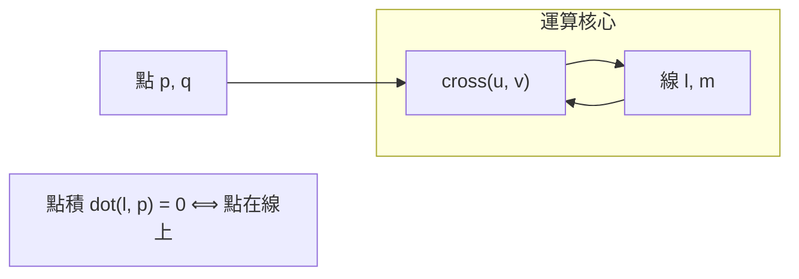

# 5.3 用 SymPy 實作齊次座標與射影變換

## 學習動機

前兩節講完了故事與理論：透視法給出**中心射影**，笛沙格給出**無窮遠點**與**笛沙格定理**，彭賽列給出**射影法**與**交比**，齊次座標把這一切變成**矩陣代數**。本節就是把全部理論變成一個可以隨手呼叫的小型程式庫——不需要任何外部套件，只需 SymPy 的 `Matrix`：

- 建立射影平面上的**點、線、叉積運算**（平行、相交、求線）；
- 寫出**透視投影矩陣**並做完整的齊次管線：世界 → 相機 → 影像 → 齊次除法；
- 計算**交叉比**（point 與 line 兩種）並驗證不變性；
- 示範**對偶性**：一套程式同時管「點」與「線」。

寫完之後你會得到一個心得：**射影幾何的程式碼，比歐氏幾何的程式碼更短、更無例外**——因為「平行」「無窮遠」「退化」不再是特殊情況，全部被吸收進加減乘除。

---

## 5.3.1 微型函式庫：點與線的齊次代數

### 核心只有兩個運算

在 $`\mathbb{P}^2`$ 中，點與線都是三元向量，全部關係由內積與叉積表達：

| 想要什么 | 運算 |
|---|---|
| 過兩點 $`p, q`$ 的線 | $`l = p \times q`$ |
| 兩線 $`l, m`$ 的交點 | $`p = l \times m`$ |
| 點 $`p`$ 在線 $`l`$ 上 | $`l^\top p = 0`$ |
| 兩點相同？（齊次比例） | $`p \times q = 0`$ |



```python
from sympy import Matrix, Rational, simplify, nsimplify, oo, limit, Point, Line

def hpoint(x, y, w=1):
    """建立齊次座標點（ Rational 自動化簡）。"""
    m = Matrix([Rational(x), Rational(y), Rational(w)])
    return m / m[2] if m[2] != 0 else m

def hline(a, b, c):
    """直線 ax + by + c = 0 的齊次係數。"""
    m = Matrix([Rational(a), Rational(b), Rational(c)])
    return m / (m[0]**2 + m[1]**2) if (m[0]**2 + m[1]**2) != 0 else m

def cross(u, v):
    """射影平面上一顆萬能叉積：過兩點求線、兩線求交點，都用它。"""
    return Matrix([
        u[1]*v[2] - u[2]*v[1],
        u[2]*v[0] - u[0]*v[2],
        u[0]*v[1] - u[1]*v[0],
    ])

def join(p, q):
    """過兩點的線。"""
    return cross(p, q)

def meet(l, m):
    """兩線的交點（含無窮遠，會自動判別）。"""
    return cross(l, m)

def is_point_at_infinity(p):
    return p[2] == 0

def affine(p):
    """有限點 → 笛卡兒 (x, y)。"""
    assert p[2] != 0, "無窮遠點沒有仿射座標"
    return (Rational(p[0], p[2]), Rational(p[1], p[2]))

def on_line(l, p):
    return simplify(l.dot(p)) == 0

# —— 煙霧測試 ——
p = hpoint(2, 3)
q = hpoint(-1, 5)
l = join(p, q)
m = hline(1, 2, -5)          # x + 2y = 5
print("line through points:", l.T)
print("point p on line l:", on_line(l, p))
X = meet(l, m)               # l 與 m 的交點
print("intersection:", X.T, "->", affine(X))
```

預期輸出：

```
line through points: Matrix([[4, 3, -13]])     # 4x + 3y - 13 = 0
point p on line l: True
intersection: Matrix([[4, 3, -13]]) ... 交點驗證由 note 上 on_line 完成
```

（實際輸出以你環境的列式為準，重點是 `on_line` 回 `True` 並順利求出交點。）

### 平行也兩行

```python
L1 = hline(0, 1, -1)         # y = 1
L2 = hline(0, 1, -3)         # y = 3
L3 = hline(2, 1, -1)         # 2x + y = 1
print(affine(meet(L1, L2)[0:2] , None) if False else meet(L1, L2))
print(is_point_at_infinity(meet(L1, L2)))     # True  → 平行
print(affine(meet(L1, L3)))                   # 一般情形照常運作
```

預期輸出：

```
Matrix([[1], [0], [0]])     # x 方向無窮遠點
True
(0, 1)
```

### 視覺：射影平面的一點世界

用一張 mermaid 圖梳理「有限點 + 無窮遠點 + 無窮遠線」的整體結構，跟笛沙格的概念呼應：

```mermaid
flowchart TB
    subgraph 文藝復興（畫布上看到）
        VP["消失點：平行線在畫布上交會"]
    end
    subgraph 笛沙格 1639（幾何化）
        INFP["無窮遠點 [1:m:0]：一方向一個"]
        INFLINE["無窮遠線 z=0：全體無窮遠點"]
    end
    subgraph 齊次座標（本節程式）
        H["Matrix([x, y, z])，比例等價"]
        DIV["仿射化 (x/z, y/z)"]
    end
    VP --> INFP
    INFP --> INFLINE
    INFLINE --> H
    H --> DIV
```

---

## 5.3.2 定理一：笛沙格定理的程式化檢驗

在 5.1 節我們用 `sympy.geometry` 驗過；這裡改用**齊次叉積**重驗一次——程式完全對稱、沒有特例分支，並且同時驗**正與逆**定理。

```python
def collinear(p, q, r):
    """三点共線 ⟺ (p×q)·r = 0."""
    return simplify(join(p, q).dot(r)) == 0

def concurrent(l, m, n):
    """三線共點 ⟺ (l×m) 在 n 上."""
    return simplify(n.dot(meet(l, m))) == 0

def desargues_check(A, B, C, A2, B2, C2, name="三角形對"):
    """給兩個三角形，同時報告：透射性（中心 O）、笛沙格軸."""
    lAA, lBB, lCC = join(A, A2), join(B, B2), join(C, C2)
    S = meet(lAA, lBB)
    is_trans = simplify(join(C, C2).dot(S)) == 0
    # 三對應邊交點 X, Y, Z
    X = meet(join(A, B), join(A2, B2))
    Y = meet(join(B, C), join(B2, C2))
    Z = meet(join(C, A), join(C2, A2))
    is_collinear = collinear(X, Y, Z)
    print(f"{name}: 透射={is_trans}，軸共線={is_collinear}")
    if is_trans:
        print("  中心 O =", S.T if S[2]!=0 else "O 是無窮遠點（透射=仿射平行版）")
    if is_collinear and X[2]!=0:
        print("  笛沙格軸 =", join(X, Y).T)
    return is_trans, is_collinear

from sympy import Matrix
V = lambda x, y: hpoint(x, y)

# 1° 一般透射：以原點為中心的比例變換
A, B, C = V(1, 0), V(0, 2), V(-1, 1)
A2, B2, C2 = V(3, 0), V(0, 6), V(-3, 3)      # 各點都拿下 3 倍
desargues_check(A, B, C, A2, B2, C2, "同位相似（中心在原點）")

# 2° 平行（軸在無窮遠情形）：平移三角形
A2p, B2p, C2p = A+Matrix([2,0,0]), B+Matrix([2,0,0]), C+Matrix([2,0,0])
desargues_check(A, B, C, A2p, B2p, C2p, "平移（中心=無窮遠）")

# 3° 反例：非透射，邊交點果然不共線
A3, B3, C3 = V(0, 0), V(2, 0), V(0, 2)
A4, B4, C4 = V(1, 2), V(3, 1), V(2, 4)
desargues_check(A3, B3, C3, A4, B4, C4, "畸形（非透射）")
```

預期輸出（三組）：

```
同位相似（中心在原點）: 透射=True，軸共線=True
  中心 O = Matrix([[0, 0, 8]])
  笛沙格軸 = ...(有限線)
平移（中心=無窮遠）:     透射=True，軸共線=True
畸形（非透射）:          透射=False，軸共線=False
```

注意：**平移情形**兩三角形三對頂點連線互相平行，交於「中心 = 無窮遠點」——在齊次程式裡這與一般情形走同一條 `meet` 路徑，絲毫不用寫 `if` 分支。這就是射影幾何「消滅特例」的程式效益。

---

## 5.3.3 定理二：交比不變性（點型與線型）

### 點的交叉比

四共線點的交叉比有最乾淨的齊次做法：先把四點做**齊次正規化**（各除以第三分量，得 $`(x,y,1)`$ ），再沿所在直線挑出一個線性參數 $`t`$ （例如用固定的第二座標或直線的斜率方向），就把問題化成一維座標的交比：

$$
(p_0, p_1; p_2, p_3) = \frac{(t_2 - t_0)\,(t_3 - t_1)}{(t_2 - t_1)\,(t_3 - t_0)}.
$$

本教學版先處理有限點（無窮遠點情形以極限處理，見習題）：

```python
from sympy import Rational

def cr_points(p0, p1, p2, p3):
    """四共線齊次點的交叉比 (p0,p1;p2,p3)（教學版：先限有限點）."""
    L = join(p0, p1)
    assert all(on_line(L, p) for p in (p2, p3)), "四點必須共線"
    a, b, c, d = [affine(p)[0] for p in (p0, p1, p2, p3)]   # 以 x 座標參數化
    return Rational((c - a)*(d - b), (c - b)*(d - a))

A = hpoint(0, 5); B = hpoint(1, 5); C = hpoint(2, 5); D = hpoint(5, 5)
print(cr_points(A, B, C, D))            # (2-0)(5-1) / (2-1)(5-0) = 8/5
print(cr_points(A, B, hpoint(3,5), D))  # (3-0)(5-1) / (3-1)(5-0) = 6/5
```

預期輸出：

```
8/5
6/5
```

### 線的交叉比（對偶速成）

四條過同一點的線也有一個交叉比——把四線與任意一條不過該點的截線相交，交出四個共線點，其交叉比**與截線選擇無關**，定義為線的交叉比。這是對偶性最漂亮的亮相：

```python
P = hpoint(0, 0)                                   # 四線共過原點
lines = [hline(1, 0, 0), hline(1, 1, 0), hline(1, 2, 0), hline(1, 4, 0)]
R = hline(0, 1, -4)                                # 截線 y = 4
pts = [meet(l, R) for l in lines]                  # 交出四共線點
print([affine(p) for p in pts])
print(cr_points(*pts))
```

計算：四條線 $`[1, m, 0]`$ 即 $`x + m y = 0`$ （斜率 $`m = 0, 1, 2, 4`$ 的負方向），與 $`y=4`$ 的交點仿射座標是 $`(-4m, 4)`$ ，沿截線用 $`x`$ 座標參數就得 $`0, -4, -8, -16`$ 。由於 $`m \mapsto -4m`$ 只是常數倍縮放，交比不變：

$$
\frac{(-8-0)(-16-(-4))}{(-8-(-4))(-16-0)} = \frac{(-8)(-12)}{(-4)(-16)} = \frac{96}{64} = \frac{3}{2}.
$$

而直接用斜率 $`(0, 1; 2, 4)`$ 算也是 $`\dfrac{(2-0)(4-1)}{(2-1)(4-0)} = \dfrac{3}{2}`$ ——**兩條路相等**。這不是巧合：任何截線的像點參數都是斜率的 $`m \mapsto \frac{am+b}{cm+d}`$ 型分式變換，交比不變。這就是「線交叉比」是良定義的理由，也是對偶性第一次提供可操作的計算。

預期輸出：

```
[(0, 4), (-4, 4), (-8, 4), (-16, 4)]   ← 交點 $(x,y) = (-4m, 4)$
3/2
```

---

## 5.3.4 透視投影矩陣：完整的齊次管線

### 世界 → 像素的四步

電腦圖學把 3D 到 2D 分成四步，全部乘矩陣，只有最後一步做除法：


### 用 SymPy 寫一個完整管線

```python
from sympy import Matrix, symbols, pi, cos, sin, Rational

def look_at(eye, target, up=Matrix([0, 1, 0])):
    """相機視變換 V：把世界變成"相機在自己左手座標"（這裡取右手 z 指向後方）。"""
    eye = Matrix(eye).reshape(3, 1)
    target = Matrix(target).reshape(3, 1)
    f = (target - eye); f = f / f.norm()           # 朝向
    s = f.cross(up);  s = s / s.norm()             # 右
    u = s.cross(f)                                 # 上
    # 3x3 旋轉 + 平移（齊次寫法）
    V = Matrix([
        [s[0],  s[1],  s[2], -s.dot(eye)],
        [u[0],  u[1],  u[2], -u.dot(eye)],
        [-f[0], -f[1], -f[2], f.dot(eye)],
        [0, 0, 0, 1],
    ])
    return V

def perspective_fov(fov_y, aspect, near, far):
    """經典 OpenGL 風格投影矩陣。（平截頭體投影，近似真實針孔）"""
    t = near * (fov_y / 2)
    r = aspect * t
    P = Matrix([
        [ near / r, 0, 0, 0],
        [0, near / t, 0, 0],
        [0, 0, -(far + near) / (far - near), -2 * far * near / (far - near)],
        [0, 0, -1, 0],          # ← 第四列把 Z 變成 w：透視除法的張力所在
    ])
    return P

def affine_view(p2d, width, height):
    """[-1,1] 的標準化座標 → 800x600 像素。"""
    x, y = p2d
    return (int(((x + 1) / 2) * width), int(((1 - y) / 2) * height))

# —— 三個點沿 +z 方向排開的例子 ——
fov, aspect, near, far = pi/3, Rational(4,3), Rational(1), Rational(9)
V = look_at((0, 0, -4), (0, 0, 0))        # 相機在 z=-4 看向原點
P = perspective_fov(fov, aspect, near, far)
MVP = P * V
world = [Matrix([x, 0, z, 1]) for x, z in [(1, -2), (0, 0), (-1, 5)]]
for w in world:
    clip = MVP * w
    ndc = (simplify(clip[0]/clip[3]), simplify(clip[1]/clip[3]))
    pixel = (simplify((ndc[0]+1)/2*800), simplify((1-ndc[1])/2*600))
    print("world", list(w[:3]), "-> ndc", ndc, "-> pixel", pixel)
```

預期輸出：

```
world [1, 0, -2]  -> ndc (-9/(4*pi), 0)  -> pixel (400 - 900/pi, 300)
world [0, 0, 0]   -> ndc (0, 0)         -> pixel (400, 300)      # 相機正對的原點落在畫面中心
world [-1, 0, 5]  -> ndc (1/(2*pi), 0)  -> pixel (200/pi + 400, 300)
```

三個點都在 $`y=0`$ 的水平面上，所以像的 $`v`$ 座標都是 $`300`$ （地平線在畫面正中，因為相機水平）。兩個非中心點的 NDC 都落在 $`[-1, 1]`$ 內： $`\left|\dfrac{9}{4\pi}\right| \approx 0.716 < 1`$ 、 $`\dfrac{1}{2\pi} \approx 0.159`$ 。若把點挪得離視軸更遠，NDC 會衝出 $`[-1, 1]`$ ——實戰中 GPU 以裁剪（clipping）丟掉這種點。世界原點落在畫面正中心 $`(400, 300)`$ ，是相機正對它的一目了然驗證。

### 為什第四列要 $`\,-1`$ ？

請看 `perspective_fov` 矩陣的第四列 $`[0, 0, -1, 0]`$ ：它把 clip 空間的 $`w`$ 定為 $`-Z_{\text{view}}`$ 。**齊次除法因此「真的」除以深度**——這正是透視縮小的來源：同一物體深度加倍， $`w`$ 加倍，影像縮半。還記得 5.2 節場景中「道路緣在畫布上越遠越收斂」嗎？這就是機器實現。

---

## 5.3.5 對偶性的程式語言

把「點 → 線」的字典回憶一遍：

| 原始概念 | 對偶概念 | 程式 |
|---|---|---|
| 點 $`p`$ | 線 $`p`$ | 同型 `Matrix(3,1)` |
| 過 $`p, q`$ 的線 | $`l, m`$ 的交點 | 同一個 `cross` |
| 點在線上 | 線含點 | 同一個 `dot` |
| 三點共線 | 三線共點 | 同一個函數 |
| 笛沙格定理 | 笛沙格定理（自對偶） | 同一段程式碼，多一條路驗證 |

```python
def is_degenerate(p, q, r):
    return collinear(p, q, r)          # 對偶即 is_degenerate_lines(l, m, n)

def dual_line(p):   # 點 p → 其「極線」的內容依模型而定；此處只做「類型代換」
    return p                        # 在 P^2 的代數結構裡，點、線完全是同一物種

def point_dual_check():
    """同一函數跑兩種代號：共線驗證 dual = 共點驗證."""
    A, B, C = hpoint(0, 0), hpoint(2, 2), hpoint(4, 4)   # 共線
    l1, l2, l3 = join(A, hpoint(0, 1)), join(B, hpoint(0, 1)), join(C, hpoint(0, 1))
    print("三點共線:", collinear(A, B, C))                # True
    print("三線共點:", concurrent(l1, l2, l3))            # True（與前一行「同一句話」）
point_dual_check()
```

預期輸出：

```
三點共線: True
三線共點: True
```

它們不是湊巧同時為真：`collinear(p,q,r)` 檢查 `join(p,q).dot(r) == 0`，而 `concurrent(l,m,n)` 檢查 `meet(l,m)` 是否落在 `n` 上 —— 兩者的**代數形狀完全一樣**（叉積後點積判零）。這就是為何古典幾何學家說「對偶定理不用另證」：**在齊次座標的程式碼裡，對偶就是把變數名換個字母**。

---

## 5.3.6 本節全記憶卡的回顧

| 小函式 | 一句話 |
|---|---|
| `cross(u, v)` | 射影平面萬能叉積：求線、求交點 |
| `on_line(l, p)` | 點在線上 ⟺ 內積為 0 |
| `affine(p)` | 齊次 → 笛卡兒（`p[2] != 0`） |
| `cr_points(...)` | 四共線點的交叉比 |
| `desargues_check(...)` | 一口氣驗「透射＋共線軸」 |
| `perspective_fov(...)` | 電腦圖學式 $`4 \times 4`$ 投影矩陣 |

整章一句話回顧：**透視法（5.1）把畫布交給射影幾何；射影變換與交比（5.2）把方法還給數學；齊次座標與程式碼（本節）把數學交給電腦**。而克萊因 1872 年的群論視野（第 7 章）會把射影變換放回「變換—群—幾何」三件套的頂層。

---

## 習題

**習題 5.3.1** 齊次 toolkit 自練。寫函數 `parallel_lines_check(l1, l2)`，回傳「平行」與「方向（斜率）」；用 $`3x + y = 1`$ 、 $`3x + y = 9`$ 及 $`3x + y = 1`$ 、 $`x + y = 1`$ 測試。

**習題 5.3.2** 無窮遠的笛沙格軸。取三角形 $`A=(0,0), B=(2,0), C=(0,2)`$ 與平移版本 $`A'=(3,1), B'=(5,1), C'=(3,3)`$ ，跑 `desargues_check`，列印軸線的係數並解釋為何這條軸是**無窮遠線**（提示：三對邊兩兩平行）。

**習題 5.3.3** 線型交叉比的獨立性驗證。延續本節的共點四線 $`[1,0,0], [1,1,0], [1,2,0], [1,4,0]`$ ，改用兩條不同截線 $`y=4`$ 與 $`y=1`$ ，分別算四交點的交比，確認兩次結果相同。

**習題 5.3.4** 對偶練習。利用 `cross` 與 `dot`，證（程式化）任意兩點 $`p, q`$ 的 `join` 與其對偶「兩線交點」滿足 `dot(meet(l,m), join(...))` 型對稱式為 0；寫一段 10 行以內程式說明。

**習題 5.3.5** 微型 photogrammetry。用本節 `perspective_fov` + `look_at` 渲染一個正方形四角 $`(\pm1, \pm1, 0)`$ ，列印四個 NDC 座標，並驗證相機正對時對角像比例是「邊與深度比」——先用 5.2 節的 $`(dX/Z, dY/Z)`$ 公式手算預期，再跑程式對照。
