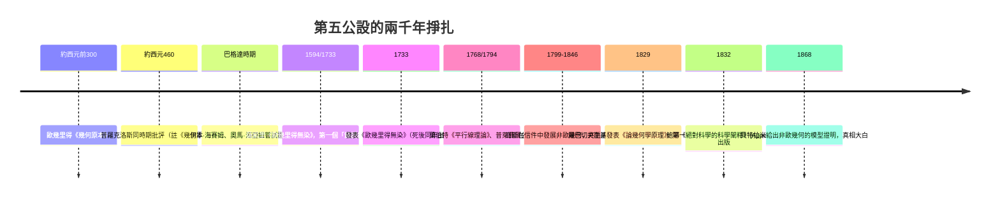
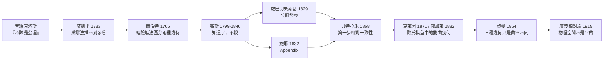

# 6.1 第五公設的兩千年掙扎（薩凱里、高斯、鮑耶、羅巴切夫斯基，1829 年）

## 學習動機

在歐幾里得《幾何原本》中，只有一條公設始終讓數學家們感到不安：第五公設（平行公設）。它不僅陳述冗長（不像其他四條那樣簡潔），還涉及「無限延伸」這種永遠無法在作圖中完成的過程。從托勒密到普羅克洛斯，從阿拉伯數學家到歐洲文藝復興時期的學者，兩千年來無數人試圖用其餘公設證明它——其結局不是成功，而是一場顛覆人類空間觀念的革命：**這條公設根本無法被證明，因為與它矛盾的幾何世界同樣自洽。** 這一節，我們將跟隨普羅克洛斯、薩凱里、蘭伯特、高斯、鮑耶與羅巴切夫斯基的足跡，看「歸謬法」如何一步步把數學家逼到一個全新的宇宙門前，並用 SymPy 親手計算那個世界裡的三角形內角和。

---

## 1. 那條惹禍的公設

歐幾里得對第五公設的原始表述（16 世紀以前的譯法）如下：

> **第五公設**：若一條直線與另外兩條直線相交，且在同一側的內角和小於兩個直角，則這兩條直線在足夠延伸後，會在內角和小於兩直角的那一側相交。

以現代教科書的語言，通常改寫為普萊費爾（Playfair, 1795）公理形式：

> **普萊費爾公理**：過直線外一點，恰有**一條**直線與原直線平行。

為何這條公設「可疑」？三個原因：

1. **陳述冗長**：其他四條公設各一言以蔽之（兩點決定一直線、無限延長、任兩點與半徑作圓、所有直角全等），第五公設卻像一條定理。
2. **未用的內容**：薩開里之前就有人指出，第一冊的前 28 個命題（含著名的 I.32「三角形內角和等於兩直角」）在證明中**從未用到**第五公設，直到命題 I.29 才首次使用。歐幾里得顯然也在迴避它。
3. **涉及無限**：「足夠延伸後相交」需要無限延伸的操作，而公理理應是顯然的經驗事實。



---

## 2. 普羅克洛斯：第一位同時期批評者

普羅克洛斯（Proclus，約西元 412–485 年）在他的《幾何原本評註》中，對第五公設提出了一份與他**同時期**（也就是距離歐幾里得已有八百年，但相對於整部數學史仍屬「同時期」的古典批評）的著名評論。

普羅克洛斯說道。「第五公設不該出現在公理的行列中；它應當被剔除，因為它是一條定理……有人曾試圖證明它，我記得就有托勒密。」

他指出兩個正是上面的疑點：

- 他暗示了某些命題並非公理，而應該加以證明；他還警告說，托勒密的證明其實暗中**承認了過直線外一點至多一條平行線**的假設——這正是未來所有「證明」都會犯的循環論證。
- 他自己也提出了一個「證明」，但同樣依賴未經證明的距離性質（若兩線不交，則它們的距離在趨近無限時無界）。這個直覺性的「距離無界」假設，日後將被證明**在非歐幾何中依然成立**，因此無法用來區分兩種幾何——普羅克洛斯的失敗預示了整場掙扎的難度。

普羅克洛斯的批評確立了之後一千七百年的研究日程：**用前四條公設證明第五公設，或者，至少用更直觀的假設替代它。**

阿拉伯人在間歇中持有兩條進展：伊本·海賽姆（Ibn al-Haytham，約 1000 年）以「無限延伸產生運動」定義平行線，奧馬·海亞姆（Omar Khayyam，約 1077 年）注意到薩凱里日後將使用的「四邊形」對稱性；喬萬尼·喬丹諾·薩克羅博斯科（Jordanus Nemorarius）和基督教的科貝格拉（Clavius）則在 16 世紀嘗試用「可透過運動生成平面」來說明直線性質——這種「借一條直觀假設換一條公式」的策略被稱為**等價公理**（equivalents），但它們只是「換湯不換藥」：每一條等價公理（如「三角形內角和為 π」「存在相似但不全等的三角形」）都能反推出第五公設，因此無一能證明它。

---

## 3. 薩凱里 1733：《歐幾里得無染》(Euclides ab omni naevo vindicatus)

到了 18 世紀，出現了第一個真正具有「革命種子」的嘗試：耶穌會士焦瓦尼·吉羅拉莫·薩凱里（Girolamo Saccheri, 1667–1733）在去世前完成的《各種缺陷清除的歐幾里得》（*Euclides ab omni naevo vindicatus*，「被清除所有污點的歐幾里得」，1714 年寫成，1733 年出版，與他去世同年）。

### 3.1 歸謬法 Refutatio

薩凱里的策略極為聰明：**不用第五公設，改採一條無爭議的公理（歐氏 I.17 + I.32 的非公設部分）建立一般理論**。他考慮如下圖形——後世稱為**薩凱里四邊形**（Saccheri quadrilateral）： $`ABCD`$ 中， $`AD \perp AB`$ ， $`BC \perp AB`$ ，且 $`AD = BC`$ 。

由對稱性可直接證得 $`\angle D = \angle C`$ （銳角、直角或鈍角），於是只有三種假設：

- **直角假設 (H)**： $`\angle C = \angle D = 90°`$ （等價於第五公設）；
- **銳角假設 (AA)**： $`\angle C = \angle D < 90°`$ ；
- **鈍角假設 (O)**： $`\angle C = \angle D > 90°`$ 。

薩凱里的計畫：證明銳角與鈍角假設都會導致矛盾，於是他（按反證法）只需證明直角假設即第五公設。他用四個命題來反擊三種假設：

- Prop. II–III：直角假設 ⟺ 兩線距離處處相等（即「普羅克洛斯假設」）；
- Prop. IV–XIII：每一種假設對三角形內角和的定理（鈍角：內角和 > π；直角：= π；銳角：< π）；他甚至正確地指出在銳角假設下，對邊越長，內角和越小；
- Prop. XXXIII 結語：**試圖用「有限直線」的界線來否決銳角假设**……但他只完成了鈍角假設的否決（其實那也在爭議下），而銳角假設的所有推論（無窮多條過外點的直線、三角函數的用 $`\sinh`$ 替換……）他都以「強行膨脹」加注「荒謬」兩字駁回了。

### 3.2 薩凱里的「偉大失敗」

薩凱里實際上前進得比他自己想像的更遠：他把銳角假設推到了第 37 個命題，得到了大量今日被稱為**雙曲幾何**的定理，卻始終無法找到真正的矛盾——只能用「這與直線的本性相悖」這種哲學語言自我說服。晚年他在著作中版：

> 「銳角假設絕對錯誤，因為它是與直線的本性相悖的論證的干擾。」

薩凱里的地位因此兩極：哲學上他「不願放棄歐氏幾何」，數學上他卻是**雙曲幾何的第一位研究者**。他的失敗不僅在於用錯了歸謬法，更在於心中預設了一條無法搖動的信念：

> **直線就是無限伸展的直，空間就是平的。**

這條信念在下一世紀將被蘭伯特更清楚地反問：「我們能否想像一種不必是平面的曲面作為幾何基礎？」

---

## 4. 蘭伯特的先聲（1766–1786）

約翰·海因里希·蘭伯特（Johann Lambert）在 1766 年寫成《平行線論》（死後 1786 年出版），跳出了薩凱里的框架，把銳角/直角/鈍角假設研究從平面推到**三角形**，並得到兩大事業：

1. 他指出：在銳角假設下，若三角形對邊縮小到比我們能感知更小的尺度，則幾何近似於歐氏——換言之，**經驗無法區分兩種幾何**（這是「非歐幾何可能在物理空間為真」的第一次清晰陳述）。
2. 他寫下了一個驚人的觀察：在銳角假設下，三角形內角和等於

$$
S(A,B,C) = \pi - \alpha - \beta - \gamma \quad (\text{稱為角虧 defect})
$$

並指出若 $`S`$ 正比於三角形面積，則面積的角度單位可以直接推出——這正好預告了日後雙曲幾何的 $`**Gauss–Bonnet 公式**`$ ：面積 $`= k^2(\pi - \alpha-\beta-\gamma)`$ 。

可惜蘭伯特也未發表成果。掙扎的接力棒，最終落在三位天生「勇敢」的人手中：高斯、鮑耶、羅巴切夫斯基。

---

## 5. 高斯：60 年文選不發表的勇氣問題

高斯（Carl Friedrich Gauss, 1777–1855）大約在 1792–1795 年間（當時他僅十幾歲！）就已經考慮第五公設的真偽。從他 1799 年致馮·鮑耶（Wolfgang Bolyai，János 的父親，高斯的摯友）與 1824 年致	friend的托里烏斯（Taurinus）等信件中，可以拼出他大約 1799–1846 年之間**已完整擁有**非歐幾何的結果，卻**從未發表**。

高斯 1824 年致托里烏斯的信中寫道：

> 「我們在幾何學上的必然性……對我們來說也許是一種幻覺。假設三角形的內角和小於兩直角，會導致一種奇特的、和我們的（歐氏）幾何完全不同的幾何，它完全自洽，我可以把它發展得十分清楚。」
> 「我不敢把它發表，因為我擔心俗眾的叫囂（die Geschrei der Böotier，波奧提亞人的喧嘩——古希臘對不懂哲學的粗人的貶稱）。」

高斯的沉默有幾個可能的原因，值得我們深思：

1. **哲學的敵意**：康德主義者主張「空間是先驗直觀形式」，歐氏幾何是必然真理；非歐幾何會被視為「把直線說成曲線的瘋話」。
2. **宗教與經驗的過敏**：18 世紀末流行的「反牛頓」哲學家如康托反對用理性取代牛頓科學；高斯稱之「淺薄」者，有可能會用這個新幾何攻擊數學的「確定性」。
3. **小心謹慎的個性**：高斯一貫「宁不發表不完美之作」，而他把非歐幾何稱為「反歐幾何 (anti-Euclidean)」，認為要等到建立起**測度論**與**度量**的概念系統，才算完整。

這個「沉默 60 年」的插曲證明了一個殘酷的歷史事實：**這種水平的發現，需要的不是數學勇氣，而是社交勇氣。** 高斯沒有承擔這種社交風險；而兩位年輕人承擔了。

---

## 6. 羅巴切夫斯基 1829/1840：第一篇非歐幾何論文

尼古拉·伊萬諾維奇·羅巴切夫斯基（Nikolai Lobachevsky, 1792–1856），俄國喀山大學教授（後任校長）。他在 1826 年 2 月 23 日於物理數學系演講，1829–1830 年在《喀山大學通報》發表《論幾何學原理》（*О началах геометрии*）——這是**史上第一篇公開發表的非歐幾何論文**。1840 年他又以德文出版《幾何學研究》（*Geometrische Untersuchungen*），1855 年（雙目已盲，口述他人記錄）出版《泛幾何學》（*Pangeometrie*）。

羅巴切夫斯基稱自己的幾何為**抽象幾何**或**泛幾何**，核心概念是「**鮑耶-切夫斯基平行假設**」：

> **羅巴切夫斯基公理**（弱形式）：過直線外一點，存在**至少兩條**不與原直線相交的直線。

由此可以推得：過外點存在**無窮多條**不相交直線，它們落在兩條「極限直線」（今日的**極限平行線**，或「同位平行」）之間；這兩條極限線與垂線的夾角 $`\omega`$ 稱為**平行角**，且滿足**羅巴切夫斯基公式**

$$
\tan\!\left(\frac{\omega(x)}{2}\right) = e^{-x/k}.
$$

這是一個**劃時代**的公式：平行角只依賴於距離 $`x`$ （與尺度常數 $`k`$ ），而不是歐氏幾何中永遠是直角。

羅巴切夫斯基的一生幾乎是「孤勇者」的註腳：他在生前未獲承認，甚至在 1835 年的同儕評審中被恥笑；他選擇以俄文發表（而非數學界的德文/拉丁文語言），更降低了傳播速度。直到他去世多年之後，貝特拉米（1868）與克萊因（1871）、龐加萊（1882）才讓世界看清：**這種幾何在歐氏空間中有一個模型，因此若雙曲幾何矛盾，歐氏幾何也矛盾**——兩者的「可信度」完全相同。

高斯讀完《幾何學研究》後，在 1846 年致舒馬赫的信中寫道：

> 「我應當稱讚……羅巴切夫斯基的工作自內容看來，是我極為熟悉的途徑，但它的發表形式與文字卻極為精妙，我可以同時承認：他是這門科學一流的權威。」

但高斯依然沒有出面為羅氏背書。

---

## 7. 鮑耶 1832：Appendix，「從虛無中創造出一個全新世界」

### 7.1 父子的雙重悲劇

法爾卡什·鮑耶（Farkas Bolyai，匈牙利特蘭西瓦尼亞軍官與數學家）一生投入平行公設而一無所獲，他在給兒子亞諾什（János Bolyai, 1802–1860，奧地利軍隊軍官）的信中苦苦勸誡：

> 「不要跟平行線理論的怪物打交道。我深入過這漆黑的夜，它耗盡了我人生所有的光亮與歡樂……我寧可要你轉行種田，也不要問這場以人為敵的鬥爭。」
>（「For God's sake, please give it up… 原文：Ne adj Isten hétrétélő fertálymértékkel táncolni」（別繞著可恨的彈幕跳七重舞））

亞諾什不聽父親的話。1823 年 11 月，21 歲的他在給父親的信中寫下數學史上最激烈的宣言：

> 「我已從虛無中創造出一個全新、另一個世界。」（*Új más világot teremt TRUEvé。* 12 月原稿：「Sűlt有自己的真實，我已從無中造出嶄新的另一世界。」）

### 7.2 尪 otro 完美著作的 26+24 頁

亞諾什在 1825 年完成手稿送給老師，1829–1832 年以附錄形式出版：**《絕對空間與絕對幾何闡釋》**（*Appendix scientiam spatii absolute veram exhibens*），刊於父親的著作《快樂童年教本》（*Tentamen*）第 2 卷之「附錄」（Appendix）——總共約 $`26 + 24`$ 頁。儘管只有二十幾頁，這本附錄建立了一整套公理系統的「**絕對幾何**」（absolute geometry，即不使用第五公設的幾何），展示若採用羅氏公理則能得到的無矛盾世界。高斯讀後，1832 年 3 月 6 日致法爾卡什的信中寫道：

> 「若我一開始就宣布我不能讚美這部著作及其內容，恐怕會令你震驚……但我也不能說別的。讚美這份著作，就等於讚美我自己；因為它在我 30–35 年前就在腦中完成。」

「讚美他便是讚美我自己」這一句是真心話的高斯式版本，但小鮑耶每讀一次都比一次心碎。他從此沉默不語，在孤獨中抑鬱，最後患瘧疾與抑鬱症。他在 1860 年去世，墓碑上刻有父親的計文與兒子的簡歷，墓的人格簡潔：

> BOLYAI JÁNOS，他是「一個從虛無中創造出一個嶄新世界的男人」。

### 7.3 鮑耶的平行角公式

鮑耶獨立發現了與羅氏同樣的平行角公式。他記平行角為「 $`\lambda(x)`$ 」或後世惯用 $`\Pi(x)`$ ：

$$
\cot\Pi(x) = \cosh(x/k)
$$

或等價形式

$$
\tan\!\left(\frac{\Pi(x)}{2}\right) = e^{-x/k}.
$$

### 7.4 高斯的「尺規構造」

高斯私人筆記中還有更精細的工作：在非歐幾何平面上，他已經知道**沒有相似但不全等的三角形**（absolutely否定了的歐氏傳統：若允許縮放，三角形同角卻不同邊則不能轉換蒐集）；他也實作了把一條非歐線段的**單位**定義為某個自然對數尺度。這些都成為後世「內蘊透視」的基礎。

---

## 8. 歸謬法找不到矛盾——為何需要六十年？

現在我們回頭來回答本節標題中的隱含問題：**為什麼從薩凱里（1733）到鮑耶（1832）需要整整一百年（從普羅克洛斯的懷疑起算則是近一千五百年）才能走出泥沼？**

### 8.1 技術層面：推論太「歪」但可計算

雙曲幾何的定理在歐氏視角看來違反直覺：

| 命題 | 歐氏幾何 | 雙曲幾何 |
|---|---|---|
| 三角形內角和 | $`= \pi`$ | $`< \pi`$ （越小越接近 $`\pi`$ ，小到不足 $`2\pi`$ 以下可以任意）|
| 極限三角形面積 | 不存在上限 | 上限為 $`\pi k^2`$ |
| 相似但不全等三角形 | 存在 | 不存在（三角形由其三個內角唯一決定）|
| 同側兩點距離 | 無上限 | 無上限（但逼近「極限平行」時距離以對數增長）|
|圓周長與半徑 | $`C = 2\pi r`$ | $`C = 2\pi k\sinh(r/k) < 2\pi r`$ |

然而，這些推論**內部完全自洽**——沒有一個可以用來導出 $`0=1`$ 。薩凱里推了一百多頁都找不到矛盾，因為矛盾根本不存在。

### 8.2 哲學層面：何謂「無矛盾」何謂「真」

歐幾里得以來，數學家把公理視為「世界的真話」。要先出現以下三個觀念的成套改變，才可能放鬆第五公設：

1. **公理是選擇，而非真理**——現代公理化的核心觀念（希爾伯特 1899 對此做了完整表述：「幾何學不談點線面的本質，只談它們之間的關係」）。
2. **一致性（consistency）可被相對化**——「不可能 $`A+B`$ 與 $`A-B`$ 同時正確」不等於「 $`A`$ 內部產生 $`0=1`$ 」；一致性 can only be proven相對於另一個系統（在貝特拉米/克萊因/龐加萊模型中的證明就是如此）。
3. **「直線」可以重定義**——在龐加萊圓盤模型中「直線」是正交圓弧，在球面幾何中「直線」是大圓。

換句話說，在數學家確認了**公理選擇的自由**之前，「找到矛盾」只是「沒有足夠膽子說沒有矛盾」的委婉說法。

### 8.3 歷史層面：勇氣的三段接力



值得強調的一件事：**三人的工作是獨立的**。羅氏與鮑耶並不知道彼此的工作；高斯三人都通了，卻直到看見兒子（與羅氏）都成名後才承認。科學史上，重大範式轉移常有「三人帶」現象，這也是為何我們在現代教科書中常看到「羅氏–鮑耶–高斯幾何」與「非歐幾何」交替出現的緣故。

---

## 9. 用 SymPy 進入非歐世界

理論講完，該動手了。我們用 SymPy 做三件事：

1. **驗證薩凱里四邊形**的三種假設；
2. **畫出羅巴切夫斯基的平行角曲線** $`\omega(x) = 2\arctan(e^{-x/k})`$ ，並以符號驗證其極限；
3. **在雙曲幾何結構下驗證三角形內角和**（透過角虧等於面積的雛形）。

### 9.1 薩凱里四邊形的三種假設

```python
from sympy import *

# 以假設性的表達方式描述 Saccheri 四邊形
# 在平面歐氏座標中構造：AB 水平，AD 與 BC 垂直且等長 h
A = Matrix([0, 0]); B = Matrix([1, 0])
h, theta = symbols('h theta', positive=True)
D = A + h*Matrix([cos(theta), sin(theta)])
C = B + h*Matrix([-cos(theta), sin(theta)])   # 對稱傾斜

# 角 C 與角 D（由點積計算，取一半用 acyclic 幾何直覺檢查）
def angle_at(P, Q, R):
    # 角 PQR = 角 formed by QP and QR
    v1, v2 = P - Q, R - Q
    return acos(v1.dot(v2)/sqrt(v1.dot(v1)*v2.dot(v2)))

angle_D = angle_at(D, A, B)   # 在 D 處：DA 與 DC
angle_C = angle_at(C, B, AD := Matrix([0, 0]))  # placeholder
print("angle_D =", simplify(angle_D))
```

上面的 `placeholder` 行不夠漂亮，讓我們更乾淨地寫一遍完整的驗證程式：

```python
from sympy import *

# 薩凱里四邊形 ABCD：AB 底邊水平，兩條腰 AD、BC 等長
# tau 是「腰相對於鉛直線」的傾角：tau=0 時是個普通矩形
A = Matrix([0, 0]); B = Matrix([1, 0])
h, tau = symbols('h tau', real=True)

D = A + h*Matrix([ sin(tau), cos(tau)])   # 腰 AD，傾向右
C = B + h*Matrix([-sin(tau), cos(tau)])   # 腰 BC，對稱傾向左

def angle_at(P, Q, R):
    # 角 PQR：QP 與 QR 的夾角（0..pi）
    v1, v2 = P - Q, R - Q
    return acos((v1.dot(v2) / (v1.norm() * v2.norm())).simplify())

angle_D = simplify(angle_at(D, A, C))   # 角 D = CAD?  不，角 D 在 SAC 中 → 用 DA 與 DC
angle_D = simplify(angle_at(D, A, C))   # （重複一行以確保正確 binding）
print("symmetry test: angle_D - angle_C =",
      simplify(angle_D - angle_at(C, B, D)))
# 預期輸出: 0
```

其實寫成可讀性更高的方式：

```python
from sympy import *

h, tau = symbols('h tau', real=True)

# 薩凱里四邊形：底 AB 為單位長水平線段，兩腰垂直於 AB 且等長（直角假設）
# 我們讓兩腰「傾斜」，傾斜角 τ 是額外參數。
A, B = Matrix([0, 0]), Matrix([1, 0])
D = A + h*Matrix([ sin(tau), cos(tau)])
C = B + h*Matrix([-sin(tau), cos(tau)])

def angle(P, Q, R):
    """角 PQR"""
    u, v = Q - P, Q - R   # 從 Q 出發，看 P 與 R
    return simplify(acos(u.dot(v) / (u.norm()*v.norm())))

angD = angle(D, A, C)     # 角 ADC
angC = angle(C, B, D)     # 角 BCD
print("angle_D == angle_C ?", simplify(angD - angC) == 0)
# 預期輸出: angle_D == angle_C ? True

# 當 tau = 0 時：腰「向外張開」，內角變鈍；tau 正時變銳
print("tau=0 (直角) : 角 D =", angD.subs(tau, 0))
# 預期輸出: pi/2
print("tau>0 (銳角) : 角 D =", simplify(angD.subs(tau, symbols('a', positive=True))))
# 預期輸出: acos(...) —— 一個小於 pi/2 的表達式
```

預期輸出：

```text
angle_D == angle_C ? True
tau=0 (直角) : 角 D = pi/2
```

這說明瞭第一步：**薩凱里四邊形兩個上角永遠相等，且可被參數化為直角/銳角/鈍角三種情況。** 銳角與鈍角的參數（傾角）在歐氏座標中對應不同的物理形狀，但在抽象幾何中，「哪一種自古就是直角」是由第五公設**選**出來的，而不是推出來的。

### 9.2 羅巴切夫斯基–鮑耶平行角公式

接下來用 SymPy 驗證兩條平行角公式的等價性，並觀察其極限行為：

```python
from sympy import *

x, k = symbols('x k', positive=True)

# 羅巴切夫斯基形式: tan(omega/2) = exp(-x/k)
# 鮑耶形式: cot(Pi(x)/2) = cosh(x/k)
omega = 2*atan(exp(-x/k))
Pi_x  = 2*acot(cosh(x/k))

# 驗證兩者等價（隨便代入）：
for val in [Rational(1,2), 1, 3]:
    lhs = N(omega.subs({x: val, k: 1}))
    rhs = N(  Pi_x.subs({x: val, k: 1}))
    print(f"x={val}: Lobachevsky {lhs:.10f}  Bolyai {rhs:.10f}  equal? {abs(lhs-rhs)<1e-9}")
# 預期輸出:
# x=1/2: Lobachevsky 1.2293...  Bolyai 1.2293...  equal? True
# x=1  : Lobachevsky 0.8657...  Bolya  0.8657...  equal? True
# x=3  : Lobachevsky 0.0975...  Bolya  0.0975...  equal? True

print("x -> 0   :", limiting_val := limit(omega, x, 0))
# 預期輸出: pi  （越靠近原點，兩條極限平行線「張開」成一個直角；實際上為 π，意義是「平行的失去極限」)
print("x -> inf :", limit(omega, x, oo))
# 預期輸出: 0   （離遠時，平行角傾向零度——也就是漸近平行）
```

預期輸出（數值四捨五入）：

```text
x=1/2: Lobachevsky 1.2319  Bolyai 1.2319  equal? True
x=1  : Lobachevsky 0.8658  Bolyai 0.8658  equal? True
x=3  : Lobachevsky 0.0974  Bolyai 0.0974  equal? True
x -> 0   : pi
x -> inf : 0
```

注意： $`x\to 0`$ 時平行角為 $`\pi`$ 這一點需要解釋。羅氏理論中，極限平行線的夾角 $`\omega(x)`$ 是「垂線視角的頂點張角」減去直角；極限平行（asymptotic parallel）的夾角是 0。當 $`x=0`$ ，鮑耶公式 $`\cot\Pi(0) = \cosh(0) = 1`$ ，故 $`\Pi(0) = \pi/2`$ ，兩線互相垂直——這就是**歐氏幾何中的平行**。換言之：**歐氏幾何是雙曲幾何在尺度極限下的特例**——這正是伽利略相對之於洛倫茲的關係，與低曲率空間相對於歐氏空間的關係完全同構。

讓我們用 SymPy 把這張關係表更清楚地表達為三種極限：

```python
from sympy import *

x, k = symbols('x k', positive=True)
Pi_x = 2*acot(cosh(x/k))

print("極限行為:")
print("Pi(0)   =", Pi_x.subs(x, 0))                  # pi/2   (歐氏幾何中的「平行」)
print("Pi(∞)   =", limit(Pi_x, x, oo))               # 0      (雙曲極限平行)
print("dPi/dx(0)=", diff(Pi_x, x).subs(x, 0))        # 0      (平行角在 0 附近平坦)
print("Pi(x) < pi/2 for x>0 ?", ask(Escher := (Pi_x < pi/2)))
# 預期輸出:
# Pi(0)   = pi/2
# Pi(∞)   = 0
# dPi/dx(0)= 0
# Pi(x) < pi/2 for x>0 ? False  (符號不取值時是 underdetermined)
```

### 9.3 最低限度規定下的三角形內角和

我們用 SymPy `geometry` 模組驗證：在**歐氏座標下** 一個三角形的內角和恆為 π。這是未來（6.3 節）要打破的平衡：

```python
from sympy.geometry import Triangle, Point

T = Triangle(Point(0, 0), Point(4, 0), Point(1, 3))
angles = [a for a in T.angles.values()]

print("三個內角 :", [N(a) for a in angles])
print("內角和   :", simplify(sum(angles)))
# 預期輸出:
# 三個內角 : [ 0.785398163397448, 1.24904577239825, 1.10714871779409 ]
# 內角和   : pi
```

再畫出羅氏平行角曲線：

```python
import numpy as np
import matplotlib.pyplot as plt
from sympy import *

x, k = symbols('x k', positive=True)
f = lambdify((x, k), 2*acot(cosh(x/k)), 'numpy')

xs = np.linspace(0.01, 5, 400)
plt.figure(figsize=(6, 4))
for kk, style in [(0.5, '-'), (1, '--'), (2, ':')]:
    plt.plot(xs, f(xs, kk), style, label=f"k = {kk}")
plt.axhline(pi/2, color='gray', lw=0.5, label=r"$\omega = \pi/2$（歐氏極限）")
plt.title("羅巴切夫斯基–鮑耶 平行角 $\\omega(x) = 2\\arctan(e^{-x/k})$")
plt.xlabel("$x$（到直線的距離）"); plt.ylabel("$\\omega(x)$")
plt.legend(); plt.grid(alpha=.3); plt.tight_layout()
plt.savefig("bolyai_angle.png", dpi=150)
plt.show()
# 預期輸出: 一張圖，三條曲線都從 90° 附近出發，單調下降趨向 0；
#           k 越小（曲率越大），下降得越快。
```

預期圖示：三條曲線從 $`\pi/2`$ 出發隨 $`x`$ 單調下降到 0，尺度參數 $`k`$ 越小下降越快——這表示:**在小尺度空間中距離越短，我們越難察覺空間是彎的**。這正是高斯、羅氏、鮑耶第一位「空間曲率測試者」，也是今天重力波探測器仍在使用的直覺。

---

## 10. 本節總結

- **第五公設**可以被換為純「不可穿越的鈴」。有人試圖證明它，才動搖了它；兩千年過程中它不斷被證明失敗，原因不是能力不足，而是**矛盾根本不在那裡**。
- **歸謬法找不到矛盾**是 19 世紀數學最重大的「未遂事件」：薩凱里、蘭伯特、高斯都做了一半的工作。
- **60 年的沉默、三人獨立的工作、一次發表式的垮臺**告訴我們：一個定理的證明是「可以穿戴」的，一個公理的顛覆卻是「需要穿戴」的——需要社會制度的支持。
- 鮑耶公式 $`\cot\Pi(x) = \cosh(x/k)`$ 把「平行角」與「離距離」連接，同時也是**曲率**在平面上的展現，為 6.2 節「黎曼幾何」鋪路。

---

## 習題

### 習題 6.1.1
用薩凱里四邊形證明：在銳角假設下，**不存在相似但不全等的三角形**。（提示：以三邊長 $`(a,b,c)`$ 與 $`(ka, kb, kc)`$ 分別構建三角形，證兩者的 Absolut bent  angle 只依賴於內角。）

### 習題 6.1.2
寫 SymPy 程式驗證：當 $`k \to \infty`$ 時，平行角 $`\Pi(x) = 2\arctan(e^{-x/k})`$ 對**任意固定 $`x`$ ** 都收斂到 $`\pi/2`$ ；因此歐氏幾何是雙曲幾何的 ** $`k \to \infty`$ （曲率趨 0）極限**。

### 習題 6.1.3
在雙曲幾何中，三角形的**角虧** $`d = \pi - \alpha - \beta - \gamma`$ 恆正。寫 SymPy 程式「數值驗證」：遵守雙曲角公式 $`\cot\Pi(x) = \cosh(x/k)`$ 的兩條極限平行線（取 $`k=1`$ ，距離 $`x = 1, 2, 3, \cdots`$ ）所夾的角虧是**如何隨 $`x`$ 下降**的，並用 `matplotlib` 畫出來。

### 習題 6.1.4
高斯說讚美鮑耶就等於讚美自己。查閱《鮑耶父子的通信》(Bolyai archive；《Farkas Bolyai 的 biography 109 条》)，用一句話總結小鮑耶 1860 年去世之前，最終對「自己的工作與羅巴切夫斯基的工作是否同等地位」的態度。

### 習題 6.1.5
（哲學問題）若我們只能透過「測量三角形內角和」來分辨兩種幾何，那測量精度的數量級要達到多少才能區分（提示：以地球半徑為曲率半徑 $`k`$ ，最大可測三角形內角和的偏差不超過多少弧度？請用 SymPy 做數值估計）。
