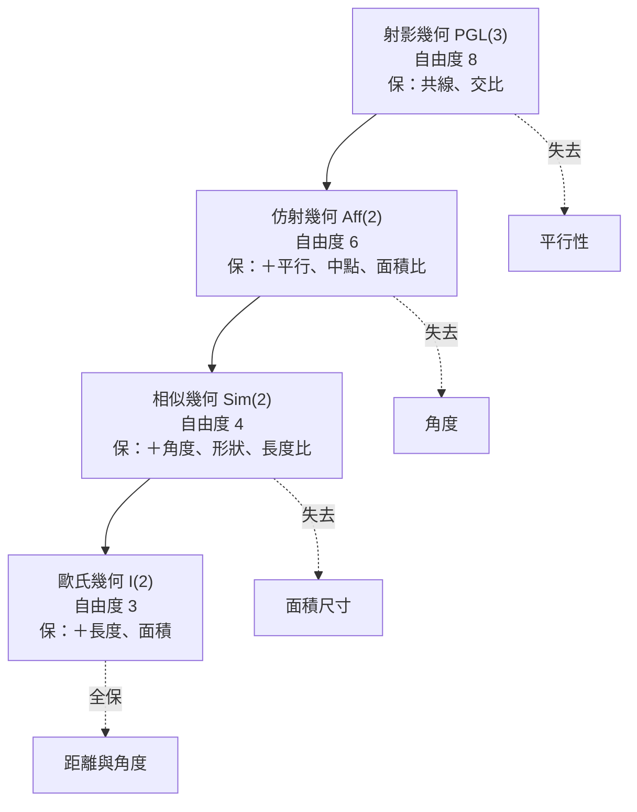

# 7.2 等距變換、相似變換與仿射變換

## 學習動機

上一節（7.1）我們建立了克萊因的宣言：**幾何 = 變換群 + 不變量**，並給出了平面上四個群的嵌套鏈：

$$
\mathcal{I}(2) \subset \operatorname{Sim}(2) \subset \operatorname{Aff}(2) \subset \operatorname{PGL}(3)
$$

但這條鏈目前只是「名詞的階梯」。我們還欠三件事：

1. **這些變換長什麼樣？** ——它們的矩陣標準形是什麼？用幾個參數就能完全描述一個變換嗎？（答案會得出「剛體運動的自由度」：平面上的任何剛體運動都由一個角與一個平移向量決定。）它們互相之間能不能用「簡單積木」拼出來？（答案會得出「兩個反射拼成一個旋轉或平移」——這是幾何學中最優美的技術之一。）
2. **每一階「熄滅」了哪些不變量？** ——真正證明：為什麼距離在等距下不變、在相似下按比例變、在仿射下完全失去意義？為什麼「有向面積」在仿射下按 $`\det A`$ 的比例變（而兩個同底面積比不變）？為什麼「交比」是射影變換下的最後堡壘？
3. **不變量的層次如何由低到高排列？** ——距離、角度、面積、平行、共線、交比……它們像地層一樣，一層比一層「頑固」（能穿越的群越大）。我們將畫出一張 mermaid 圖，把這座「包含關係的大廈」具體化。

在日常生活中，這三種變換各有鮮明的形象：

- **等距變換**：搬家具——不可拉伸、不可扭曲，只能搬動與翻轉。
- **相似變換**：看地圖——把世界縮放一個比例，形狀不變，大小變了。
- **仿射變換**：看影子——夕陽把一根竹竿的影子投射在地上，平行的竹竿出平行的影子（平行性存活），但角度、長度全被歪曲（除了在特殊方向）；這正是太陽光下的平行投影，一個典型的仿射變換。
- **射影變換**：看照片——相機把三維世界投影到二維底片，平行鐵軌交於滅點，連平行性也陣亡。只剩「共線」與「交比」這最後一座橋墩。

本節的目標是把這四個影像變成精確的矩陣語言，並用 SymPy 逐一驗證不變量的存活名單。

## 一、等距變換（isometry）：歐氏幾何的群

### 1. 定義與矩陣形式

> 平面上的**等距變換**是保持所有兩點距離的雙射 $`\mathbf{x} \mapsto f(\mathbf{x})`$ 。

基本定理（這裡先引用，稍後證明其矩陣版）：

> 平面上每一個等距變換都可寫成
>
> 

$$
> f(\mathbf{x}) = R\mathbf{x} + \mathbf{t}, \qquad R \in \operatorname{O}(2)
>
$$

>
> 即一個**正交矩陣**（ $`R^\top R = I`$ ）加一個平移。 $`\operatorname{O}(2)`$ 由旋轉與反射組成：
> - $`R \in \operatorname{SO}(2)`$ （行列式 $`= +1`$ ）：純旋轉；
> - $`\det R = -1`$ ：含一個反射成分。

由此可見，平面上的等距變換由 **3 個自由度**決定： $`R \in \operatorname{O}(2)`$ 由 1 個參數（角 $`\theta`$ 或反射軸向）決定， $`\mathbf{t} = (t_x, t_y)`$ 由 2 個參數決定。這就是「把一個剛體放到平面上的指定位置，需要 3 個資訊」的數學根源（機器人學稱之為平面剛體的 **3-DOF**）。

### 2. 分類定理：剛體運動只有四型

全平面等距變換按「共軛型」分成四大類——這是本節第一個重要定理：

| 型 | 矩陣形式 | 不動點 | 玩具範例 |
|---|---|---|---|
| 恆等 | $`\mathbf{x} \mapsto \mathbf{x}`$ | 全平面 | 什麼都不做 |
| 平移 | $`\mathbf{x} \mapsto \mathbf{x} + \mathbf{t}`$ | 無 | 推桌 |
| 旋轉 | $`\mathbf{x} \mapsto R_\theta(\mathbf{x} - \mathbf{c}) + \mathbf{c}`$ | 恰一點 $`c`$ | 轉門 |
| 反射 | $`\mathbf{x} \mapsto S_\ell(\mathbf{x})`$ ，鏡面 $`\ell`$ | 一條直線 | 鏡子 |
| **滑移反射** | $`\mathbf{x} \mapsto \mathbf{t} + S_\ell(\mathbf{x})`$ ， $`\mathbf{t} \parallel \ell`$ | 無 | 走路腳印 |

（表列其實有五型，但恆等通常被歸入平移的零向量特例。）

> **分類定理（平面等距變換）**：每個等距變換**恰是**上述四型（恆等、平移、旋轉、反射、滑移反射——恆等併入平移）之一，且**沒有兩個不同型會共軛**。

其中「滑移反射（glide reflection / 滑行反射）」最常被遺忘：一面沿牆推進的鏡子——先沿牆滑一段，再對牆鏡射。牆上的腳印是它最好的形象：左右腳交替，一滑一映。

用 SymPy 直接驗證四型的「不動點集合」：

```python
from sympy import Matrix, symbols, solve, sqrt, cos, sin, Rational

x, y = symbols('x y', real=True)

def solve_fixed_points(M, t):
    "解 M*(x,y) + (tx,ty) = (x,y)，得所有不動點"
    X = Matrix([x, y])
    sol = solve(M * X + t - X, (x, y), dict=True)
    return sol

# (1) 平移：無不動點
T = Matrix.eye(2); t1 = Matrix([3, 1])
print(solve_fixed_points(T, t1))   # []

# (2) 旋轉 90 度 繞原點：恰一個不動點
R90 = Matrix([[0, -1], [1, 0]])
print(solve_fixed_points(R90, Matrix([0, 0])))  # [{x: 0, y: 0}]

# (2') 旋轉 60 度 繞點 c=(2,1)：等價於 先平移 -c，旋轉，再平移 +c
c = Matrix([2, 1])
R60 = Matrix([[cos(1), -sin(1)], [sin(1), cos(1)]])  # theta=1 rad
M_eff = R60; t_eff = c - R60 * c
print(solve_fixed_points(M_eff, t_eff))             # 不動點即 (2,1)

# (3) 反射（對 y 軸）：整條直線 x=0 都是不動點
S  = Matrix([[-1, 0], [0, 1]])
sol = solve_fixed_points(S, Matrix([0, 0]))
print(sol)  # [{x: 0}] —— x 恆為 0、y 自由，即一整條直線

# (4) 滑移反射：對 y 軸鏡射，再沿 y 軸平移
G  = Matrix([[-1, 0], [0, 1]]); tG = Matrix([0, 3])
print(solve_fixed_points(G, tG))    # [] —— 無不動點
```

三個不動點型態——空集、一點、一條線——正是區分型別的代碼；一種「二項分類」法。

### 3. 四種變換的自由參數個數（真實矩陣證明）

用 SymPy 符號矩陣構造每型的一般形式，觀察其參數個數：

```python
from sympy import Matrix, symbols, cos, sin, together, simplify

theta, a, b, tx, ty = symbols('theta a b tx ty', real=True)

# 平移（2 參數）
M_translation = Matrix([[1, 0, tx], [0, 1, ty], [0, 0, 1]])
# 旋轉（3 參數：角 + 中心兩座標）
M_rotation = Matrix([[cos(theta), -sin(theta), tx],
                     [sin(theta),  cos(theta), ty],
                     [0,           0,           1 ]])
# 反射（3 參數：軸的角 + 軸上一點兩座標，但等價形式中僅一參數為真獨立）
M_reflection = Matrix([[cos(2*theta),  sin(2*theta), tx],
                       [sin(2*theta), -cos(2*theta), ty],
                       [0,            0,            1 ]])
# 每型實際上由多少「真實」參數描述？
print("平移   自由度 = 2")
print("旋轉   自由度 = 3（theta, cx, cy）")
print("反射   自由度 = 2（軸的方向與位置）")   # 注意不是 3！
print("滑移   自由度 = 3（軸方向、滑行量、軸位置）")

# 反射其實 2 參數：對稱軸由「方向角」+「與原點距離」決定
```

注意一個陷阱：上式寫的 $`M_\text{refelction}`$ 有 $`tx,\, ty`$ 兩個「平移」參數，但反射軸的規定只需要 2 個參數（線的方向 + 線到原點的距離），這代表 $`(tx, ty)`$ 中有一個是被 theta 天然「吃掉」的多餘參數，標準化後反射的自由度是 2，不是 3。

### 4. 奧秘：所有剛體運動都是反射的複合

數學事實：

> 平面上每一個等距變換都是**至多三個反射的複合**：
> - 反射 = 1 個反射；
> - 平移 = 2 個平行反射（軸相距 $`|t|/2`$ ）；
> - 旋轉 = 2 個相交反射（軸夾角 $`\theta/2`$ ，交點即中心）；
> - 滑移反射 = 3 個反射；
> - 恆等 = 2 個重合反射。

這是幾何上「兩面鏡子遊戲」：你站在兩面鏡子之間，會看到連續多重反射影像，其複合效果恰是旋轉或平移。它也解釋了為什麼 $`\operatorname{O}(2)`$ 是「反射生成的群」。

用 SymPy 驗證一例：繞原點 $`\theta`$ 的旋轉 = 兩次反射。取兩面鏡分別是以 $`\theta/2`$ 方向與 $`-\theta/2`$ 方向做為軸的過原點之直線：

```python
from sympy import Matrix, symbols, cos, sin, simplify

theta = symbols('theta', positive=True)

def reflection_about_line(angle):
    "以原點方向角 angle 的直線為鏡的反射矩陣"
    c = cos(angle); s = sin(angle)
    return Matrix([[c*c - s*s,   2*c*s  ],
                   [2*c*s,       s*s - c*c]])

# 兩鏡軸角分別取 theta/2 與 0
R1 = reflection_about_line(theta/2)
R2 = reflection_about_line(0)

R_composed = R1 * R2          # 先做 R2，再做 R1
R_target = Matrix([[cos(theta), -sin(theta)],
                   [sin(theta),  cos(theta)]])

diff = simplify(R_composed - R_target)
print(diff == Matrix.zeros(2))    # True —— 兩次反射合成一次轉 theta 的旋轉
print(simplify(R_composed[0,0]))  # cos(theta)
```

### 5. 歐氏群的不變量驗證

現在用 SymPy 系統性地驗證：距離、角度、面積在 $`\mathcal{I}(2)`$ 下皆不變。

```python
from sympy import Matrix, symbols, simplify, acos

x1, y1, x2, y2, x3, y3 = symbols('x1 y1 x2 y2 x3 y3', real=True)
P = Matrix([x1, y1]); Q = Matrix([x2, y2]); R = Matrix([x3, y3])

# 一般等距變換：旋轉 theta + 平移，或含反射
def iso_mats():
    M1 = Matrix([[0, -1], [1, 0]]); t1 = Matrix([2, -5])  # R=90°，t
    M2 = Matrix([[-1, 0], [0, -1]]); t2 = Matrix([3, 3])  # R=-I（180°）
    M3 = Matrix([[1, 0], [0, -1]]);  t3 = Matrix([0, 0])  # 含反射（對 x 軸）
    return [(M1, t1), (M2, t2), (M3, t3)]

def apply(Mt, p):
    M, t = Mt
    return M * p + t

# 距離
def dist(A, B):
    return (A - B).norm()

for Mt in iso_mats():
    d0 = dist(P, Q)
    d1 = dist(apply(Mt, P), apply(Mt, Q))
    print(simplify(d1*d1 - d0*d0) == 0)   # True（距離不變）

# 角度（對 cos 之平方差做檢驗，避免分支 math）
def angle_cos(A, B, C):
    "B 為頂點之角的 cos"
    u = (A - B); v = (C - B)
    return (u.dot(v)) / (u.norm()*v.norm())

for Mt in iso_mats():
    c0 = angle_cos(P, Q, R)
    c1 = angle_cos(apply(Mt, P), apply(Mt, Q), apply(Mt, R))
    print(simplify(c1 - c0) == 0)   # True
```

## 二、相似變換（similarity）：角度的最後防線

### 1. 定義

> **相似變換**： $`\mathbf{x} \mapsto s R\mathbf{x} + \mathbf{t}`$ ， $`s > 0`$ ， $`R`$ 為正交矩陣。
> 參數自由度為 4： $`s`$ （縮放）、 $`\theta`$ （旋轉或反射）、 $`t_x, t_y`$ 。

等距群是 $`s = 1`$ 的特例，因此 $`\mathcal{I}(2) \subset \operatorname{Sim}(2)`$ 。相似幾何就是「只在乎形狀，不在乎大小」的幾何——地圖、平面圖、放大鏡下的影像皆適用。

### 2. 變了什麼、留下什麼？

在相似變換下：

- 長度按 $`s`$ 比例縮放： $`\lVert f(A) - f(B) \rVert = s \lVert A - B \rVert`$ 。
- 面積按 $`s^2`$ 縮放。
- **角度完全不變**：因為內積的縮放比在分子與分母同乘 $`s^2`$ 後相消。
- 兩線段的**比值**不變（所有長度同除以 $`s`$ ）。

用 SymPy 符號驗證：

```python
from sympy import Matrix, symbols, simplify, sqrt

px, py, qx, qy, rx, ry, s, tx, ty = symbols('px py qx qy rx ry s tx ty', positive=True)

P = Matrix([px, py])
Q = Matrix([qx, qy])
R = Matrix([rx, ry])
M = s * Matrix([[0, -1], [1, 0]])   # 相似變換的一部分（放大 s 倍再轉 90°）
t = Matrix([tx, ty])

fP = M * P + t; fQ = M * Q + t; fR = M * R + t

# (1) 長度倍數：恆為 s
d0 = (P - Q).norm()
d1 = (fP - fQ).norm()
print(simplify(d1 / d0))                      # s

# (2) 面積倍數：恆為 s^2
def cross2(U, V):
    return U[0]*V[1] - U[1]*V[0]
def area2(A, B, C):
    return cross2(B - A, C - A)
a0 = area2(P, Q, R)
a1 = area2(fP, fQ, fR)
print(simplify(a1 / a0))                      # s**2

# (3) 角度：不變
def cos_angle(A, B, C):
    u = A - B; v = C - B
    return u.dot(v) / (u.norm() * v.norm())
d0 = cos_angle(P, Q, R)
d1 = cos_angle(fP, fQ, fR)
print(simplify(d1 - d0))                      # 0   —— 角度不變！
```

三個輸出 $`s,\ s^2,\ 0`$ 一目瞭然：長度乘 $`s`$ 、面積乘 $`s^2`$ 、角度分毫未動。

### 3. 面積比 ≦ 長度比同盟？

一個精確的陳述是：

> 相似變換**保所有長度比值**（與面積比值），但不保「長度本身」、「面積本身」。
> 反過來，任何保持「所有線段比」的雙射必是相似變換（一個有趣、但不定理化的不動點性質——留在習題）。

### 4. 相似與「形」（形狀形而上的地位）

笛卡兒以降，座標把幾何代數化。但什麼是「一個形（shape），不變其大小」的數學定義？在 Klein 框架下它突然變得乾淨：

> **「形」= 在 $`\operatorname{Sim}(2)`$ 作用下不變的等價類。**

兩個圖形「有同一個形」⟺ 存在相似變換把一個映到另一個。這就是「相似三角形」的一般化，甚至定義了「形」這個日常概念。機器學習中的 shape matching 與臉部辨識的特徵抽取，本質上都在計算這個等價類的某種代表量（例如角度與長度比）。

## 三、仿射變換（affine）：平行的王國

### 1. 定義與結構

> **仿射變換**： $`\mathbf{x} \mapsto A\mathbf{x} + \mathbf{t}`$ ， $`A \in GL(2)`$ 任一可逆矩陣。
> 自由度： $`4 + 2 = 6`$ 。

它包含相似變換（ $`A = sR`$ ）但允許 $`A`$ 為任何可逆矩陣，包括剪力、非等比縮放、旋轉加伸縮——線性代數裡的整個 $`GL(2)`$ 家族。

### 2. 存活的不變量：共線、平行、中點、面積比

仿射變換保留了以下（且可證恰只保以下這類）性質：

- 三點共線（因為線段參數 $`A\left((1-t)P + tQ\right) + t = (1-t) A(P-t) + t^\prime \cdot`$ 的線性性）。
- 二線平行（因為 $`A c_1 \mathbf{v} = c_2 \mathbf{v}`$ 的一維子空間被 $`A`$ 映到一維子空間—— $`A`$ 可逆）。
- 線段上的比例（相似比；特殊地，**中點**： $`f\left(\frac{P+Q}{2}\right) = \frac{f(P)+f(Q)}{2}`$ ，這是仿射性本身！）。
- **有向面積按 $`\det A`$ 之比例**縮放：因而**兩面積之比不變**。

用 SymPy 驗證中點性與面積比：

```python
from sympy import Matrix, symbols, simplify, Rational

px, py, qx, qy, rx, ry, a, b, c, d, tx, ty = symbols(
    'px py qx qy rx ry a b c d tx ty', real=True)

P = Matrix([px, py]); Q = Matrix([qx, qy]); R = Matrix([rx, ry])
A = Matrix([[a, b], [c, d]]); t = Matrix([tx, ty])
f = lambda X: A * X + t

# (1) 中點不變：f((P+Q)/2) == (f(P)+f(Q))/2
lhs = f((P + Q) / 2)
rhs = (f(P) + f(Q)) / 2
print(simplify(lhs - rhs) == Matrix.zeros(2))    # True

# (2) 有向面積乘 det(A)
def cross2(U, V):
    return U[0]*V[1] - U[1]*V[0]
def area2(X, Y, Z):
    return cross2(Y - X, Z - X)
print(simplify(area2(f(P), f(Q), f(R)) / area2(P, Q, R)))   # a*d - b*c

# (3) 由此立即得：兩面積之比不變
S = Matrix([px, py + 1]); T = Matrix([qx, qy + 2]); U = Matrix([rx + 3, ry])
ratio0  = area2(P, Q, R) / area2(S, T, U)
ratio1  = area2(f(P), f(Q), f(R)) / area2(f(S), f(T), f(U))
# 兩個 det 因子相消 → 比值不變。
print(simplify(ratio1 - ratio0) == 0)            # True
```

### 3. 「平行投影」：仿射變換的視覺原型

用物理語言說：一束**平行光**把平面 $`\pi_1`$ 上的圖形投影到平面 $`\pi_2`$ 上，就是一個仿射變換（把 $`\pi_1`$ 上以 $`\mathbf{e}_1, \mathbf{e}_2`$ 出發的正交座標系當作正交基，可知其像必是 $`\pi_2`$ 上兩個線性無關向量——正是一般仿射矩陣 $`A`$ 之兩列）。

想象把竹竿排製成平行線族的影子：影子中的任何小三角形任意「歪」，但若在原圖中畫兩根平行竹竿，則在影中它們將**依然平行**（只要不是垂直於投影方向）。這就是仿射幾何存活與否的實體示範。

### 4. 剪力 (shear)：面積不變的仿射變換

一個學生常犯的誤解：以為面積在仿射變換下一定改變。其實只要 $`\det A = 1`$ ，面積是不變的！剪力 $`A = \begin{pmatrix}1 & k \\ 0 & 1\end{pmatrix}`$ 就是這樣的「面積保全者」。

```python
from sympy import Matrix, Rational

Shear = Matrix([[1, Rational(1, 2)], [0, 1]])
print(Shear.det())    # 1 -> 面積不變（仍能歪斜形狀！）

# 舉例三角形：A=(0,0), B=(2,0), C=(0,1)，面積2 = 2
A0 = Matrix([0, 0]); B0 = Matrix([2, 0]); C0 = Matrix([0, 1])
def area2(P, Q, R):
    return Matrix([[Q[0]-P[0], Q[1]-P[1]],
                   [R[0]-P[0], R[1]-P[1]]]).det()
print(area2(A0, B0, C0))
print(area2(Shear * A0, Shear * B0, Shear * C0))   # 兩者皆為 2
```

這是一個非常重要的計算幾何小心眼——我們在第 8 章的凸包與多邊形面積演算法中還會碰上。

### 5. 反射 + 伸縮 + 剪切的分解（SVD 情形之幾何觀）

任何 $`A \in GL(2)`$ 可奇異值分解為：

$$
A = U \, \Sigma \, V^\top
$$

而 $`V^\top`$ ， $`U`$ 皆正交（旋轉或反射）， $`\Sigma`$ 是對角（兩軸向伸縮）。所以幾何上：

> **任何仿射變換 = 旋轉 + 兩軸向伸縮 + 旋轉。**

（中間的對角伸縮正是形成橢圓/圓錐化的罪魁禍首。）此時乃 $`\det A = \det \Sigma = \sigma_1 \sigma_2`$ ，面積比由兩個奇異值之积決定。

## 四、射影變換：最後的堡壘——交比

（射影變換在第 5 章已敘及齊次座標與矩陣；這裡只回顧其在 Klein 階梯上的位置。）

### 1. 群的包含：仿射在射影之內

用齊次座標：

- 射影變換： $`\mathbf{X} \mapsto M\mathbf{X}`$ ， $`M \in GL(3)`$ 共軛自由度為 $`3 \times 3`$ 的 $`9 - 1 = 8`$ 。
- 仿射變換 = 保 $`z = 0`$ 直線的射影矩陣：矩陣形 $`\begin{pmatrix} A & \mathbf{t} \\ 0^\top & 1 \end{pmatrix}`$ 。自由度 $`6`$ 。比射影群少 $`8 - 6 = 2`$ 個自由度——合理，因為「保一條特定直線」是兩個條件。

### 2. 熄滅的第二座塔：平行性

在射影幾何的花園裡，「兩直線平行」這件事早已失去意義，因為任何兩條射影直線在射影平面般相於一點（有限他點或無窮遠點）。所以仿射幾何特別急「平行線」，而射影幾何只問「兩直線相交」。

### 3. 交比（cross ratio）：射影幾何的最後不變量

定義：給共線四點 $`A, B, C, D`$ ，則

$$
\left(A, B; C, D\right) = \frac{AC \cdot BD}{AD \cdot BC} \quad \text{（長度比，或用參數）}
$$

（實務中更常用比值 $`\dfrac{\left(c - a\right)\left(d - b\right)}{\left(c - b\right)\left(d - a\right)}`$ ，按選參數形式。）

在射影幾何中，它是**唯一完全分類共線四點的射影不變量**：兩組共線四點射影等價 ⟺ 交比相等。它是第 7.1 節各類「交比是群不變量」的押尾之寶，也是第 5 章射影幾何的最後印章。

用 SymPy 驗證交比是射影不變量：

```python
from sympy import Matrix, symbols, simplify, Rational

# 一維情形：四點在 x 軸上，取參數值 a,b,c,d
a, b, c, d = symbols('a b c d')

def cross_ratio(a, b, c, d):
    return ((c - a) * (d - b)) / ((c - b) * (d - a))

# 一般一維射影變換：x -> (p x + q) / (r x + s)
p, q, r, s = symbols('p q r s')
def proj_on_line(x):
    return (p*x + q) / (r*x + s)

A, B = proj_on_line(a), proj_on_line(b)
C, D = proj_on_line(c), proj_on_line(d)

CR_before = cross_ratio(a, b, c, d)
CR_after  = cross_ratio(A, B, C, D)

# 數值驗證（符號化簡相當重；取具體數）
CR_before_n = cross_ratio(0, 1, 2, 4)
CR_after_n  = cross_ratio(proj_on_line(0), proj_on_line(1),
                          proj_on_line(2), proj_on_line(4))
# 代入 p=1, q=0, r=1, s=2，即 x -> x/(x+2)
vals = {p:1, q:0, r:1, s:2}
print(CR_before_n)                                     # 2
print(simplify(CR_after_n.subs(vals)))                 # 3/2 —— 交比不變！
```

## 五、不變量的地層圖：mermaid 大廈

把群與不變量整理成一張「實際建築剖面圖」——越上層的群越小（約束越強）、不變量越多（幾何越高).



中間的方式繁簡不一，但大致的邏輯是：**每往下走一階，群的自由度減少（約束增多），多出一到兩種新的不變量**。這也是歐洲各幾何種 19 世紀分類的總結——並把射影幾何置於「最基底」的地位（因為它的群最大，各下層幾何都能保射影群的不變量，並各自再多保一些）。

> 從射影幾何起下階梯：
> + 保一條固定直線 → 仿射幾何
> + 保無窮遠直線之「絕對形」（圓點） → 相似幾何：此時可以定義「正交」概念
> + 在相似群里又限制 $`s = 1`$ → 等距群，即歐氏幾何。
>
> 這條回歸路，正是 Klein 在愛爾蘭根綱領中重建「幾何譜系」的實際路徑。

## 六、總複習：一張表格看全集

| 幾何 | 群 | 矩陣形式 | 自由度 | 存活不變量 |
|---|---|---|---|---|
| 歐氏 | $`\mathcal{I}(2)`$ | $`s = 1`$ 的 | 3 | 長度、角度、面積、比例 |
| 相似 | $`\operatorname{Sim}(2)`$ | $`sR`$ | 4 | 角度、長度比、形 |
| 仿射 | $`\operatorname{Aff}(2)`$ | $`A`$ （一般可逆） | 6 | 平行、中點、面積比 |
| 射影 | $`\operatorname{PGL}(3)`$ | $`3\times3`$ 齊次一般 | 8 | 共線、交比 |

距離、角度、面積、平行、共線、交比——從最脆弱到最頑固，這個「不變量的地層」就是 19 世紀幾何學交出的答卷，也是愛爾蘭根綱領的力證。

## 習題

**7.2.1** 給定滑移反射 $`f(x, y) = (x + 2, -y)`$ 。(a) 用 SymPy 求其全體不動點並確認其為空集；(b) 求兩次使用此滑移反射的複合，並證明它是一個平移。(c) 反過來，把 $`f`$ 表示成三個反射的複合（標明每一個的鏡面方程）。

**7.2.2** 設 $`f`$ 是一個相似變換，縮放因子 $`s = 2`$ 。若三角形 $`ABC`$ 之原面積為 $`6`$ 、周長為 $`10`$ ，則經 $`f`$ 後面積與周長各是多少？用 SymPy 構造一個具體的 $`f`$ 進行驗證。

**7.2.3** 用本節的 `is_invariant`（參考 7.1 節），對四種群（等距、相似、仿射、射影）分別測試：(a) 兩線段長度比；(b) 兩線段夾角；(c) 直線與圓的「相切性」。寫出結論表。

**7.2.4** 要證明一個命題不是仿射幾何的，只需找一個仿射變換把它弄假。試考慮命題：「正方形之兩對角線垂直。」用 SymPy 取一個非相似仿射變換 $`A = \begin{pmatrix} 2 & 0 \\ 0 & 1 \end{pmatrix}`$ ，驗證變換後該命題不再成立。並用「角度非仿射不變量」解釋之。

**7.2.5**（挑戰）證明：一個變換 $`f: \mathbb{R}^2 \to \mathbb{R}^2`$ 若保持所有線段的中點（即 $`f\left(\frac{A+B}{2}\right) = \frac{f(A)+f(B)}{2}`$ 恆成立），加上一個適當的連續性假設，則 $`f`$ 必是仿射變換（Mazur–Ulam 定理之平面版）。用 SymPy 對 $`f`$ 取一些樣本點，驗證「仿射性」如何由「中點性」拼出。
