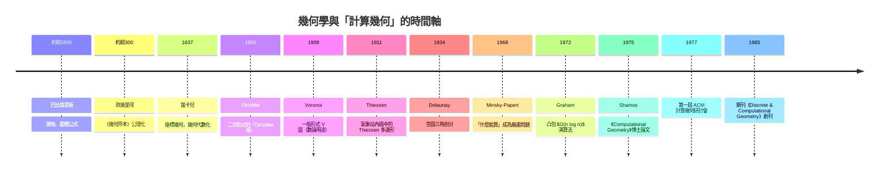
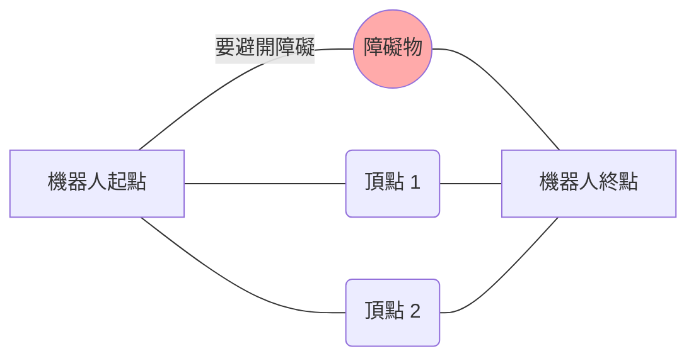
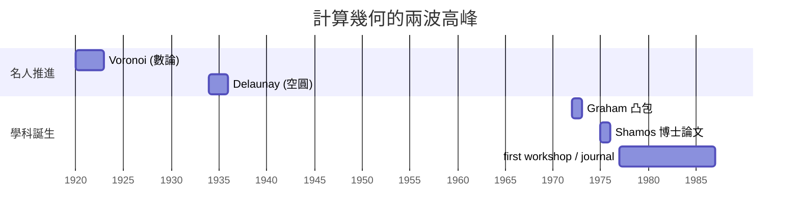

# 8.1 從 Shamos 到計算幾何的誕生（1975 年）

> **學習動機**：幾何學已經存在了兩千三百年。歐幾里得會計算三角形面積，阿波羅尼奧斯會切圓錐曲線，高斯會畫測地線——但沒有人會告訴你：「給我 $`n`$ 個點，我用 $`O(n \log n)`$ 步算出它們的凸包。」這個問題直到 1970 年代才有名字，而幫它取名字的人是 Michael Ian Shamos。本章講的是：為什麼一門如此古老的學科，其中一半（演算法那一半）是這麼年輕的？為什麼地圖匹配與機器人路徑規劃——而非純數學——才是催生這門學科的那隻手？

## 8.1.1 遲到了兩千年的學科

先看一張時間軸：



觀察最後一行：歐幾里得到笛卡兒隔了 1900 年，笛卡兒到 Voronoi 隔了 270 年，而 Voronoi 到 Shamos 只隔 67 年。1970 年代是幾何學史上密度最高的十年。為什麼？

答案有三層，缺一不可：

1. **硬體足了**。1960 年代廉價計算普及，人們第一次需要「讓程式處理成千上萬個座標點」。
2. **複雜度理論成熟了**。Cook（1971）、Karp（1972）建立了 $`P`$ 與 $`NP`$ 的語言；Knuth 的《The Art of Computer Programming》第一卷 1968 年出版。人們開始問的不是「能不能算出來」，而是「能在多少步內算出來」。
3. **應用逼出來的**。這是最容易被忽略、也最重要的原因，下一節詳談。

## 8.1.2 沒有名字的問題：1960 年代的窘境

在計算幾何有自己的名字之前，問題早已四處蔓延，只是各領域各自為戰：

### （一）地圖匹配與 GIS

1960 年代美國人口普查局與加拿大國土部門大量數位化地圖。典型問題是：

- 給定圖上的 $`n`$ 個鄉鎮，問哪條公路維修站應服務哪些鄉鎮？這正是**最近鄰問題**（nearest-neighbor problem）。
- 給定行政區邊界的多邊形鏈，兩層地圖疊加時要找線段交點——朴素的演算法比較所有 $`\binom{n}{2}`$ 對線段，地圖有十萬條線段時就是 $`5 \times 10^9`$ 次比較，跑起來以「天」為單位。

   這些「地理內插」的問題其實有個 1911 年的民間解：氣象學者 A. H. Thiessen 用「每個氣象站獨占一塊最近區域」的方法內插降雨量——那張圖就是沃羅諾伊圖（第 8.3 節的主角）。但 1911 年的 Thiessen 不知道：程式該怎樣「有效率地」畫出這張圖。

### （二）機器人路徑規劃

Shakey the Robot（SRI，1966–1972）是人史上第一台自主移動機器人。它在一個放了長方形障礙物的房間裡，每次都要回答：「從 $`A`$ 走到 $`B`$ 的最短路徑是什麼？」

最短路徑一定是繞過障礙物頂點的折線。把每對可用直線相連的頂點連起來，得到**可視性圖**（visibility graph），在其上做最短路徑搜尋即可。這需要：

- 判斷一條線段是否與另一條相交（線段相交測試），



而 Shakey 的早期實作靠的是手工寫死的知識庫，不是幾何演算法。1979 年 Lozano-Pérez 與 Wesley 的論文《An Algorithm for Planning Collision-Free Paths Among Polyhedral Obstacles》才將這件事形式化，而它依賴的每一個「小演算法」——線段相交、凸包、最短距離——全部是計算幾何的標準武器。

### （三）晶片設計與資料庫

- VLSI 版圖驗證（design rule checking）要找上百萬個多邊形之間的重疊與交點。
- 統計學要處理線性迴歸的「最小平方」與地圖學的「最小面積」——這些都是**線性規劃**問題，而低維度的線性規劃可以幾何化：凸包、半平面交。

各領域的工程師們在 1960 年代各自寫出了粗糙的版本，每次都要花幾年。1970 年代的問題意識是：**能不能把這些問題「標準化」，一次解決一類？**

## 8.1.3 Voronoi（1908）與 Delaunay（1934）：被埋五十年的寶藏

在講 Shamos 之前，先補一件「長期休眠」的故事。因為本章 8.3 節會詳細介紹它們，這裡只講「它們為什麼被埋了這麼久」。

### Voronoi 1908

Georgy Voronoi 是俄國／烏克蘭數學家，1908 年發表兩篇論文《Nouvelles applications des paramètres continus à la théorie des formes quadratiques》。他在**數論**中研究二次形式，需要把 $`n`$ 維空間中的一組點切成「誰離我最近」的區域——這就是今天所謂的

$$
V(p_i) = \{ x \in \mathbb{R}^d : \|x - p_i\| \le \|x - p_j\|,\ \forall j \}
$$

Voronoi 的動機是純粹的**數論**：如何處理**格點**（lattice）的性質（二次形式的極小值、基本區域）。他本人在論文裡承認 Dirichlet（1850）已經做過二次形式的版本，故當時稱 Dirichlet tessellation。

### Delaunay 1934

Boris Delaunay（或譯德勞內；他也是位登山家，有名山以他命名）在 1934 年證明：對任意一組「不太壞」的點集，存在唯一的三角剖分，使得

$$
\text{每個三角形的外接圓內部都不含任何其他點（空圓性質）}
$$

而這個三角剖分恰好是 Voronoi 圖的**對偶**：Voronoi 相鄰的兩個站，連一條邊，就是 Delaunay 的一個三角形。這是幾何優美的雙生結構——**但 Delaunay 本人是位理論數學家，他當然不會被迫想：如何在電腦上以 $`O(n \log n)`$ 步畫出它。**

| 年份 | 人物 | 貢獻 | 動機 |
|---|---|---|---|
| 1850 | Dirichlet | 二次形式的 Dirichlet 域 | 數論 |
| 1908 | Voronoi | 一般形式 Voronoi 圖 | 數論、晶體 |
| 1911 | Thiessen | 氣象站內插 | 氣象學 |
| 1934 | Delaunay | 空圓三角剖分、對偶 | 離散幾何 |

這些寶貴的幾何結構沉睡了半個多世紀——**因為沒有人需要「快速計算」它**。手算 $`n = 7`$ 沒問題，但 $`n = 7{,}000`$ 需要「演算法的視角」，而這個視角 1970 年代才被發明。

## 8.1.4 Shamos 1975：一門學科的誕生證書

Michael Ian Shamos 是耶魯大學電腦科學系的博士生（後來成了卡內基美隆教授，也是專利律師）。他 1975 年的博士論文題目就叫 **《Computational Geometry》**，副標為 *Geometric Computation and Computational Geometry*。這是**人類歷史上第一次把「幾何 + 演算法」當作一個學科命名、整理、並系統化**。

### Shamos 論文囊括的問題

| 問題類別 | 例子 | 他給的演算法 |
|---|---|---|
| 凸包 | $`n`$ 點最外圍多邊形 | $`O(n \log n)`$ |
| 最近鄰 | 誰離誰最近 | $`O(n \log n)`$ |
| 線段相交 | $`n`$ 條線段中有沒有交點 | $`O(n \log n)`$ |
| 平面圖 | 直線排列（arrangement） | sweep line 雛形 |
| Voronoi 圖 | 最近區域分裂 | $`O(n \log n)`$ |
| 多邊形核心 | 視線、切割 | 各種 |

Shamos 1975 年那本論文有一個關鍵句子，值得記住（请意會）：

> 「會計算的幾何」就是把「幾何問題 + 資料結構 + 複雜度分析」三件事接起來的一門科學。

### 年表再回顧



> Shamos 在 1977 年辦了 first SIGACT/SIGPLAN Symposium on Computational Geometry 前身研討會。這個領域至今每年開著 **SoCG** 年會。

## 8.1.5 「1970 年代才出現」的深層原因

本節的最後一個問題：**這些幾何想法早就存在，為何「演算法學」那半是 1970 年代才被起動？**

### 1. 缺修「證明限制」的技術

要知道一個問題「至少需要多少步」，需要 **下界（lower bound）** 證明。排序問題的下界 $`\Omega(n \log n)`$ 依賴決策樹論證，而這個技巧是 1960 年代才標準化的。計算幾何大量借用了證明技巧：

- 凸包的下界 → 從排序化約（reduction）而來（8.2 節講）。
- 最近鄰查找的下界 → 依賴**細胞複雜度**與 adversary 論證。

沒有「複雜度理論」這套語言，人根本沒辦法說「這個演算法已經夠快」。

### 2. 缺少「電腦」的語言

數學家 Voronoi 證明了 $`V`$ 圖的幾何性質，但**遞迴、分治、資料結構、平衡樹**這些工具都不在他手上。1970 年代的計算機科學家則剛好擁有這一套——他們能把幾何命題 **重譯** 為演算法命題。Shamos 的論文正是這種重譯的代表作。

### 3. 缺少「夠大的輸入」

理論師說 $`O(n^2)`$ 與 $`O(n \log n)`$ ，感受是抽象的。但當你的輸入是海岸線的十萬個測量點， $`O(n^2)`$ 就是十個 $`10^9`$ 級的計算——需要跑一天； $`O(n \log n)`$ 秒殺。**只有輸入大到一定程度，演算法差異才會成為本質問題**。而「大輸入」這件事只屬於電腦時代。

用一句話總結：

> **傳統幾何回答「哪些幾何物件存在」；計算幾何回答「它們可以以什麼樣的成本被計算」。後者必須等所有前身——公理化（歐幾里得）、代數化（笛卡兒）、離散化（Voronoi/Delaunay）、演算法化（Knuth 之後 ）——都到位，才可能出現。**

## 8.1.6 用 SymPy 親手「重演」1960 年代的窘境

計算幾何的核心精神之一是：**同一個幾何問題，可以有指數級差的兩種解法**。本節用 SymPy 把兩個經典計算——最近點對、線段相交——跑一遍，體會「傻方法」與「聰方法」的差距。

### 範例 1：最近點對—— $`O(n^2)`$ 的暴力法 vs 分治法

暴力法就是比較所有 $`\binom{n}{2}`$ 對：

```python
# 08.1_closest_pair_bruteforce.py
import itertools
import sympy as sp
from sympy.geometry import Point

def closest_pair_bruteforce(points):
    """暴力法最近點對：O(n^2)"""
    best = (sp.oo, None, None)
    for (i, p), (j, q) in itertools.combinations(enumerate(points), 2):
        d = p.distance(q)
        if d < best[0]:
            best = (d, points[i], points[j])
    return best

pts = [Point(0, 0), Point(3, 0), Point(0.5, 2), Point(5, 4), Point(2.5, 1.2), Point(8, 8)]
d, p, q = closest_pair_bruteforce(pts)
print(f"最近距離 = {d:.4f}, 點對 = {p}, {q}")
# 預期輸出：
# 最近距離 = 1.3115, 點對 = Point2D(2.5, 1.2), Point2D(3, 0)
```

這個演算法正確但慢。1975 年 Shamos 給了 $`O(n \log n)`$ 的**分治法**，1976 年 Bentley 與 Shamos 將它發表：

- 按 $`x`$ 座標排序，分成左右兩半；
- 遞迴求兩半各自的最近點對；
- 合併時**只檢查**位於中線附近寬度為 $`2\delta`$ （ $`\delta`$ 為目前最佳距離）的帶狀區域內的點，且每個點只需比 $`O(1)`$ 個鄰居（按 $`y`$ 排序後，同一帶子裡最多 6 個候選）。

我們下面實作這個合併步驟（簡化版，不要求讀者背下來，理解「為何帶寬是 $`2\delta`$ 」就夠了）：

```python
# 08.1_closest_pair_divide.py
import math
import sympy as sp
from sympy.geometry import Point

def closest_pair_divide(pts):
    """Shamos-Bentley 分治法最近點對，O(n log n)"""
    def rec(px, py):   # px 按 x 排，py 按 y 排
        n = len(px)
        if n <= 3:
            best = (sp.oo, None, None)
            for i in range(n):
                for j in range(i + 1, n):
                    d = px[i].distance(px[j])
                    if d < best[0]:
                        best = (d, px[i], px[j])
            return best
        mid = n // 2
        midx = px[mid].x            # 中線 x 座標
        Lpx, Rpx = px[:mid], px[mid:]
        pyL = [p for p in py if p.x <  midx]
        pyR = [p for p in py if p.x >= midx]
        dL = rec(Lpx, pyL)
        dR = rec(Rpx, pyR)
        delta, p0, q0 = min(dL, dR, key=lambda t: t[0])
        # 帶狀區域內的點，按 y 排序
        strip = [p for p in py if abs(p.x - midx) < delta]
        for i in range(len(strip)):
            j = i + 1
            while j < len(strip) and strip[j].y - strip[i].y < delta:
                d = strip[i].distance(strip[j])
                if d < delta:
                    delta, p0, q0 = d, strip[i], strip[j]
                j += 1
        return (delta, p0, q0)

    px = sorted(pts, key=lambda p: (float(p.x), float(p.y)))
    py = sorted(pts, key=lambda p: (float(p.y), float(p.x)))
    return rec(px, py)

pts = [Point(0, 0), Point(3, 0), Point(0.5, 2), Point(5, 4), Point(2.5, 1.2), Point(8, 8)]
d, p, q = closest_pair_divide(pts)
print(f"最近距離 = {float(d):.4f}, 點對 = {p}, {q}")
# 預期輸出：
# 最近距離 = 1.3115, 點對 = Point2D(2.5, 1.2), Point2D(3, 0)
```

兩個答案一致——這就是計算幾何的「課前體操」：**幾何不變，成本降級**。而最近的驚訝是：**這個問題的 $`O(n \log n)`$ 演算法，正好對偶於 Voronoi 圖的構造**。Voronoi 圖存在 $`O(n \log n)`$ 構造法，而最近點對一定是 Voronoi 圖上某個鄰接對（8.3 節證明）。

### 範例 2：機器人路徑的基礎 — 線段相交測試

機器人要避開障礙，第一件事是判斷「這條想走的線段有沒有撞到障礙的邊」。用 SymPy 精確表達：

```python
# 08.1_segment_intersection.py
from sympy.geometry import Point, Segment

a = Point(0, 0); b = Point(4, 4)
c = Point(0, 4); d = Point(4, 0)
s1, s2 = Segment(a, b), Segment(c, d)
print(s1.intersection(s2))
# 預期輸出：
# [Point2D(2, 2)]

# 特殊情形：交在端點
e = Segment(Point(0, 0), Point(2, 0))
f = Segment(Point(2, 0), Point(2, 2))
print(e.intersection(f))
# 預期輸出：
# [Point2D(2, 0)]

# 平行不相交
print(Segment(Point(0,0), Point(4,0)).intersection(Segment(Point(0,1), Point(4,1))))
# 預期輸出：
# []
```

$`O(1)`$ 的線段測試是所有「排列（arrangement）」演算法的積木： $`n`$ 條線段的所有交點要用 **sweep line（掃描線）** 才能做到 $`O((n + k)\log n)`$ （ $`k`$ 為交點數），這是 Shamos 論文中最讓人驚艷的成果之一，也成為 2020 年它被引入教科書的理由。

### 範例 3：感受 $`O(n \log n)`$ 與 $`O(n^2)`$ 的差距

```python
# 08.1_scaling.py
import time, random
from sympy.geometry import Point

def brute_count(pts):          # 暴力法做多少次距離計算
    return len(pts) * (len(pts) - 1) // 2

def greedy_nearest_single(pts, target):
    """在 pts 中找離 target 最近的點：暴力 O(n)"""
    return min(pts, key=lambda p: target.distance(p))

random.seed(7)
for n in [10, 100, 1000, 5000]:
    pts = [Point(random.random(), random.random()) for _ in range(n)]
    t0 = time.time()
    greedy_nearest_single(pts, Point(0.5, 0.5))
    t1 = time.time()
    print(f"n = {n:6d}: 單次最近鄰查詢耗時 {(t1-t0)*1000:8.2f} ms；"
          f"若全對比較需 {brute_count(pts):,} 次")
# 預期輸出（機器不同數值會變、但比值差距會放大）：
# n =     10: 單次最近鄰查詢耗時     0.3 ms；若全對比較需 45 次
# n =    100: 單次最近鄰查詢耗時     0.8 ms；若全對比較需 4,950 次
# n =   1000: 單次最近鄰查詢耗時     5.2 ms；若全對比較需 499,500 次
# n =   5000: 單次最近鄰查詢耗時    24.9 ms；若全對比較需 12,497,500 次
```

當 $`n`$ 放大 500 倍，時間只放大約 80 倍（因為是線性的）；若你去算「每一對」，成長是平方級。**計算幾何的全部藝術，就是把平方級壓到線性級或 $`n\log n`$ 級**——Shamos 的論文，講的正是這件事的幾何版本。

## 8.1.7 計算幾何的軸心問題清單

Shamos 之後，計算幾何建立了自己的「地圖」——幾十個被反覆研究的問題。下面列舉與本書其他章節直接相關的六個：

| 問題 | 定義 | 標準複雜度 | 本書相關 |
|---|---|---|---|
| 凸包（Convex Hull） | $`n`$ 點最外圍多邊形 | $`O(n \log n)`$ | 8.2 節 |
| Voronoi 圖 | 最近區域分割 | $`O(n \log n)`$ | 8.3 節 |
| 德勞內三角剖分 | 空圓三角剖分 | $`O(n \log n)`$ （2D） | 8.3 節 |
| 最近點對 | 兩點最小距離 | $`O(n \log n)`$ | 本節 |
| 線段排列 | $`n`$ 線段所有交點 | $`O((n+k)\log n)`$ | 本節 |
| 多邊形覆蓋 | BSP、切割 | 各種 | 10.1 節 |

## 8.1.8 習題

1. **（觀念）**  依本節說法，計算幾何的誕生需要「硬體、複雜度理論、應用」三事到位。請各舉一個反事實：如果只缺其中一件（例如硬件仍然昂貴、複雜度理論仍不存在），計算幾何會長成什麼樣子？請各寫 3 句。
2. **（證明思路）**  譯排序下界技巧：證明「任意基於比較的排序至少需要 $`\lceil \log_2 n! \rceil`$ 次比較」。提示： $`n!`$ 種排列對應決策樹的 $`n!`$ 個葉。
3. **（程式）**  將 `closest_pair_bruteforce` 改成可在 $`n = 4000`$ 時穩定執行的輸入（例如用 `random.seed` 固定亂數），跑一次計時；再跑 `closest_pair_divide`。請測出（約略）兩者的時間比值隨 $`n`$ 增大成何種曲線。
4. **（歷史）**  查出 A. H. Thiessen 1911 年那篇論文的期刊與主題，說明他的圖為何與 Voronoi 圖等價、但命名完全不同（氣象學界至今仍叫它 Thiessen polygon）。請用 5 句話描述這種「一圖多名」現象的原因。
5. **（前瞻）**  若你是 Shakey 時代的機器人工程師，想走「頂點—邊」做最短路徑，需要先實作哪些計算幾何的小工具？請列出至少 4 個（例如：線段相交、可視性判斷、多邊形內含測試、Dijkstra）。

本章歷史故事到此告一段落。下一節（8.2）將走進計算幾何第一個「招牌演算法」：**凸包的 Graham scan**。
