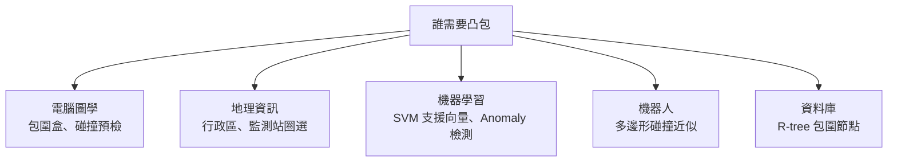

# 8.2 凸包演算法：Graham scan 與 QuickHull

> **學習動機**：你有一張由上千個 GPS 軌跡點組成的地圖，政府想知道「這些點全部起來，最外圍的邊界是哪一圈」——這個問題叫**凸包**（convex hull）。它是最簡單、也最基礎的計算幾何問題：電腦圖學用它做包圍盒、資料挖掘用做特徵包絡、地理學用做邊界、機器人用做**碰撞偵測**。本節不只要讓你「會算」，還要讓你體會計算幾何最動人的一件事：**同一個問題的「傻解」與「聰解」可以是 $`n^2`$ 與 $`n\log n`$ 的差別**——而聰解背後竟然只花一根指頭的直覺：**右轉 = 壞**。

## 8.2.1 問題是什麼

給定平面上 $`n`$ 個點 $`P_1, \dots, P_n`$ ，**凸包**是一個同時滿足兩件事的多邊形：

1. **包住**：所有點都在它裡面或邊上；
2. **最小**：它是滿足 (1) 的多邊形中最小的（以面積或周長說都一樣）。

直白版說法：「拿一條再造的橡皮筋，圈住所有圖釘之後鬆手，橡皮筋會縮到什麼形狀，那形狀就是凸包。」

### 為什麼這是最基礎的問題？

因為**幾乎所有領域都要它**：



在 SVM 的幾何詮釋中，最大分隔面問題正好被本問題化約（一版 SVM 等價於求某個凸包上的點）。

### 為什麼這問題「不算簡單」

你會想：這還不簡單？把點一個個接起來就好。但隨手一試就會發現：從哪個點開始？接下一個點時如何不被「裡面的點」拐走？

這就是計算幾何的「**示範級問題**」：它夠小，可講清楚策略；夠講究，能夠訓練「正確處理退化情形（三點共線、重複點）」這門手藝。

## 8.2.2 為什麼最好也只能到 $`O(n \log n)`$

答案來自 8.1 節談過的**排序下界**。有一個漂亮的化約（reduction）：

> **定理（凸包下界）**：任何**基於比較**（可以在二次方程式的 $`x`$ 軸上排序……的比較模型）的凸包演算法，最壞情形必須花 $`\Omega(n \log n)`$ 步。
>
> **證明想法**：把排序化約為凸包。給定要排序的實數 $`x_1, \dots, x_n`$ ，把它們當作點 $`(x_i, x_i^2)`$ ，都落在拋物線 $`y = x^2`$ 上。這組點的凸包，**按照逆時針方向走一圈恰是按 $`x`$ 由小到大排序的結果**。所以：若能在 $`o(n \log n)`$ 內求出凸包，就能 $`o(n \log n)`$ 排序，違反排序的 $`\Omega(n\log n)`$ 下界。 $`\square`$

這裡有個精妙的直覺：把「排序一組數」翻譯成「包一組點」的凸包。這樣一來，Graham 1972 年那個 $`n\log n`$ 的掃描不是「誰編出來的好演算法」，而是**它不可能比排序更快**——既然凸包下界就是排序下界，一聰明的實作「把所有必要資訊都摸一遍」在理論上已是最快。

> 下界成立的前提是「比較模型」。也有不基於比較的極端演算法（如 QuickHull 的平均複雜度是 $`O(n)`$ 、最壞仍是 $`O(n\log n)`$ ，在某些分布甚至可以更特別），但一般情況下 $`O(n\log n)`$ 是金牌。

## 8.2.3 演算法一：Gift Wrapping（Jarvis，1973）

「Gift wrapping」最有畫面，且最像人怎麼包禮物：

**想法**：從最下面（ $`y`$ 最小）的點開始，像橡皮補繞圈一樣，每次都挑「最往右使我們繞過去的」那個點。

### 虛擬碼

```
JarvisMarch(P):
    hull = [ 由 y 最小的點 start ]     # 若多個 y 相同，取 x 最小
    current = start
    repeat:
        next = 任意一點（不是 current）
        for p in P:
            if p == current: continue
            if (next == current) or (current, next, p 是左轉):
                next = p               # 想要「最靠右的」就會把所有別的點留在左邊
        hull.append(next)
        current = next
    until next == start
    return hull
```

「左轉」判斷是計算幾何的原子操作，值得背下來：

$$
\text{cross}((b-a), (c-b)) \iff (b_x - a_x)(c_y - b_y) - (b_y - a_y)(c_x - b_x)
$$

- $`> 0`$ ：從 $`a \to b \to c`$ **左轉**（逆時針）；
- $`= 0`$ ：三點共線；
- $`< 0`$ ：**右轉**（順時針）。

### 複雜度

- 每次「挑最右」要掃 $`O(n)`$ 個點；
- 凸包最多有 $`h`$ 個頂點；
- 總共 $`O(nh)`$ 。

**好的一面**：輸出敏感（output-sensitive）——若凸包很小 ( $`h \ll n`$ )，特別快。
**壞的一面**：最壞情形 $`h = n`$ ，退化成 $`O(n^2)`$ 。

## 8.2.4 演算法二：Graham scan（1972）—— $`O(n \log n)`$

Ron Graham（貝爾實驗室）1972 年的短文讓凸包成為「典範級演算法」，它是計算幾何史上的第一件「鎮館之寶」。它也是第一個提出「**用一個資料結構（堆疊），一次掃描**」解這類問題的範本——後來的一整族「掃描演算法」都是它的後代。

### 想法（三步）

1. **找樞紐（pivot）**：取 $`y`$ 座標最小的點 $`P_0`$ （多個時取 $`x`$ 最小）。它一定**在**凸包上，而且讀者可以證明：以 $`P_0`$ 為原點，**凸包其他頂點都在一個半平面上**（角度都在 $`[0, \pi]`$ 內）。
2. **按極角排序**：把其他點按「相對於 $`P_0`$ 的極角」排序。這一步花 $`O(n\log n)`$ 。
3. **掃描（scan）**：依排好的順序逐點推入堆疊，**每當發現「堆疊頂端三點是右轉」就彈出**：
   - 堆疊前兩位 + 新點若左轉 → 前兩位可以保留，push 新點；
   - 若右轉 → **頂點會把其他點「拐到裡面」**，它不可能是凸包點，pop 掉。
   - 共線（ $`= 0`$ ）：視你想要的結果，保留（把共線點都算在邊上）或丟掉，本節取「丟掉較近者」。

### 虛擬碼

```
GrahamScan(P):
    找 pivot p0（y 最小，若相同 x 最小）
    把其餘點 sorted by 極角 angle(p - p0)；角度相同時，先放距離小的
    stack = []
    for p in sorted:
        while stack.size >= 2 and cross(stack[-2], stack[-1], p) <= 0:
            stack.pop()      # 右轉或共線 → 頂點是「拐進去」的
        stack.push(p)
    stack.push(p0)            # 收尾：回到起點
    return stack
```

> 根號 $`O(n\log n)`$ 有個下界證明在此不深入。關鍵是盤算：排序 $`O(n\log n)`$ + 每個點最多被 push/pop 一次 → scan 是 $`O(n)`$ 。

### Python 實作

```python
# 08.2_graham_scan.py
import math

def cross(o, a, b):
    """cross o→a→b；>0 左轉、=0 共線、<0 右轉"""
    return (a[0] - o[0]) * (b[1] - o[1]) - (a[1] - o[1]) * (b[0] - o[0])

def graham_scan(points):
    """Graham scan 凸包；回傳逆時針順序的頂點（不含重複尾端點）"""
    pts = sorted(set(points))               # 去重
    if len(pts) <= 2:
        return pts
    pivot = min(pts, key=lambda p: (p[1], p[0]))
    others = [p for p in pts if p != pivot]
    # 依極角排序；角度相同時，離 pivot 較近者先
    def angle_key(p):
        dx, dy = p[0] - pivot[0], p[1] - pivot[1]
        return (math.atan2(dy, dx), dx * dx + dy * dy)
    others.sort(key=angle_key)
    hull = [pivot]
    for p in others:
        while len(hull) >= 2 and cross(hull[-2], hull[-1], p) <= 0:
            hull.pop()
        hull.append(p)
    return hull

if __name__ == "__main__":
    pts = [(0, 0), (1, 1), (2, 0), (2, 2), (0, 2), (1, -1), (2, 1),
           (3, 0), (1, 0), (1, 2), (3, 3), (0, 3), (3, 2)]
    print(graham_scan(pts))
    # 預期輸出：
    # [(0, 0), (1, -1), (3, 0), (3, 3), (0, 3)]
```

讓我們驗證它：這 13 個點中，最外圈的應該是 (1,−1)（最下方尖角）、(3,0)、(3,3)、(0,3)。這就是好答案——它逆時針走完一圈。

### 正確性的直觀

這個演算法有一個非常值得細品的地方：**用排序把問題壓平了**。

- 排序之後，所有點「相對於 pivot 都是逆時針」暴露好。
- 所以任何一個「右轉」一定意味著：**中間那個點在未來的凸包形狀之中，找不到任何理由**——要不是因為後來的點救了它，它一定是早期判斷失誤被我收進了堆疊。
- 堆疊剛好提供了「後悔」的機制。這就是計算幾何常見的招式之一：**先將幾何條件排序化，再用資料結構處理「後悔」**。

### 複雜度分析

| 步驟 | 複雜度 |
|---|---|
| 找 pivot | $`O(n)`$ |
| 極角排序 | $`O(n\log n)`$ |
| 掃描（每點 push / pop 至多一次） | $`O(n)`$ |
| **總計** | $`O(n \log n)`$ |

**下界**： $`O(n\log n)`$ 是最優的（見 8.2.2）。

### 退化情形

- **多點共線**： $`\text{cross} = 0`$ 時，條件被視為「右轉」被彈出 → 共線的「邊上點」被丟掉。想保留邊上點可以把 `<=` 改成 `<`（但要另外解決接尾問題）。
- **完全重複的點**：`set(points)` 先去重。
- **只有 1 或 2 個點**：直接回傳（凸包退化成「點」或「線段」）。

### SymPy 的幾何版本

上面是純 Python。若你想用本書的主打工具 SymPy，**可以且應該**用幾何物件改寫，它表達了純數學版的樣貌：

```python
# 08.2_graham_scan_sympy.py
import math
import sympy as sp
from sympy.geometry import Point, Polygon

def cross_sympy(o, a, b):
    return sp.sign((a.x - o.x) * (b.y - o.y) - (a.y - o.y) * (b.x - o.x))

def graham_scan_sympy(points):
    pts = sorted(set(points), key=lambda p: (float(p.x), float(p.y)))
    pivot = min(pts, key=lambda p: (float(p.y), float(p.x)))
    others = [p for p in pts if p != pivot]
    def key(p):
        dx, dy = p.x - pivot.x, p.y - pivot.y
        return (math.atan2(float(dy), float(dx)), float(dx)**2 + float(dy)**2)
    others.sort(key=key)
    hull = [pivot]
    for p in others:
        while len(hull) >= 2 and cross_sympy(hull[-2], hull[-1], p) <= 0:
            hull.pop()
        hull.append(p)
    return Polygon(*hull)

ps = [Point(0,0), Point(2,0), Point(2,2), Point(0,2), Point(1,1), Point(1,-1)]
print(graham_scan_sympy(ps))
# 預期輸出：
# Polygon(Point2D(0, 0), Point2D(1, -1), Point2D(2, 0), Point2D(2, 2), Point2D(0, 2))
print(graham_scan_sympy(ps).perimeter)
# 預期輸出：
# 4 + 2*sqrt(2)
```

注意這裡 1,1 這個「中心點」被自動消掉——它對凸包毫無貢獻（它被包在裡面）。論面積或周長，可以精確求出（ $`\sqrt{2}`$ 不會被浮點化）。

## 8.2.5 演算法三：Andrew 的 Monotone Chain（1979）

Andrew 1979 年的版本幾乎是 Graham scan 的對偶：他**按 $`x`$ 排序而非極角排序**，建出「下坡」與「上坡」兩段再合起來。實務上幾乎所有人都偏好它——它在浮點環境下比極角排序更穩（沒有反正切）。

```python
# 08.2_monotone_chain.py

def cross(o, a, b):
    return (a[0] - o[0]) * (b[1] - o[1]) - (a[1] - o[1]) * (b[0] - o[0])

def monotone_chain(points):
    pts = sorted(set(points))
    if len(pts) <= 2:
        return pts
    lower, upper = [], []
    for p in pts:                    # 下段：往右走保持左轉不彈
        while len(lower) >= 2 and cross(lower[-2], lower[-1], p) <= 0:
            lower.pop()
        lower.append(p)
    for p in reversed(pts):          # 上段：往左走保持左轉不彈
        while len(upper) >= 2 and cross(upper[-2], upper[-1], p) <= 0:
            upper.pop()
        upper.append(p)
    return lower[:-1] + upper[:-1]   # 頭尾各扣一重複點

if __name__ == "__main__":
    pts = [(0, 0), (1, 1), (2, 0), (2, 2), (0, 2), (1, -1), (2, 1),
           (3, 0), (1, 0), (1, 2), (3, 3), (0, 3), (3, 2)]
    print(monotone_chain(pts))
    # 預期輸出：
    # [(0, 0), (1, -1), (3, 0), (3, 3), (0, 3)]
```

## 8.2.6 演算法四：QuickHull（1996）——分治風格

QuickHull 的精神，如同 QuickSort：**挑一條線把問題劈成兩半，只處理「有意義」的那一半**。

### 概念虛擬碼

```
QuickHull(S, a, b):
    # 假設 a, b 已是凸包上的兩點，要解決「a、b 直線右側的點」
    找出距離 ab 直線最遠的點 c
    （若找不到 → 直接回傳空，即這一邊沒有點）
    hull 順序中放入 c
    QuickHull(S 中 ab 直線右側且 ac 直線右側的點, a, c)
    QuickHull(S 中 ab 直線右側且 cb 直線右側的點, c, b)
```

大鳥視角：

1. 先找出 $`y`$ 最小與最大兩點，用直線把點集切兩半；
2. 每一邊找「最遠」的點 $`c`$ ， $`c`$ 一定在凸包上（因為所有點都在 $`ab`$ 這一側， $`ab`$ 是未來凸包可能的邊；離它最遠的點一定是 boundary）；
3. 三角形 $`abc`$ 中的點都不可能被打包，丟掉它們；
4. 但三角形兩側以外的點還要遞迴。**由於每次都丟掉大量不需要的點**，平均上很快，實作得好的話平均 $`O(n)`$ （最壞 $`O(n^2)`$ ，例如所有點都在同一條邊上）。

它由 Bykat (1978) 先提出，Barber–Dobkin–Huhdanpaa (1996) 出現了目前最常用的版本，取名 QuickHull。它是**Qhull** 套件的核心，而 Qhull 是 SciPy 的 `spatial` 模組幕後的 C 程式。

### 複雜度對比

| 演算法 | 年份 | 平均 | 最壞 | 特點 |
|---|---|---|---|---|
| Gift wrapping（Jarvis） | 1973 | $`O(nh)`$ | $`O(n^2)`$ | 輸出敏感，實作極容易懂 |
| Graham scan | 1972 | $`O(n\log n)`$ | $`O(n\log n)`$ | 需極角排序 |
| Monotone chain | 1979 | $`O(n\log n)`$ | $`O(n\log n)`$ | 實務首選，浮點穩健 |
| QuickHull | 1996 | $`O(n)`$ | $`O(n^2)`$ | 分治，實務常用 |

> 注意：QuickHull 平均 $`O(n)`$ **並不違反** $`\Omega(n \log n)`$ 下界，因為該下界限定在純「比較式」演算法才有；QuickHull 藉由「距離計算」（非純比較）繞道，且平均情況才有 $`O(n)`$ 。

## 8.2.7 用 SymPy 幫你驗證一切

計算幾何的**程序性正確性**很重要：3 點共線、浮點誤差，「碰巧對」常常是因為「沒踩到地雷」。SymPy 可讓你做「顯示式驗證」：

```python
# 08.2_verify.py
import sympy as sp
from sympy.geometry import Point, Polygon, Segment, Line

ps = [Point(0,0), Point(2,0), Point(2,2), Point(0,2), Point(1,1), Point(1,-1)]
hull = Polygon(Point(0,0), Point(1,-1), Point(2,0), Point(2,2), Point(0,2))
for p in ps:
    print(p, "在 hull 之中嗎?", hull.encloses_point(p) or hull.on_boundary(p.__class__(p.x, p.y)))
# 預期輸出（在邊框上的點，內部則為 False）：
# 頂點會導致 on_boundary 為 True；內部點如 Point2D(1, 1) 則 encloses 為 True
```

更「數學」的做法：檢查**凸性**（相鄰三頂點在凸包上必須左轉）：

```python
# 08.2_convexity_check.py
from sympy.geometry import Point, Polygon

def is_convex_polygon(poly):
    """檢查多邊形頂點依序走來，每個轉角是否都是左轉（凸且逆時針） """
    vs = list(poly.vertices)
    n = len(vs)
    if n < 3:
        return True
    sign = 0
    for i in range(n):
        a, b, c = vs[i], vs[(i + 1) % n], vs[(i + 2) % n]
        val = ((b.x - a.x) * (c.y - b.y) - (b.y - a.y) * (c.x - b.x))
        cur_sign = 1 if val > 0 else (-1 if val < 0 else 0)
        if cur_sign == 0:
            return False
        if sign == 0:
            sign = cur_sign
        elif sign != cur_sign:
            return False
    return True

poly = Polygon(Point(0,0), Point(1,-1), Point(2,0), Point(2,2), Point(0,2))
print(is_convex_polygon(poly))
# 預期輸出：True
bad = Polygon(Point(0,0), Point(2,0), Point(1,1), Point(0,2))
print(is_convex_polygon(bad))
# 預期輸出：False（這是多個箭形，凹多邊形）
```

**凸性檢查**是好文章的**後置條件**：不管你的演算法多複雜，產物必須是「凸的、逆時針的」多邊形。想得出來後，任何一天你在生產環境寫的凸包程式都可以輕易做後置驗證。

## 8.2.8 凸包的三大日常應用

### 1. 地理資訊（行政區、邊界）

`社區工作站服務範圍` 這類事情經常直接畫成凸包：給定 5000 個家訪紀錄點，問「服務範圍」並計算其面積。當然，凸包比「真實服務半徑」要「鬆」（它是最近似的包絡），但它**是一個正確且單純的包絡**，所以 GIS 常常先用它做第一層估計。

### 2. SVM 與資料分類

SVM 的**幾何版本**（Bennett & Bredensteiner, 2000）正好是這樣的敘述：**在正負類的（縮小後）凸包縮短之間的距離畫一條分隔超平面**。很多機器學習的物理直覺都以「**只需要懂凸包**」就能看懂。

### 3. 碰撞偵測

做遊戲或機器人模擬時，物件常被近似為凸多邊形。先檢查兩個**凸包**有無重疊；有重疊才需要更精細的多面體碰撞判定。外圍包絡的粗糙性換來的是**極高速的錯誤刪除**。

## 8.2.9 Graham scan 是計算幾何的「啟蒙故事」

最後送一個觀念：

> **凸包不只是問題，還是**一種「加速器」：**凸包加速器**就是「先把 $`n`$ 個點包起來，之後做任何其他運算時只需要看凸包上的 $`h`$ 個點」。用 $`h \ll n`$ 的幸運把代價折下來。

比如：求 $`n`$ 點中誰距離固定點最遠，一定是凸包上的點；最大距離（**直徑**）也在凸包上。許多「最遠」型問題都是這樣，先把注意力從 $`n`$ 個點縮到 $`h`$ 個點。

## 8.2.10 習題

1. **（手算）**  把點集 $`P = \{(0,0), (4,0), (4,3), (0,3), (2,2), (3,1), (1,1)\}`$ 用 Graham scan 的三步驟手算一遍（依 y 最小 pivot、極角排序、掃描），寫出每步堆疊內容。
2. **（證明）**  證明 8.2.2 節的化約事實：點 $`(x_i, x_i^2)`$ 的凸包之逆時針頂點順序即是 $`x_i`$ 排序結果。提示：拋物線是凸函數，其上的弦都在曲線上方。
3. **（程式 A）**  將 `graham_scan` 改為能保留**邊上共線點**（不從邊上丟掉）的版本。請思考：把 `<=` 改成 `<` 後，還需要做什麼接尾處理？
4. **（程式 B）**  實作一個簡化版 QuickHull，給定 30 個隨機點，用 `matplotlib.pyplot.plot` 畫出「原始點 + 凸包」，與本節 Monotone chain 結果比較是否一致。
5. **（應用思考）**  8.2.8 節說「最大距離沿凸包」，請證明：給定 $`n`$ 點，**直徑的最高最快演算法是 $`O(n \log n)`$ **（用旋轉卡尺 rotating calipers），並以 $`O(h)`$ 前置條件套用。你可以在网上查 Graham–Yao 1983 的 scanning 演算法線索。
