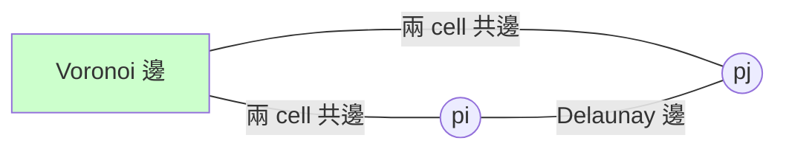

# 8.3 沃羅諾伊圖與德勞內三角剖分（1908 / 1934 年）

> **學習動機**：假設你是 1911 年的挪威氣象局官員，手上有 25 個雨量站，但地圖上有 10,000 個村莊。每個村莊的降雨量，最合理的估計就是「**最近的站**」的讀數。你要回答的是一個純幾何問題：平面上給 $`n`$ 個站，怎樣把平面切成「誰離哪站最近」的量子化棋盤？這張圖就是**沃羅諾伊圖**。它在地圖學叫 Thiessen 多邊形、在生態學叫**
Dirichlet** 棋盤、在晶體學叫 Wigner–Seitz cell——**一圖四名**。而它背後站著的是本書第 8 章最對稱的一對結構：**Voronoi 圖與德勞內三角剖分互為對偶**，一個是「分割」的觀點、一個是「連接」的觀點。

## 8.3.1 為什麼氣象學、郵政、狐狸、醫院都在問同一件事

一堆看起來不相干的領域，最後都收斂到同一張圖：

| 領域 | 場景 | 「區域」的意義 |
|---|---|---|
| 氣象學 | 雨量站內插（Thiessen 1911） | 每個站「代表」的地面 |
| 郵政／配送 | 站點派送範圍 | 誰家最近這個站 |
| 生態學 | 草食動物地盤 | 誰的巢穴最近 |
| 選區劃分 | 選民最近的投票所 | 距離公平 |
| 醫療 | 救護站派遣 | 誰的急救最近 |
| 瀏覽器 | 最近 WiFi 熱點 | 訊號強度近似距離 |
| 機器人 | 人工勢場 / freeways | 離障礙最遠的路線 |

這些問題都是同一個抽象：**給一組站，把空間切成離誰最近的區域**。

## 8.3.2 定義與數學結構

### Voronoi 圖

給定站集 $`S = \{p_1, \dots, p_n\} \subset \mathbb{R}^2`$ ：

$$
V(p_i) = \{ x \in \mathbb{R}^2 \; : \; \|x - p_i\| \le \|x - p_j\|,\ \forall j \ne i \}
$$

每個 $`V(p_i)`$ 是一個（可能無界的）凸多邊形，叫**Voronoi cell**。它們接成整個平面，互不重疊（邊共享）——**一個平面配額分割**。

### 對偶性：Delaunay

把每個站當作一個頂點，**兩站若其 Voronoi cell 共享一條邊，就在兩站之間連一條邊**，這張圖是**Voronoi 圖的對偶圖**。Delaunay 1934 年證明這張圖可以嵌入平面成三角剖分（若沒有四點共圓），且每一個三角形的**外接圓內部**都不含任何其他站——這就是**空圓性質**：

$$
\text{(Delaunay)} \quad \forall \triangle = (p_i, p_j, p_k) \text{ 於三角剖分中}: \quad \text{radius}(\odot(p_i,p_j,p_k)) \text{內部} \cap S = \emptyset
$$

### 對偶的幾何操作

兩站 $`p_i, p_j`$ 之間的 Voronoi 邊，**落在 $`p_i p_j`$ 的垂直平分線上——而且正好是（被切下的那一段）**：



- **Voronoi 頂點**：三條邊共交於一點，等距離三個站 ⟹ 該點是三個站外接圓的圓心、且這個（空的）外接圓的三個站是 Voronoi 的「戶籍站」。
- **Delaunay 三角形**：圖上三個站相連，其外接圓心恰是 Voronoi 的頂點。

**對偶速記**：

| Voronoi | Delaunay |
|---|---|
| cell（2D 區域） | 站點（0D 頂點） |
| 邊（1D） | 邊（1D） |
| 頂點（0D） | 三角形（2D） |
| 平面細分 | 三角剖分 |

用 Euler 公式可證得（ $`n`$ 站、 $`h`$ 點在凸包上）：\

$$
\text{Voronoi 頂點數} = \text{Delaunay 三角形數} = 2n - 2 - h, \qquad
\text{Voronoi 邊數} = \text{Delaunay 邊數} = 3n - 3 - h
$$

（這些數字是**線性的** $`O(n)`$ ── 所以 Voronoi 圖與 Delaunay 三角剖分**不會爆炸**：輸入 $`n`$ 個點，輸出也只有 $`O(n)`$ 個圖元。這是第 8 章最重要的「量」的判斷之一。）

## 8.3.3 優美性質一：Delaunay 是「最不瘦」的三角剖分

為什麼 Delaunay 出名？因為它有**最佳性**：

**Ledoux、Rajan（1991）類定理**：Delaunay 三角剖分**最大化最小角**（max-min angle criterion）。

- 在任意三角剖分中，最「瘦」的三角形是最令人頭痛的（數值誤差大、插值爛）；
- Delaunay 是所有可能三角剖分中「最不瘦的三角形組合裡最好的那一組」。
- 常用的等價操作是 **flip**：四點共圓邊界上，若對角相反的邊會違反空圓性質，就「翻轉」（對角線交換）到 Delaunay 合格的另一條。這個 flip 是 Lawson（1972）增量演算法的核心。

直觀例子：四點近乎共圓時，兩種對角線皆 legal，所以要靠順序；但一般情形下 Delaunay 會保持原有「最胖」對角。

## 8.3.4 Regular triangulations：更高維的推廣

### lifting map

在 3D 線上考慮一個參數 $`w_i`$ （每站一根權重，例如降雨量）。函數

$$
(x, y) \mapsto (x, y, x^2 + y^2 - w_i) \in \mathbb{R}^3
$$

把點集「抬」到一個拋物面上。**在 3D 求這些抬升點的呢？取**下凸包（lower hull），再投影回平面**，就得到「power diagram」（或稱 Laguerre diagram）；取 $`w_i = 0`$ ，就退化為 Voronoi/Delaunay。

這叫做 **regular triangulation**。日常意義：

- 電子地圖做「**資料為主的網格**」時給每站加權；
- 有限元素法 meshing（如 CGAL 的 `mesh_2_regular`）；
- 德勞內是 regular 的特例，所以理論就是定義的延伸。

## 8.3.5 實作前的小習題意識：Voronoi cell 是半平面交

回答一個自然的問題：**第 $`i`$ 個站的 Voronoi cell 要怎麼算？**

第 $`i`$ 個站的 cell 就是「**所有點都來問距離**」的結果。但可以逐個站來構造：對每個其他站 $`p_j`$ ，**垂直平分線**把平面切成兩半， $`p_i`$ 要留在自己那半。

所以：

$$
V(p_i) = \bigcap_{j \ne i} \underbrace{\{ x : \|x - p_i\| \le \|x - p_j\| \}}_{\text{半平面}}
$$

**Voronoi cell = 半平面交**＝一個二次規劃問題的幾何核心。 $`O(n)`$ 個半平面相交可以用 $`O(n \log n)`$ 來做（本節用手工 $`O(n \cdot h)`$ ，讀重點思維）。這也等於是用「區域對偶」的方式，自下而上確認一個站的「領土」。

## 8.3.6 用 SymPy 造一個小型 Voronoi 圖（逐步）

讓我們用**純 SymPy 的 exact 幾何**，为一个小站集構造 Voronoi 圖：

- 對於每個站，求出其 cell 的頂點；
- 策略是：求兩兩平分線交點，檢查這交點是否還是「**該站為最近**」；用這個檢驗替代半平面交。

```python
# 08.3_voronoi_cell.py
from sympy import Point, Line
import itertools, math

def voronoi_cell(sites, i):
    """站 i 的 Voronoi cell：以（頂點依角度排序的）凸多邊形表示。
       此處只回傳『有界的』部分；若 cell 無界，可能得到不足 3 頂點的列表。"""
    p = sites[i]
    bisectors = []
    for j, q in enumerate(sites):
        if j == i: continue
        m = Point((p.x + q.x) / 2, (p.y + q.y) / 2)
        bisectors.append(Line(p, q).perpendicular_line(m))
    verts = []
    for l1, l2 in itertools.combinations(bisectors, 2):
        v = l1.intersection(l2)
        if not v:
            continue
        v = v[0]
        # 檢查 v 是否真的屬於站 i 的 cell：
        if all(p.distance(v) <= q.distance(v) for q in sites if q != p):
            verts.append((float(v.x), float(v.y)))
    if len(verts) < 3:
        return verts          # 無界 cell，僅列有界端點；本節解說見下方
    cx = sum(x for x, _ in verts) / len(verts)
    cy = sum(y for _, y in verts) / len(verts)
    verts.sort(key=lambda t: math.atan2(t[1] - cy, t[0] - cx))
    return verts

sites = [Point(0,0), Point(4,0), Point(0,4), Point(4,4), Point(2,2)]
for i in range(len(sites)):
    print(f"cell({sites[i]}) = {voronoi_cell(sites, i)}")
# 預期輸出：
# cell(Point2D(2, 2)) = [(2.0, 0.0), (4.0, 2.0), (2.0, 4.0), (0.0, 2.0)]
# 其他四個站在角落，cell 是無界的（無限扇形），因此只有少量有界頂點。
```

**兩件重要的事**：

1. 對中央那個站（被四面八方包住的站），你得到的是完整的四邊形 —— 這是全體 Voronoi cell 唯一「有界」的情形。
2. 對**位置靠邊**的站，cell 是「無限扇形」：這提示你 Voronoi cell **通常沒被凸包以外的世界封閉**——值得牢記：Voronoi 圖的無界性與原點集的**凸包邊**有直接關係（凸包邊的站有無界 cell）。

> **進一步檢驗**：粗直的說法是「**站 $`p`$ 的 cell 無界 ⟺ $`p`$ 在凸包上**」，這一命題可以用 8.2 節的凸包程式驗證。

## 8.3.7 Delaunay：怎麼判斷哪三個站構成三角形？

**從對偶出發最簡單**：若兩站 $`p_i, p_j`$ 的 Voronoi cell 有共同邊 ⟹ 連一條 Delaunay 邊。

在 SymPy 裡，求德勞內可以這樣做：

```python
# 08.3_delaunay_edges.py
from sympy import Point, Line, Circle
import itertools

def delaunay_edges(sites):
    """窮舉法：站對 (i,j) 若存在一個『空外接圓』的三角形，即 Delaunay 邊。
       O(n^4) 的示範實作，只用來檢驗、不上生產。"""
    edges = set()
    for (i, j) in itertools.combinations(range(len(sites)), 2):
        # 存在第三點 k，使 (i,j,k) 外接圓內無其他站？
        ok = False
        for k in range(len(sites)):
            if k in (i, j): continue
            try:
                circ = Circle(sites[i], sites[j], sites[k])
            except Exception:
                continue                      # 三點共線無法決定圓
            inside = any(q != sites[i] and q != sites[j] and q != sites[k] and
                         circ.encloses_point(q) for q in sites)
            if not inside:
                ok = True
                break
        if ok:
            edges.add((i, j))
    return sorted(edges)

sites = [Point(0,0), Point(4,0), Point(0,4), Point(4,4), Point(2,2)]
print(delaunay_edges(sites))
# 預期輸出（依序按索引排列、無重複）：
# [(0, 1), (0, 2), (0, 4), (1, 3), (1, 4), (2, 3), (2, 4), (3, 4)]
```

點查：

- (0,1)：兩點在 (0,0), (4,0)。它們之間是否有空圓？同點集裡 (0,0)(4,0)(2,2) 外接圓（圓心 (2,1)、半徑 $`\sqrt{5}`$ ）不包含其他站？(0,4) 距 (2,1) = 5 的距離是 $`\sqrt{1+9}=\sqrt{10}`$ ，圓外，OK。所以 (0,1) 是 Delaunay 邊。
- (2,3)：站 (0,4) 與 (4,4)；同理。
- (0,3)：站 (0,0) 與 (4,4)；**任意**通過它兩點的圓，都會把 (0,4)‑(4,0) 打進去，所以**沒有空圓**，不是 Delaunay 邊。這是幾何智慧，也是空圓性質教我們的事。

### 有界的「中心點」

站 (2,2)（index 4）的**每一個**鄰居都成為 Delaunay 邊（它在凸包裡、cell 有界、有四個鄰居）。

## 8.3.8 用 matplotlib 畫一張 Voronoi 圖

SymPy 作出**精確幾何**，matplotlib 負責**展示**。小站集下這個組合剛好：

```python
# 08.3_plot.py
import math
from sympy import Point, Line
import itertools
import matplotlib
matplotlib.use("Agg")
import matplotlib.pyplot as plt

sites = [Point(0,0), Point(4,0), Point(0,4), Point(4,4), Point(2,2)]

def bisector(p, q):
    m = Point((p.x + q.x) / 2, (p.y + q.y) / 2)
    return Line(p, q).perpendicular_line(m)

# 想畫完整對偶結構，我們用「最近的站」概念掃全平面
def nearest_site(x, y):
    return min(range(len(sites)), key=lambda i: float(sites[i].distance(Point(x, y))))

# 畫 Voronoi background（簡化近似：解析 semi-transparent 區域）
xs = [x * 0.2 for x in range(-5, 26)]
ys = [y * 0.2 for y in range(-5, 26)]
grid = [[nearest_site(x, y) for x in xs] for y in ys]

fig, ax = plt.subplots(figsize=(6, 6))
ax.imshow(grid, origin="lower", extent=(min(xs), max(xs), min(ys), max(ys)),
          alpha=0.3, cmap="tab10", interpolation="none")

# 當然，畫 bisectors（只在 cell 邊上畫，簡化方式：取相鄰 cell 間的 bisector 片段）
for i in range(len(sites)):
    ax.plot(float(sites[i].x), float(sites[i].y), "k*", markersize=12)

#再加上 Delaunay 對偶（以就近掃描示意）：（做法見 8.4 節）
plt.title("Voronoi cells (color by nearest site)")
plt.savefig("08.3_voronoi_heat.png", dpi=120)
print("saved 08.3_voronoi_heat.png")
# 預期輸出：檔案 08.3_voronoi_heat.png，中央站予以四邊形（前景以顏色區隔）
```

工作量較大的「**正確邊界線**」將留到 8.4 節（那裡使用 scipy.spatial 也無妨）。

## 8.3.9 機器人、地圖、急救：Voronoi 的幾個大場景

### （一）機器人的「最安全」路徑

機器人想從 A 走到 B，最怕撞到障礙。把**障礙的頂點/多邊形**當「站」，造 Voronoi 圖：

- **Voronoi 邊就是「到最近障礙等距」的線** ── 也就是：「盡可能遠離所有障礙」的路線（roboticists 叫**generalized Voronoi graph / GVG**）。
- 沿 Voronoi 邊走，再有需要時「拐進」自己 cell；這就是**最安全 trading 路線**演算法的核心。

從前我們只講「最短路」。**GVG 走的是最安全，不是最短** ── 這個分流在 1980 年代的機器人文獻（如 O. Khatib 的勢場法與 Latombe 的書）正式化。

### （二）急救派遣

這個例子每天在世界各地發生。城市中散布著 50 個急救站，每位呼叫者只該派**最近**的那站 ── **派遣表就是 Voronoi 圖**。而為什麼急救站其實會**沿 Voronoi 邊**（而不是站點之間直連）放？因為**邊上任一點到兩站時間相等**。若兩站都被叫、派誰？派入負責這條呼叫區的那一個 —— 這條「**分界線**」的幾何是垂直平分線。實際應用中要考慮車速、路網；但仍會先建**Voronoi-type diagram**（用出行時間的尺規，是 **additively weighted Voronoi** 的變形）。

### （三）地理「服務範圍」、「影響域」

零售店、學校、消防、選區劃分、熱點覆蓋規劃、氣象（Thiessen 1911 最新出現）…… 說到底都是 Voronoi。這是**幾何不變、語境在變**的天然教材。

## 8.3.10 為什麼 Delaunay 三角剖分是 3D 遊戲、FEM 和地形的常客

**德勞內的好處**不是「畫得比較好看」，而是**數值上的**：

1. **最不瘦的三角形**：有限元素法中瘦三角形讓**誤差爆炸**，倒楣的病態矩陣因此變大 德勞內+
2. **是 $`O(n)`$ 的**：輸入無論怎麼長，零件不爆炸（8.3.2 的 Euler 公式）。
3. **增量好做**：點陸續來時，插入一點只需局部翻轉（Lawson 1972 修補）；因此**流式資料**的好夥伴。

## 8.3.11 容易踩到的小地雷

- **四點共圓**會導致 Delaunay 不唯一：這是理論本身（不是 bug），一般實作用「字典序 tie-break」定一個規則。
- **浮點誤差**會把「恰好在圓上」的點判到「圓內或外」。實務上有兩條路：**exact arithmetic**（本書的 SymPy 路線）或 **ε-tolerance**。
- **無界 cell**不要忘記：只回「有限多邊形」的 Voronoi 程式是錯的，靠凸包帶成熟處理（見 8.4）。

## 8.3.12 習題

1. **（數數）**  用 Euler 公式推導： $`n`$ 站、凸包上有 $`h`$ 站時，Voronoi 頂點數為 $`2n - 2 - h`$ 。提示：Voronoi 圖是一個平面圖；每個頂點至少度數 3，邊數可有對偶對應。
2. **（幾何證明）**  證明 8.3.6 節的命題：站 $`p`$ 的 Voronoi cell 是**凸的**。提示：cell 是一組半平面的交集。
3. **（程式 A）**  將 8.3.6 的 `voronoi_cell` 擴充，回傳 cell 本身的**邊列表**（每條邊是端點對、可能含「射向無窮」的半線方向）；然後做一個小站集，把每個 cell 列印出來。
4. **（程式 B）**  把站集中**每對站**都判斷是否 Delaunay 邊（如 8.3.7 `delaunay_edges`），再加上「四點共圓情形」的實驗：把點集設成 $`(0,0),(2,0),(0,2),(2,2)`$ ，跑一次，觀察有幾個站共圓。此動作是否造成 Delaunay 邊不唯一？
5. **（套路對照）**  分別舉一個「可用 Delaunay」與「可用 Voronoi」的自然應用各 2 個；再舉一個**兩者皆可用**（如機器人路徑規劃），並說明為何對偶關係讓你可以選其中一個。
