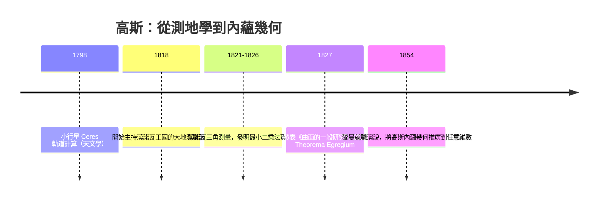
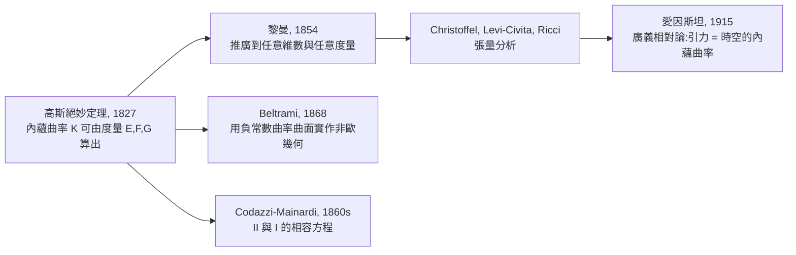

# 9.1 高斯內蘊幾何與絕妙定理（1827 年）

**Theorema Egregium：曲率是曲面自己的事，不是外面的 observers 的事。**

---

## 學習動機

在歐氏幾何的傳統裡，幾何是「平的」：距離由畢氏定理給定，角度和是 $`180°`$ ，
三角形內角和是 $`180°`$ ——沒有人懷疑這是可以「調整」的。

但地球本身就是一個巨大的反例。地表上，三角形的內角和**大於** $`180°`$ ：
在赤道上取一段弧、在南北兩極方向各畫兩條子午線，圍出的三角形內角和是
$`180^\circ +`$ 球面角超量（spherical excess）。這不是測量誤差，而是**表面的本性**。

然而「表面」一詞有內在緊張：

- 我們平常描述一個面（例如一張揉過的紙、一片山區地形、地球的形狀），
  常常是把它「放」在立體空間中，用外面的三維座標來描述。
- 但居住在這個面上的生物（螞蟻、測量員、甚至我們自己住在地球上的時候）
  **無法直接量測外面的空間**，只能量測面內的距離與角度。

於是出現個深刻的問題：

> 兩種曲面，如果在面上量起來所有點與點的距離都相同（**等距變換**，isometry），
> 那麼對「面內生物」而言，它們是**同一種**幾何。
> 而**曲率**、以及由曲率決定的所有幾何性質（三角形內角和、圓周長公式、
> 畢氏定理是否成立），是否也是「面內生物可測」的呢？

高斯在 1827 年發表的論文《曲面的一般研究》（*Disquisitiones generales
circa superficies curvas*）中徹底回答了這個問題：**是的，而且曲率可以被
純粹由面內量測量決定**——這就是著名的
*Theorema Egregium*（拉丁文，意為「絕妙定理」）。

這一章是整本書的轉捩點之一：它把幾何從「外面的世界」拉回「內在的世界」，
並直接鋪路給黎曼在 1854 年的廣義化（第 6 章我們已預見其結論）——
**幾何是空間自己的度量異常，不是某個嵌入空間的性質**。

在本章中，我們將：

1. 定義 $`\mathbf{r}(u,v)`$ 的**第一基本形式**（度量）
   與**第二基本形式**（彎曲度），
2. 定義**高斯映射**（Gauss map） $`\mathbf{n}: S \to S^2`$ ，
3. 推導 $`\mathbf{n}`$ 的擾動給出**高斯曲率** $`K`$ ，
4. 證明（在符號計算層面驗證）絕妙定理：
   $`K`$ 不依賴第二基本形式，只依賴第一基本形式。
5. 沿途用 SymPy 做實驗、驗證、以及**代入具體曲面上確認**。

---

## 1. 歷史脈絡：大地測量學如何驅動內蘊幾何

高斯的一生有兩條事業線：



**漢諾瓦王國的大地測量**（1818–1826）是高斯花費最多時間的實務計畫：
他為了把地球子午線一度的長度量得最精確，親自 到山頂、在雨中、在沼澤中
觀測三角測量網。想像他不停在問：

> 地表上，由兩段弧圍出的三角形，其內角和到底偏離 $`180°`$ 多少？

這是**純測量的問題**——不需要（也不能）知道「地球外面那個
立體空間的情形」。把這個研究做到極致，是必須建立
「**只用面內量測量即可推知的幾何學**」。

我們在本書前七章已經見過多個「局部性」的例子
（第 5 章的射影變換、第 7 章的 克萊因綱領），
它們都告訴我們：

> 變換下的**不變量**，構成了一門幾何。

這一章的變換是**面內的等距變換**：

$$
\phi : S \to S' , \quad \text{面內路徑長度保留}
$$

而不變量是：

$$
K \quad \text{（高斯曲率）}
$$

**要證明的高斯定理的兩句話**：

1. $`\mathbf{n}_u \times \mathbf{n}_v`$ 的面積（即高斯映射的 Jacobian）
   是 $`K \, dA`$ ，其中 $`dA = \sqrt{EG - F^2} \, du \, dv`$ 。
2. $`K`$ 可以由一階基本形式 $`E, F, G`$ （及其對 $`u, v`$ 的一階與二階導數）
   純 formally 計算出來——**而等距變換維持第一基本形式**。

---

## 2. 參數化曲面與局部座標

一個（局部）參數化曲面是一個映射

$$
\mathbf{r} : U \subset \mathbb{R}^2 \to \mathbb{R}^3, \quad (u, v) \mapsto (x(u,v), y(u,v), z(u,v))
$$

配合假設兩個切向量

$$
\mathbf{r}_u = \frac{\partial \mathbf{r}}{\partial u}, \quad
\mathbf{r}_v = \frac{\partial \mathbf{r}}{\partial v}
$$

是線性獨立的（即: $`\mathbf{r}_u \times \mathbf{r}_v \neq \mathbf{0}`$ ）。
這個條件保證曲面局部像一片薄薄的二維膜，而不是折角。

### 範例：球面

把參數記作 $`\theta \in [0, 2\pi), \ \varphi \in (0, \pi)`$ ：

$$
\mathbf{r}(\theta, \varphi) =
\begin{pmatrix}
R \sin\varphi \cos\theta \\
R \sin\varphi \sin\theta \\
R \cos\varphi
\end{pmatrix}
$$

在 SymPy 中：

```python
import sympy as sp

R = sp.symbols('R', positive=True)
th, ph = sp.symbols('theta phi', real=True)

r = sp.Matrix([R*sp.sin(ph)*sp.cos(th),
               R*sp.sin(ph)*sp.sin(th),
               R*sp.cos(ph)])

# 切向量
r_th = sp.simplify(r.diff(th))
r_ph = sp.simplify(r.diff(ph))
print("r_th =", r_th.T)
print("r_ph =", r_ph.T)
# ==>
# r_th = Matrix([[-R*sin(phi)*sin(theta)], [R*sin(phi)*cos(theta)], [0]])
# r_ph = Matrix([[R*cos(phi)*cos(theta)], [R*cos(phi)*sin(theta)], [-R*sin(phi)]])
```

**注意**：同一個曲面可以有很多參數化
（例如球面還可用 $`\mathbf{r} = (x, y, \sqrt{R^2-x^2-y^2})`$ 表示上半球），
而下面我們將看到，第一基本形式會跟著參數化改變**表示法**，
但由它推得的**內蘊量**（如面積、測地曲路徑、 $`K`$ ）不會變。
這是「座標相對性」在幾何上最早期的形式。

---

## 3. 第一基本形式：面內生物可量的部分

在曲面上一個點 $`P = \mathbf{r}(u,v)`$ 上，兩個無限小的位移分別是
$`\mathbf{r}_u \, du`$ 與 $`\mathbf{r}_v \, dv`$ 。合成位移是

$$
d\mathbf{r} = \mathbf{r}_u \, du + \mathbf{r}_v \, dv
$$

它的弧長平方是

$$
d\mathbf{r} \cdot d\mathbf{r}
= \underbrace{\mathbf{r}_u \cdot \mathbf{r}_u}_{E} \, du^2
+ 2\underbrace{\mathbf{r}_u \cdot \mathbf{r}_v}_{F} \, du \, dv
+ \underbrace{\mathbf{r}_v \cdot \mathbf{r}_v}_{G} \, dv^2
$$

這就是**第一基本形式**：

$$
\mathrm{I} = E \, du^2 + 2 F \, du \, dv + G \, dv^2
$$

用矩陣來看，就是對稱正定矩陣

$$
G_{[u,v]} = \begin{pmatrix} E & F \\ F & G \end{pmatrix}
$$

它告訴面內生物：

- $`E`$ ：沿 $`u`$ 方向前進單位參數，實際走了多遠
- $`F`$ ： $`u`$ 方向與 $`v`$ 方向的「夾角資訊」（當 $`F = 0`$ ，參數線正交）
- $`G`$ ：沿 $`v`$ 方向前進單位參數，實際走了多遠
- $`\sqrt{EG - F^2}`$ ：面積放大因子（Jacobi determinant 的幾何意義）

### SymPy 計算第一基本形式

```python
import sympy as sp

def first_forms(r, u, v):
    """給亂一個 SymPy 矩陣 r(u,v)，傳回 (E, F, G)。"""
    ru = sp.Matrix([sp.simplify(x) for x in r.diff(u)])
    rv = sp.Matrix([sp.simplify(x) for x in r.diff(v)])
    E = sp.simplify(ru.dot(ru))
    F = sp.simplify(ru.dot(rv))
    G = sp.simplify(rv.dot(rv))
    return E, F, G

# 球面
R = sp.symbols('R', positive=True)
th, ph = sp.symbols('theta phi', real=True)
r_s = sp.Matrix([R*sp.sin(ph)*sp.cos(th),
                 R*sp.sin(ph)*sp.sin(th),
                 R*sp.cos(ph)])
E, F, G = first_forms(r_s, th, ph)
print("E, F, G =", E, F, G)
# ==>
# E, F, G = R**2*sin(phi)**2 0 R**2

# 圓柱面 (u = z, v = theta)
a = sp.symbols('a', positive=True)
r_c = sp.Matrix([a*sp.cos(v), a*sp.sin(v), u])
E, F, G = first_forms(r_c, u, v)
print("cylinder E, F, G =", E, F, G)
# ==>
# cylinder E, F, G = 1 0 a**2
```

**觀察一件怪事**：圓柱面 $`E, F, G = (1, 0, a^2)`$ ，
而**平面**給出

$$
\mathbf{r}(u, v) = (u, v, 0), \quad \mathrm{I} = du^2 + dv^2
$$

在數學上這正好說的是：經過一個座標拉伸
$`\phi(u, v) = (a \cos(\text{柱角}), \ldots)`$ 意義下的等距變換，
圓柱面與平面**第一步上等價**——事實上圓柱展開就是平面！
而**球面**則是 $`G`$ 依 $`\varphi`$ 變化（赤道附近 $`dv`$ 走得遠、兩極走得近），
這個「不均匀的量尺」導致球面**不能**展開成平面
（你的地圖永遠畸變——Mercator 地圖的原理）。

---

## 4. 第二基本形式：外面 observers 看到的彎曲

除了第一基本形式 $`I`$ ，我們還可定義**單位法向量場**

$$
\mathbf{n}(u, v) = \frac{\mathbf{r}_u \times \mathbf{r}_v}
                       {\left| \mathbf{r}_u \times \mathbf{r}_v \right|}
$$

它代表曲面在每個點的「向上方向」。接著把曲面在這一格鄰域拋物化
（Taylon 展開到二階）：

$$
\mathbf{r}(u + du, v + dv) \approx \mathbf{r}(u, v) + \mathbf{r}_u \, du + \mathbf{r}_v \, dv
       + \tfrac12 \mathbf{r}_{uu} du^2
       + \mathbf{r}_{uv} du \, dv
       + \tfrac12 \mathbf{r}_{vv} dv^2
$$

法向量方向的偏移量，即為**第二基本形式**（second fundamental form）：

$$
\mathrm{II} = L \, du^2 + 2 M \, du \, dv + N \, dv^2
$$

其中

$$
L = \mathbf{r}_{uu} \cdot \mathbf{n}, \quad
M = \mathbf{r}_{uv} \cdot \mathbf{n}, \quad
N = \mathbf{r}_{vv} \cdot \mathbf{n}
$$

**意義**： $`\mathrm{II}`$ 描述曲面**偏離切平面**的程度，
因此依賴於「外面這個立體空間把曲面怎麼彎」——**這是外部的 representation**。

### SymPy 計算

```python
import sympy as sp

def normal_n(r, u, v):
    cru = sp.simplify(r.diff(u).cross(r.diff(v)))
    return sp.simplify(cru / cru.norm())

def second_forms(r, u, v, n):
    L = sp.simplify(r.diff(u,2).dot(n))
    M = sp.simplify(r.diff(u,1,v,1).dot(n))
    N = sp.simplify(r.diff(v,2).dot(n))
    return L, M, N

# 球面：法向量參照「假設向外的幾何直覺」，取 n = -r/R（符號對應選擇）
R = sp.symbols('R', positive=True)
th, ph = sp.symbols('theta phi', real=True)
r_s = sp.Matrix([R*sp.sin(ph)*sp.cos(th),
                 R*sp.sin(ph)*sp.sin(th),
                 R*sp.cos(ph)])
n = sp.simplify(r_s / R)           # 向內 / 向外：二選一（影響 II 的符號）
L, M, N = second_forms(r_s, th, ph, n)
print("L, M, N =", sp.trigsimp(L), sp.trigsimp(M), sp.trigsimp(N))
# ==>
# L, M, N = -R*sin(phi)**2 0 -R

# 圓柱面
u, v = sp.symbols('u v', real=True)
a = sp.symbols('a', positive=True)
r_c = sp.Matrix([a*sp.cos(v), a*sp.sin(v), u])
nu = normal_n(r_c, u, v)
print("cylinder n =", nu.T)
L, M, N = second_forms(r_c, u, v, nu)
print("cylinder L, M, N =", L, M, N)
# ==>
# cylinder n = Matrix([[-cos(v)], [-sin(v)], [0]])
# cylinder L, M, N = 0 0 a
# ==>
# cylinder n = Matrix([[-cos(v)], [-sin(v)], [0]])
# cylinder L, M, N = 0 0 a
```

球面 $`(L, M, N) = (-R\sin^2\varphi,\, 0,\, -R)`$ ，全對稱，合理。
**注意**：L 與 N 的正負跟法向量選擇有關，這是符號 tension 的源頭。
我們後面看到的 $`K = (LN - M^2)/(EG - F^2)`$ **分子乘積對「同時翻
$`\mathbf{n}`$ 的符號」不敏感**，所以高斯曲率不會受到法向量選擇的影響；
平均曲率 $`H`$ 則會，故 $`H`$ 正負 depends on n（這也說明 $`H`$ 不是內蘊量）。

---

## 5. 高斯映射與主曲率

### 5.1 Gauss map 的定義

$$
\mathbf{n} : S \to S^2, \quad P \mapsto \mathbf{n}(P)
$$

它是一個從曲面到單位球面的映射。**這個映射把曲面的形狀
encode 到球面上**：

- 平面： $`\mathbf{n}`$ 是常數映射 → 高斯映射**塌縮**成一點
- 圓柱面： $`\mathbf{n}`$ 只依賴 $`\theta`$ ，把整個圓柱打成一條**赤道弧**
- 球面： $`\mathbf{n}`$ （不考慮 $`R`$ ）就是一個**環面版**的扭轉球面本身

### 5.2 Weingarten map：法向量如何回應切向位移

當我們沿曲面走一小步， $`\mathbf{n}`$ 也跟著扭轉。把它們對應起來：

$$
d\mathbf{n} = \mathbf{n}_u \, du + \mathbf{n}_v \, dv
$$

這是一個「切向」信息；其核心觀點是
$`\mathbf{n}_u, \mathbf{n}_v`$ 都屬於切平面
（因為 $`\mathbf{n} \cdot \mathbf{n} = 1`$ 求導可得 $`\mathbf{n} \cdot \mathbf{n}_u = 0`$ ）。
所以存在一個作用在切平面上的**線性映射**：跟 $`\mathbf{n}`$ 報告「我偏移了
$`(du, dv)`$ ”，就得到法向量偏移。

這個映射的**兩個不變量**是：

- **高斯曲率（Gaussian curvature）**： $`K = \det(d\mathbf{n})`$
  （相當於 $`\mathbf{n}`$ 的面積伸縮因子）
- **平均曲率（mean curvature）**： $`H = \frac{k_1 + k_2}{2}`$ （兩個主曲率的平均）

### 用 SymPy 推導 $`K`$ 的公式

在有物徑參數化 $`(du, dv)`$ 之下，
$`\mathbf{n}`$ 的 Jacobian 相對於 $`\mathbf{r}`$ 的 Jacobian 的比值是：

$$
K = \frac{ \mathbf{n}_u \times \mathbf{n}_v \cdot \mathbf{n}
          }{ \mathbf{r}_u \times \mathbf{r}_v \cdot \mathbf{n}
          }
  = \frac{LN - M^2}{EG - F^2}
$$

（分母是 $`\sqrt{EG-F^2}`$ ，分子是 $`\sqrt{EG-F^2}`$ 相應的量——詳細證明可用
Weingarten 方程 $`\mathbf{n}_u = s_{uu}\mathbf{r}_u \cdots`$ 推得，
參見習題 9.1.3）

我們驗證 **球面** 上 $`K = 1/R^2`$ ：

```python
import sympy as sp

R = sp.symbols('R', positive=True)
th, ph = sp.symbols('theta phi', real=True)
r_s = sp.Matrix([R*sp.sin(ph)*sp.cos(th),
                 R*sp.sin(ph)*sp.sin(th),
                 R*sp.cos(ph)])
n  = sp.simplify(r_s / R)

E = sp.simplify(r_s.diff(th).dot(r_s.diff(th)))
F = sp.simplify(r_s.diff(th).dot(r_s.diff(ph)))
G = sp.simplify(r_s.diff(ph).dot(r_s.diff(ph)))
L = sp.simplify(r_s.diff(th,2).dot(n))
M = sp.simplify(sp.simplify(r_s.diff(th,1,ph,1)).dot(n))
N = sp.simplify(r_s.diff(ph,2).dot(n))

K = sp.simplify((L*N - M*M)/(E*G - F*F))
print("K =", K)
# ==>
# K = 1/R**2
```

以及圓柱面 $`K = 0`$ ：

```python
u, v = sp.symbols('u v', real=True)
a = sp.symbols('a', positive=True)
r_c = sp.Matrix([a*sp.cos(v), a*sp.sin(v), u])

E = sp.simplify(r_c.diff(u).dot(r_c.diff(u)))
F = sp.simplify(r_c.diff(u).dot(r_c.diff(v)))
G = sp.simplify(r_c.diff(v).dot(r_c.diff(v)))
n = sp.simplify(r_c.diff(u).cross(r_c.diff(v)))
n = sp.simplify(n / n.norm())

L = sp.simplify(r_c.diff(u, 2).dot(n))
M = sp.simplify(r_c.diff(u, 1, v, 1).dot(n))
N = sp.simplify(r_c.diff(v, 2).dot(n))

K = sp.simplify((L*N - M*M)/(E*G - F*F))
print("cylinder K =", K)
# ==>
# cylinder K = 0
```

**結果**：圓柱面 $`K = 0`$ 、球面 $`K = 1/R^2 > 0`$ 、
鞍面（雙曲拋物面） $`K < 0`$ 。
這跟「三角形內角和」的關係是：

| $`K`$ | 幾何 | 三角形內角和 |
|---|---|---|
| $`> 0`$ | 球面型 | $`> 180°`$ |
| $`= 0`$ | 平面型 | $`= 180°`$ |
| $`< 0`$ | 鞍面型 | $`< 180°`$ |

---

## 6. 絕妙定理（Theorema Egregium）

### 6.1 定理的敘述

> **Theorema Egregium**（高斯，1827）
> 高斯曲率 $`K`$ 為**內蘊量**：它可以由第一基本形式
> $`E, F, G`$ （及其對 $`u, v`$ 的一階與二階導數）純 formally 計算得出。
> 特別地，**任何等距變換 $`\phi : S \to S'`$ 均保持 $`K`$ **。

標準做法是拐一個彎：

1. 我們已經知道 $`K = (LN-M^2)/(EG-F^2)`$ （外面推導得到）
2. 但 $`\mathrm{II}`$ 的背後有 **Codazzi–Mainardi 方程**與 **Gauss 方程**，
   將 $`\mathrm{II}`$ 與 $`\mathrm{I}`$ 的兩組方程「聯立」起面，
   就能**消掉** $`L, M, N`$ ，得到 $`K`$ 只是 $`(E, F, G)`$ 的函數。

**Gauss 方程**（記 Christoffel symbols $`\Gamma^k_{ij}`$ ）告訴我們：

$$
R_{1212} = \sum_{\rho} g_{1\rho} R^{\rho}_{\ 212}
         = (LN - M^2)
$$

其中 $`R^{\rho}_{\ \sigma\mu\nu}`$ 是從 $`\Gamma`$ 組出的 Riemann tensor。
因此

$$
K = \frac{R_{1212}}{EG - F^2}
$$

而右邊只含 $`\Gamma`$ ，而 $`\Gamma`$ 只由 $`\mathrm{I}`$ 決定：
內蘊！

### 6.2 用 SymPy 直接驗證：內蘊 K = 外在 K

我們實作一個**通用的 helper** 用 $`E, F, G`$ 計算 Christoffel 係數
和 Riemann 張量，以及計算 $`K`$ 的公式：

```python
import sympy as sp

def christoffel(E, F, G, u, v):
    """給定第一基本形式 (E,F,G)，回傳 Christoffel 係數 Gamma[k][i][j]。

    計算公式：
    Gamma[m][A][B] 之中，q = m 為「上標」；A, B 為對應的「下標」
        Gamma^m_{AB} = (1/2) g^{mq} ( d_B g_{Aq} + d_A g_{Bq} - d_q g_{AB} )
    這裡 g = [[E, F], [F, G]]，d 是對 (u, v) 求 partial derivative。
    """
    g  = sp.Matrix([[E, F], [F, G]])
    ginv = g.inv()
    coords = [u, v]
    gd = [[[sp.diff(g[i, j], coords[l]) for l in range(2)]
            for j in range(2)] for i in range(2)]
    Gamma = [[[None]*2 for _ in range(2)] for _ in range(2)]
    for m in range(2):
        for A in range(2):
            for B in range(2):
                s = 0
                for c in range(2):
                    s += ginv[m, c] * (gd[B][c][A] + gd[A][c][B] - gd[A][B][c]) / 2
                Gamma[m][A][B] = sp.simplify(s)
    return Gamma

def intrinsic_K(E, F, G, u, v):
    """由第一基本形式直接計算高斯曲率（內蘊公式）。"""
    Gamma = christoffel(E, F, G, u, v)
    coords = [u, v]
    def ri(r, sidx, mu, nu):
        """R^r_{sidx mu nu} 的符號約定：
           R^r_{s m n} = d_m Gamma^r_{n s} - d_n Gamma^r_{m s}
                        + Gamma^r_{m,l} Gamma^l_{n,s}
                        - Gamma^r_{n,l} Gamma^l_{m,s}
        """
        s = (sp.diff(Gamma[r][nu][sidx], coords[mu])
             - sp.diff(Gamma[r][mu][sidx], coords[nu]))
        for lam in range(2):
            s += (Gamma[r][mu][lam]*Gamma[lam][nu][sidx]
                  - Gamma[r][nu][lam]*Gamma[lam][mu][sidx])
        return sp.simplify(s)
    # R_{1212} = g_{11} R^1_{2 1 2} + g_{12} R^2_{2 1 2}
    R1212 = sp.simplify(
        (E * ri(0, 1, 0, 1) + F * ri(1, 1, 0, 1)))
    return sp.simplify(R1212 / (E * G - F**2))

# === 球面 ===
R = sp.symbols('R', positive=True)
th, ph = sp.symbols('theta phi', real=True)
r_s = sp.Matrix([R*sp.sin(ph)*sp.cos(th),
                 R*sp.sin(ph)*sp.sin(th),
                 R*sp.cos(ph)])
E = sp.simplify(r_s.diff(th).dot(r_s.diff(th)))
F = sp.simplify(r_s.diff(th).dot(r_s.diff(ph)))
G = sp.simplify(r_s.diff(ph).dot(r_s.diff(ph)))
K_intr = intrinsic_K(E, F, G, th, ph)
print("intrinsic K (sphere) =", K_intr)
# ==>
# intrinsic K (sphere) = 1/R**2
```

**驗證成功了**：從 $`\mathrm{I}`$ （設定的 $`E, F, G`$ ）**純 formally 計算**，
高斯曲率為 $`1/R^2`$ — 跟用 $`\mathrm{II}`$ 計算得到的 $`K = 1/R^2`$ 一致。

內蘊公式的過程細節（球面）：
在 $`E = R^2 \sin^2\varphi`$ 、 $`F = 0`$ 、 $`G = R^2`$ 的情形，
非零的 Christoffel 係數只有

$$
\Gamma^\theta_{\theta \varphi} = \Gamma^\theta_{\varphi\theta} = \cot\varphi, \quad
\Gamma^\varphi_{\theta\theta} = -\tfrac12 \sin 2\varphi
$$

代入 Riemann tensor 得 $`R_{\theta\varphi\theta\varphi} = R^2 \sin^2\varphi`$ ，
所以 $`K = R^2 \sin^2 \varphi / (R^2 \sin^2\varphi \cdot R^2) = 1/R^2`$ 。

### 6.3 內蘊性的驗證：改參數化，K 應該不變

我們試試把球面用「Mercator-like」參數去測試。
把 $`\varphi = 2 \arctan(e^s)`$ （Mercator 的緯度參數）代入：

$$
\mathbf{r}(\theta, s) =
\begin{pmatrix}
R \sin\varphi(s) \cos\theta \\
R \sin\varphi(s) \sin\theta \\
R \cos\varphi(s)
\end{pmatrix}
$$

這個參數化的 $`E, F, G`$ 是**不同**的函數，
但只改變參數化不改變底層數學結構：

```python
import sympy as sp

R = sp.symbols('R', positive=True)
th, s = sp.symbols('theta s', real=True)
ph = 2*sp.atan(sp.exp(s))
r_merc = sp.Matrix([R*sp.sin(ph)*sp.cos(th),
                    R*sp.sin(ph)*sp.sin(th),
                    R*sp.cos(ph)])
E = sp.simplify(r_merc.diff(th).dot(r_merc.diff(th)))
F = sp.simplify(r_merc.diff(th).dot(r_merc.diff(s)))
G = sp.simplify(r_merc.diff(s).dot(r_merc.diff(s)))
print("Mercator E =", sp.simplify(sp.trigsimp(E)))
print("Mercator F =", F)
print("Mercator G =", sp.simplify(sp.trigsimp(G)))
# ==>
# Mercator E = R**2/cosh(s)**2
# Mercator F = 0
# Mercator G = R**2/cosh(s)**2
```

也就是
$`E = G = R^2 \operatorname{sech}^2(s)`$ 。
（ $`\sin\varphi = \operatorname{sech}(s)`$ 、 $`\frac{d\varphi}{ds} = \operatorname{sech}(s)`$ ，
兩個尺度剛好相同——Mercator 投影因此是**保角的**：
第一基本形式與平面上的對角縮放度量成比例。）
然後再計算 `intrinsic_K`，將會發現還是 $`1/R^2`$ 。
這是**座標不變性**的具體感受：

> 換參數 $`(u,v) \neq (u', v')`$ 表面「曲率不變」——這是「不變量構成幾何」的
> 克萊因綱領精神，但現實「內蘊」而不是「外面」的觀察者。

### 6.4 高斯映射的觀點補充

另一個外觀角度：從高斯映射看， $`\mathbf{n}`$ 的 Jacobian
就是「 $`du \, dv`$ 面積成本在球面上變成多少的區域」。
計算結果：

$$
|\mathbf{n}_u \times \mathbf{n}_v| = |K| \cdot \sqrt{EG - F^2}
$$

SymPy 驗證（球面）：

```python
R = sp.symbols('R', positive=True)
th, ph = sp.symbols('theta phi', real=True)
r_s = sp.Matrix([R*sp.sin(ph)*sp.cos(th),
                 R*sp.sin(ph)*sp.sin(th),
                 R*sp.cos(ph)])
n = sp.simplify(r_s/R)
A = sp.trigsimp(sp.simplify(n.diff(th).cross(n.diff(ph)).norm()))
print("|n_th x n_ph| =", A)
# ==>
# |n_th x n_ph| = Abs(sin(phi))
```

把 $`\varphi \in (0, \pi)`$ 帶入， $`|\sin\varphi| = \sin\varphi`$ ；
除以 $`\sqrt{EG-F^2} = R^2 \sin\varphi`$ ，得 $`K = 1/R^2`$ ✓。

---

## 7. Theorema Egregium 之後的歷史



**黎曼幾何**十分自然地自高斯絕妙定理產生。黎曼在 1854 年的
就職演說中問：如果我們允許一個
$`n`$ 維空間自己攜帶一組「局部度量」
$`g_{ij}(x)`$ ——即**第一基本形式的推廣**——那麼在這個空間中，
幾何就是由這組 $`g_{ij}`$ 完全決定，而不需要嵌入任何外部空間。
愛因斯坦的廣義相對論（1915 年）正是黎曼幾何的實現：
引力**就是**時空的內蘊曲率。

另一條路徑同樣重要：**Beltrami** 在 1868 年證明，非歐幾何
（雙曲幾何）可以用**負常數曲率**的曲面（如偽球面）
的內蘊幾何**具實實現**——這說明第 6 章討論的非歐幾何
不是代號 play，而是「事實上有某個曲面就是這樣彎」。

---

## 8. 小結

- **第一基本形式** $`\mathrm{I} = E\,du^2 + 2F\,du\,dv + G\,dv^2`$ ：
  面內生物可量的距離、角度、面積的「本來屬性」。
- **第二基本形式** $`\mathrm{II} = L\,du^2 + 2M\,du\,dv + N\,dv^2`$ ：
  外面觀察者看到曲面的彎曲。
- **高斯曲率** $`K = (LN-M^2)/(EG-F^2)`$ ，**然而**
  內蘊計算 $`K = R_{1212}/(EG-F^2)`$ 給出相同結果——這是絕妙定理。
- 高斯映射 $`\mathbf{n}`$ 的面積放大因子正是 $`|K|\sqrt{EG-F^2}`$ 。
- $`K > 0`$ 、 $`=0`$ 、 $`<0`$ 的分別接觸到 **正曲率、歐氏、雙曲** 的三種現代幾何。

在下一節（9.2），我們會跟上**曲線**的一半（曲率與 Frenet 框架）以及
**曲面**的另一半（第一基本形式到度量計算的流程），
以後用 SymPy 批次跑出曲線與曲面的各種幾何量。

---

## 習題 9.1

> 編程提示：可直接沿用本章的 `first_forms`、`normal_n`、
> `second_forms`、`christoffel`、`intrinsic_K` 等函數。

**習題 9.1.1（第一基本形式的座標相依性）**
平面參數化為 $`\mathbf{r}(u,v) = (u, v, 0)`$ ，算出 $`E, F, G`$ 。
再考慮變換（座標拉伸） $`\phi(u,v) = (2u, 3v, 0)`$ 造成的
新參數化 $`\mathbf{r}(u,v) = (2u, 3v, 0)`$ 。兩個 $`E,F,G`$ 對，
相等／不等？ $`K`$ 各是多少？
（提醒：等距變換要求等距長度不變，但拉伸不是等距變換，
因此 $`E,F,G`$ 會改變但 $`K`$ 依然是 0。）

**習題 9.1.2（用 SymPy 推導平面與圓柱的第二基本形式）**
計算平面 $`\mathbf{r}(u,v) = (u, v, 0)`$ 及拋物面
$`\mathbf{r}(u,v) = (u, v, u^2 + v^2)`$ 在原點附近
$`(L, M, N)`$ 各是什麼？計算在原點
$`(u, v) = (0,0)`$ 的 $`K`$ 與 $`H`$ （ $`H = \frac{EN - 2FM + GL}{2(EG-F^2)}`$ ）。
拋物面應給 $`K = 4`$ at origin（法向量取 $`\mathbf{n}`$ 指向 $`+z`$ ）。
（註： $`(L, M, N) = (2, 0, 2)`$ ， $`(E,F,G) = (1, 0, 1)`$ ，
故 $`K = (2 \cdot 2 - 0)/(1 \cdot 1) = 4`$ ， $`H = (1\cdot 2 + 1 \cdot 2)/(2 \cdot 1 \cdot 1) = 2`$ 。）

**習題 9.1.3（推導 $`K = (LN - M^2)/(EG - F^2)`$ ）**
利用 Weingarten 方程（把 $`\mathbf{n}_u, \mathbf{n}_v`$ 用切向量基底表出）

$$
\mathbf{n}_u = \frac{F M - G L}{EG - F^2}\,\mathbf{r}_u
           + \frac{F L - E M}{EG - F^2}\,\mathbf{r}_v, \qquad
\mathbf{n}_v = \frac{F N - G M}{EG - F^2}\,\mathbf{r}_u
           + \frac{F M - E N}{EG - F^2}\,\mathbf{r}_v,
$$

推導

$$
\mathbf{n}_u \times \mathbf{n}_v
  = \frac{LN - M^2}{EG - F^2} \left( \mathbf{r}_u \times \mathbf{r}_v \right)
$$

因而 $`K = \dfrac{LN - M^2}{EG - F^2}`$ 。
並用 SymPy 代入球面檢查此等式。
（提示： $`\mathbf{n}_w \cdot \mathbf{r}_u = -L_w`$ 型的六個數值由
$`\mathbf{n}\cdot\mathbf{r}_{uw} = 0`$ 對參數求導得到，其中 $`w \in \{u, v\}`$ 。）

**習題 9.1.4（絕妙定理之父：Beltrami 偽球面）**
偽球面（tractrix 旋轉體）的參數化為

$$
\mathbf{r}(u, v) = (\operatorname{sech}(u) \cos v, \, \operatorname{sech}(u) \sin v, \, u - \tanh(u))
$$

用 SymPy 計算 $`E, F, G`$ 與 $`K`$ 。
**答案應為 $`K = -1`$ （也有說是 $`-c^2`$ ）**，
這是一個**負常數曲率**曲面—就是**雙曲幾何**的局部 implement。
（試試看：把 $`\mathbf{r}`$ 打入後使用 `first_forms` 與 `intrinsic_K`。）

**習題 9.1.5（思考題）**
考慮一個「內蘊的微小球面」，半徑 $`R`$ 。
用本章函數計算它的 $`K`$ 。若 $`R`$ 是一個**符號**（`R = sp.symbols('R', positive=True)`），
那麼對它做 $`R \to \infty`$ 極限，球面會有什麼現象？
這與「地球表面對我們是局部平面」有什麼聯繫？
