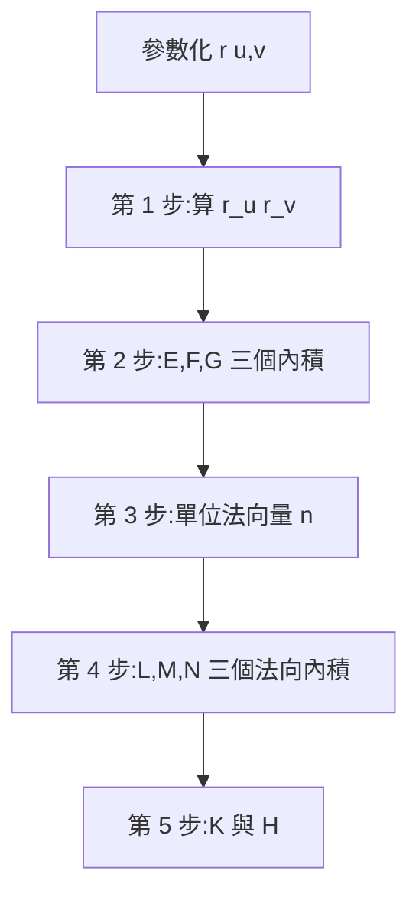
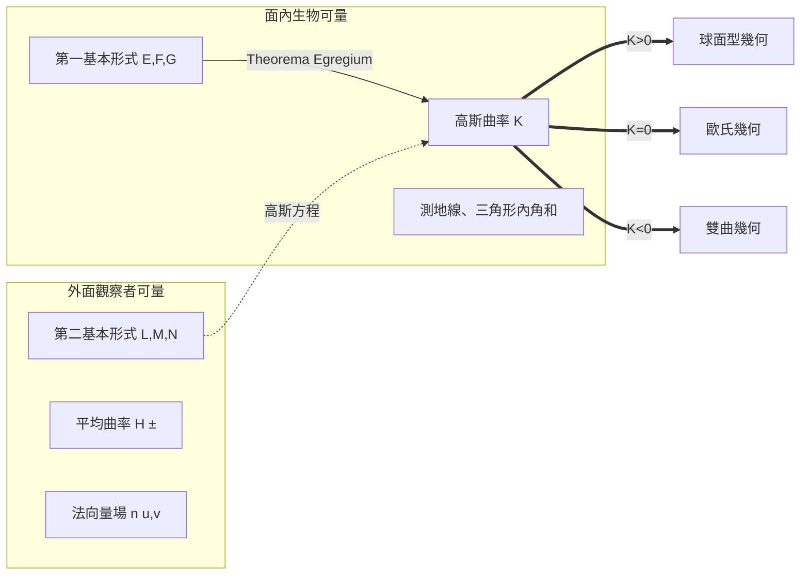

# 9.2 曲線與曲面：曲率、第一基本形式

**曲率是幾何的「局部天氣」：曲線上它告訴你車要轉多急，
曲面上它告訴你面內生物量到的空間有多彎。**

---

## 學習動機

上一節（9.1）我們直奔高斯的絕妙定理，把曲面的「內蘊曲率」一次講完。
但層層推導裡其實藏著兩個更基礎的問題我們太快跳過了：

1. **一條曲線的曲率到底是什麼？**
   為什麼要除以速度的三次方？為什麼曲率與撓率（torsion）能唯一確定
   一條曲線的形狀？
2. **曲面的第一基本形式是怎麼從切向量算出來的？**
   $`E, F, G`$ 究竟如何在 SymPy 流程中一步步現身？

這一節把基礎補齊。歷史上，這一整套「沿曲線運動 → 丈量轉彎的快慢（曲率）」的
框架是**運動學的產物**：十八世紀的數學家（Euler 建立剛體運動的寫法、
Monge 的葉形幾何及其學生 Dupin、Meusnier）不斷在問：
*一輛車沿曲線跑、法向盤撐在轉彎處，切線方向的翻轉有多快？*
接著 Gauss 開啟曲面道路，而 Frenet（以及幾乎同時的 Serret）在
1847 年把曲線框架系統化為 $`\mathbf{T}`$ - $`\mathbf{N}`$ - $`\mathbf{B}`$ 三元組。

這也是本章節內容進一步往第 10 章（電腦圖學的樣條路徑、NURBS）、
以及物理學（Frenet 框架的協變加速、廣義相對論測地線）
鋪路的節骨。

在本節中，我們將：

1. 參數化一條曲線 $`\mathbf{r}(t)`$ ，討論切向量與弧長參數化。
2. 建立 Frenet–Serret 框架（ $`\mathbf{T}, \mathbf{N}, \mathbf{B}`$ ），
   給出曲率 $`\kappa`$ 與撓率 $`\tau`$ 。
3. 推導**任意參數**下的曲率公式
   $`\kappa = |\mathbf{r}' \times \mathbf{r}''| / |\mathbf{r}'|^3`$ ，
   並看到「除以 $`|\mathbf{r}'|^3`$ 」是自然的。
4. 流程化地計算曲面的第一、第二基本形式。
5. 沿途用 SymPy 驗證（螺旋線、拋物面、球面等）。

---

## 1. 參數化曲線：速度決定一切（但曲率不跟速度走）

一條參數化曲線是

$$
\mathbf{r}(t) = \bigl(x(t), y(t), z(t)\bigr), \quad t \in [a, b]
$$

它的**速度**是

$$
\mathbf{r}\,'(t) = (x'(t), y'(t), z'(t)), \quad
|\mathbf{r}\,'(t)|  \text{ 是速率}
$$

如果速率滿足 $`|\mathbf{r}\,'(t)| = 1`$ ，我們稱 $`\mathbf{r}`$ 以
**弧長參數化**（一般用參數 $`s`$ 記之）：
這時走過的距離就是參數本身的長度

$$
s(t) = \int_a^t |\mathbf{r}\,'(u)| \, du
$$

**一條幾何曲線**乃是「相同的點集合」的多種參數化中的一種等價類。
其中**曲率不跟速度走**：無論你以 $`2x`$ 速度（比如 $`t = \tilde t / 2`$ ）
還是其他參數量測，都得到相同的曲率數值。
這是整節的第一個「不變量」精神：

> 跟幾何有關的量，需要在**任何參數重標**下是不變的。

### SymPy：弧長

```python
import sympy as sp

t, s = sp.symbols('t s', real=True)
a, b = sp.symbols('a b', positive=True)

# 螺旋線 (helix)
r = sp.Matrix([a*sp.cos(t), a*sp.sin(t), b*t])
speed = sp.simplify(r.diff(t).norm())
print("speed =", speed)
# ==>
# speed = sqrt(a**2 + b**2)

# 從 t = 0 到 t = s 走了多遠
arc = sp.simplify(sp.integrate(speed, (t, 0, s)))
print("arc length =", arc)
# ==>
# arc length = s*sqrt(a**2 + b**2)
```

螺旋線的**速率**是常數 $`\sqrt{a^2 + b^2}`$ ：它繞圓柱上升時是一條
直線從平面捲起來的等價物，
而**這**就是本節第二個重點：曲線與曲面都是『底層幾何 + 參數化方式』的產物。

---

## 2. Frenet–Serret 框架

設 $`\mathbf{r}(t)`$ 為一條參數化曲線（ $`\mathbf{r}\,' \neq 0`$ ，且 $`\mathbf{r}\,' \times \mathbf{r}\,'' \neq 0`$ ，
即曲線局部不塌到直線上）。定義單位切向量

$$
\mathbf{T}(t) = \frac{\mathbf{r}\,'(t)}{|\mathbf{r}\,'(t)|}
$$

它是「當下的行進方向」。求導（在**弧長參數**下會好算很多：以 $`s`$ 記之
時 $`\mathbf{T}'(s)`$ 就是加速度的切向分量）：

$$
\frac{d\mathbf{T}}{ds} = \kappa \, \mathbf{N}, \quad \kappa = \left| \frac{d\mathbf{T}}{ds} \right|
$$

其中 $`\mathbf{N}`$ 是「單位主法向量」，
$`\kappa`$ 是**曲率**； $`1/\kappa`$ 是曲率半徑（曲線逼近的圓半徑）。

再來定義副法向量：

$$
\mathbf{B} = \mathbf{T} \times \mathbf{N}
$$

於是 $`\{ \mathbf{T}, \mathbf{N}, \mathbf{B}\}`$ 為右手標架，
沿曲線扭著跑。Frenet–Serret 公式：

$$
\frac{d\mathbf{T}}{ds} = \kappa \, \mathbf{N}, \qquad
\frac{d\mathbf{N}}{ds} = -\kappa \, \mathbf{B} \times \mathbf{N} = -\kappa \mathbf{T} + \tau \, \mathbf{B}, \qquad
\frac{d\mathbf{B}}{ds} = -\tau \, \mathbf{N},
$$

其中 $`\tau`$ 是**撓率**（torsion）：描述曲線**脫離平面**的速率
（ $`\tau = 0 \Longleftrightarrow`$ 曲線是平面曲線）。

**「唯一成形」定理（有符號調整）**：確定一條帶方向（directed）的曲線，
只需要 $`\kappa(s) > 0`$ 和 $`\tau(s)`$ 兩個函數——知道曲率的變化方式與
撓率的變化方式，曲線形狀就完全決定（的確是 **up to 等距變換**）——
這個 theorem 給了我們一個「曲線被困在自己的曲率中」的圖景，
同時也是第 10 章 CAD 樣條曲線還原曲線的關鍵。

### 用 SymPy 建構 Frenet 框架

```python
import sympy as sp

def frenet(r, t):
    """給入參數化曲線 r(t) (SymPy given a matrix)，傳回 T, N, B, kappa, tau。"""
    r1  = sp.Matrix([sp.simplify(x) for x in r.diff(t)])
    spd = sp.simplify(r1.norm())
    T = sp.simplify(r1 / spd)

    T1 = sp.simplify(T.diff(t))
    T1n = sp.simplify(T1.norm())
    kappa = sp.simplify(T1n / spd)           # 參數重標不變
    N  = sp.simplify(T1 / T1n)

    B = sp.simplify(T.cross(N))

    # tau = -dB/ds . N = -(dB/dt . N) / spd
    tau = sp.simplify(-sp.simplify(B.diff(t)).dot(N) / spd)
    return T, N, B, kappa, tau

t = sp.symbols('t', real=True)
a, b = sp.symbols('a b', positive=True)
r_helix = sp.Matrix([a*sp.cos(t), a*sp.sin(t), b*t])
T, N, B, kappa, tau = frenet(r_helix, t)

print("kappa =", kappa)
print("tau =", tau)
# ==>
# kappa = a/(a**2 + b**2)
# tau = b/(a**2 + b**2)
```

**重要驗證**：螺旋線的 $`\kappa = a/(a^2 + b^2)`$ ， $`\tau = b/(a^2+b^2)`$ ，
兩者的**比值**為 $`\kappa/\tau = a/b`$ ——螺旋線的每一圈角度為
$`2\pi b / \sqrt{a^2+b^2}`$ 的上升 — 完全由比率 $`\tau / \kappa`$ 決定。
雙向驗證：若取 $`b=0`$ （純圓），則 $`\tau = 0`$ ✓（平面曲線），
若退化到 $`a = 0`$ （可以直接沿 $`z`$ 軸走直線），則 $`\kappa = 0`$ ✓。

### 正交性的檢查

```python
print("T.N =", sp.simplify(T.dot(N)))
print("T.B =", sp.simplify(T.dot(B)))
print("N.B =", sp.simplify(N.dot(B)))
# ==>
# T.N = 0  T.B = 0  N.B = 0
```

---

## 3. 任意參數下的曲率公式：為什麼除以 $`|\mathbf{r}'|^3`$

上一段我們定義 $`\kappa = |d\mathbf{T}/ds|`$ ，但在實作層面，
把 $`s(t)`$ 求出再重參數化，計算代價不小。
幸好有一條可以在**任意參數**下直接使用的公式

$$
\kappa
= \frac{ \left| \mathbf{r}\,' \times \mathbf{r}\,'' \right| }
       { \left| \mathbf{r}\,' \right|^3 }
$$

**直觀推導**（用一個 $`\times`$ 的幾何意義）：

$`\mathbf{r}\,' = v \mathbf{T}`$ （ $`v = |\mathbf{r}\,'|`$ 為速率），求導：

$$
\mathbf{r}\,'' = v\,' \, \mathbf{T} + v \frac{d\mathbf{T}}{dt}
$$

利用 $`\dfrac{d\mathbf{T}}{dt} = v \, \dfrac{d\mathbf{T}}{ds} = v \kappa \mathbf{N}`$
（連鎖法則）：

$$
\mathbf{r}\,'' = v\,' \, \mathbf{T} + v^2 \kappa \, \mathbf{N}
$$

叉積：

$$
\mathbf{r}\,' \times \mathbf{r}\,''
 = v \mathbf{T} \times ( v\,' \mathbf{T} + v^2 \kappa \mathbf{N})
 = v^3 \kappa \, (\mathbf{T} \times \mathbf{N})
$$

取長度即得 $`\left| \mathbf{r}\,' \times \mathbf{r}\,'' \right| = v^3 \kappa`$ 。
**除以 $`v^3`$ 的來源**一目了然：一項來自速度大小線性增益 ×
兩項來自於加速度轉向分量的 $`v^2`$ 增益。這條公式也讓對
**任何參數化下**、無需重參數化即可算曲率 ✓。

### SymPy 推導：用符號 $`x(t), y(t)`$ 做二維公式

```python
import sympy as sp

t = sp.symbols('t', real=True)
x, y = sp.Function('x')(t), sp.Function('y')(t)

# 二維情形：把「叉積」用 z-分量方式 (wedge = x'y'' - x''y') 表示，
# 並給出相應的 |r'|^3 = (x'^2 + y'^2)^(3/2)
w     = sp.simplify(x*sp.diff(y, t, 2) - sp.diff(x, t, 2)*y)
k2d   = sp.simplify(w / (sp.diff(x,t)**2 + sp.diff(y,t)**2)**sp.Rational(3, 2))
print("kappa_2D =", k2d)
# ==>
# kappa_2D = (x(t)*Derivative(y(t), (t, 2))
#             - y(t)*Derivative(x(t), (t, 2))) /
#            (Derivative(x(t), t)**2 + Derivative(y(t), t)**2)**(3/2)
```

代入拋物線 $`\mathbf{r}(t) = (t, t^2)`$ ：

```python
tt = sp.symbols('tt', real=True)
r_p = sp.Matrix([tt, tt**2, sp.Integer(0)])   # 熱身：加個 0 進來化為三維
rx = sp.simplify(r_p.diff(tt).cross(r_p.diff(tt, 2)))
kappa = sp.simplify(rx.norm() / r_p.diff(tt).norm()**3)
print("parabola kappa =", kappa)
print("kappa at vertex =", kappa.subs(tt, 0))
# ==>
# parabola kappa = 2/(4*tt**2 + 1)**(3/2)
# kappa at vertex = 2
```

**驗證**：對 $`y = a x^2`$ 型的拋物線，頂點處 $`y\,'' = 2a`$ （切線水平、
所以 $`d\mathbf{T}/ds`$ 恰為 $`y''`$ ），故頂點曲率 $`\kappa(0) = 2a`$ ；
當 $`a = 1`$ 時 $`\kappa = 2`$ 、曲率半徑 $`1/\kappa = 1/2`$ ✓。
它不只是熟能生巧——第 10 章我們還會再把這個頂點曲率半徑帶進
樣條曲線中。

### 注意：速度影響分子分母同時

**如果用一個「重參數化」 $`\mathbf{r}(t) = \tilde{\mathbf{r}}(\varphi(t))`$ ，
這兩個分量將會同時個別改變；
而它們的比值，經分母的三次方抵銷，是不變的。** 這是曲率
在「參數相對性」下的 invariance——一個提前的小克萊因綱領。
SymPy 可以驗證這不變性（習題 9.2.3）。

---

## 4. 撓率（torsion）：曲線如何「逃離平面」

撓率 $`\tau`$ 的意義是：副法向量 $`\mathbf{B}`$ 沿弧長旋轉的速率。
跟曲率不同的是，**撓率允許正負**（ $`\mathbf{B}`$ 往左偏或往右偏）；
兩個手性且鏡像的螺旋線有相同的曲率但 $`\tau`$ 的符號相反。

**任意參數下**之公式等同（用 $`\mathbf{r}'''\cdot (\mathbf{r}'\times \mathbf{r}'')`$ ）：

$$
\tau = \frac{ \left( \mathbf{r}\,' \times \mathbf{r}\,'' \right)
             \cdot \mathbf{r}\,''' }
             { \left| \mathbf{r}\,' \times \mathbf{r}\,''\right|^2 }
$$

用 SymPy 檢查兩套公式：

```python
import sympy as sp

t = sp.symbols('t', real=True)
a, b = sp.symbols('a b', positive=True)
r_helix = sp.Matrix([a*sp.cos(t), a*sp.sin(t), b*t])

# 法一：Frenet 一步步
r1 = sp.simplify(r_helix.diff(t))
T  = sp.simplify(r1 / r1.norm())
T1 = sp.simplify(T.diff(t)); T1n = sp.simplify(T1.norm())
N  = sp.simplify(T1 / T1n)
B  = sp.simplify(T.cross(N))
tau1 = sp.simplify(-sp.simplify(B.diff(t)).dot(N) / r1.norm())
print("tau (Frenet, all-parameter) =", tau1)
# ==>
# tau (Frenet, all-parameter) = b/(a**2 + b**2)

# 法二：純行列式公式
r2 = sp.simplify(r_helix.diff(t).cross(r_helix.diff(t, 2)))
tau2 = sp.simplify(r2.dot(r_helix.diff(t, 3)) / r2.norm()**2)
print("tau (det formula) =", tau2)
# ==>
# tau (det formula) = b/(a**2 + b**2)
```

**驗證**：兩個公式一致 ✓。並且取 $`b \to 0`$ 得 $`\tau \to 0`$ （平面 ✓）。

---

## 5. 從曲線到曲面：第一基本形式的計算流程

現在我們回頭確實建立曲面的計算流程。
在 9.1 我們已經給了 $`E, F, G`$ 的定義；在這裡，把它變成
五步清楚、可重複的流程，讓每一步對應一個 SymPy 函數。

### 5.1 五步流程



**一個通用的 SymPy 曲面幾何 helper：**

```python
import sympy as sp

def surf_geometry(r, u, v, normal_manual=None):
    """給一個參數化曲面 r(u,v)，回傳其
       (E, F, G), (L, M, N), K, H, n, det_metric。
    參數 normal_manual 可指定 n 的符號化（例如 n = r/R for 球面）。
    """
    ru  = r.diff(u)
    rv  = r.diff(v)

    E = sp.simplify(ru.dot(ru))
    F = sp.simplify(ru.dot(rv))
    G = sp.simplify(rv.dot(rv))

    cru = sp.simplify(ru.cross(rv))
    if normal_manual is None:
        n = sp.simplify(cru / cru.norm())
    else:
        n = normal_manual

    L = sp.simplify(r.diff(u, 2).dot(n))
    M = sp.simplify(sp.simplify(r.diff(u, 1, v, 1)).dot(n))
    N = sp.simplify(r.diff(v, 2).dot(n))

    det_metric = sp.simplify(E*G - F**2)
    K = sp.simplify((L*N - M*M) / det_metric)
    H = sp.simplify((E*N - 2*F*M + G*L) / (2*det_metric))
    return (E, F, G), (L, M, N), K, H, n, det_metric
```

### 5.2 球面：美得對稱

```python
R = sp.symbols('R', positive=True)
th, ph = sp.symbols('theta phi', real=True)
r_s = sp.Matrix([R*sp.sin(ph)*sp.cos(th),
                 R*sp.sin(ph)*sp.sin(th),
                 R*sp.cos(ph)])

n_manual = sp.simplify(r_s / R)     # 用幾何直覺選定法向量（避免 Abs(sin) 這種代數噪音）
(E, F, G), (L, M, N), K, H, n, detG = surf_geometry(
    r_s, th, ph, normal_manual=n_manual)

print("E, F, G =", E, F, G)
print("L, M, N =", sp.trigsimp(L), sp.trigsimp(M), sp.trigsimp(N))
print("K =", K, "   H =", sp.trigsimp(H))
print("det G =", detG)
# ==>
# E, F, G = R**2*sin(phi)**2 0 R**2
# L, M, N = -R*sin(phi)**2 0 -R
# K = 1/R**2   H = -1/R
# det G = R**4*sin(phi)**2
```

**幾何上的注解**：

- $`E, F, G`$ 中「 $`G`$ 恰為 $`R^2`$ 」而「 $`E`$ 乘上 $`\sin^2\varphi`$ 」：
  沿經度（ $`\theta`$ ）走時，愈靠近極點，同一個 $`d\theta`$ 走得愈短——
  這正是地表測量早就知道的事實（高緯度的兩條經線比較靠近）。
- $`\mathrm{II} = -R ( \sin^2\varphi \, d\theta^2 + d\varphi^2 )`$ ，
  球面「每一個方向都是一樣彎」：它是 $`K`$ 常數曲面的代表案例。
- $`H = -1/R`$ 的**負號**來自法向量選擇：我們取了 $`\mathbf{n} = \mathbf{r}/R`$
  （指向球外）；若改取 $`\mathbf{n} = -\mathbf{r}/R`$ （指向球心，這也是
  $`\mathbf{r}_\theta \times \mathbf{r}_\varphi`$ 的自然朝向），便得 $`H = +1/R`$ 。
  而 $`K = 1/R^2`$ 不受影響：這就說明 $`K`$ 不依賴法向量的選擇、
  $`H`$ 依賴（這就是 9.1 那個絕妙定理的細節張力）。

### 5.3 圓柱面：可以攤平的曲面

```python
u, v = sp.symbols('u v', real=True)
a = sp.symbols('a', positive=True)
r_c = sp.Matrix([a*sp.cos(v), a*sp.sin(v), u])

(E, F, G), (L, M, N), K, H, n, detG = surf_geometry(r_c, u, v)
print("E, F, G =", E, F, G)
print("L, M, N =", L, M, N)
print("K =", K, "   H =", H)
# ==>
# E, F, G = 1 0 a**2
# L, M, N = 0 0 a
# K = 0   H = 1/(2*a)
```

**重要事實**： $`K = 0`$ 但 $`H \neq 0`$ 。
圓柱面在**外面**看是有「彎」（ $`\mathrm{II}`$ 有一個非零方向），
但**在裡面**看是「平」的：螞蟻在圓柱面內的各種量測
（三角形內角和、圓周長）跟在平面一樣。
這就是**曲率無共存現象（彈性之 vs 形之）的簡單例子**——紙捲成柱面不會撕破，
是因為這個過程是**等距變換**（保留 $`E, F, G`$ 、因而保留 $`K`$ = 0）。
這其實也是日常生活的事實：**只有 Gaussian 曲率 0 的曲面可被展開成平面**
（在一張紙上折角、捲成筒可以，捲成球殼不行—這就是「地圖不可能完美」的根源）。

### 5.4 鞍面：負曲率的例子

```python
x, y = sp.symbols('x y', real=True)
r_d = sp.Matrix([x, y, x**2 - y**2])    # 雙曲拋物面

(E, F, G), (L, M, N), K, H, n, detG = surf_geometry(r_d, x, y)
print("E, F, G =", E, F, G)
print("n =", n.T)
print("K =", K)
print("H =", H)
# ==>
# E, F, G = 4*x**2 + 1 -4*x*y 4*y**2 + 1
# n = Matrix([[-2*x/sqrt(4*x**2 + 4*y**2 + 1)],
#             [2*y/sqrt(4*x**2 + 4*y**2 + 1)],
#             [1/sqrt(4*x**2 + 4*y**2 + 1)]])
# K = -4/(16*x**4 + 32*x**2*y**2 + 8*x**2 + 16*y**4 + 8*y**2 + 1)
# H = 4*(y**2 - x**2)/(4*x**2 + 4*y**2 + 1)**(3/2)
```

**注解**：

- $`E = 4x^2 + 1`$ 、 $`F = -4xy`$ 、 $`G = 4y^2 + 1`$ ：
  這是一個「隨位置變化的度量」——這正是 9.1 的
  $`\mathrm{I}`$ 的**意義**：畢氏定理的局部變體。
- $`K < 0`$ ：鞍面上三角形內角和**小於** $`180°`$
  （在離原點愈近的位置情形愈接近 $`180°`$ ，因為 $`K(0,0) = -4`$ 但
  愈遠愈趨近 0）。
- 在原點 $`K = -4`$ ；在遠離處 $`K \to 0`$ （漣漪展開直線化）。

---

## 6. 從測量的視角：內蘊與外蘊



**內蘊的資訊**（第一基本形式與其推衍——曲率 $`K`$ 、測地線、面積、
角和等）是面內生物可測；**外蘊的資訊**（第二基本形式、平均曲率 $`H`$
的符號等等）則需要含「附件」的空間才能知道。

這種二分是本書第 6 章**黎曼幾何**的主體：
在黎曼之前的說法，空間默認「放在某個更大的空間裡、
從外面量」；黎曼之後，空間自己攜帶度量 $`g_{ij}`$
（就是第一基本形式的推廣），以及伴隨的曲率張量
$`R^i{}_{jkl}`$ （就是 Christoffel 推衍的推廣），從此全
內蘊。

所以說，「曲率與第一基本形式」不只是微分的工具，
而是把「幾何分成內蘊／外蘊」這門思想革命的文章。

---

## 7. 小結

- **曲線**：先用弧長重參數化，再得到各種參數無關的不變量：
  Frenet $`\mathbf{T} - \mathbf{N} - \mathbf{B}`$ 框架、 $`\kappa`$ 與 $`\tau`$
  完全決定曲線的形狀（唯一成形定理）。公式
  $`\kappa = |\mathbf{r}'\times\mathbf{r}''|/|\mathbf{r}'|^3`$ 、
  $`\tau = (\mathbf{r}'\times\mathbf{r}'') \cdot \mathbf{r}''' / |\mathbf{r}'\times\mathbf{r}''|^2`$
  可以直接由 SymPy 推導。
- **曲面**： 五步流程（ $`E, F, G`$ → $`\mathbf{n}`$ → $`L, M, N`$ →
  $`K, H`$ ）是牢記節奏；接著 9.3 這一節我們將用這個流程在
  程式上帶入參數化，自動計算 $`K`$ 。
- **內蘊 vs 外蘊**：第一基本形式是內蘊量、
  第二基本形式與 $`H`$ 的符號則是外蘊量——
  這是古典微分幾何觀念的根基。

在下一節（9.3）我們會用一系列完整的 SymPy 演則——球面、圓柱面、
鞍面——把以上的流程具體化，讓一套 helper 在任意情況下都可工作。

---

## 習題 9.2

> 編程提示：沿用本章之 `frenet(r, t)`、`surf_geometry(r, u, v, normal_manual)`
> 等函數。

**習題 9.2.1（橢圓的曲率）**
橢圓參數化為 $`\mathbf{r}(t) = (a\cos t, b\sin t, 0)`$ ， $`a, b > 0`$ 。
用本節之輔助函式計算 $`\kappa(t)`$ ；然後計算在 $`(a, 0)`$ 與 $`(0, b)`$
處的曲率，並驗證「極大曲率在長軸端點」。
（答案： $`\kappa(t) = \dfrac{ab}{(a^2\sin^2 t + b^2\cos^2 t)^{3/2}}`$ ，
故 $`\kappa(a, 0) = a/b^2`$ 、 $`\kappa(0, b) = b/a^2`$ 。）

**習題 9.2.2（平面曲線 $`\tau = 0`$ ）**
三維空間中的平面曲線，例如 $`\mathbf{r}(t) = (\cos t, \sin t, 0)`$ ，
確認其 $`\tau(t) = 0`$ ；與其推廣 $`\mathbf{r}(t) = (\cos t, \sin t, \cos t + \sin t)`$
——仍在某個平面裡面（是哪個平面？）——也驗證 $`\tau = 0`$ 。
（提示：三個座標滿足 $`z = x + y`$ ，所以曲線整條落在平面 $`z = x + y`$ 上。）

**習題 9.2.3（參數重標的不變性）**
考慮曲線 $`\tilde{\mathbf{r}}(s) = (\cos s, \sin s, s)`$ （單位螺旋線），
再做重參數化 $`\mathbf{r}(t) = \tilde{\mathbf{r}}(2t)`$ 。
分別計算 $`\kappa_{\tilde{\mathbf{r}}}`$ 與 $`\kappa_{\mathbf{r}}`$ ，確認相等。
（解釋： $`\mathbf{r}\,' = 2\tilde{\mathbf{r}}\,'`$ 、
$`\mathbf{r}\,'' = 4\tilde{\mathbf{r}}\,''`$ ，所以分子 $`|\mathbf{r}\,'\times\mathbf{r}\,''|`$
變成 $`8`$ 倍，而分母 $`|\mathbf{r}\,'|^3`$ 也變成 $`8`$ 倍——比值不變。）

**習題 9.2.4（第一基本形式矩陣）**
在雙曲拋物面 $`\mathbf{r}(x, y) = (x, y, x^2 - y^2)`$ 上，用 `surf_geometry`
算出 $`E, F, G`$ 。把它寫成矩陣
$`\mathbf{G}[x,y] = \begin{pmatrix} E & F \\ F & G \end{pmatrix}`$ ，
計算 $`\det \mathbf{G}`$ ，並化簡。你應該得到
$`\det \mathbf{G} = 4x^2 + 4y^2 + 1 = |\mathbf{r}_x \times \mathbf{r}_y|^2`$ ，
這正是面積元素 $`dA = \sqrt{\det \mathbf{G}}\, dx\, dy`$ 的出處：
第一基本形式不只是量長度，也是量面積。

**習題 9.2.5（思考題：同一平面的兩種度量）**
考慮「極座標」參數化的平面
$`\mathbf{r}(r, \theta) = (r\cos\theta, r\sin\theta, 0)`$ 。
計算 $`E, F, G`$ （你應得到 $`E = 1, F = 0, G = r^2`$ ，仍指向同一個平面）
與它跟直角座標參數化 $`\mathbf{r}(u, v) = (u, v, 0)`$ 的
$`E = 1, F = 0, G = 1`$ 比較。
兩個參數化描述**同一個**平面； $`E, F, G`$ 卻不同——
這說明第一基本形式是「參數化 + 曲面」的資料、
而非曲面單獨的資料。用 `intrinsic_K`（9.1 節）驗證兩組 $`(E,F,G)`$
算出之 $`K`$ 都是 $`0`$ 。
