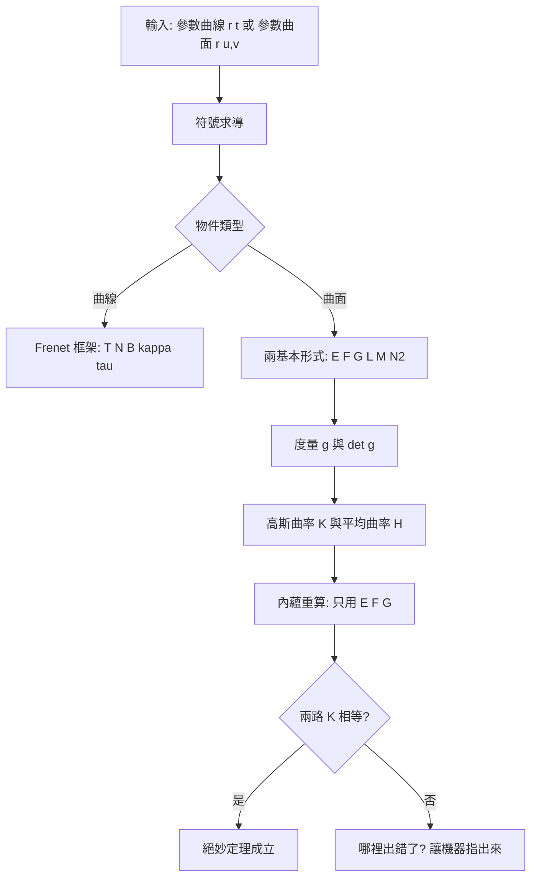
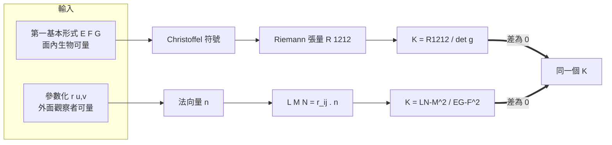
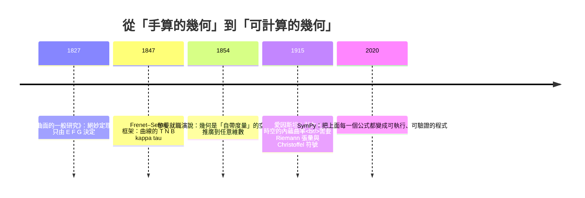

# 9.3 用 SymPy 計算曲線曲率與曲面度量

**手算會出錯；讓機器替你把每一步都寫出來，它就不會出錯——
而且它還會把你出錯的地方指出來。**

---

## 學習動機

前面兩節（9.1 與 9.2）把高斯內蘊幾何的**理論**鋪好了：
絕妙定理說曲率是內蘊量，第一基本形式決定度量，
第二基本形式給出彎曲的方向。但理論歸理論，
真正要「算」的時候，我們立刻撞上一面牆——**手算的牆**。

試着自己推一遍球面的高斯曲率。你會寫下

$$
\mathbf{r}(u,v) = \bigl(R\sin u \cos v,\; R\sin u \sin v,\; R\cos u\bigr),
\quad u \in (0, \pi),\ v \in [0, 2\pi)
$$

然後要算 $`\mathbf{r}_u`$ 、 $`\mathbf{r}_v`$ 、法向量 $`\mathbf{n}`$ ，
再把三個二階導數 $`\mathbf{r}_{uu}, \mathbf{r}_{uv}, \mathbf{r}_{vv}`$
分別投影到 $`\mathbf{n}`$ 上——手上是六個分量、三次內積、
一個正規化的分母 $`\sqrt{|\mathbf{r}_u \times \mathbf{r}_v|}`$ 。
用一張草稿紙做得到的話，只要其中一個 $`\sin`$ 記成了 $`\cos`$ ，
或是最後的 $`\det g`$ 少減了一次 $`F^2`$ ，
你就會得到一個**看起來很合理、但錯了**的答案。
更糟的是：**你不知道它錯了。**
$`1/R^2`$ 和 $`1/(2R^2)`$ 在紙上看起來差不多；
球面和柱面在「平面曲線的直覺」裡長得也不像，
所以一個手算的 $`K`$ 值幾乎沒有自我檢查的能力。

這就是本節要反轉的東西：

> **讓符號運算承擔「手算」的部分：**
> 人負責提出假設與選擇符號，機器負責求導、化簡、與**比對**。

SymPy 在這件事上有三個天賦：**不會忘記 $`\tfrac12`$ **（展開式裡的係數、
內積裡的每一項，機器都一視同仁地處理）；
**化簡到「同一個東西」的樣子**（手寫的 $`R^2\sin^2 u`$ 與
$`R^2 - R^2\cos^2 u`$ 你可能看不出是同一個式子，SymPy 的 `simplify` 看得出來）；
**可以「反推」**（給它 $`E, F, G`$ ，讓它用 Christoffel 符號與 Riemann 張量
算出 $`K`$ ；再給它 $`\mathbf{r}(u,v)`$ ，讓它用第二基本形式算出 $`K`$ 。
**兩個答案相等嗎？** 這就是絕妙定理的**程式化證明**。）

這也正是全書的主軸：幾何不是紙上的定理，
而是**可以用程式生產、驗證、與視覺化的東西**。
第 6 章我們用 SymPy 畫過龐加萊圓盤模型，第 8 章我們寫過 Delaunay 三角剖分；
本節要做的，是把「微分幾何」也拉進這個世界。



---

## 1. 符號幾何工具箱

先把本節會反覆用到的函式寫好。它們不是「玩具」——
它們就是 9.1 與 9.2 的五步流程的程式化版本。

```python
import sympy as sp

def clean(expr):
    """simplify 對三角函數有時不夠強，補一層 trigsimp。"""
    return sp.simplify(sp.trigsimp(sp.simplify(expr)))

def tidy(expr, t):
    """把三角式整理成以 cos(t) 為主的形式（給輸出報表用）。"""
    e = sp.simplify(sp.expand_trig(expr))
    e = e.subs(sp.sin(t)**2, 1 - sp.cos(t)**2)
    return sp.simplify(sp.expand_trig(e))

def frenet_frame(r, t):
    """參數化曲線 r(t) (SymPy Matrix) -> (T, N, B, kappa, tau)。"""
    r1 = sp.Matrix([clean(x) for x in r.diff(t)])
    spd = clean(r1.norm())                        # 速率 |r'|
    T = sp.Matrix([clean(x) for x in r1 / spd])    # 單位切向量
    T1 = sp.Matrix([clean(x) for x in T.diff(t)])
    T1n = clean(T1.norm())
    kappa = clean(T1n / spd)                      # kappa = |dT/ds|
    N = sp.Matrix([clean(x) for x in T1 / T1n])
    B = sp.Matrix([clean(x) for x in T.cross(N)])
    tau = clean(-sp.Matrix([clean(x) for x in B.diff(t)]).dot(N) / spd)
    return T, N, B, kappa, tau

def plane_kappa(xf, yf, t):
    """平面曲線 (x(t), y(t)) 的曲率 |x'y''-y'x''| / (x'^2+y'^2)^(3/2)。"""
    r = sp.Matrix([xf, yf, sp.Integer(0)])
    r1 = r.diff(t); cr = r1.cross(r.diff(t, 2))
    return clean(cr.norm() / r1.norm()**3)

def surface_forms(r, u, v, normal_manual=None):
    """參數曲面 r(u,v) -> (E,F,G), (L,M,N2), det_g, K, H, n, g, b。
    記號取捨：第二基本形式的第三個分量記作 N2（避免與法向量 n 混淆）。"""
    ru = r.diff(u); rv = r.diff(v)
    E = clean(ru.dot(ru)); F = clean(ru.dot(rv)); G = clean(rv.dot(rv))
    if normal_manual is None:
        cru = clean(ru.cross(rv))
        n = sp.Matrix([clean(x) for x in cru / cru.norm()])
    else:
        n = normal_manual
    L = clean(r.diff(u, 2).dot(n))        # r_uu . n
    M = clean(r.diff(u, 1, v, 1).dot(n))  # r_uv . n
    N2 = clean(r.diff(v, 2).dot(n))       # r_vv . n
    det_g = clean(E * G - F**2)
    return dict(E=E, F=F, G=G, L=L, M=M, N2=N2, det_g=det_g,
                K=clean((L*N2 - M**2) / det_g),
                H=clean((E*N2 - 2*F*M + G*L) / (2 * det_g)),
                n=n, g=sp.Matrix([[E, F], [F, G]]), b=sp.Matrix([[L, M], [M, N2]]))

def christoffel(E, F, G, u, v):
    """第一基本形式 -> Christoffel 符號 Gamma[m][A][B]（0<->u, 1<->v）。"""
    g = sp.Matrix([[E, F], [F, G]]); ginv = g.inv(); coords = [u, v]
    gd = [[[sp.diff(g[i, j], coords[l]) for l in range(2)]
            for j in range(2)] for i in range(2)]
    Gamma = [[[None]*2 for _ in range(2)] for _ in range(2)]
    for m in range(2):
        for A in range(2):
            for B in range(2):
                Gamma[m][A][B] = sp.simplify(sum(
                    ginv[m, c]*(gd[B][c][A] + gd[A][c][B] - gd[A][B][c])/2
                    for c in range(2)))
    return Gamma

def intrinsic_K(E, F, G, u, v):
    """內蘊高斯曲率 K = R_{1212} / (EG - F^2)：只用 E, F, G。"""
    Gamma = christoffel(E, F, G, u, v); coords = [u, v]
    def ri(r, sidx, mu, nu):      # R^r_{s mu nu}，符號約定見 9.1
        s = (sp.diff(Gamma[r][nu][sidx], coords[mu])
             - sp.diff(Gamma[r][mu][sidx], coords[nu]))
        for lam in range(2):
            s += (Gamma[r][mu][lam]*Gamma[lam][nu][sidx]
                  - Gamma[r][nu][lam]*Gamma[lam][mu][sidx])
        return sp.simplify(s)
    R1212 = sp.simplify(E*ri(0, 1, 0, 1) + F*ri(1, 1, 0, 1))
    return sp.simplify(R1212 / (E*G - F**2))

def geodesic_residuals(E, F, G, u, v):
    """測地線方程左邊（殘差）：(eq_u, eq_v)，其中 u = us(s), v = vs(s)。"""
    Gamma = christoffel(E, F, G, u, v)
    s = sp.Symbol('s', real=True)
    us = sp.Function('us')(s); vs = sp.Function('vs')(s)
    eq_u = sp.simplify(sp.diff(us, s, 2)
                        + Gamma[0][0][1]*sp.diff(us, s)*sp.diff(vs, s)
                        + Gamma[0][1][1]*sp.diff(vs, s)**2)
    eq_v = sp.simplify(sp.diff(vs, s, 2)
                        + Gamma[1][0][0]*sp.diff(us, s)**2
                        + 2*Gamma[1][0][1]*sp.diff(us, s)*sp.diff(vs, s))
    return eq_u, eq_v

def check_geodesic(eq_u, eq_v, u, uval, vval):
    """把 (u(s), v(s)) 的解代進測地線方程，檢查殘差是否為 0。"""
    s = sp.Symbol('s', real=True)
    subs = {sp.Function('us')(s): uval, sp.Function('vs')(s): vval}
    return (sp.simplify(eq_u.subs(subs).subs(u, uval)),
            sp.simplify(eq_v.subs(subs).subs(u, uval)))
```

**三個設計決定：**

1. **`clean` 為什麼多包一層 `trigsimp`？** `simplify` 擅長代數恆等式，
   對三角恆等式（ $`\sin^2 + \cos^2 = 1`$ 、倍角公式）則力有未逮；
   9.2 裡我們已看過 `trigsimp` 把 $`\cos(2t)`$ 化回 $`\cos^2 t - \sin^2 t`$ 的威力。
   `tidy` 則是給「輸出報表」用的排版工具，
   把 $`\sin(3t)`$ 、 $`\cos(5t)`$ 的混合體整理成乾淨的 $`\cos t`$ 形式。

2. **`surface_forms` 為什麼有 `normal_manual` 參數？**
   當法向量由 $`\mathbf{r}_u \times \mathbf{r}_v`$ 自動算出來時，
   它的模長會帶上 $`\sqrt{\text{一堆平方和}}`$ ；在球面上這會變成
   $`\mathrm{Abs}(\sin u)`$ 這種噪音符號。
   用幾何直覺直接指定 $`\mathbf{n} = \mathbf{r}/R`$ （朝外），表達會乾淨很多——
   **這是符號運算的重要修養：讓代數去配合你的意圖，而不是相反。**

3. **第二基本形式的第三個分量為什麼叫 `N2` 而不是 `N`？**
   教科書傳統把第二基本形式寫成 $`L, M, N`$ ，其中 $`N = \mathbf{r}_{vv} \cdot \mathbf{n}`$ ；
   但同一個字母 $`N`$ 在幾何裡也常拿來表示**單位法向量本身**。
   9.1/9.2 用小寫 $`\mathbf{n}`$ 表示法向量、大寫 $`N`$ 表示第二基本形式；
   到了本節要在程式裡同時處理兩者，為免除歧義，變數改記作 **`N2`**。
   文中敘述仍沿用 $`L, M, N`$ ——
   這是**程式語言的可讀性優先於純粹形式統一**的典型例子。

---

## 2. 空間曲線：讓機器建構 Frenet 框架

先把 9.2 算過的**圓螺線**交給機器，這次不只求 $`\kappa`$ 與 $`\tau`$ ，
而是把整個框架 $`(\mathbf{T}, \mathbf{N}, \mathbf{B})`$ 一併產出，
並**驗證 Frenet–Serret 方程本身**。

```python
import sympy as sp
from geo_lib import *

t = sp.symbols('t', real=True)
a, b = sp.symbols('a b', positive=True)

r_helix = sp.Matrix([a*sp.cos(t), a*sp.sin(t), b*t])
T, N, B, kappa, tau = frenet_frame(r_helix, t)
print("T =", T.T); print("N =", N.T); print("B =", B.T)
print("kappa =", kappa, " tau =", tau)
print("正交性 T.N, T.B, N.B =", clean(T.dot(N)), clean(T.dot(B)), clean(N.dot(B)))
print("單位性 |T|,|N|,|B| =", clean(T.norm()), clean(N.norm()), clean(B.norm()))

# 驗證 Frenet–Serret 方程：dT/ds = kappa N, dN/ds = -kappa T + tau B, dB/ds = -tau N
r1 = r_helix.diff(t); spd = clean(r1.norm())
def dds(V): return sp.Matrix([clean(x) for x in V.diff(t)]) / spd
for label, residual in [
        ("dT/ds - kappa*N",        dds(T) - kappa*N),
        ("dN/ds - (-kappa T + tau B)", dds(N) - (-kappa*T + tau*B)),
        ("dB/ds + tau*N",          dds(B) + tau*N)]:
    print(label, "=", sp.Matrix([clean(sp.simplify(residual[i])) for i in range(3)]))

# 用 9.2 的行列式公式交叉驗證 kappa 與 tau
cr = r_helix.diff(t).cross(r_helix.diff(t, 2))
print("kappa (cross) =", clean(cr.norm()/spd**3), " 差 =", clean(kappa - cr.norm()/spd**3))
print("tau   (det)   =", clean(cr.dot(r_helix.diff(t, 3))/cr.dot(cr)),
      " 差 =", clean(tau - cr.dot(r_helix.diff(t, 3))/cr.dot(cr)))
print("arc length 0->s =", sp.simplify(sp.integrate(spd, (t, 0, sp.Symbol('s', real=True)))))
# ==>
# T = Matrix([[-a*sin(t)/sqrt(a**2 + b**2), a*cos(t)/sqrt(a**2 + b**2), b/sqrt(a**2 + b**2)]])
# N = Matrix([[-cos(t), -sin(t), 0]])
# B = Matrix([[b*sin(t)/sqrt(a**2 + b**2), -b*cos(t)/sqrt(a**2 + b**2), a/sqrt(a**2 + b**2)]])
# kappa = a/(a**2 + b**2)  tau = b/(a**2 + b**2)
# 正交性 T.N, T.B, N.B = 0 0 0
# 單位性 |T|,|N|,|B| = 1 1 1
# dT/ds - kappa*N = Matrix([[0], [0], [0]])
# dN/ds - (-kappa T + tau B) = Matrix([[0], [0], [0]])
# dB/ds + tau*N = Matrix([[0], [0], [0]])
# kappa (cross) = a/(a**2 + b**2)  差 = 0
# tau   (det)   = b/(a**2 + b**2)  差 = 0
# arc length 0->s = s*sqrt(a**2 + b**2)
```

框架的幾何意義一眼可辨： $`\mathbf{N} = (-\cos t, -\sin t, 0)`$
**只依賴 $`t`$ 的水平方向**——圓螺線的主法向量永遠指向圓心，
這正是「等角螺線繞圓柱上升」的代數表達。
三個零矩陣、兩個零差值則說明：**機器不只給答案，還給你一個可以信得過的憑證。**

### 2.1 懸鏈線與 Viviani 曲線

懸鏈線是**平面**曲線，所以它的撓率必須恆為零——這是一個可以讓機器檢查的預測。
Viviani 曲線則是**球與圓柱的交線**：半徑 $`a`$ 的球（球心在原點）
與半徑 $`a/2`$ 的圓柱（圓柱軸通過 $`(a/2, 0)`$ 、內切於球面）的交線，
參數化為 $`\mathbf{r}(t) = (a\cos^2 t, a\sin t\cos t, a\sin t)`$ 。

```python
r_cat = sp.Matrix([t, a*sp.cosh(t/a), sp.Integer(0)])
T, N, B, kappa, tau = frenet_frame(r_cat, t)
print("懸鏈線 T =", T.T); print("懸鏈線 N =", N.T); print("懸鏈線 B =", B.T)
print("懸鏈線 kappa =", kappa, " tau =", tau, " kappa at t=0 =", kappa.subs(t, 0))

r_viv = sp.Matrix([a*sp.cos(t)**2, a*sp.sin(t)*sp.cos(t), a*sp.sin(t)])
print("Viviani 在球面上 |r|^2 =", sp.simplify(r_viv.dot(r_viv)))
print("Viviani 在圓柱上 x^2+y^2 - a*x =",
      sp.simplify(r_viv[0]**2 + r_viv[1]**2 - a*r_viv[0]))
T, N, B, kappa, tau = frenet_frame(r_viv, t)
print("Viviani kappa =", tidy(kappa, t)); print("Viviani tau =", tidy(tau, t))
# ==>
# 懸鏈線 T = Matrix([[1/cosh(t/a), tanh(t/a), 0]])
# 懸鏈線 N = Matrix([[-tanh(t/a), 1/cosh(t/a), 0]])
# 懸鏈線 B = Matrix([[0, 0, 1]])
# 懸鏈線 kappa = 1/(a*cosh(t/a)**2)  tau = 0  kappa at t=0 = 1/a
# Viviani 在球面上 |r|^2 = a**2
# Viviani 在圓柱上 x^2+y^2 - a*x = 0
# Viviani kappa = sqrt(3*cos(t)**2 + 5)/(a*(cos(t)**2 + 1)**(3/2))
# Viviani tau = 6*cos(t)/(a*(3*cos(t)**2 + 5))
```

三個觀察：

- ** $`\mathbf{B} = (0,0,1)`$ 恆定**：這正是「曲線始終待在同一個平面裡」
  的代數說法（平面曲線的副法向量垂直於那個平面，因此固定）。
- ** $`\kappa = 1/(a\cosh^2(t/a))`$ 在 $`t = 0`$ 取極大值 $`1/a`$ **：
  懸鏈線在最低點彎得最急，在兩端幾乎是直的。
- ** $`\tau`$ 的符號會變**： $`t = \pi/2`$ 附近 $`\cos t < 0`$ ，撓率為負；
  $`t = \pi/2`$ 時 $`\tau = 0`$ ——Viviani 曲線在那一瞬間「躺平」在某個平面上。

順帶一提，`clean` 對 Viviani 曲線給出的是 $`\sin(3t)`$ 、 $`\cos(5t)`$ 的混合體，
而 `tidy` 把它整理成乾淨的 $`\cos t`$ 形式。兩者數學上等價
（`simplify` 檢查過差為 0），但後者**可讀性高得多**——
**機器的輸出還需要人來排版。**

### 2.2 符號 vs 數值：交叉驗證

符號推導再漂亮，也該用數值方法 sanity check 一下。
下面用**中心差分**獨立算出 $`\kappa`$ 與 $`\tau`$ ，跟符號結果比對：

```python
import numpy as np

def frenet_numeric(r, t, t0, aval, h=1e-6):
    """中心差分獨立算出 (kappa, tau)，作為符號結果的對照組。"""
    aS = sp.Symbol('a', positive=True)
    f1 = sp.lambdify((t, aS), sp.diff(r, t), 'numpy')
    def der(x): return np.asarray(f1(x, aval), dtype=float).ravel()
    def nrm(v): return float(np.sqrt(np.sum(v**2)))
    def T(x): v = der(x); return v/nrm(v)
    def N(x):
        dT = (T(x+h)-T(x-h))/(2*h); return dT/nrm(dT)
    def B(x): return np.cross(T(x), N(x))
    dT = (T(t0+h)-T(t0-h))/(2*h); dB = (B(t0+h)-B(t0-h))/(2*h)
    speed = nrm(der(t0))
    return nrm(dT)/speed, -float(np.dot(dB, N(t0)))/speed

kappa_cand = sp.sqrt(3*sp.cos(t)**2 + 5)/(a*(sp.cos(t)**2 + 1)**sp.Rational(3, 2))
tau_cand = 6*sp.cos(t)/(a*(3*sp.cos(t)**2 + 5))
for t0 in [0.0, 0.3, 0.7, 1.0, 1.5]:
    kn, tn = frenet_numeric(r_viv, t, t0, 1.0)
    print(f"t={t0}: kappa num={kn:.8f} sym={float(kappa_cand.subs({t:t0, a:1.0})):.8f}"
          f" | tau num={tn:.8f} sym={float(tau_cand.subs({t:t0, a:1.0})):.8f}")
# ==>
# t=0.0: kappa num=1.00000000 sym=1.00000000 | tau num=0.74999392 sym=0.75000000
# t=0.3: kappa num=1.05161104 sym=1.05161104 | tau num=0.74076010 sym=0.74076201
# t=0.7: kappa num=1.30248864 sym=1.30248864 | tau num=0.67937766 sym=0.67936145
# t=1.0: kappa num=1.65072984 sym=1.65072984 | tau num=0.55172707 sym=0.55172487
# t=1.5: kappa num=2.22271833 sym=2.22271833 | tau num=0.08463017 sym=0.08463056
```

兩條獨立的路徑（解析代數 vs 數值微分）給出小數點後六位一致的結果：
**符號給公式，數值給信心。**

---

## 3. 平面曲線的曲率

空間曲線的曲率寫成 $`\kappa = |\mathbf{r}' \times \mathbf{r}''|/|\mathbf{r}'|^3`$ ，
是為了處理三維方向。若是平面曲線 $`\mathbf{r}(t) = (x(t), y(t))`$ ，
叉積退化成一個純量：**二維的「叉積」就是行列式（wedge 積）**。
SymPy 可以直接把這件事 show 出來：

```python
import sympy as sp
from geo_lib import *
import numpy as np
import matplotlib.pyplot as plt

t = sp.symbols('t', real=True)
a, b = sp.symbols('a b', positive=True)

X = sp.Function('X')(t); Y = sp.Function('Y')(t)
r = sp.Matrix([X, Y, sp.Integer(0)])
r1 = r.diff(t); cross = r1.cross(r.diff(t, 2))
print("r' x r'' =", cross.T)
print("|r'|^2   =", sp.simplify(r1.dot(r1)))
print("kappa    =", sp.simplify(sp.sqrt(cross.dot(cross))/(sp.sqrt(r1.dot(r1)))**3))

print("圓     k =", plane_kappa(a*sp.cos(t), a*sp.sin(t), t))
print("橢圓   k =", plane_kappa(a*sp.cos(t), b*sp.sin(t), t))
print("拋物線 k =", plane_kappa(t, t**2, t))
print("雙曲線 k =", plane_kappa(a*sp.cosh(t), b*sp.sinh(t), t))
print("懸鏈線 k =", plane_kappa(t, a*sp.cosh(t/a), t))

ts = np.linspace(-4, 4, 400)
f_par = sp.lambdify(t, plane_kappa(t, t**2, t), 'numpy')
f_hyp = sp.lambdify((t, a, b), plane_kappa(a*sp.cosh(t), b*sp.sinh(t), t), 'numpy')
fig, ax = plt.subplots(1, 2, figsize=(9, 3.4))
ax[0].plot(ts, f_par(ts)); ax[1].plot(ts, f_hyp(ts, 2.0, 1.0), color='C2')
ax[0].set_title(r'parabola $y=x^2$: $\kappa=2/(4t^2+1)^{3/2}$')
ax[1].set_title(r'hyperbola $a=2,b=1$')
for A in ax: A.set_xlabel('t'); A.set_ylabel(r'$\kappa$')
plt.tight_layout(); plt.savefig('/tmp/geo93_curv.png', dpi=90)
print("kappa parabola at t=0 :", float(f_par(0.0)))
# ==>
# r' x r'' = Matrix([[0, 0, Derivative(X(t), t)*Derivative(Y(t), (t, 2)) - Derivative(X(t), (t, 2))*Derivative(Y(t), t)]])
# |r'|^2   = Derivative(X(t), t)**2 + Derivative(Y(t), t)**2
# kappa    = sqrt((Derivative(X(t), t)*Derivative(Y(t), (t, 2)) - Derivative(X(t), (t, 2))*Derivative(Y(t), t))**2)/(Derivative(X(t), t)**2 + Derivative(Y(t), t)**2)**(3/2)
# 圓     k = 1/a
# 橢圓   k = a*b/(a**2*sin(t)**2 + b**2*cos(t)**2)**(3/2)
# 拋物線 k = 2/(4*t**2 + 1)**(3/2)
# 雙曲線 k = a*b/(a**2*sinh(t)**2 + b**2*cosh(t)**2)**(3/2)
# 懸鏈線 k = 1/(a*cosh(t/a)**2)
# kappa parabola at t=0 : 2.0
```

讀法：叉積的 $`z`$ 分量正是 $`x'y'' - y'x''`$ ，其餘兩個分量恆為零。
取模長後就得到教科書上的公式

$$
\kappa = \frac{\left| x' y'' - y' x'' \right|}{ \left( x'^2 + y'^2 \right)^{3/2} }.
$$

**這個「推導」本身就是符號運算的示範**：沒有任何一步是手工代數，
機器從「叉積 + 模長」這兩個定義出發，把結論推出來了。

幾個可以停下來想一想的地方：**圓**的 $`\kappa = 1/a`$ 是**常數**——
圓是「等曲率」曲線，曲率半徑就是半徑本身；
**橢圓**的 $`\kappa`$ 在長軸端點 $`(a,0)`$ 取極大值 $`a/b^2`$ 、
在短軸端點 $`(0,b)`$ 取極小 $`b/a^2`$ ——**曲率大 = 彎得急 = 曲率半徑小**；
**拋物線** $`y = x^2`$ 的頂點處 $`\kappa = 2`$ ，也就是「拋物線的曲率半徑在頂點是 $`1/2`$ 」，
這個數字在第 10 章的樣條曲線設計裡還會再出現。
而拋物線與雙曲線的曲率圖是**左右對稱的鐘形**：
兩者都關於 $`y`$ 軸對稱，參數 $`t`$ 變號只是把曲線反向走一遍。

---

## 4. 曲面：第一、第二基本形式

現在把焦點轉到曲面。9.2 的五步流程是
$`\mathbf{r}_u, \mathbf{r}_v`$ → $`E, F, G`$ → $`\mathbf{n}`$ → $`L, M, N`$ → $`K, H`$ ，
而 `surface_forms` 就是這五步的函式化。

### 4.1 球面：先看一個非對稱參數化

為了讓 $`E, F, G`$ 的角色**看得見**，我們用一個「不對稱」的參數化：
把極角與方位角對調。**請注意這與 9.2 的寫法差在哪裡**——
9.2 用 $`(\theta, \varphi)`$ ，其中 $`\theta`$ 是**方位角**、 $`\varphi`$ 是**極角**，
所以那裡得到 $`E = R^2\sin^2\varphi`$ 、 $`G = R^2`$ 。
本節依題意改用 $`(u, v) = (\text{極角}, \text{方位角})`$ ，
於是 $`E`$ 與 $`G`$ 的角色**對調**：

$$
\mathbf{r}(u,v) = \bigl(R\sin u \cos v,\; R\sin u \sin v,\; R\cos u\bigr),
\quad u \in (0,\pi),\ v \in [0, 2\pi).
$$

**為什麼要用開區間 $`u \in (0,\pi)`$ ？** 因為 $`u = 0`$ 與 $`u = \pi`$ 是**極點**：
在那裡 $`\mathbf{r}_u = \mathbf{0}`$ ，參數化退化（所有 $`v`$ 都對應同一個點），
$`\mathbf{r}_u \times \mathbf{r}_v`$ 為零向量，法向量無法定義。
這是球面參數化**固有的奇點**，與算法無關——
把它排除在定義域外，是負責任的做法。

```python
import sympy as sp
from geo_lib import *

R = sp.symbols('R', positive=True)
u, v = sp.symbols('u v', real=True)
a = sp.symbols('a', positive=True)
x, y = sp.symbols('x y', real=True)

r_sph = sp.Matrix([R*sp.sin(u)*sp.cos(v), R*sp.sin(u)*sp.sin(v), R*sp.cos(u)])
# 用幾何直覺指定法向量：朝外（= r/R），避開 Abs(sin u) 噪音
n_out = sp.Matrix([sp.sin(u)*sp.cos(v), sp.sin(u)*sp.sin(v), sp.cos(u)])
d = surface_forms(r_sph, u, v, normal_manual=n_out)
print("球面 E =", d['E'], "| F =", d['F'], "| G =", d['G'])
print("球面 L =", d['L'], "| M =", d['M'], "| N2 =", d['N2'])
print("球面 det g =", d['det_g'], "| K =", d['K'], "| H =", d['H'])
print("g 矩陣 =\n", d['g']); print("b 矩陣 =\n", d['b'])

r_cyl = sp.Matrix([a*sp.cos(v), a*sp.sin(v), u])
d = surface_forms(r_cyl, u, v)
print("圓柱 E,F,G =", d['E'], d['F'], d['G'])
print("圓柱 L,M,N2 =", d['L'], d['M'], d['N2'])
print("圓柱 K =", d['K'], "| H =", d['H'], "| det g =", d['det_g'])

r_sad = sp.Matrix([x, y, x**2 - y**2])
d = surface_forms(r_sad, x, y)
print("鞍面 E,F,G =", d['E'], d['F'], d['G'])
print("鞍面 L,M,N2 =", d['L'], d['M'], d['N2'])
print("鞍面 K =", d['K'], "| H =", d['H'])
print("K at (0,0) =", d['K'].subs({x: 0, y: 0}))
print("K 與 -4/(1+4x^2+4y^2)^2 的差 =",
      sp.simplify(d['K'] - (-4/(1 + 4*x**2 + 4*y**2)**2)))
# ==>
# 球面 E = R**2 | F = 0 | G = R**2*sin(u)**2
# 球面 L = -R | M = 0 | N2 = -R*sin(u)**2
# 球面 det g = R**4*sin(u)**2 | K = R**(-2) | H = -1/R
# g 矩陣 =
#  Matrix([[R**2, 0], [0, R**2*sin(u)**2]])
# b 矩陣 =
#  Matrix([[-R, 0], [0, -R*sin(u)**2]])
# 圓柱 E,F,G = 1 0 a**2
# 圓柱 L,M,N2 = 0 0 a
# 圓柱 K = 0 | H = 1/(2*a) | det g = a**2
# 鞍面 E,F,G = 4*x**2 + 1 -4*x*y 4*y**2 + 1
# 鞍面 L,M,N2 = 2/sqrt(4*x**2 + 4*y**2 + 1) 0 -2/sqrt(4*x**2 + 4*y**2 + 1)
# 鞍面 K = -4/(4*x**2 + 4*y**2 + 1)**2 | H = 4*(-x**2 + y**2)/(4*x**2 + 4*y**2 + 1)**(3/2)
# K at (0,0) = -4
# K 與 -4/(1+4x^2+4y^2)^2 的差 = 0
```

幾點觀察：

- $`F = 0`$ ：兩組參數線（緯線與經線）在球面上**處處正交**，這是球面參數化的性質。
- $`G = R^2\sin^2 u`$ ：沿方位角走一單位參數，實際走的距離是 $`R\sin u`$ ——
  **愈靠近極點，同一個 $`d v`$ 走得愈短**。
  這正是地表測量早就知道的事實（高緯度的兩條經線比較靠近）。
- $`K = 1/R^2`$ 與 $`u`$ 無關：常數曲率。球面是「每個方向都一樣彎」的代表。
- $`H = -1/R`$ 的負號來自法向量朝向：我們取 $`\mathbf{n} = \mathbf{r}/R`$ （朝外）；
  若改取 $`\mathbf{n} = -\mathbf{r}/R`$ ， $`H`$ 變成 $`+1/R`$ ，但 $`K`$ 不變——
  這正是 9.1 提到的「 $`K`$ 內蘊、 $`H`$ 外蘊」的張力。
- **圓柱面 $`K = 0`$ 但 $`H \neq 0`$ **——這是本節最重要的「視覺陷阱」：
  圓柱面在**外面**看是有彎的，但在**裡面**看是平的：
  螞蟻在圓柱面內量的三角形內角和、圓周長，跟在平面上一樣。
  紙捲成柱面不會撕破，正是因為這是**等距變換**（保留 $`E, F, G`$ 、因而保留 $`K = 0`$ ）。
- 鞍面的曲率是 $`K(x,y) = -4/(1+4x^2+4y^2)^2`$ 、 $`K(0,0) = -4`$ ，**隨位置改變**：
  在原點是 $`-4`$ ，往遠處走則 $`K \to 0`$ ——
  高斯曲率是**點的函數**，不是曲面的整體常數。

---

## 5. 度量與高斯曲率

第一基本形式的矩陣 $`g = \begin{pmatrix} E & F \\ F & G \end{pmatrix}`$
就是**度量的矩陣表示**；它的行列式 $`\det g = EG - F^2`$ 控制面積
$`dA = \sqrt{\det g}\, du\, dv`$ 。而高斯曲率（外蘊路徑）是

$$
K = \frac{LN - M^2}{EG - F^2} = \frac{\det b}{\det g}.
$$

**「 $`K = \det b / \det g`$ 」這個比值形式，是本節的核心。**
分子 $`\det b`$ 帶著「外面的空間把曲面怎麼彎」，
分母 $`\det g`$ 帶著「面內生物量到什麼」——
絕妙定理說的是：**這個比值，其實只由分母決定。**

### 5.1 一個手算陷阱： $`1/(2R^2)`$ 是怎麼冒出來的

我們常聽到一句話：「球面的高斯曲率是 $`1/R^2`$ 」。
但也有人在某處看到過 $`1/(2R^2)`$ 。哪一個對？讓機器判定。

先手算的思路走一遍：Taylon 展開到二階是（9.1 已經寫過這個式子）

$$
\mathbf{r}(u+du, v+dv) \approx \mathbf{r} + \mathbf{r}_u du + \mathbf{r}_v dv
+ \tfrac12 \mathbf{r}_{uu} du^2 + \mathbf{r}_{uv} du\, dv + \tfrac12 \mathbf{r}_{vv} dv^2
$$

於是有個**很自然的誘惑**：「法向偏移是 $`\tfrac12 \mathbf{r}_{uu} du^2 + \ldots`$ ，
所以 $`L`$ 應該帶一個 $`\tfrac12`$ ！」

**這個誘惑是錯的。** 因為第二基本形式的**定義**
（9.1 的 $`\mathrm{II} = L\,du^2 + 2M\,du\,dv + N\,dv^2`$ ）
已經把那個 $`\tfrac12`$ 吸收進去了：
$`\mathrm{II} = \tfrac12(\mathbf{r}_{uu} du^2 + 2\mathbf{r}_{uv} du\, dv + \mathbf{r}_{vv} dv^2)\cdot\mathbf{n}`$ ，
所以 $`L = \mathbf{r}_{uu}\cdot\mathbf{n}`$ （**沒有** $`\tfrac12`$ ）、
$`M = \mathbf{r}_{uv}\cdot\mathbf{n}`$ 、 $`N = \mathbf{r}_{vv}\cdot\mathbf{n}`$ 。
讓 SymPy 來裁決這個爭議：

```python
import sympy as sp
from geo_lib import *

R = sp.symbols('R', positive=True)
u, v = sp.symbols('u v', real=True)
r_sph = sp.Matrix([R*sp.sin(u)*sp.cos(v), R*sp.sin(u)*sp.sin(v), R*sp.cos(u)])
n_out = sp.Matrix([sp.sin(u)*sp.cos(v), sp.sin(u)*sp.sin(v), sp.cos(u)])
d = surface_forms(r_sph, u, v, normal_manual=n_out)

print("正確 K =", d['K'])
L_wrong = d['L']/2                       # 誤把 Taylor 展開的 1/2 塞進 L
K_wrong = sp.simplify((L_wrong*d['N2'] - d['M']**2)/d['det_g'])
print("誤算 K =", K_wrong)
print("誤算與正確的比值 =", sp.simplify(K_wrong/d['K']))

dA = sp.sqrt(d['det_g'])
total = sp.simplify(sp.integrate(sp.integrate(d['K']*dA, (u, 0, sp.pi)), (v, 0, 2*sp.pi)))
area = sp.simplify(sp.integrate(sp.integrate(dA, (u, 0, sp.pi)), (v, 0, 2*sp.pi)))
print("總曲率 =", total, " 面積 =", area, " 總曲率/面積 =", sp.simplify(total/area))
# ==>
# 正確 K = R**(-2)
# 誤算 K = 1/(2*R**2)
# 誤算與正確的比值 = 1/2
# 總曲率 = 4*pi 面積 = 4*pi*R**2 總曲率/面積 = R**(-2)
```

**這就是「手算會出錯」的具體樣本。**
$`1/(2R^2)`$ 不是憑空捏造的，它有非常合理的來源——
只是錯在把 Taylor 展開係數和第二基本形式的定義搞混了。
而 SymPy 只要一行 `simplify` 就能把兩個答案的**比值**算出來： $`\tfrac12`$ 。
差異被量化了，錯處被定位了。**正確答案是 $`K = 1/R^2`$ 。**

順帶一提， $`\det g`$ 也值得單獨看一眼：球面上 $`\det g = R^4\sin^2 u`$ ，
配合 $`dA = \sqrt{\det g}\,du\,dv`$ ，可以驗證高斯–博內定理
（整個球面的總曲率 $`= 4\pi`$ ）： $`4\pi`$ 與 $`4\pi R^2`$ ——
**這正是 9.2 說的「地圖不可能完美」的根源**：
高斯–博內定理強迫整個球面的總曲率是 $`4\pi`$ ，
而平面上的任何有限區域總曲率都是 $`0`$ 。

---

## 6. 具體曲面實作

### 6.1 旋轉曲面： $`K = -f''/(f(1+f'^2)^2)`$

旋轉曲面是本節最值得完整推導的例子，因為它給出一個**只有一個函數**的優雅公式。
取母線 $`\mathbf{r}(u, v) = \bigl(f(u)\cos v,\; f(u)\sin v,\; u\bigr)`$ ，
其中 $`f(u)`$ 是「半徑」對「高度」的描述。
我們用 `sp.Function('f')` 讓 SymPy **對任意 $`f`$ ** 算出曲率：

```python
import sympy as sp
from geo_lib import *

u, v = sp.symbols('u v', real=True)
R = sp.symbols('R', positive=True)
a = sp.symbols('a', positive=True)
f = sp.Function('f')
fp = sp.diff(f(u), u); fpp = sp.diff(f(u), u, 2)
# 母線切向量 r_u = (f' cos v, f' sin v, 1)，繞 z 軸旋轉
# 法向量取 (-cos v, -sin v, f') / sqrt(1+f'^2)
n_rev = sp.Matrix([-sp.cos(v)/sp.sqrt(1 + fp**2),
                   -sp.sin(v)/sp.sqrt(1 + fp**2),
                   fp/sp.sqrt(1 + fp**2)])
r_rev = sp.Matrix([f(u)*sp.cos(v), f(u)*sp.sin(v), u])

d = surface_forms(r_rev, u, v, normal_manual=n_rev)
print("E =", d['E'], "| F =", d['F'], "| G =", d['G'])
print("L =", d['L'], "| M =", d['M'], "| N2 =", d['N2'])
print("K =", d['K'])
target = -fpp/(f(u)*(1 + fp**2)**2)
print("目標式 -f''/(f(1+f'^2)^2) =", target)
print("差 =", sp.simplify(d['K'] - target))

# 拿公式去算實際曲面：catenoid 與球面
def rev_normal(ff, u, v):
    fp = sp.diff(ff, u)
    return sp.Matrix([-sp.cos(v)/sp.sqrt(1 + fp**2),
                      -sp.sin(v)/sp.sqrt(1 + fp**2),
                      fp/sp.sqrt(1 + fp**2)])

f_cat = a*sp.cosh(u/a)
r_cat = sp.Matrix([f_cat*sp.cos(v), f_cat*sp.sin(v), u])
d_cat = surface_forms(r_cat, u, v, normal_manual=rev_normal(f_cat, u, v))
print("catenoid K =", sp.simplify(sp.trigsimp(d_cat['K'])))
print("= -1/(a^2 cosh^4(u/a)) ? 差 =",
      sp.simplify(sp.trigsimp(d_cat['K']) + 1/(a**2*sp.cosh(u/a)**4)))

f_s = sp.sqrt(R**2 - u**2)                # 球面（以 z 為高度參數）
r_s = sp.Matrix([f_s*sp.cos(v), f_s*sp.sin(v), u])
d_s = surface_forms(r_s, u, v, normal_manual=rev_normal(f_s, u, v))
print("球面（另一參數化）K =", sp.simplify(sp.radsimp(d_s['K'])))
# ==>
# E = Derivative(f(u), u)**2 + 1 | F = 0 | G = f(u)**2
# L = -Derivative(f(u), (u, 2))/sqrt(Derivative(f(u), u)**2 + 1) | M = 0 | N2 = f(u)/sqrt(Derivative(f(u), u)**2 + 1)
# K = -Derivative(f(u), (u, 2))/((Derivative(f(u), u)**2 + 1)**2*f(u))
# 目標式 -f''/(f(1+f'^2)^2) = -Derivative(f(u), (u, 2))/((Derivative(f(u), u)**2 + 1)**2*f(u))
# 差 = 0
# catenoid K = -1/(a**2*cosh(u/a)**4)
# = -1/(a^2 cosh^4(u/a)) ? 差 = 0
# 球面（另一參數化）K = R**(-2)
```

**這是一個真正的「定理」被程式證明了**：對**任意**（可微的）函數 $`f`$ ，
旋轉曲面的高斯曲率恆為

$$
K = -\frac{f''}{f \left(1 + f'^2\right)^2}.
$$

（這就是 9.1 習題 9.1.4 的偽球面所依賴的公式。）
而球面這次是**用完全不同的參數化**（ $`u`$ 是高度而不是極角）
得到同樣的 $`K = 1/R^2`$ ：**參數化不同，答案相同**——
這是內蘊性的第一個證據。

---

## 7. 內蘊 vs 外蘊：程式化的對照

現在來做本節最關鍵的實驗。絕妙定理說：** $`K`$ 只由第一基本形式決定**。
把它變成一個可以執行的程式實驗——走**兩條路**算 $`K`$ ，看答案是否相同：

> - **外蘊路徑**：給 $`\mathbf{r}(u,v)`$ → 求 $`L, M, N`$ → $`K = (LN-M^2)/(EG-F^2)`$
> - **內蘊路徑**：只給 $`E, F, G`$ → 求 Christoffel 符號 → 求 Riemann 張量 → $`K = R_{1212}/\det g`$

```python
import sympy as sp
from geo_lib import *

R = sp.symbols('R', positive=True)
u, v = sp.symbols('u v', real=True)
a = sp.symbols('a', positive=True)
x, y = sp.symbols('x y', real=True)
cases = []

r_sph = sp.Matrix([R*sp.sin(u)*sp.cos(v), R*sp.sin(u)*sp.sin(v), R*sp.cos(u)])
n_out = sp.Matrix([sp.sin(u)*sp.cos(v), sp.sin(u)*sp.sin(v), sp.cos(u)])
cases.append(("球面", surface_forms(r_sph, u, v, normal_manual=n_out), u, v))

r_cyl = sp.Matrix([a*sp.cos(v), a*sp.sin(v), u])
cases.append(("圓柱面", surface_forms(r_cyl, u, v), u, v))

r_sad = sp.Matrix([x, y, x**2 - y**2])
cases.append(("鞍面", surface_forms(r_sad, x, y), x, y))

f = sp.Function('f'); fp = sp.diff(f(u), u)
n_rev = sp.Matrix([-sp.cos(v)/sp.sqrt(1 + fp**2),
                   -sp.sin(v)/sp.sqrt(1 + fp**2),
                   fp/sp.sqrt(1 + fp**2)])
r_rev = sp.Matrix([f(u)*sp.cos(v), f(u)*sp.sin(v), u])
cases.append(("旋轉曲面", surface_forms(r_rev, u, v, normal_manual=n_rev), u, v))

for name, d, cu, cv in cases:
    K_ext = d['K']; K_int = intrinsic_K(d['E'], d['F'], d['G'], cu, cv)
    print(f"--- {name} ---")
    print("  外蘊 K =", K_ext)
    print("  內蘊 K =", K_int)
    print("  差     =", sp.simplify(K_ext - K_int))
# ==>
# --- 球面 ---
#   外蘊 K = R**(-2)
#   內蘊 K = R**(-2)
#   差     = 0
# --- 圓柱面 ---
#   外蘊 K = 0
#   內蘊 K = 0
#   差     = 0
# --- 鞍面 ---
#   外蘊 K = -4/(4*x**2 + 4*y**2 + 1)**2
#   內蘊 K = -4/(16*x**4 + 32*x**2*y**2 + 8*x**2 + 16*y**4 + 8*y**2 + 1)
#   差     = 0
# --- 旋轉曲面 ---
#   外蘊 K = -Derivative(f(u), (u, 2))/((Derivative(f(u), u)**2 + 1)**2*f(u))
#   內蘊 K = -Derivative(f(u), (u, 2))/((Derivative(f(u), u)**2 + 1)**2*f(u))
#   差     = 0
```

**四個曲面，內外兩路，差全部為 0。**
鞍面那兩個外觀不同的式子（ $`-4/(4x^2+4y^2+1)^2`$ 與
$`-4/(16x^4+32x^2y^2+8x^2+16y^4+8y^2+1)`$ ）在 `simplify` 眼裡是同一個函數——
**機器自動做了我們手算時最費力的事**。



**這就是絕妙定理的程式化版本。**
而它的實用價值立刻出現：**只要有度量，就能預測曲率，
不需要知道曲面是怎麼嵌在空間裡的**——
地形測量（只需要 $`E, F, G`$ ）、醫學影像的曲率估計、
CAD 裡的曲率分析全都是這個原理的應用。
而換參數化時 $`K`$ 也不變：把球面的極角與方位角對調，
$`E`$ 與 $`G`$ 對調、 $`L`$ 與 $`N`$ 對調，但 $`K`$ 一模一樣——
**這就是「參數化是記號、曲率是幾何」。**

---

## 8. 測地線方程：符號推導的示範

既然已經有了 `christoffel`，我們順手把**測地線方程**也推導出來，
作為「用符號運算做微分幾何」的完整示範：

$$
\frac{d^2 x^k}{ds^2} + \Gamma^k_{ij} \frac{dx^i}{ds}\frac{dx^j}{ds} = 0,
\qquad k \in \{u, v\}.
$$

用球面的度量 $`E = R^2`$ 、 $`F = 0`$ 、 $`G = R^2\sin^2 u`$ ，
並驗證兩個已知的測地線（赤道與子午線）；再看圓柱：

```python
import sympy as sp
from geo_lib import *

R = sp.symbols('R', positive=True)
u, v = sp.symbols('u v', real=True)
a = sp.symbols('a', positive=True)
Gamma = christoffel(R**2, 0, R**2*sp.sin(u)**2, u, v)
names = ['u', 'v']
for m, A, B in [(m, A, B) for m in range(2) for A in range(2) for B in range(2)]:
    if Gamma[m][A][B] != 0:
        print(f"Gamma^{names[m]}_{names[A]}{names[B]} =", Gamma[m][A][B])

eq_u, eq_v = geodesic_residuals(R**2, 0, R**2*sp.sin(u)**2, u, v)
print("eq_u =", eq_u); print("eq_v =", eq_v)

s = sp.Symbol('s', real=True); v_0 = sp.Symbol('v_0')
print("赤道 殘差 =", check_geodesic(eq_u, eq_v, u, sp.pi/2, s/R))   # u = pi/2, v = s/R
print("子午線 殘差 =", check_geodesic(eq_u, eq_v, u, s/R, v_0))        # u = s/R, v = v_0

eq_u, eq_v = geodesic_residuals(1, 0, a**2, u, v)
print("圓柱 eq_u =", eq_u, " eq_v =", eq_v)
print("螺旋線 u=s, v=2s 殘差 =", check_geodesic(eq_u, eq_v, u, s, 2*s))
# ==>
# Gamma^u_vv = -sin(2*u)/2
# Gamma^v_uv = 1/tan(u)
# Gamma^v_vu = 1/tan(u)
# eq_u = -sin(2*u)*Derivative(vs(s), s)**2/2 + Derivative(us(s), (s, 2))
# eq_v = Derivative(vs(s), (s, 2)) + 2*Derivative(us(s), s)*Derivative(vs(s), s)/tan(u)
# 赤道 殘差 = (0, 0)
# 子午線 殘差 = (0, 0)
# 圓柱 eq_u = Derivative(us(s), (s, 2))  eq_v = Derivative(vs(s), (s, 2))
# 螺旋線 u=s, v=2s 殘差 = (0, 0)
```

（ $`\Gamma^u_{vv} = -\sin u\cos u`$ ， $`\Gamma^v_{uv} = \Gamma^v_{vu} = \cot u`$ 。）
**球面上的赤道與子午線確實是測地線**（殘差兩個零）。
而圓柱面上的測地線方程更簡單（ $`E = 1, G = a^2, F = 0`$ ，
所有 Christoffel 符號皆為零），於是 $`u'' = 0`$ 、 $`v'' = 0`$ ——
**圓柱上的螺旋線**都是測地線。

---

## 9. 對照與前因後果

本節的技術只有三件事，但它們各自對應一個歷史性的思想轉折。



**回應第 6 章。** 6.2 我們講過黎曼在 1854 年的就職演說：
「如果我們允許一個 $`n`$ 維空間自己攜帶一組局部度量 $`g_{ij}(x)`$ ，
那麼幾何就由這組 $`g_{ij}`$ 完全決定，不需要嵌入任何外部空間。」
本節的程式實驗正是這句話的**可執行版本**：
給 `intrinsic_K(E, F, G, u, v)` 一組度量，它就吐出曲率，
**從此不需要 $`\mathbf{r}(u,v)`$ 、不需要法向量、不需要「外面的空間」**。

**回應愛因斯坦。** 廣義相對論的物理內容是：
引力不是外加的力，而是**時空本身的內蘊曲率**。
要把它寫成方程式，就需要 Christoffel 符號與 Riemann 曲率張量——
正是本節 `christoffel()` 與 `intrinsic_K()` 在二維的版本。
把 `coords` 從長度 2 改成 3、4，`intrinsic_K` 就升級成 $`R^i{}_{jkl}`$ 的計算機，
而 Einstein 場方程 $`R_{ij} - \tfrac12 R g_{ij} = 8\pi T_{ij}`$
就是把這個張量擺進方程式的左邊。

**回應全書的主軸。** 本書每一章都在做同一件事：
把一個「幾何上的直覺」翻譯成**可執行的代碼**——
1.3 的 `Circle` 讓古埃及的三角形有了程式化的畢氏定理，
6.3 的 `HyperbolicPoint` 讓薩凱里的假想世界可以被畫出來，
8.4 的 `Delaunay` 讓 Voronoi 圖可以被生成，
本節的 `frenet_frame` 與 `surface_forms` 則讓「彎曲」變成一個**回傳數值的函式**。

> **幾何學的下一個形態，不是更多的紙，而是更多能執行的公式。**

---

## 10. 小結

- **符號運算取代手算的三個理由**：不會漏掉 $`\tfrac12`$ 、
  能化簡到可辨識的形態、能「兩路並算」互相驗證。
- **曲線**：`frenet_frame(r, t)` 一鍵產生 $`(T, N, B, \kappa, \tau)`$ ，
  並可自動檢驗 Frenet–Serret 方程本身。
  圓螺線 $`\kappa = a/(a^2+b^2)`$ 、 $`\tau = b/(a^2+b^2)`$ ；
  懸鏈線 $`\kappa = 1/(a\cosh^2(t/a))`$ 、 $`\tau = 0`$ ；
  Viviani 曲線 $`\kappa = \sqrt{3\cos^2 t + 5}/(a(\cos^2 t+1)^{3/2})`$ 、
  $`\tau = 6\cos t/(a(3\cos^2 t+5))`$ 。
- **平面曲線**： $`\kappa = |x'y''-y'x''|/(x'^2+y'^2)^{3/2}`$ 由三維叉積公式退化而來，
  圓 $`\kappa = 1/a`$ 、拋物線 $`\kappa = 2/(4t^2+1)^{3/2}`$ 、
  雙曲線 $`\kappa = ab/(a^2\sinh^2 t + b^2\cosh^2 t)^{3/2}`$ 。
- **曲面**： $`E, F, G`$ 與 $`L, M, N`$ 五秒可得；
  記號上把第二基本形式的第三個分量記作 `N2` 以與法向量區分。
  球面 $`E = R^2`$ 、 $`G = R^2\sin^2 u`$ 、 $`K = 1/R^2`$ ；
  圓柱面 $`K = 0`$ 但 $`H \neq 0`$ ；
  鞍面 $`K = -4/(1+4x^2+4y^2)^2`$ 、 $`K(0,0) = -4`$ ；
  旋轉曲面 $`K = -f''/(f(1+f'^2)^2)`$ 。
- **記號陷阱**：若誤把 Taylor 展開的 $`\tfrac12`$ 塞進 $`L`$ ，
  球面的 $`K`$ 會變成 $`1/(2R^2)`$ ——**正確答案是 $`1/R^2`$ **。
  符號運算能立刻把這類錯誤量化成一個比值。
- **絕妙定理的程式化**：內蘊路徑（只用 $`E, F, G`$ ）與外蘊路徑（用 $`L, M, N`$ ）
  算出的 $`K`$ 差為 0，在球面、圓柱面、鞍面、旋轉曲面上全部成立。
- **測地線**：Christoffel 符號 $`\Gamma^k_{ij}`$ 由 $`g_{ij}`$ 唯一決定；
  球面的赤道與子午線、圓柱上的螺旋線，殘差都是 $`(0, 0)`$ 。

---

## 習題 9.3

> 編程提示：沿用本章的 `geo_lib` 中的
> `frenet_frame`、`plane_kappa`、`surface_forms`、
> `christoffel`、`intrinsic_K`、`geodesic_residuals`、`check_geodesic`。

**習題 9.3.1（Viviani 曲線的完整框架）**
用 `frenet_frame` 計算 Viviani 曲線
$`\mathbf{r}(t) = (a\cos^2 t, a\sin t\cos t, a\sin t)`$ 的完整 $`(T, N, B)`$ 。
然後驗證它落在球面 $`|x|^2 = a^2`$ 與圓柱 $`x^2+y^2 = ax`$ 上，
並找出 $`\tau = 0`$ 的那個 $`t`$ 值。
（提示： $`\tau = 6\cos t/(a(3\cos^2 t + 5))`$ ，故 $`\cos t = 0`$ ，
即 $`t = \pi/2`$ 或 $`3\pi/2`$ ；前者時曲線落在 $`xz`$ 平面上。）

**習題 9.3.2（曲率的符號反轉）**
把圓螺線的參數換成 $`\tilde{\mathbf{r}}(t) = (a\cos t, a\sin t, -bt)`$ ，
用 `frenet_frame` 計算 $`\kappa`$ 與 $`\tau`$ ，
並解釋 $`\tau`$ 的符號為何改變、但 $`\kappa`$ 為何不變。
（提示： $`\tau`$ 描述的是「脫離平面」的方向，反向走會翻手；
$`\kappa`$ 是長度量。答案： $`\kappa = a/(a^2+b^2)`$ 不變， $`\tau = -b/(a^2+b^2)`$ 。）

**習題 9.3.3（度量的變換與曲率的不變）**
考慮球面 $`x^2+y^2+z^2 = R^2`$ 的另一個參數化
（用**緯度** $`\lambda`$ 取代極角 $`u`$ ，即 $`u = \pi/2 - \lambda`$ ）。
用 `surface_forms` 算出它的 $`E, F, G`$ （應該是
$`E = R^2`$ 、 $`F = 0`$ 、 $`G = R^2\cos^2\lambda`$ ），
並用 `intrinsic_K` 驗證 $`K = 1/R^2`$ 不變。
（注意：內蘊公式算出的原始式子含有 $`\tan\lambda`$ 與 $`\cos 2\lambda`$ ，
需用 `sp.trigsimp(sp.expand_trig(...))` 才會化回 $`1/R^2`$ 。）
**思考**：這說明了「參數化只是記號」嗎？

**習題 9.3.4（雙曲面 catenoid 的常數曲率？）**
用旋轉曲面公式 $`K = -f''/(f(1+f'^2)^2)`$ 計算
catenoid（ $`f(u) = a\cosh(u/a)`$ ）的 $`K`$ 。
你會得到 $`K = -1/(a^2\cosh^4(u/a))`$ ——它**不是常數**。
但 Beltrami 在 1868 年證明非歐幾何可以用**負常數曲率**曲面實作。
試著找出正確的偽球面母線（提示：9.1 習題 9.1.4 給了參數化
$`\mathbf{r}(u,v) = (\operatorname{sech}u \cos v, \operatorname{sech}u \sin v, u - \tanh u)`$ ），
用你的程式驗證它的 $`K`$ **真的是常數**，並找出那個常數是多少。
（答案是 $`K = -1`$ 。）

**習題 9.3.5（把絕妙定理做成一個函式）**
寫一個函式 `theorema_egregium(r, u, v)`，
接受一個參數曲面 $`\mathbf{r}(u,v)`$ ，
回傳 `(K_extrinsic, K_intrinsic, difference)` 三元組。
然後用它在下列曲面上跑一遍並印出表格：
球面（ $`K = 1/R^2`$ ）、圓柱面（ $`K = 0`$ ）、
鞍面（ $`K = -4/(1+4x^2+4y^2)^2`$ ）、
拋物面 $`z = x^2 + y^2`$ （ $`K = 4/(1+4x^2+4y^2)^2`$ ）、
以及你自己找的一個曲面。
**所有 difference 都應該是 0**——若不是，你的程式的哪一步有問題？
