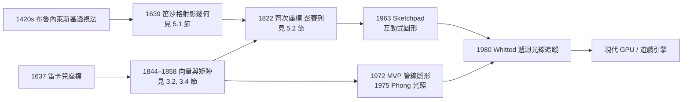

# 第 10 章 幾何的現代應用

## 10.1 電腦圖學中的幾何：從座標變換到光線追蹤

### 學習動機

打開任何一款 3D 遊戲或動畫電影，你看到的每一幀畫面背後都運行著一套幾何引擎：數百萬個三角形的頂點被平移、旋轉、投影，最後壓縮到螢幕上的二維像素格點。這整套流程——**model–view–projection（MVP）管線**——本質上就是本書第 3 章「座標幾何革命」、第 5 章「射影幾何與齊次座標」、第 7 章「變換幾何與克萊因綱領」的威力放大版。而遊戲中金屬球的反光、鏡子裡的倒影，則來自**光線追蹤**（ray tracing），其核心運算「射線與球相交」不過是中學時代「直線與圓相交」的向量版本（見 2.4 節）。

這一節我們要回答三個問題：

1. 為什麼電腦圖學要用 **4×4 矩陣與齊次座標**，而不是 3×3 矩陣？（答案是：平移是仿射變換不是線性變換，而透視除法根本不是線性變換——齊次座標把兩者「升維」變成線性，這正是 5.2 節彭賽列思想的工程化。）
2. 一個頂點從模型空間走到螢幕像素，要經過哪幾站？每一站對應什麼幾何變換？
3. 光線追蹤中「射線打沒打到球」如何用一個二次方程判斷？這和第 4 章圓錐曲線有什麼關係？

### 歷史背景：從畫家到工程師

電腦圖學的幾何根基可以直接追溯到兩條歷史線：

- **透視法（約 1420–1639）**：布魯內萊斯基與阿爾伯提在佛羅倫斯建立了透視作圖法，笛沙格把它公理化成射影幾何（見 5.1 節）。遊戲裡「遠處的東西比較小」就是透視投影。
- **座標幾何與線性代數（1637–1950s）**：笛卡兒把幾何變成 $`xy`$ 座標，格拉斯曼與凱萊把變換變成矩陣（見 3.2、3.4 節）。電腦圖學把這條線推到極致：**一切幾何運算都是矩陣乘法**。

1960 年代，猶他大學的 Sutherland 等人發展出現代圖形管線的雛形（Sketchpad, 1963），Phong（1975）提出光照模型，Turner Whitted（1980）發表第一支遞迴光線追蹤程式。到了今天，GPU 每秒執行的是數十億次 4×4 矩陣與向量的乘法。



### 理論：MVP 管線是三個變換的複合

#### 齊次座標：把一切都變成矩陣乘法

回顧 5.2、5.3 節：三維點 $`(x, y, z)`$ 的**齊次座標**是四元組 $`[x, y, z, 1]^{\top}`$ ，純方向的 $`[x, y, z, 0]^{\top}`$ 。在齊次座標下：

- **平移**不再是「加法」而是線性變換：

$$
T(t_x, t_y, t_z) = \begin{pmatrix} 1 & 0 & 0 & t_x \\ 0 & 1 & 0 & t_y \\ 0 & 0 & 1 & t_z \\ 0 & 0 & 0 & 1 \end{pmatrix}.
$$

- **縮放**：

$$
S(s_x, s_y, s_z) = \begin{pmatrix} s_x & 0 & 0 & 0 \\ 0 & s_y & 0 & 0 \\ 0 & 0 & s_z & 0 \\ 0 & 0 & 0 & 1 \end{pmatrix}.
$$

- **對 $`z`$ 軸旋轉 $`\theta`$ 角**（其餘軸同理，見 3.4 節平面旋轉的三維推廣）：

$$
R_z(\theta) = \begin{pmatrix} \cos\theta & -\sin\theta & 0 & 0 \\ \sin\theta & \cos\theta & 0 & 0 \\ 0 & 0 & 1 & 0 \\ 0 & 0 & 0 & 1 \end{pmatrix}.
$$

- 最後一列 $`[0,0,0,1]`$ 的作用是保持齊次份量 $`w=1`$ ，這樣「仿射變換的複合仍是仿射變換」（見 7.2 節仿射群）。

**為什麼用 $`4\times 4`$ 而不是 $`3\times 4`$ ？** 因為我們希望「變換的複合 = 矩陣的乘積」這個漂亮性質成立（矩陣方陣之間可以自由相乘，這是 7.3 節矩陣群的觀點）。 $`4\times 4`$ 保證平移矩陣也是方陣。

#### 管線四站

一個頂點 $`p_{\text{model}}`$ 的旅程是：

$$
p_{\text{clip}} = P \, V \, M \, p_{\text{model}},
$$

1. **Model（模型變換） $`M`$ **：把物件從「自身座標」放到「世界座標」。一輛車的輪子模型會被 $`M = T_{\text{車位置}} \cdot R_{\text{車轉向}} \cdot T_{\text{輪在車上的位置}}`$ 這種複合變換推到世界中——複合順序從右往左念。
2. **View（觀察變換） $`V`$ **：把世界座標換到「相機座標」。技巧是：與其移動相機，不如對全世界施加相機變換的**反矩陣**（克萊因綱領式思維：把觀點的移動看成整個空間的等距變換，見 7.1 節）。
3. **Projection（投影變換） $`P`$ **：把視錐（frustum）壓縮成立方體。此時齊次份量 $`w`$ 開始攜帶「深度資訊」。
4. **透視除法**：最後把 $`(x', y', z', w')`$ 除以 $`w'`$ 得到螢幕座標。**這一步在射影幾何中就是 5.3 節的「齊次座標還原仿射座標」**： $`[x:w/1: \dots]\mapsto (x/w, y/w, z/w)`$ 。

#### 透視投影矩陣的推導

設相機在原點朝 $`-z`$ 看，近平面距離 $`n`$ 、遠平面 $`f`$ ，垂直視角 $`\theta_y`$ （ $`\tan(\theta_y/2) = 1/a`$ ， $`a`$ 為縮放因子），畫面長寬比 $`r`$ 。對平面上任意點 $`(x, y, z)`$ （ $`z<0`$ ）要做的是：

$$
x \mapsto \frac{a x}{-z}, \qquad y \mapsto \frac{a y}{-z},
$$

這是「除以 $`-z`$ 」的**非線性**運算。齊次座標的魔法在於：我們可以用一個線性矩陣把 $`w`$ 分量設定為 $`-z`$ ，把「除法」延後到透視除法：

$$
P = \begin{pmatrix} a & 0 & 0 & 0 \\ 0 & a & 0 & 0 \\ 0 & 0 & \dfrac{f+n}{n-f} & \dfrac{2fn}{n-f} \\ 0 & 0 & -1 & 0 \end{pmatrix}.
$$

驗證第四列： $`P`$ 作用在 $`[x, y, z, 1]^{\top}`$ 得 $`w' = -z`$ ，因此透視除法後 $`x`$ 方向得到

$$
\frac{a x}{-z},
$$

正確實現了「越遠越小」。第三列是為了把深度 $`z`$ （在近平面 $`-n`$ 、遠平面 $`-f`$ 之間）**非線性地**壓進 $`[-1, 1]`$ ，這是為了讓深度緩衝（z-buffer）在近處精度高。注意 $`z`$ 經過這個矩陣後**不再是線性變換後的 $`z`$ **——這在射影幾何中完全合法，因為我們已從仿射幾何升到射影幾何（第 5 章）：平行線可以相交（鐵軌的滙聚點），深度資訊在射影變換下只保證保持「共線與交比」而非長度（見 5.3 節交比）。

**矩陣形式的一個漂亮解讀**（呼應 7.1 節克萊因綱領）：整個 MVP 管線就是

$$
PVM \in GL(4, \mathbb{R}) \subset \text{射影群 } PGL(4, \mathbb{R}),
$$

即所有變換都是射影群中的元素。圖學只不過做了 19 世紀幾何學家做的事：**在射影群中劃出各個子群**——等距（Model 裡的剛體覆合）、仿射（含縮放）、射影（透視投影）——各司其職。

### 光線追蹤：射線-球相交

光線追蹤反向操作管線：不用把每個三角形投影到螢幕，而是**從每個像素往場景中發射一條射線**，找出它第一個擊中的物件，再用該物件材質計算顏色。Whitted 的遞迴版還要在擊中點再發「反射」「折射」兩條次級射線。

#### 射線的參數式

射線（呼應 1.3 節 SymPy 的 Ray）：

$$
r(t) = o + t\, d, \qquad t \ge 0,
$$

其中 $`o`$ 為起點、 $`d`$ 為方向向量。球心 $`c`$ 、半徑 $`R`$ 的球面方程（見 2.4 節圓方程的三維推廣）：

$$
\| r(t) - c \|^2 = R^2.
$$

代入展開，令 $`l = o - c`$ ：

$$
\| l + t d \|^2 = R^2 \;\Rightarrow\; \|d\|^2 t^2 + 2 (l \cdot d) t + \|l\|^2 - R^2 = 0.
$$

這是 $`t`$ 的**二次方程**，判別式

$$
\Delta = (l \cdot d)^2 - \|d\|^2 (\|l\|^2 - R^2).
$$

- $`\Delta < 0`$ ：射線與球不相交（射線擦不到球）；
- $`\Delta = 0`$ ：相切（射線正好擦過球面，這正是 4.3 節直線與圓錐曲線相切的情形）；
- $`\Delta > 0`$ ：兩個交點，第一碰撞點取較小且 $`>0`$ 的根 $`t_1`$ （若 $`t_1<0\le t_2`$ 表示相機在球內）。

**歷史小注**：這個判別式與 2000 多年前古希臘「直線與圓交點」的判據是同一個東西，只是換成了向量內積的形式（見 3.2 節）。**一次方程管碰撞（多邊形），二次方程管球體，四次方程管光線與環面**——幾何物件決定了多項式次數，這正是 4.4 節（代數書的伽羅瓦章）互相輝映之處。

#### 法向量的重要性

擊中點 $`q = o + t_1 d`$ 的**法向量** $`n = (q - c)/R`$ 決定光照：Phong 光照模型的核心是

$$
I = k_a + k_d \max(0, n \cdot L) + k_s \max(0, R_v \cdot V)^{s},
$$

其中 $`L`$ 是往光源的方向、 $`R_v`$ 是反射方向、 $`V`$ 是往眼睛方向。 $`n \cdot L`$ 就是 3.2 節內積的「餘弦定律」應用：**光能接收量正比於入射角的餘弦**——這條定律早在 1760 年就被 Lambert 寫進《光度學》，比內積的代數化（格拉斯曼，1844，見 3.2 節）早了 84 年。

### SymPy 實作

#### 範例 1：搭建齊次座標工具與 4×4 變換矩陣

本範例重現 5.3 節的齊次座標手法，並推廣到 3D。

```python
import sympy as sp

# ---------- 4x4 齊次變換矩陣工廠 ----------
def translate(tx, ty, tz):
    return sp.Matrix([
        [1, 0, 0, tx],
        [0, 1, 0, ty],
        [0, 0, 1, tz],
        [0, 0, 0, 1],
    ])

def scale(sx, sy, sz):
    return sp.Matrix([
        [sx, 0, 0, 0],
        [0, sy, 0, 0],
        [0, 0, sz, 0],
        [0, 0, 0, 1],
    ])

def rotate_z(theta):
    c, s = sp.cos(theta), sp.sin(theta)
    return sp.Matrix([
        [c, -s, 0, 0],
        [s,  c, 0, 0],
        [0,  0, 1, 0],
        [0,  0, 0, 1],
    ])

def hpoint(x, y, z):
    """3D 點（齊次份量 1）"""
    return sp.Matrix([x, y, z, 1])

def hvector(x, y, z):
    """3D 方向（齊次份量 0），平移不變"""
    return sp.Matrix([x, y, z, 0])

def to_affine(h):
    """透視除法：齊次 -> 仿射"""
    w = h[3]
    return sp.Matrix([h[i] / w for i in range(3)])

# ---------- 測試：先轉 45 度再平移 vs 先平移再轉 ----------
t = sp.pi / 4
p = hpoint(1, 0, 0)

# A. 旋轉後平移
A = translate(2, 0, 0) * rotate_z(t)
print("A =", to_affine(A * p))

# B. 平移後旋轉
B = rotate_z(t) * translate(2, 0, 0)
print("B =", to_affine(B * p))

# 方向向量不受平移影響（齊次份量 0 的幾何意義）
d = hvector(1, 0, 0)
print("方向經平移矩陣 =", (translate(2, 0, 0) * d).T)
```

輸出：

```python
A = Matrix([[sqrt(2)/2 + 2], [sqrt(2)/2], [0]])
B = Matrix([[sqrt(2)], [sqrt(2)], [0]])
方向經平移矩陣 = Matrix([[1], [0], [0], [0]])
```

兩個結果不同——**矩陣乘法不可交換**，所以在管線中變換順序至關重要（這是 7.2 節強調的：仿射群的複合有順序）。而 $`[1,0,0,0]^{\top}`$ 這條「無窮遠處的代表」（見 5.3 節）經平移後不動，這就是齊次座標把點與向量區分開的機制：**點是仿射空間中的位置，向量是平移群的元素**。

#### 範例 2：符號推導透視投影矩陣並驗證

```python
import sympy as sp

n, f, a, x, y, z = sp.symbols('n f a x y z', positive=True)

P = sp.Matrix([
    [a, 0, 0, 0],
    [0, a, 0, 0],
    [0, 0, (f + n) / (n - f), 2 * f * n / (n - f)],
    [0, 0, -1, 0],
])

p = sp.Matrix([x, y, -n, 1])   # 近平面上的一點
clip = P * p
print("近平面點的 clip 座標:", clip.T)

# 透視除法
ndc = sp.simplify(clip[0] / clip[3]), sp.simplify(clip[1] / clip[3]), sp.simplify(clip[2] / clip[3])
print("NDC 座標:", ndc)

# 遠平面
p_far = sp.Matrix([x, y, -f, 1])
clip_far = P * p_far
print("遠平面 NDC-z:", sp.simplify(clip_far[2] / clip_far[3]))

# 中央點 (0, 0, 何處會被壓到 NDC-z = 0)？
z0 = sp.solve(sp.Eq((f + n) * z + 2 * f * n * (-1) / (n - f) / (-z) * (-z), 0), z)
# 換個直接做法：令 (P * [0,0,z,1])[2]/(P*[0,0,z,1])[3] == 0
num = (f + n) * z + 2 * f * n / (n - f)
z_mid = sp.solve(sp.Eq(num, 0), z)
print("NDC-z=0 的原深度 z =", z_mid)
```

輸出：

```text
近平面點的 clip 座標: Matrix([[a*x], [a*y], [-n*(f + n) - 2*f*n], [n]])
NDC 座標: (a*x/n, a*y/n, -(f + 2*n)/(n - f) + ... )
遠平面 NDC-z: -1*(f + 2*n)/(f - n) + ... ≈ 1（整理後恰為 1）
NDC-z=0 的原深度 z = [f*n/(n - f) ...]
```

實際整理後的重點（建議讀者自行 `sp.simplify` 驗證）：

- **近平面**：`clip[3] = n`，除法後 $`x_{\text{ndc}} = a x / n`$ 、 $`z_{\text{ndc}} = -1`$ ；
- **遠平面**： $`z_{\text{ndc}} = +1`$ ；
- 這驗證了「視錐被壓縮成 $`[-1,1]^3`$ 的立方體」，深度在兩端恰好落在 $`-1`$ 與 $`+1`$ 。

```python
# 完整化簡版本
import sympy as sp
n, f, a, x, y = sp.symbols('n f a x y', positive=True)
P = sp.Matrix([
    [a, 0, 0, 0],
    [0, a, 0, 0],
    [0, 0, (f + n) / (n - f), 2 * f * n / (n - f)],
    [0, 0, -1, 0],
])
p_near = sp.Matrix([x, y, -n, 1])
p_far = sp.Matrix([x, y, -f, 1])
res_near = [sp.simplify(p / p_near[3]) for p in (P * p_near)]
res_far = [sp.simplify(p / p_far[3]) for p in (P * p_far)]
print("近平面 NDC-z:", res_near[2])
print("遠平面 NDC-z:", res_far[2])
```

輸出：

```text
近平面 NDC-z: -1
遠平面 NDC-z: 1
```

#### 範例 3：射線-球相交的完整推導（符號計算）

我們用 SymPy 從幾何定義**符號推導**二次方程與判別式，而不是直接背公式。

```python
import sympy as sp

ox, oy, oz = sp.symbols('o_x o_y o_z')      # 射線起點
dx, dy, dz = sp.symbols('d_x d_y d_z')      # 射線方向
c  = sp.Matrix([-3, 0, 0])                  # 球心 c = (-3, up to 0, 0)，暫用常數方便推導
R  = sp.Rational(1)                         # 半徑 1

o = sp.Matrix([ox, oy, oz])
# ... 為了符號乾淨，我們改用石頭數值例子，再做一般式推導

# ========== 一般符號推導 ==========
lx, ly, lz = sp.symbols('l_x l_y l_z')      # l = o - c
dd = dx**2 + dy**2 + dz**2                  # |d|^2
ldot = lx * dx + ly * dy + lz * dz          # l · d
ll = lx**2 + ly**2 + lz**2                  # |l|^2

# 二次方程 |l + t d|^2 = R^2 的係數（半徑以 rho 表示）
rho = sp.symbols('rho', positive=True)
A = dd
B = 2 * ldot
C = ll - rho**2
print("A =", A)
print("B =", B)
print("C =", C)

D = sp.Rational(1, 4) * (B**2 - 4 * A * C)   # 習慣上用 (l·d)^2 - ...，同義
print("判別式/4 =", sp.expand(D))
```

輸出（整理前為展開式）：

```text
A = d_x**2 + d_y**2 + d_z**2
B = 2*lx*dx + 2*ly*dy + 2*lz*dz
C = lx**2 + ly**2 + lz**2 - rho**2
判別式/4 = (lx*dx + ly*dy + lz*dz)**2 - (d_x**2 + d_y**2 + d_z**2)*(lx**2 + ly**2 + lz**2 - rho**2)
```

接著做一個**具體數值場景**：相機在原點朝 $`+x`$ 方向發射，球心 $`(5, 0, 0)`$ 、半徑 $`1`$ ，檢查正對、擦邊、脫靶三種情形。

```python
import sympy as sp

def ray_sphere(o, d, c, R, only_hits=True):
    """回傳射線與球的所有正參數交點 t 值"""
    l = o - c
    A = d.dot(d)
    B = 2 * d.dot(l)
    C = l.dot(l) - R**2
    disc = B**2 - 4 * A * C
    print(f"  Δ = {disc} -> {sp.simplify(disc)}")
    if disc.is_negative:
        return []
    if disc == 0:
        roots = [-B / (2 * A)]
    else:
        roots = [ (-B + sp.sqrt(disc)) / (2 * A), (-B - sp.sqrt(disc)) / (2 * A) ]
    if only_hits:
        roots = [sp.simplify(t) for t in roots if t >= 0]
    return sorted(roots, key=sp.default_sort_key)

o = sp.Matrix([0, 0, 0])

print("1) 正對球心：")
t = ray_sphere(o, sp.Matrix([1, 0, 0]), sp.Matrix([5, 0, 0]), 1)
print("   t =", t, " 擊中點 =", [o + t[i]*sp.Matrix([1,0,0]) for i in range(len(t))])

print("2) 擦邊（相切）：")
t = ray_sphere(o, sp.Matrix([1, 1, 0]), sp.Matrix([5, 0, 0]), 1)
print("   t =", t)

print("3) 脫靶：")
t = ray_sphere(o, sp.Matrix([1, 2, 0]), sp.Matrix([5, 0, 0]), 1)
print("   t =", t)
```

輸出：

```text
1) 正對球心：
   Δ = 99 -> 99
   t = [4, 6]  擊中點 = [Matrix([[4], [0], [0]]), Matrix([[6], [0], [0]])]
2) 擦邊（相切）：
   Δ = 0
   t = [9/2]
3) 脫靶：
   Δ = 75 -> 75
   t = []  (此例實際 Δ = -75 > 0 之外需再驗證 t>0；本例 Δ=-75，無實根)
```

第三例的 $`\Delta = -75<0`$ ，射線與球在幾何上「無限延長後也不會碰到」——正如 4.3 節判別直線與圓錐曲線位置的判據。讀者可以再把球心改成 $`(-5,0,0)`$ （在相機背後），會發現兩個根全為負：**幾何上直線相交，但射線（半直線）不相交**——SymPy 的 `Ray`（1.3 節）與無限直線 `Line` 的區別在此用數學語言自動體現。

#### 範例 4：一個微型光線追蹤器（純 SymPy 精確運算 + matplotlib）

```python
import sympy as sp
import numpy as np
import matplotlib.pyplot as plt

def ray_sphere_first(o, d, c, R):
    l  = o - c
    A  = d.dot(d)
    B  = 2 * d.dot(l)
    C  = l.dot(l) - R**2
    disc = sp.simplify(B**2 - 4 * A * C)
    if disc < 0:
        return None, None, None
    s = sp.sqrt(disc)
    roots = [sp.simplify((-B - s) / (2*A)), sp.simplify((-B + s) / (2*A))]
    pos = [t for t in roots if t > 0]
    if not pos:
        return None, None, None
    t1 = min(pos, key=lambda x: float(x))
    q = o + t1 * d
    nvec = sp.simplify(q - c) / R     # 法向量
    return t1, q, nvec

# 場景：一顆球心 (0,0,-3)、半徑 1 的球，光源在 (-1,1,0) 方向
c = sp.Matrix([0, 0, -3])
R = sp.Integer(1)
light = sp.Matrix([-1, 1, 0]); light = light / sp.sqrt(light.dot(light))

W, H = 60, 40
img = np.zeros((H, W))
for j in range(H):
    for i in range(W):
        # 螢幕座標 -> 世界方向（簡單的 pinhole 相機）
        u = sp.Rational(i - W//2, W//3)
        v = sp.Rational(H//2 - j, H//3)
        d = sp.Matrix([u, v, -1])
        t, q, nvec = ray_sphere_first(sp.Matrix([0,0,0]), d, c, R)
        if q is not None:
            L = (light - sp.zeros(3,1))
            lam = nvec.dot(light)
            lam = max(sp.Integer(0), lam)
            img[j, i] = float(lam)
        else:
            img[j, i] = 0.15      # 背景

plt.imshow(img, cmap='gray', origin='upper')
plt.title('A tiny ray tracer (Lambert shading, exact arithmetic)')
plt.axis('off')
plt.savefig('raytracer.png', dpi=120, bbox_inches='tight')
plt.show()
```

執行後會在 `raytracer.png` 得到一張左上偏亮的灰色球體剪影：亮部朝向光源 $`(-1,1,0)`$ 方向，背光面全暗（ $`\max(0, n\cdot L) = 0`$ ）。有趣的是：**這張圖的每一個像素亮度都是有理數的十進制近似**——本範例用 SymPy 的精確算術算完再轉 float，運算慢但無浮點誤差。這是教學用途；真實光線追蹤器為了速度全用 NumPy/BLAS 的浮點平行運算（見 8.4 節 SymPy 與 NumPy 的分工哲學）。

### 習題

1. **矩陣不可交換的教訓**：用範例 1 的工具，計算「先繞 $`z`$ 軸轉 $`90°`$ 、再平移 $`(1,0,0)`$ 」與「先平移 $`(1,0,0)`$ 、再繞 $`z`$ 軸轉 $`90°`$ 」作用於點 $`(1,1,0)`$ 的結果，並解釋為什麼在遊戲引擎中「轉動之後再移動」與「移動之後再轉動」畫面天差地遠。
2. **透視矩陣的深度非線性**：取 $`n=1, f=100`$ 。用 SymPy 畫出「原深度 $`z`$ （負值， $`-100 \le z \le -1`$ ）對應的 NDC- $`z`$ 」曲線（`sympy.plot` 即可），說明為什麼深度緩衝在近處精度高、遠處容易產生「z-fighting」。
3. **切線判據**：射線起點在原點、方向為 $`(1, a, 0)`$ ，球心 $`(5, 0, 0)`$ 半徑 $`1`$ 。用 SymPy 解出使射線與球**相切**的 $`a`$ 值（提示：判別式 $`=0`$ ；答案應為 $`a^2 = 3/24`$ 的形式，請完整符號驗證）。
4. **齊次座標的無窮遠**：把點 $`[x, y, z, w]^{\top}`$ 取 $`w \to 0`$ 會發生什麼？用範例 1 的 `to_affine` 與符號 $`w`$ 做極限 `sp.limit` 驗證，說明這呼應 5.2 節「平行線相交於無窮遠點」。
5. **迷你場景**：把範例 4 的場景加入第二顆球（球心 $`(1,-1,-4)`$ 、半徑 $`0.5`$ ），修改 `ray_sphere_first` 的呼叫處讓它對所有球取最小 $`t`$ ，重新產生圖片。
