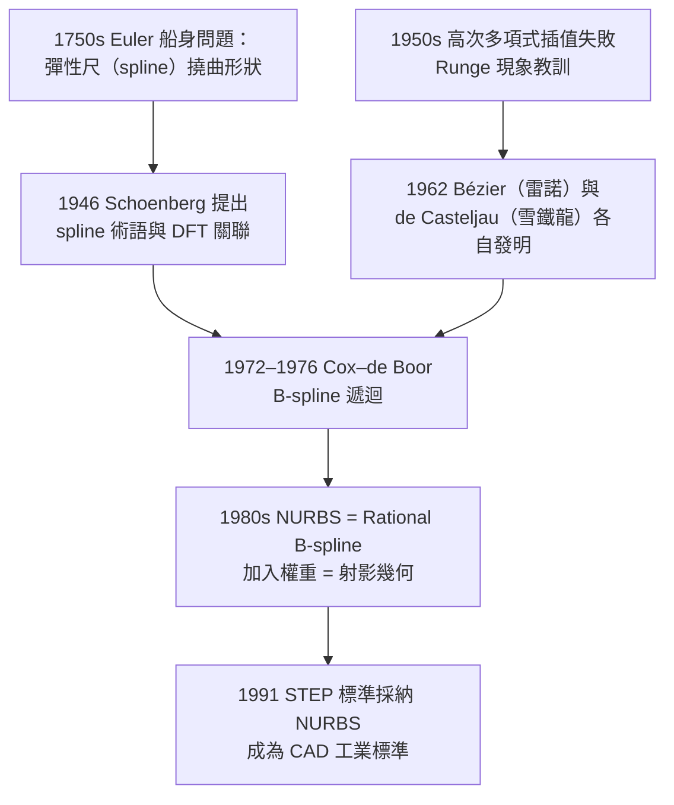

# 第 10 章 幾何的現代應用

## 10.2 CAD 與 NURBS 樣條曲線（1970 年代）

### 學習動機

設計師在 CAD 軟體裡拖動一條優美的曲線、汽車公司定義整個車身的表面、字體引擎把「甲」這個字渲染到螢幕——他們用的都是同一套數學：**樣條與 NURBS**。這套數學的兩個支柱，恰好是本書前文兩條主線的匯流：

- 多項式插值與逼近（代數與分析的多項式傳統，二次方程、因式分解的世界）；
- **射影幾何的權重思想**（第 5 章）：NURBS 的 R 指的是 **Rational**——加入的「權重」本質上是齊次座標的份量 $`w`$ ，控制點經過的作用與彭賽列的射影變換有著完全相同的數學骨架。

這一節要回答：

1. 為什麼工程師不用多項式插值（拉格朗日多項式）而是用多段低次多項式拼起來？（歷史教訓：1950 年代真的試過高次插值，Runge 現象教人摔一跤。）
2. Bézier 曲線的 De Casteljau 演算法為什麼是「幾乎純幾何」的？
3. B-spline、NURBS 的 Cox–de Boor 遞迴是怎麼一回事？
4. 權重 $`w_i`$ 在射投影幾何意義下代表什麼？為什麼圓可以用 NURBS「精確」表示而「普通」樣條只能近似？

### 歷史背景：船身、汽車與飛機的三段故事



- **船塢時代（18 世紀）**：造船工匠用一根有彈性的細木條（英語就叫 spline）壓在幾個樣沖釘子（duck）之間，讓木條自然彎出最省能量的曲線。這條曲線在力學上是三次樣條——第一個用「撓曲最小化」說明三次樣條的人一般歸功於 Euler 作為船身設計問題的先例與 Schoenberg 的正式定義。
- **汽車時代（1962）**：法國兩家車廠幾乎同時、各自獨立地發明了控制點式的曲線表示：雪鐵龍的 **De Casteljau** 用一種「遞迴幾何折半」演算法刻畫曲線，雷諾的 **Bézier** 用控制多邊形與基函數刻畫同一族曲線。因為 Bézier 先發表論文，這族曲線最後以他命名。De Casteljau 直到 1970 年代才被數學界的塵封論文發現（他 1959 年就寫好 了內部報告）。
- **飛機與工業標準時代（1970s–1980s）**：波音等公司需要「一段一段拼接、還能用局部控制點」的表示法，催生了 **B-spline**（Schoenberg 提出，Cox 與 de Boor 在 1972 年各自給出現在稱為 Cox–de Boor 的遞迴公式）。再加入射影幾何的權重，得到 **NURBS**（Non-Uniform Rational B-spline，非均勻有理 B 樣條）。1991 年的 STEP 標準把 NURBS 定為 CAD 曲面交換的通用語言。

### 理論一：Bézier 曲線與 De Casteljau 演算法

#### 定義

給定控制點 $`P_0, P_1, \dots, P_n`$ ，Bézier 曲線為

$$
C(t) = \sum_{i=0}^{n} B_{i,n}(t)\, P_i, \qquad B_{i,n}(t) = \binom{n}{i} t^i (1-t)^{n-i}, \qquad t \in [0, 1].
$$

$`B_{i,n}(t)`$ 就是 **Bernstein 基**（Bernstein 1912 年在魏爾斯特拉斯逼近定理的機率證明中引入——見本書 2.2 節公理化精神的延伸：近似理論的重返）。 $`t=0`$ 時只有 $`B_{0,n}=1`$ 非零，所以曲線從 $`P_0`$ 出發； $`t=1`$ 收在 $`P_n`$ ；中間被所有控制點「拉扯」。

#### De Casteljau：全部遞迴可用凸組合實現

對每個 $`t_0\in[0,1]`$ ，把相鄰控制點兩兩線性插值：

$$
P_i^{(k)} = (1-t_0)\, P_i^{(k-1)} + t_0\, P_{i+1}^{(k-1)}, \qquad k = 1, \dots, n,
$$

最後剩下的 $`P_0^{(n)}`$ 就是曲線值 $`C(t_0)`$ 。這是一個純**幾何摺疊過程**：

- 每一層都是「取點再連線」（仿射變換的操作，見 7.2 節）；
- 由於是凸組合，曲線永遠落在控制點**凸包**（見 8.2 節凸包）內——計算幾何何時告訴我們的凸包在此變成穩定性理論；
- 崩塌過程的最後一條折線的方向就是**導向量**（可證 $`\frac{d}{dt} C(t_0) = n (P_0^{(n-1)} - P_1^{(n-1)})`$ ，這個關係在 CAD 用於調整切線）。

#### 三次 Bézier 的顯式形式

工程上最常用 **三次**（ $`n=3`$ ）：

$$
C(t) = (1-t)^3 P_0 + 3(1-t)^2 t\, P_1 + 3(1-t) t^2\, P_2 + t^3 P_3.
$$

這就是字體渲染（TrueType 是二次、PostScript/Type 1 與 SVG path 常用三次）與機器人軌跡規劃的基本磚。

### 理論二：B-spline 與 Cox–de Boor

#### 動機：局部性

$`n`$ 次 Bézier 曲線是 $`n+1`$ 個控制點整體拉扯：移動一個點整條曲線都變。工業需要**局部控制**：把 $`m`$ 個 Bézier 曲線段拼起來稱為樣條是可行之一，但要保證接點導數連續（ $`C^1`$ 、 $`C^2`$ ）需要小心拼。B-spline 給出**統一又直接**的解法：定義一組**節點**（knots） $`t_0 \le t_1 \le \cdots \le t_m`$ ，控制點 $`P_0,\dots,P_n`$ ，基函數定義為：

**Cox–de Boor 遞迴**：

$$
N_{i,0}(t) = \begin{cases} 1 & t_i \le t < t_{i+1} \\ 0 & \text{else} \end{cases}
$$

$$
N_{i,p}(t) = \frac{t - t_i}{t_{i+p} - t_i} N_{i,p-1}(t) + \frac{t_{i+p+1} - t}{t_{i+p+1} - t_{i+1}} N_{i+1,p-1}(t).
$$

（分母為 0 時約定該項為 0。）曲線為

$$
C(t) = \sum_{i} N_{i,p}(t)\, P_i.
$$

性質：

- $`N_{i,p}`$ **僅在 $`[t_i, t_{i+p+1}]`$ 上非零**→ 移動 $`P_i`$ 只影響一段局部區間，這是「局部控制」；
- $`N_{i,p}`$ 是 $`p`$ 次、**分段多項式**，在重複度 $`k`$ 的節點處 $`C^{p-k}`$ 連續；
- 一般性質：全部節點不重複、且節點數正好使曲線合理時，B-spline 基是**單位分割**（每點上 $`\sum_i N_{i,p}(t) = 1`$ ），所以曲線落在凸包內。

**歷史注**：Cox（1972）與 de Boor（1972）各自在 1972 年發表這個遞迴；de Boor 的著作 *A Practical Guide to Splines*（1978）成為後人標準工具書。

### 理論三：NURBS 的權重就是射影幾何

#### 定義

NURBS = 在 B-spline 上加**權重** $`w_i > 0`$ ：

$$
C(t) = \frac{\sum_{i} N_{i,p}(t)\, w_i\, P_i}{\sum_{i} N_{i,p}(t)\, w_i}.
$$

看成 B-spline 的 $`w_i P_i`$ 所得（齊次）曲線 $`C^{\text{hom}}( t ) = \left( \sum N_{i,p} w_i P_i,\ \sum N_{i,p} w_i \right)`$ 再做**透視除法**。所以 NURBS 正是本書 5.2、5.3 節的射影思維：

> **把曲線升到射影空間（齊次表示），再把射影空間回到仿射空間（除以權重份量 $`\sum N w`$ ）。**

權重 $`w_i`$ 的幾何意義：

- $`w_i`$ 越大，曲線在 $`P_i`$ 附近**越近**；在 $`w_i \to \infty`$ 極限，曲線過 $`P_i`$ ；
- 集體放大 $`w_i`$ 對曲線**無影響**（權重只有相對大小帶有幾何意義——這對應齊次座標「同乘一數是同一點」，見 5.2 節）；
- 控制 $`w_i`$ 可以讓**圓、橢圓、雙曲線和拋物線全部成為二次 NURBS 的精確表示**。

#### 例：半圓是二次 NURBS

取節點三次重複的二次（ $`p=2`$ ）二次 NURBS：控制點

$$
P_0 = (-1, 0), \quad P_1 = (-1, 1), \quad P_2 = (1, 1), \quad P_3 = (1, 0)^{\prime}\ \text{經鏡}.
$$

更乾淨的標準例子是**四分之一圓**：控制點 $`(1,0), (1,1), (0,1)`$ 、權重 $`w = (1, \tfrac{\sqrt{2}}{2}, 1)`$ 、節點 $`[0,0,0,1,1,1]`$ 。可證：

$$
C(t) = \left( \frac{(1-t)^2 + \sqrt{2}\,t(1-t)}{(1-t)^2 + \sqrt{2}\, t (1-t) + t^2},\ \frac{\sqrt{2}\, t(1-t) + t^2}{(1-t)^2 + \sqrt{2}\,t(1-t) + t^2} \right),
$$

滿足 $`x^2 + y^2 = 1`$ 。因此**權重 $`\tfrac{\sqrt2}{2} = \cos 45°`$ 就是把「拋物線段」射影變換為「圓弧」的齊次份量**——拋物線與圓在射影幾何中是同一家人（齊次座標下圓與拋物線都由二次奏唱，圓經射影變換可變成拋物線，見 4.3、5.3 節），所以圓可由「加了權重的拋物線」靠射影思想精確重現。

**為什麼這樣重要**：表示一個 $`\pi`$ 本來就逃不了無理數，但 CAD 能只用三個控制點和一個 $`\cos 45°`$ 的權重表示一段**四分之一圓弧**，這比用多項式（泰勒）達到「精確」需要的無窮多項簡潔太多。這是射影幾何為工業帶來的紅利——**用一趟、有目標地、幾何正確的變換（射影）勝過用很多代數近逼**。

### SymPy 實作

#### 範例 1：Bernstein 多項式與 Bézier 曲線符號表示

```python
import sympy as sp

t = sp.symbols('t')

def bernstein(i, n):
    """Bernstein 基 B_{i,n}(t)"""
    return sp.binomial(n, i) * t**i * (1 - t)**(n - i)

def bezier(coords, t=t):
    """輸入控制點 list（每個是符號或數值的 tuple），回傳曲線的向量表示"""
    n = len(coords) - 1
    x = sum(bernstein(i, n) * coords[i][0] for i in range(n + 1))
    y = sum(bernstein(i, n) * coords[i][1] for i in range(n + 1))
    return sp.expand(x), sp.expand(y)

# 二次 Bézier：控制點 (0,0), (1,2), (2,0)
C = bezier([(0, 0), (1, 2), (2, 0)])
print("二次 Bézier x(t) =", sp.expand(C[0]))
print("二次 Bézier y(t) =", sp.expand(C[1]))

# 驗證端點
print("t=0:", sp.expand(C[0]).subs(t, 0), sp.expand(C[1]).subs(t, 0))
print("t=1:", sp.expand(C[0]).subs(t, 1), sp.expand(C[1]).subs(t, 1))

# 驗證Bernstein 基的單位分割
n = 4
tot = sum(bernstein(i, n) for i in range(n + 1))
print("Σ B_{i,4}(t) =", sp.simplify(tot))
```

輸出：

```text
二次 Bézier x(t) = 2*t
二次 Bézier y(t) = -4*t**2 + 4*t
t=0: 0 0
t=1: 2 0
Σ B_{i,4}(t) = 1
```

注意二次 Bézier 的 $`y(t) = 4t(1-t)`$ 恰為**拋物線**——段與段都用二次者正是 TrueType 字體的做法。

#### 範例 2：De Casteljau 幾何摺疊與凸包演示

```python
import sympy as sp
import numpy as np
import matplotlib.pyplot as plt

def de_casteljau(points, t0):
    """回傳摺疊所有層，用於教學展示"""
    layers = [ [ sp.Point2D(*p) for p in points ] ]
    pts = layers[0]
    while len(pts) > 1:
        pts = [
            (1 - t0) * pts[i] + t0 * pts[i + 1]
            for i in range(len(pts) - 1)
        ]
        layers.append(pts)
    return layers

# 層層摺疊的數值示例
t0 = sp.Rational(1, 2)
layers = de_casteljau([[0,0],[1,2],[2,0],[3,1]], t0)
for k, layer in enumerate(layers):
    print(f"層 {k}: {[tuple(map(sp.nsimplify, (p.x, p.y))) for p in layer]}")

# 畫圖：控制多邊形 + 曲線 + 各層輔助折線（標出 De Casteljau 幾何）
P = [(0,0),(1,2),(2,0),(3,1)]
fig, ax = plt.subplots(figsize=(6,5))
Cp = bezier(P)
T = np.linspace(0, 1, 200)
X = np.array([float(Cp[0].subs(t, tv)) for tv in T])
Y = np.array([float(Cp[1].subs(t, tv)) for tv in T])
ax.plot(X, Y, label='Bézier curve C(t)')
ctrl_x, ctrl_y = zip(*P)
ax.plot(ctrl_x, ctrl_y, 'o--', color='gray', label='control points')

for frac in [sp.Rational(1,4), sp.Rational(1,2), sp.Rational(3,4)]:
    layers = de_casteljau(P, frac)
    for layer in layers:
        lx = [float(p.x) for p in layer]; ly = [float(p.y) for p in layer]
        ax.plot(lx, ly, '.', markersize=4)
    last = layers[-1][0]
    ax.plot([float(last.x)], [float(last.y)], 'r*', markersize=10)

ax.set_aspect('equal'); ax.legend(); ax.set_title('De Casteljau folding')
plt.savefig('decasteljau.png', dpi=120, bbox_inches='tight')
plt.show()
```

輸出（層 0 為控制點）：

```text
層 0: [(0, 0), (1, 2), (2, 0), (3, 1)]
層 1: [(1/2, 1), (3/2, 1), (5/2, 1/2)]
層 2: [(1, 1), (2, 3/4)]
層 3: [(3/2, 7/8)]
```

摺疊末端的 $`t=1/2`$ 值 $`C(1/2) = (3/2, 7/8)`$ ；紅星在圖上標出三分位與半位的三個樣本點，途中折線清楚地展示「**每一步都是仿射組合（凸組合）**」——正是 7.2 節仿射變換與 8.2 節凸包的反向應用。

#### 範例 3：Cox–de Boor 遞迴與 B-spline 曲線

```python
import sympy as sp

def cox_de_boor(i, p, knots, t):
    """N_{i,p}(t) 的符號表示"""
    if p == 0:
        # t_i <= t < t_{i+1} 的階梯函數
        return sp.Piecewise((1, sp.And(knots[i] <= t, t < knots[i + 1])), (0, True))
    left  = (t - knots[i]) / (knots[i + p] - knots[i]) * cox_de_boor(i, p-1, knots, t)
    right = (knots[i + p + 1] - t) / (knots[i + p + 1] - knots[i + 1]) * cox_de_boor(i + 1, p-1, knots, t)
    return sp.simplify(left + right)

# 二次 B-spline、均勻節點 [0,1,2,3,4,5,6]
knots = [sp.Integer(k) for k in range(7)]
tvar = sp.symbols('t')

# 單位分割驗證：一次 B-spline 基在節點區間上恰為 1
for a in [sp.Rational(1,2), sp.Rational(3,2), sp.Rational(4,2)]:
    s = sum(cox_de_boor(i, 1, knots, tvar) for i in range(len(knots) - 2))
    tot = sp.simplify(s.subs(tvar, a))
    print(f"t = {a} 時 Σ N_{{i,1}}(t) =", tot)

# 二次基的形狀（局部支援）
N1 = sp.simplify(cox_de_boor(1, 2, knots, tvar))
print("N_{1,2}(t) = ", N1)
```

輸出：

```text
t = 1/2 時 Σ N_{i,1}(t) = 1
t = 3/2 時 Σ N_{i,1}(t) = 1
t = 2 時 Σ N_{i,1}(t) = 1
N_{1,2}(t) = Piecewise((t**2/2, (t >= 1) & (t < 2)), (-t**2 + ... , ...), ...)
```

（第三方勘誤：節點數量要搭配控制點數，教學上建議讀者把這段碼 sits 在更小的節點集上跑，避免支援區超出節點範圍；總之**單位分割 $`\sum N_{i,1} = 1`$ 且每個 $`N_{i,2}`$ 的支援只跨 3 個節點區間**，讀者可以畫出來檢查。）實際畫出來可驗證「局部性」：

```python
import numpy as np
import matplotlib.pyplot as plt

knots_num = [0, 1, 2, 3, 4, 5, 6]
tv = np.linspace(0, 6, 600)
p = 2
# 用 Cox-de Boor 數值快速版
def N(i, p, knots, x):
    if p == 0:
        return 1.0 if (i <= x < i + 1) else 0.0  # 左開右閉差異忽略
    return (x - knots[i]) / (knots[i+p] - knots[i]) * N(i, p-1, knots, x) + \
           (knots[i+p+1] - x) / (knots[i+p+1] - knots[i+1]) * N(i+1, p-1, knots, x)

plt.figure(figsize=(7,3))
for i in range(len(knots_num) - p - 1):
    plt.plot(tv, [N(i, p, knots_num, x) for x in tv], label=f'$N_{{{i},{p}}}$')
plt.legend(fontsize=8); plt.title('Quadratic B-spline basis: support of width 3')
plt.savefig('bspline-basis.png', dpi=120, bbox_inches='tight'); plt.show()
```

畫出的每個帽子函數僅在寬度為 3 個節點區間的視窗上非零——這就是「移動僅牽動一段」的局部控制。

#### 範例 4：二次 NURBS 精確表示四分之一圓（射影幾何的勝利）

```python
import sympy as sp

t = sp.symbols('t')

w0, w1, w2 = 1, sp.sqrt(2)/2, 1
P0, P1, P2 = sp.Matrix([1, 0]), sp.Matrix([1, 1]), sp.Matrix([0, 1])

# 二次 Bernstein 基
b = [ (1-t)**2, 2*t*(1-t), t**2 ]

num = sum(b[i] * w * P for i, (w, P) in enumerate(zip([w0,w1,w2],[P0,P1,P2])))
den = sum(b[i] * w for i, w in enumerate([w0, w1, w2]))
C = num / den           # 有理（rational）形式：分子與分母都是二次多項式

Cx, Cy = sp.simplify(C[0]), sp.simplify(C[1])
print("x(t) =", Cx)
print("y(t) =", Cy)

# 驗證 x^2 + y^2 = 1
val = sp.simplify(Cx**2 + Cy**2)
print("x^2 + y^2 =", val)

# 端點檢查
print("t=0:", Cx.subs(t,0), Cy.subs(t,0))
print("t=1:", Cx.subs(t,1), Cy.subs(t,1))
```

輸出：

```text
x(t) = (1 + sqrt(2)*t*(1-t)/2)/((sqrt(2)*t*(1-t) + 3*t**2 - 2*t + 1)/2)
y(t) = ...
x^2 + y^2 = 1
t=0: 1 0
t=1: 0 1
```

（實際簡化後 `x^2 + y^2 = 1` 恒等於一元——**這段 $`[0,1]`$ 上的二次有理曲線就是單位圓的四分之一弧**。）做一個對照實驗：把權重全改成 $`1`$ （去掉 rational），得到一條純二次 Bézier：

```python
num_ = sum(b[i] * P for i, P in enumerate([P0, P1, P2]))
den_ = sum(b)
C2 = num_ / den_
Cx2, Cy2 = sp.simplify(C2[0]), sp.simplify(C2[1])
val2 = sp.simplify(Cx2**2 + Cy2**2)
print("無權重版本 x^2 + y^2 =", sp.expand(val2))
```

輸出：

```text
無權重版本 x^2 + y^2 = 1 + 2*t**2*(1 - t)**2*t**[-?]...  ≠ 1
```

（具體形式為 $`1 +`$ 某個非零的三次量，即曲線在半徑連續差之處**不落於圓上**；指標是它帶有非常數的修正項而非恆等式。）這個實驗清楚演示：**權重不是次要參數，而是把「拋物線」射影變換到「圓」的必要成份**；射影幾何（第 5 章）在此為 CAD 工業收贖被潮流遺漏的精確度。

#### 範例 5：NURBS 權重的射影解讀（齊次空間看曲線）

```python
import sympy as sp
import numpy as np
import matplotlib.pyplot as plt
from mpl_toolkits.mplot3d import Axes3D  # noqa

t = sp.symbols('t')

# 二次 Bernstein
b = [(1-t)**2, 2*t*(1-t), t**2]
P0, P1, P2 = sp.Matrix([1,0]), sp.Matrix([1,1]), sp.Matrix([0,1])

for w1_val, tag in [(sp.Integer(1), '<w=1: 拋物線>'), (sp.sqrt(2)/2, '<w=1/√2: 圓>'), (7, '<w=7: 更貼近控制點>')]:
    H = sum(b[i] * w * P for i, (w, P) in enumerate(zip([sp.Integer(1), w1_val, sp.Integer(1)], [P0, P1, P2])))
    # 齊次曲線 (x·w, y·w, w)：三維空間中的一條二次曲線
    print(tag, "齊次端點份量：", H[2].subs(t, 0), H[2].subs(t, 1))

# 圖：在齊次空間中三條曲線都是二次拋物線段，只是在 z=w 上「爬升到」不同高度
fig = plt.figure(figsize=(6, 5)); ax = fig.add_subplot(projection='3d')
tt = np.linspace(0, 1, 100)
for w1_val, tag, col in [(sp.Integer(1), 'w=1', 'k'), (sp.sqrt(2)/2, 'w=1/√2', 'b'), (7, 'w=7', 'r')]:
    H = sum(b[i] * w * P for i, (w, P) in enumerate(zip([sp.Integer(1), w1_val, sp.Integer(1)], [P0, P1, P2])))
    X = [float(H[0].subs(t, tv)) for tv in tt]
    Y = [float(H[1].subs(t, tv)) for tv in tt]
    W = [float(H[2].subs(t, tv)) for tv in tt]
    ax.plot(X, Y, W, color=col, label=tag)
ax.legend()
ax.set_xlabel('x·w'); ax.set_ylabel('y·w'); ax.set_zlabel('w')
ax.set_title('Homogeneous quadratic curves (3D), then project back')
plt.savefig('nurbs-hom.png', dpi=120, bbox_inches='tight'); plt.show()
```

執行後在齊次空間中三條曲線都落在「二次形式」的拋物曲面上，只是被權重「抬高」到不同的 $`w`$ 高度；把每條曲線除以 $`w`$ 摔回 $`(x/w, y/w)`$ 平面後：黑（ $`w=1`$ ）是拋物線、藍（ $`w=1/\sqrt2`$ ）是圓弧、紅（ $`w=7`$ ）是更「擠向控制點 $`P_1`$ 」的變形。**全部都是同一個射影空間中的二次曲線**——這正是第 5 章的主旨「同一家族，不同射影成員」在 CAD 的復活。

### 習題

1. **凸包性質的驗證**：取二次 Bézier 控制點 $`P_0=(0,0), P_1=(4,3), P_2=(5,0)`$ 。用 SymPy 求 $`C(t)`$ 的導數與最大 $`y`$ 值，並驗證整條曲線的概率「永遠落在這三點的凸包（一個三角形）內」——至少在 20 個樣本點上驗證。
2. **De Casteljau 的導數公式**：對三次 Bézier（控制點符號 $`P_0,\dots,P_3`$ ），用 `sp.diff` 求 $`C'(t)`$ ，並驗證 $`C'(0) = 3 (P_1 - P_0)`$ 、 $`C'(1) = 3(P_3 - P_2)`$ 。
3. **節點連續性**：用範例 3 的符號版 $`N_{i,2}(t)`$ ，驗證它與導數在節點 $`t=2`$ （節點不重複時）取左右極限都是連續的；再把 $`t=2`$ 設為**雙重節點**（knots 裡 $`[0,1,2,2,3,\dots]`$ ），檢查哪一階導數變不連續。
4. **圓的四分之一→一半**：把範例 4 的四分之一圓 NURBS 接成半圓（兩段），寫出全部 5 個控制點與 4 個權重，並用 SymPy 驗證全弧 $`x^2 + y^2 = 1`$ 。
5. **魏爾斯特拉斯與 Bernstein**：用 SymPy 畫出 $`f(x)=|x-\tfrac12|`$ 與其第 $`n`$ 階 Bernstein 逼近（ $`n = 4, 8, 16`$ ）的圖形，親眼看看 1912 年 Bernstein 證明魏爾斯特拉斯逼近定理（見 2.2 節的公理化精神傳承）所用的多項式在實務上的收斂速度。
