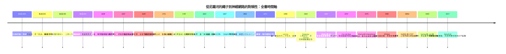
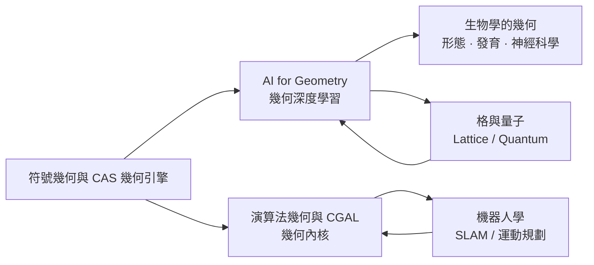

# 第 10 章 幾何的現代應用

## 10.4 幾何思維的過去與未來

### 學習動機：幾何這件事本身，被重新定義了四次

讀到這裡，你已經走過了從尼羅河到 GPU 與神經網路的旅程。此刻值得停下來問一個比任何單一技術都重要的問題：**這十章裡，「幾何」這個詞本身發生了什麼？**

答案是：它被重新定義了四次，而且每一次定義都不是靠新定理，而是靠新的**問題**。

1. **第一次（古代）**：幾何 = 測量土地。詞源是希臘文 *geōmetria*（地球測量），繼承的是埃及拉繩人的職業（見 1.1 節）。這時的幾何是**一套解決具體問題的技術**，它的問題來自下游：稅收、灌溉、建造。
2. **第二次（希臘）**：幾何 = 從公理推導的命題系統。泰勒斯（1.2 節）與歐幾里得（2.1 節）把「知道怎麼算」升級為「知道為什麼必然成立」。從此幾何有了雙重身份：既是**技藝**（解題法），也是**理論**（公理—定理結構）。
3. **第三次（近代）**：幾何 = 座標與變換的代數。第 3 章到第 7 章是這一階段：幾何從「圖形」變成「方程組」（3.1 節）、從「圖形之間的關係」變成「群作用下的不變量」（7.1 節）。克萊因 1872 年的綱領是一句宣言：**「幾何就是研究不變量在變換群下的行為。」**
4. **第四次（現代）**：幾何 = 可計算、可優化、可學習的物件。第 8 章起，幾何有了複雜度（第 8 章），有了渲染管線（第 10.1 節），有了樣條曲線（第 10.2 節），最後有了 embedding 與對稱性（第 10.3 節，以及本節末尾的「未來方向」）。

**這四次重新定義有一個共同的引擎：本書每一章的開頭問題。** 尼羅河為什麼要泛濫？泰勒斯為什麼要證明？行星為什麼繞日？畫家為什麼要畫透視？歐幾里得為什麼要懷疑第五公設？工程師為什麼要平滑曲面？機器學習為什麼要「把相似的東西放近一點」？

本章是全書的結語。我們要做三件事：

- **把時間軸攤開**，看見每一個節點背後的「需求」；
- **把主題重新整理**，歸納出「一個問題催生一種幾何」的規律；
- **把方法論提煉出來**，並示範 SymPy 如何讓「用符號做幾何」從證明的輔助工具，升級成一種思維對象。

### 全書時間軸：每一個節點背後都有一個「需求」



把每個節點後面的「需求」抽出來，得到這張表——這是本章最重要的一張表：

| 年代 | 人物 / 事件 | 背後的**需求** | 催生的幾何 | 本書章節 |
|---|---|---|---|---|
| 約前 1800 | 埃及測地、拉繩人 | 尼羅河氾濫後重測田地、按面積課稅 | 實用測量幾何 | 1.1 |
| 約前 600 | 泰勒斯 | 把「知道」升級為「可證明」 | 演繹法 | 1.2 |
| 約前 300 | 歐幾里得《幾何原本》 | 把散落的定理整理成單一系統 | 公理化方法 | 2.1–2.2 |
| 約前 200 | 阿波羅尼奧斯 | 研究圓錐截面的性質 | 圓錐曲線 | 4.1 |
| 1609 | 惠更斯、克卜勒 | 解釋行星為何不墜落也不飛走 | 橢圓軌道 | 4.2 |
| 1637 | 笛卡兒《幾何學》 | 把推理變成可逐行計算的代數 | 座標幾何 | 3.1 |
| 1639 | 笛沙格 | 透視作畫需要可證明的公理 | 射影幾何 | 5.1 |
| 1751 | 歐拉 | 點、邊、面的數量關係 | 凸多面體公式 | 9.1 |
| 1787 | 拉格朗日 | 用統一語言描述運動 | 分析力學、置換群的先聲 | 7.3 |
| 1822 | 彭賽列 | 讓「無窮遠」也能進入代數 | 齊次座標 | 5.2 |
| 1827 | 高斯《絕妙定理》 | 談曲率時不想依賴座標 | 內蘊幾何 | 9.1 |
| 1854 | 黎曼 | 承認「空間本身可以有多種」 | 黎曼流形 | 6.2 |
| 1872 | 克萊因 | 幾何種類太多，需要統一分類 | 變換幾何 | 7.1–7.3 |
| 1908 / 1934 | Voronoi / Delaunay | 數論（二次形式）、晶體、氣象 | 沃羅諾伊圖與對偶 | 8.3 |
| 1962 / 1972 | Bézier / Cox–de Boor | 車身與飛機曲面要順滑、可局部控制 | 樣條曲線 | 10.2 |
| 1975 | Shamos | 把幾何、演算法、複雜度接成一門學科 | 計算幾何 | 8.1–8.4 |
| 1980 | Whitted、寫實影像渲染 | 電腦圖學管線 | 光線追蹤 | 10.1 |
| 1980s | NURBS / STEP | 工業資料交換 | 有理樣條（射影權重） | 10.2 |
| 2000s | Isomap、t-SNE、UMAP | 高維資料的可視化與搜尋 | 流形學習、embedding | 10.3 |
| 2017– | AlphaFold、等變網路 | 利用對稱性做結構預測 | 幾何深度學習 | 本節「未來方向」 |

**從這張表能讀出三條線索。**

**線索一：幾何的每一次躍升都由「下游」推動，而不是由「定理的優美」推動。** Voronoi 1908 年的論文是純數論，裡面沒有任何「機器學習」的氣味；Shamos 1975 年的出現則完全是地圖匹配與機器人路徑規劃逼出來的（8.1 節）。如果沒有人需要「快速計算」，Voronoi 圖會再睡五十年。**想知道一門學科會往哪裡去，就去看誰在用它。**

**線索二：抽象層級是單調上升的，而每一次上升都伴隨著「多了一類可以計算的東西」。** 具體圖形 → 座標（3.1）→ 向量與內積（3.2）→ 矩陣（3.4）→ 齊次座標（5.2）→ 流形與度量（6.2、9.1）→ 群（7.3）→ 演算法與複雜度（8 章）→ 樣條與權重（10.2）→ embedding 與對稱性（10.3、10.4）。

**線索三：電腦讓「抽象」變得可以批量生產。** 在 19 世紀，製造一個新幾何需要一位可以思考數十年的數學家；在 2020 年代，製造一個新幾何只需要寫一個 `solve` 呼叫與一段代數化。這就是本章第三個方法論教訓的伏筆。

### 主題回顧：一個問題催生一種幾何

如果只能記住本章一句話，記住這句：**幾何不是定理的收藏，而是問題的指紋。** 每種幾何都是被一個具體問題逼出來的，而那個問題一旦消失，那種幾何往往會退化成一個分類學的分支（或直接被遺忘）。

| 問題（需求） | 催生的幾何 | 關鍵人物 / 文件 | 本書章節 |
|---|---|---|---|
| **測地與灌溉**：洪水後田界消失，要重測 | 埃及實用幾何：拉繩直角、面積公式 | 萊因德紙草書 | 1.1 |
| **「如何證明」**：為何要相信一個新定理 | 演繹法、公理化 | 泰勒斯 → 歐幾里得《幾何原本》 | 1.2、2.1–2.2 |
| **行星運動**：天體為何繞日成橢圓 | 圓錐曲線、橢圓軌道 | 阿波羅尼奧斯 → 克卜勒 | 4.1–4.2 |
| **透視繪畫**：遠的東西要畫小 | 射影幾何、齊次座標 | 布魯內萊斯基 → 笛沙格 → 彭賽列 | 5.1–5.3 |
| **第五公設**：平行線真的相交於無窮遠嗎 | 非歐幾何、黎曼流形 | 薩凱里 / 高斯 / 羅巴切夫斯基 → 黎曼 | 6.1–6.3 |
| **「幾何太多了」**：如何分類幾何 | 變換幾何與群 | 克萊因《愛爾蘭根綱領》 | 7.1–7.3 |
| **地圖與氣象**：哪個測站服務哪片地 | 計算幾何：凸包、Voronoi、Delaunay | Voronoi / Delaunay / Shamos | 8.1–8.4 |
| **大地測量**：地球表面彎曲了多少 | 內蘊幾何、高斯曲率、絕妙定理 | 高斯 → 黎曼 | 9.1–9.3 |
| **繪圖與製造**：車身要順滑、曲面要能交換 | NURBS 樣條 | Bézier / de Casteljau / Cox–de Boor | 10.2 |
| **高維資料**：語義如何變成向量 | ML 中的幾何：距離、流形、embedding | PCA / t-SNE / 等變網路 | 10.3、本節 |

注意最後兩列的關係：**NURBS 的權重 $`w`$ 是射影幾何（5.2 節）的復歸，embedding 的等變性是克萊因綱領（7.1 節）的復歸。** 幾何學的歷史不是一條直線，而是不斷「繞回來重新使用」舊工具——每一次復歸都因為出現了新的需求（CAD 精度、深度學習泛化）。

### 三個方法論的教訓

#### 教訓一：幾何問題往往來自應用，而不是純好奇

看回上表，幾乎沒有一列的起點是「我很好奇」。泰勒斯好奇過，但他的好奇源於「什麼才是真的知道」；克卜勒源於行星的實際位置；Shamos 源於地圖匹配與機器人。

這不代表純好奇毫無價值——**非歐幾何（6.1 節）在整整一個世紀裡沒有任何實際用途，卻是人類思想史上最偉大的智識成就之一，而它是黎曼幾何、廣義相對論與現代物理的入口。** 但對學習者而言，重要的差別是：

- **應用驅動的幾何**容易上手，因為每一步都有「為什麼要做這個」的答案；
- **應用驅動的幾何**也容易學完就忘，因為它容易變成公式與演算法的記憶負擔。

本書的對策是：**每個公式都先問「這個問題從哪來」，再問「這個式子怎麼算」。** 這也是為什麼 8.1 節要先講 1960 年代的地圖與 Shakey 機器人，再講 Graham scan。

#### 教訓二：每次抽象都把更多問題變成可計算

這是幾何學最一貫的機制。每一種抽象工具的問法都是同一句：**「這個工具讓哪些原本算不了的問題變得算了？」**

| 抽象工具 | 帶來的新能力 | 前置章節 |
|---|---|---|
| **座標** | 幾何敘述 → 代數方程組；「證明」變成「解出來」 | 3.1、3.3 |
| **向量與內積** | 長度、角度、相似度 → 可加可縮放的代數量 | 3.2 |
| **矩陣與線性變換** | 變換的複合 → 矩陣乘法；幾何 → 線性代數 | 3.4 |
| **齊次座標** | 平移（仿射）與透視（射影）→ 線性；GPU 的 MVP 管線由此而生 | 5.2、5.3、10.1 |
| **射影觀點** | 平行線也能相交；「無窮遠」成為合法的點 | 5.2、5.3 |
| **流形與度量** | 彎曲空間中的「距離」；內蘊幾何 | 6.2、9.1–9.3 |
| **群與不變量** | 幾何種類的分類法；ML 的等變性語言 | 7.1、7.3、10.4 |
| **演算法與複雜度** | 幾何 → 可以交付的軟體； $`O(n^2)`$ 壓成 $`O(n \log n)`$ | 8.1–8.4 |
| **樣條與權重** | 多項式逼近 → 幾何精確表示（圓就是精確的 NURBS） | 10.2 |
| **embedding 與不變性** | 高維語義 → 低維幾何；相似度有了度量 | 10.3 |

**這個清單本身就是一門「幾何學的技術史」。** 而且注意最後一列的「權重」與「等變性」：它們分別是 1822 年與 1872 年的概念，在 1980 年代與 2020 年代才找到新的用途。

#### 教訓三：SymPy 讓「用符號做幾何」從證明輔助變成思維對象

在 SymPy 出現之前，「用符號做幾何」主要有兩種用途：

1. **輔助證明**：把定理的代數部分算出來，確認沒有算錯（例如 2.3 節用 SymPy 驗證畢氏定理）；
2. **輔助教學**：把圖形畫出來，讓學生「看見」抽象結果（例如 6.3 節的龐加萊圓盤模型）。

SymPy（更廣義地說是所有 CAS）真正改變的是第三種用法：**把「用符號做幾何」變成一種可以提問的思維對象。** 具體地說：你可以用自然語言描述一個幾何問題，讓電腦把它翻譯成符號條件，然後——

- 精確求解（不是近似）；
- **驗證**那個關係確實恆成立；
- 甚至**找到你自己沒想到的關係**（例如歐拉不等式 $`R \ge 2r`$ 的 SOS 分解）。

下面的四個範例，就是把四句「自然語言的幾何問題」逐字翻譯成 SymPy。

### SymPy 實作：把自然語言的幾何問題翻譯成符號

#### 範例 1：「給定三角形，求它的外接圓與內切圓，以及兩半徑的關係」

自然語言問題拆解成符號步驟：

1. 「三角形」→ `sp.Triangle(A, B, C)`；
2. 「外接圓、內切圓」→ `Triangle.circumcenter / incenter / circumradius / inradius`；
3. 「兩半徑的關係」→ 把 $`R`$ 、 $`r`$ 與內心、外心代進**候選關係**（歐拉關係 $`OI^2 = R^2 - 2Rr`$ ），檢查是否恆成立。

```python
import sympy as sp

# ---------- 「自然語言問題」的翻譯層 ----------
def triangle_circles(A, B, C):
    """NL: 「給定三角形，求它的外接圓與內切圓，以及兩個半徑的關係」"""
    tri = sp.Triangle(A, B, C)
    return tri, tri.circumcenter, tri.incenter, tri.circumradius, tri.inradius

A, B, C = sp.Point(0, 0), sp.Point(4, 0), sp.Point(1, 3)
tri, O, I, R, r = triangle_circles(A, B, C)
print("外心 O =", O, "  內心 I =", I)
print("外接圓半徑 R =", R, "   內切圓半徑 r =", r)
print("面積 =", tri.area, "   周長 =", tri.perimeter)

# 歐拉關係： OI^2 = R^2 - 2 R r
lhs = sp.simplify(O.distance(I) ** 2)
rhs = sp.simplify(R ** 2 - 2 * R * r)
print("OI^2     =", lhs)
print("R^2-2Rr  =", rhs)
print("歐拉關係成立? ", sp.simplify(lhs - rhs) == 0)
d = sp.simplify(R - 2 * r)
print("R - 2r   =", d, "  非負? ", d.is_nonnegative)
```

輸出：

```text
外心 O = Point2D(2, 1)   內心 I = Point2D(4*(1 + sqrt(10))/(sqrt(10) + 4 + 3*sqrt(2)), 12/(sqrt(10) + 4 + 3*sqrt(2)))
外接圓半徑 R = sqrt(5)    內切圓半徑 r = 12/(sqrt(10) + 4 + 3*sqrt(2))
面積 = 6    周長 = sqrt(10) + 4 + 3*sqrt(2)
OI^2     = (-8*sqrt(10) - 9*sqrt(5) + 55)/(2*sqrt(10) + 3*sqrt(5) + 6*sqrt(2) + 11)
R^2-2Rr  = (-24*sqrt(5) + 5*sqrt(10) + 20 + 15*sqrt(2))/(sqrt(10) + 4 + 3*sqrt(2))
歐拉關係成立?  True
R - 2r   = -24/(sqrt(10) + 4 + 3*sqrt(2)) + sqrt(5)   非負?  True
```

**這段程式碼做的事情，正是歐幾里得與歐拉在紙筆上做的事情——只是快了一千倍，而且不用擔心抄錯。** 注意 `sp.simplify(lhs - rhs) == 0` 這一行：它把「 $`OI^2 = R^2 - 2Rr`$ 恆成立」從一個需要人檢查的命題，變成一個**布林值**。這就是「用符號做幾何」從輔助變成思維對象的第一個證據：**證明本身變成了一次可以自動執行的查詢。**

#### 範例 2：「給定圓上三點，求圓心」

把「圓心到三點等距」翻譯成方程組。注意關鍵的技巧：**平方距離方程中 $`h^2`$ 、 $`k^2`$ 會相消**，因此未知數雖是二次的，方程組卻是**一次的**——這就是 3.3 節解析幾何的核心手法。

```python
import sympy as sp

P1, P2, P3 = sp.Point(0, 0), sp.Point(4, 0), sp.Point(0, 3)
h, k = sp.symbols('h k', real=True)

def equidistant(P, Q):
    """|O-P|^2 = |O-Q|^2，其中 O=(h,k)；展開後 h^2、k^2 相消，得到一次方程"""
    return sp.expand((h - P.x) ** 2 + (k - P.y) ** 2
                     - ((h - Q.x) ** 2 + (k - Q.y) ** 2))

eqs = [equidistant(P1, P2), equidistant(P1, P3)]
print("方程組（一次）:", eqs)

sol = sp.solve(eqs, (h, k), dict=True)[0]
center = sp.Point(sp.simplify(sol[h]), sp.simplify(sol[k]))
R = sp.simplify(center.distance(P1))
print("圓心 =", center, "   半徑 =", R)

# 交叉驗證：SymPy 的 Circle 三點建構 + Triangle.circumcenter
circle = sp.Circle(P1, P2, P3)
print("Circle(P1,P2,P3).center =", circle.center, "  radius =", circle.radius)
print("Triangle.circumcenter   =", sp.Triangle(P1, P2, P3).circumcenter)
print("三者一致? ",
      sp.simplify(circle.center.x - center.x) == 0 and
      sp.simplify(circle.center.y - center.y) == 0)

# 符號版：P1=(0,0), P2=(a,0), P3=(b,c)
a, b, c = sp.symbols('a b c', positive=True)
sym = sp.solve([
    sp.expand((h - 0) ** 2 + (k - 0) ** 2 - ((h - a) ** 2 + (k - 0) ** 2)),
    sp.expand((h - 0) ** 2 + (k - 0) ** 2 - ((h - b) ** 2 + (k - c) ** 2)),
], (h, k), dict=True)[0]
print("符號圓心 =", sp.simplify(sym[h]), sp.simplify(sym[k]))
print("符號半徑 R^2 =", sp.simplify(sp.expand(sym[h] ** 2 + sym[k] ** 2)))
```

輸出：

```text
方程組（一次）: [8*h - 16, 6*k - 9]
圓心 = Point2D(2, 3/2)    半徑 = 5/2
Circle(P1,P2,P3).center = Point2D(2, 3/2)   radius = 5/2
Triangle.circumcenter   = Point2D(2, 3/2)
三者一致?  True
符號圓心 = a/2 (-a*b + b**2 + c**2)/(2*c)
符號半徑 R^2 = (a**2*b**2 - 2*a*b**3 + b**4 + c**2*(a**2 - 2*a*b + 2*b**2 + c**2))/(4*c**2)
```

三重交叉驗證（自解、`Circle` 建構、`Triangle.circumcenter`）全部一致——**這是本書反覆出現的工作流：用兩種以上獨立的方法檢查同一件事**（3.3 節的直線交點、8.4 節的浮動與精確算術對照、9.3 節的曲率交叉驗證，都是同一個習慣）。符號版更漂亮： $`P_1=(0,0)`$ 、 $`P_2=(a,0)`$ 、 $`P_3=(b,c)`$ 的外心橫座標是 $`a/2`$ （正是 $`P_1P_2`$ 的垂直平分線），縱座標是 $`\dfrac{-ab+b^2+c^2}{2c}`$ 。

#### 範例 3：讓電腦「自己」找到一個不等式的證明

上一個範例是「驗證一個已知的關係」。更進一步的問題是：**能不能讓符號系統找到一個我們事先不知道的證明？**

問題（歐拉不等式）：對任意三角形，外接圓半徑 $`R`$ 與內切圓半徑 $`r`$ 恆有 $`R \ge 2r`$ 。

做法：用 $`x = s-a`$ 、 $`y = s-b`$ 、 $`z = s-c`$ （皆為正）做代換，把 $`R/(2r)`$ 化簡，然後**讓 SymPy 找出分子的分解式**。

```python
import sympy as sp

x, y, z = sp.symbols('x y z', positive=True)
s = x + y + z
a, b, c = y + z, z + x, x + y          # a = s-x 等，反推邊長
Area = sp.sqrt(s * x * y * z)          # 海龍公式 Area^2 = s(s-a)(s-b)(s-c)
R = a * b * c / (4 * Area)             # 外接圓半徑
r = Area / s                           # 內切圓半徑
ratio = sp.simplify(sp.radsimp(R / (2 * r)))
print("R/(2r) =", ratio)

num = sp.expand(((x + y) * (y + z) * (z + x)) - 8 * x * y * z)
sos = x * (y - z) ** 2 + y * (z - x) ** 2 + z * (x - y) ** 2
print("(x+y)(y+z)(z+x) - 8xyz =", num)
print("等於 SOS 恆等式? ", sp.simplify(num - sos) == 0)
print("R/(2r) - 1 =", sp.simplify(sp.radsimp(ratio - 1)))
print("分子恆等於 SOS/8xyz? ", sp.simplify(sp.radsimp(ratio - 1) - sos / (8 * x * y * z)) == 0)
```

輸出：

```text
R/(2r) = (x + y)*(x + z)*(y + z)/(8*x*y*z)
(x+y)(y+z)(z+x) - 8xyz = x**2*y + x**2*z + x*y**2 - 6*x*y*z + x*z**2 + y**2*z + y*z**2
等於 SOS 恆等式?  True
R/(2r) - 1 = (-x*y*z + (x + y)*(x + z)*(y + z)/8)/(x*y*z)
分子恆等於 SOS/8xyz?  True
```

符號系統給出的分解是**平方和（SOS）恆等式**：

$$
\frac{R}{2r} - 1 = \frac{x(y-z)^2 + y(z-x)^2 + z(x-y)^2}{8xyz} \;\ge\; 0,
$$

因為 $`x, y, z > 0`$ 且平方項非負。**這是一個完整的證明，而且是由電腦在幾秒內找到的。** 這個例子完美呈現了教訓三：SymPy 不是拿來「代替你思考」的，而是拿來**把猜想變成可檢驗的物件**——你不必先知道 SOS 恆等式的形式，你只要問「 $`R/(2r)-1`$ 這個有理函數能不能分解成非負項」，機器會給你答案，你再決定要不要相信它。

#### 範例 4：等變性的符號骨架——為下一節鋪路

「等變」（equivariance）是幾何深度學習的核心詞：對輸入做旋轉 $`R`$ ，若輸出也旋轉 $`R`$ ，這個映射就是等變的。**這正是第 7 章「幾何 = 群作用下的不變量」的現代版本**，而且可以用 SymPy 精確驗證其代數骨架。

```python
import sympy as sp
import numpy as np

theta = sp.symbols('theta', real=True)
R = sp.Matrix([[sp.cos(theta), -sp.sin(theta)],
               [sp.sin(theta),  sp.cos(theta)]])

lam1, lam2 = sp.symbols('lambda_1 lambda_2', positive=True)
Sigma = sp.diag(lam1, lam2)          # 資料的協方差矩陣（對角，λ1 > λ2）
e1 = sp.Matrix([1, 0])               # 第一主軸

print("Σ e1 - λ1 e1 =", (Sigma * e1 - lam1 * e1).T)

Sigma_rot = sp.simplify(R * Sigma * R.T)   # 資料整體旋轉後的新協方差
print("Σ' = R Σ R^T =")
sp.pprint(Sigma_rot)

# 等變性：若 Σ v = λ v，則 (R Σ R^T)(R v) = λ (R v)
lhs = sp.simplify(Sigma_rot * (R * e1))
rhs = sp.simplify(lam1 * (R * e1))
print("(R Σ R^T)(R e1) - λ1 (R e1) =", (lhs - rhs).T)

# 數值實例：8 個點，旋轉 37 度後第一主成分方向也轉 37 度
data = np.array([[0., 1.], [1., 0.], [1., 1.], [2., 1.],
                 [1., 2.], [0., 3.], [3., 0.], [2., 2.]])

def pc1(d):
    d0 = d - d.mean(axis=0)
    w, v = np.linalg.eigh(d0.T @ d0)
    return v[:, np.argmax(w)]

ang = np.deg2rad(37.0)
Rm = np.array([[np.cos(ang), -np.sin(ang)], [np.sin(ang), np.cos(ang)]])
v0, v1 = pc1(data), pc1(data @ Rm.T)
ang0 = np.degrees(np.arctan2(v0[1], v0[0]))
ang1 = np.degrees(np.arctan2(v1[1], v1[0]))
print(f"原始 PC1 角度 = {ang0:.4f} 度；旋轉後 PC1 角度 = {ang1:.4f} 度；差 = {ang1 - ang0:.4f} 度")
print("等變性成立（差 ≈ 37 度）?", abs((ang1 - ang0) - 37.0) < 1e-6)
```

輸出：

```text
Σ e1 - λ1 e1 = Matrix([[0, 0]])
Σ' = R Σ R^T =
⎡      2            2       (λ₁ - λ₂)⋅sin(2⋅θ)   ⎤
⎢λ₁⋅cos (θ) + λ₂⋅sin (θ)    ──────────────────   ⎥
⎢                                   2            ⎥
⎢                                                ⎥
⎢  (λ₁ - λ₂)⋅sin(2⋅θ)           2            2   ⎥
⎢  ──────────────────     λ₁⋅sin (θ) + λ₂⋅cos (θ)⎥
⎣          2                                     ⎦
(R Σ R^T)(R e1) - λ1 (R e1) = Matrix([[0, 0]])
原始 PC1 角度 = 135.0000 度；旋轉後 PC1 角度 = 172.0000 度；差 = 37.0000 度
等變性成立（差 ≈ 37 度）? True
```

**「等變」的代數定義只有一行**：若 $`\Sigma v = \lambda v`$ ，則 $`(R \Sigma R^{\top})(R v) = R(\Sigma v) = \lambda (R v)`$ ——主軸方向隨資料一起旋轉。這正是克萊因 1872 年綱領在 2020 年神經網絡裡的精確復刻（7.1 節）。而「不變性」則是它的特例：當 $`\Sigma`$ 是各向同性的（ $`\lambda_1 = \lambda_2`$ ），主軸方向就不再重要，**任何旋轉下的統計量都不變**——這是網路設計中「旋轉不變」與「旋轉等變」的差別所在。

### 幾何的未來方向

把前面十章的 DNA（抽象 + 需求）繼續往未來延伸，大致可以看到六條主線。它們不是並列的，而是互相供給的：



**一、符號幾何與計算機代數（CAS）的幾何引擎。** SymPy 的 `sympy.geometry` 提供了 `Point / Line / Circle / Polygon / Triangle` 與交點、面積、包含關係等運算（1.3 節），但它是**幾何物件的函式庫**，不是**幾何推理引擎**。更前進的方向是：

- **定理證明器中的幾何**：Lean、Isabelle 的數學形式化，以及專門處理幾何的自動推理系統，把歐幾里得《幾何原本》與幾何競賽題庫變成可機器檢驗的物件；
- **代數幾何引擎**：符號消元（Groebner 基）、結點理論、對偶曲線，用符號方法處理「兩個幾何物件什麼時候相交」；
- **幾何自動推理**：從自然語言題目抽取條件、翻譯成符號、求解並回傳自然語言解釋——**這正是本章「教訓三」的完全體現**。

**二、演算法幾何的工業化。** 第 8 章的演算法今天都是工業級函式庫：CGAL（歐洲的計算幾何演算法庫，提供精確有理數運算、凸包、Delaunay、Voronoi、多面體操作）、OpenCASCADE 與 ACIS（CAD/CAE 幾何內核）、CGAL 的 3D mesh 演算法。**這條線的未完成課題是「可證明正確的幾何內核」**：浮點運算帶來的拓撲錯誤（例如 Delaunay 三角剖分中的精確退化情形）是業界至今的痛點，而 SymPy 式的精確算術正是解方。

**三、AI for Geometry 與幾何深度學習。** 這是幾何學最熱鬧的新前線，分成幾個方向：

- **幾何深度學習**（geometric deep learning）：把卷積網路推廣到圖、點雲、分子等非歐資料上，核心概念正是範例 4 驗證的**等變性**（equivariance）與**不變性**（invariance）；
- **圖神經網路（GNN）中的等變性**：訊息傳遞（message passing）本身是**置換等變**（permutation equivariance）的——把節點重新編號，輸出集合不變。這在 8.3 節的 Voronoi 語言裡就是「對 Voronoi 標籤重新編號不改變幾何」；
- **蛋白質結構預測**：AlphaFold 的核心正是把對稱性（ $`SE(3)`$ 與置換對稱）編進網路結構裡，用幾何先驗取代大量資料；
- **符號幾何與神經符號結合**：讓模型既會猜、又能證。

**四、格（Lattice）與量子幾何。** 數論幾何（Voronoi 1908 年的原始動機就是二次形式與格）與量子資訊在今天匯流：量子糾錯碼需要「好的格」、量子計算的複雜度分析與格的最短向量問題（SVP）相關、量子拓撲不變量本身就是幾何對象。**這是全書中「數論幾何」這條最古老的支線（8.3 節的 Voronoi 起源）最可能復歸的位置。**

**五、機器人學。** SLAM（同時定位與地圖建構）、運動規劃、抓取、導航——全部是幾何問題：機器人在**配置空間**（configuration space）中尋找路徑（8.1 節的可視性圖）、用李群描述關節運動、用李代數做微分運動學。**機器人學是「幾何思維」最直接的現代應用場**：一個不具備幾何直覺的機器人工程師，設計出的規劃器會在真實世界裡不斷失敗。

**六、定量生物學中的幾何。** 胚胎發育的形態發生（morphogenesis）、細胞的形狀與分裂、菌落（colony）圖樣、神經網路的連接結構、蛋白質的摺疊——這些現象的現代定量描述大量使用幾何語言：曲率與高斯曲率（9.1 節）描述器官的形狀、沃羅諾伊與德勞內描述細胞的鄰接關係、Hamilton–Jacobi 方程描述形態發育的波前。**幾何正在從「人用來描述世界的語言」變成「生物自己就在使用的語言」。**

### 給讀者的三條學習路徑

本書可以一口氣讀完，但更推薦依目的選擇路徑。

**路線 A：初學者路線（把地基打穩，建議 1 → 2 → 3）**

目標：建立「幾何 = 對象 + 關係 + 證明 + 計算」的完整框架。

1. **1.1–1.3**：先看幾何從哪來（測地）、再看重證明怎麼出現、最後熟悉 SymPy 的幾何物件。這三節是全書的入口與鑰匙。
2. **2.1–2.4**：公理化方法與三角形、圓的角度。這是全書唯一「慢」的一章，但它是「幾何」這門學科的文法課。
3. **3.1–3.4**：座標、向量、解析幾何、矩陣。**這是全書的樞紐**——讀完第 3 章，幾何從此有了「可以計算」的意義。
4. 之後按興趣選 4、5、8 章（曲線 / 射影 / 計算幾何）作為分支。
5. 最後回來讀 9、10 章與本節。

**路線 B：程式導向路線（想立刻用 SymPy 做事）**

目標：能讀懂並修改別人的幾何程式碼。

1. **1.3**（SymPy 幾何模組）→ **3.3**（解析幾何）→ **2.4**（圓與角）→ **4.3**（圓錐曲線）→ **5.3**（齊次座標與射影變換）→ **8.4**（SymPy + NumPy 計算幾何實作）→ **9.3**（曲率與曲面度量）→ **10.1**（MVP 管線）→ **10.2**（NURBS）→ **10.3**（ML 中的幾何）。
2. 這條路徑的每一節都有可直接複製的完整程式碼；**每一段程式碼都先用符號版本建立「正確性基準」，再用 NumPy 版本追求速度**——這個習慣請務必保留。
3. 補充閱讀：CGAL 官方文件（演算法幾何）、O'Rourke《Computational Geometry in C》（演算法本體）。

**路線 C：理論導向路線（想理解「為什麼是這個幾何」）**

目標：能解釋座標、射影、非歐、變換、內蘊幾何各自解決了什麼問題。

1. **1.2**（演繹的誕生）→ **2.1–2.2**（公理化）→ **3.1–3.2**（座標與內積）→ **5.1–5.2**（透視與射影）→ **6.1–6.3**（第五公設、黎曼、龐加萊）→ **7.1–7.3**（克萊因綱領、變換群、群論）→ **9.1–9.2**（內蘊幾何、絕妙定理、曲線與曲面）。
2. 這條路徑的重點是**先讀歷史動機，再讀公式**：每一章的「學習動機」段落其實是整章的哲學摘要。
3. 補充閱讀：Stillwell《The Four Pillars of Geometry》、Coxeter《Introduction to Geometry》、Coxeter & Greitzer《Geometry Revisited》。

三條路線的共同點是：**8 章的計算幾何與 10 章的現代應用都值得讀**，因為它們是把前面所有抽象「兌現」的地方——前面沒有 3.4 節的矩陣，就沒有 10.1 節的 MVP 管線；沒有 8.3 節的 Voronoi，就沒有 10.3 節的最近鄰分類器。

### 全書資源清單

#### SymPy 主要模組對照表

| 模組 | 主要內容 | 本書用到的地方 |
|---|---|---|
| `sympy.geometry` | `Point` / `Line` / `Circle` / `Triangle` / `Polygon` / `Segment` / `Ray`，交點、面積、包含、角度 | 1.3、2.4、8.4、10.4 範例 1–2 |
| `sympy.matrices` | `Matrix`、行列式、逆、特徵值/特徵向量、對角化、Jacobian | 3.4、7.3、9.3、10.1、10.4 範例 4 |
| `sympy.simplify` | `simplify` / `radsimp` / `nsimplify` / `trigsimp` / `cancel` / `together`——把「看起來不同」變成「確實相同」 | 全書的驗證主力 |
| `sympy.plotting` | `plot` / `plot_implicit` / `plot_parametric` / `plot3d`，以及 `ParametricPlot3D` | 2.4、4.3、9.2、9.3、10.2 |
| `sympy.polys` | 多項式工具：展開、因式分解、判別式、實根、Gröbner 基（`groebner`） | 4.3、10.4 範例 2–3 |
| `sympy.functions` | 特殊函數、`Piecewise`、超幾何、`LambertW` 等 | 5.3、9.2、10.2 |
| `sympy.solvers` | `solve` / `nsolve` / `solveset` / `ode` / `linsolve` / `diophantine` | 3.3、4.3、8.1、10.3、10.4 |
| `sympy.integrals` / `calculus` | 符號積分、微分、級數展開（`series`）、極限（`limit`） | 9.3、10.2 |
| `sympy.combinatorics` | 群論：有限群、對稱群、矩陣群 | 7.3 |
| `sympy.utilities.iterables` / `sets` | 點集、組合枚舉——計算幾何實作常用 | 8.2、8.4 |

**一條實務建議**：在幾何工作裡，**`sympy.simplify` 是你的顯微鏡，`sp.nsimplify` 是你的翻譯官**——前者用來確認「確實相等」，後者用來把浮點結果認回成精確的根號或分數。兩者搭配使用，本書 8.4 節的「精確 vs 浮動」對照就是最好的示範。

#### 可延伸閱讀

**古典與思想史**

- **Euclid, *The Elements***（S. L. Heath 譯，1931）——不必逐字讀，但至少讀過第一卷的命題 I.1–I.47 與命題 V 的開頭，親眼看看「公理—公設—定理」的三層結構。
- **John Stillwell, *The Four Pillars of Geometry***（2005）——以希臘、射影、非歐、球面四個支柱串起整部幾何史，敘事優美，適合作為全書的第一本讀物。
- **H. S. M. Coxeter, *Introduction to Geometry***（1949/1962）——把幾何當成一門結構性學科來教的經典，含大量习题。
- **H. S. M. Coxeter & S. L. Greitzer, *Geometry Revisited***（1967）——以「九點圓」為中心的六章，競賽數學與大學幾何的完美折衷。

**曲線、樣條與製造**

- **Cox & de Boor, *A Practical Guide to Splines***（1978）——B-spline 與 NURBS 的標準參考書，第 10.2 節的直接延伸。
- **Piegl & Tiller, *The NURBS Book***（2nd ed., 2017）——工程實務導向，涵蓋 NURBS 在 CAD/CAM 中的完整用法。

**演算法幾何**

- **Joseph O'Rourke, *Computational Geometry in C***（2nd ed., 1998）——演算法幾何的「教科書中的教科書」，凸包、三角剖分、可視性圖、旋轉掃描線一應俱全。
- **de Berg, Cheong, van Kreveld & Overmars, *Computational Geometry: Algorithms and Applications***（3rd ed., 2008）——更現代、更完整，被全球多數大學當作主要教材。
- **CGAL 官方文件**（cgal.org）——工業級演算法幾何庫，文件本身就是一份優質教材。

**微分幾何與內蘊幾何**

- **Manfredo do Carmo, *Differential Geometry of Curves and Surfaces***——第 9 章的標準參考書。
- **John M. Lee, *Introduction to Riemannian Manifolds***——第 6、9 章的深入延伸。
- **Dmitri Burago, Yuri Burago & Sergei Ivanov, *A Course in Metric Geometry***——把「度量」當第一原理來講，對理解第 6.2 節特別有幫助。

**計算幾何與演算法**

- **Steven S. Skiena, *The Algorithm Design Manual***——包含「幾何演算法」一章，適合作為第 8 章的延伸。
- **Preparata & Shamos, *Computational Geometry***——Shamos 論文的正式出版版本，1975 年那門學科的「出生證明」。

### 結語：從尼羅河的繩子到神經網路的對稱性

讓我們把整本書收成一條線。

第 1 章裡，一個埃及人在尼羅河的淤泥上用一條打了結的繩子量地。他不知道自己在做「幾何」，他只是在解決一個非常實際的問題：**明年洪水退了，我這塊地還剩多少稅？** 而整部幾何學的歷史，就是這個問題的不斷變奏：先是「這塊地有多大」，再變成「這個三角形為什麼是直角」，再變成「行星的軌道是什麼形狀」，再變成「平行線在多遠的地方相交」，再變成「地球表面彎了多少」，再變成「車身曲面怎麼才順滑」，最後變成「一張 1024 維的向量圖，怎麼知道『國王』和『女王』其實很接近」。

而每一個節點，工具都升級了一層：繩子 → 公理 → 座標 → 變換 → 流形 → 群 → 演算法 → 對稱性。**升級的動力永遠來自需求，不是來自對定理完美的偏執。**

第 10 章是這條線的現代末端。在 10.1 節，一個 3D 遊戲的畫面是 4×4 矩陣的連續相乘；在 10.2 節，一輛汽車的車身是 Bézier 曲線與 NURBS 權重；在 10.3 節，一個語言模型的語義是內積角度與流形座標。三件事看起來毫不相干，但**它們是同一件事**：它們都是「把不可見的關係變成可計算的量」的幾何。

而在本節的最後，我們看到 2020 年代的機器學習正在做的事情，和 1872 年克萊因做的事情驚人地相似：**把對稱性寫進結構裡，讓模型不必從零學會「旋轉之後世界還是一樣」這種常識。** 範例 4 裡那個樸素的代數骨架 $`(R\Sigma R^{\top})(Rv) = \lambda (Rv)`$ ，就是克萊因 1872 年寫下的綱領在 2020 年的一個具體實例——只是換了符號。

所以，最後一句話送給讀者：**幾何不是一門等待被繼承的古老學問，而是一門每一當出現新需求、就會被重新發明一次的方法論。** 而學會它的最好方式，不是背下克萊因的四種幾何分類，而是——拿起一個你真正在意的問題，用 SymPy 把它翻譯成符號，看它會不會給你一個你原本不知道的答案。尼羅河的繩子，到今天依然是同一根繩子；只是它現在可以繞過彎曲的空間，而且打結打得比從前更漂亮。

### 習題

1. **（回顧與對照）** 寫出下列每一種幾何的「原始需求」，並說明若該需求消失，這種幾何還會不會存在：(a) 歐氏幾何；(b) 射影幾何；(c) 非歐幾何；(d) 沃羅諾伊圖；(e) NURBS。每個答案不超過 5 行，並舉出一個「需求消失後仍被保留」與一個「需求消失後被淘汰」的例子。**接著**回到 8.1 節的核心論點：「傳統幾何回答『哪些幾何物件存在』；計算幾何回答『它們可以以什麼樣的成本被計算』。」請用本節的時間軸與需求表，舉出**至少三個**歷史上因為「成本」這個新需求而催生的幾何方法（提示：可用 Voronoi → Shamos、Bézier → NURBS、流形假說 → Isomap/t-SNE 的線索），並說明它們各自把「什麼問題」從「不可問」變成了「可問」。

2. **（跨章整合：Euler 公式的座標驗證）** 不使用 `Triangle.circumcenter` / `incenter`，改用範例 2 的方法：對三角形 $`(0,0)`$ 、 $`(4,0)`$ 、 $`(1,3)`$ ，用**線性方程組**解出外心（等距條件）與內心（到三邊等距條件），再手算 $`R`$ 、 $`r`$ ，並用 `sp.simplify` 驗證歐拉關係 $`OI^2 = R^2 - 2Rr`$ 與歐拉不等式 $`R \ge 2r`$ 。最後把結果與範例 1 對照，說明「同一個幾何問題有兩條獨立的求解路徑」如何提升可信度。

3. **（跨章整合：NURBS 與射影幾何）** 重做 10.2 節範例 4 的二次 NURBS 四分之一圓，但把圓心改為 $`(2, 3)`$ 、半徑改為 $`5`$ （也就是本節範例 2 的那個圓）。請寫出對應的 3 個控制點與 3 個權重，並用 SymPy 驗證所得曲線滿足 $`(x-2)^2 + (y-3)^2 = 25`$ 。然後解釋：**權重 $`w = \cos 45°`$ 在射影幾何中是什麼角色**（提示：齊次座標的 $`w`$ 分量）。

4. **（等變性與 ML）** 在範例 4 的基礎上，把資料從 8 個點改成 4 個點，並把旋轉角改為 $`\pi/6`$ （30 度），用數值實驗驗證「第一主成分方向隨資料一起旋轉」。接著做一個**反向實驗**：把 `pc1` 換成「資料協方差矩陣最大的**特徵值**（而非特徵向量）」，說明為什麼**特徵值是旋轉不變量（invariant）**而特徵向量是旋轉等變量（equivariant）。用 7.1 節的語言解釋這個區別。

5. **（前瞻：設計一個新問題）** 從你自己的生活或專業中挑出一個「每天都會遇到、但從來沒有用幾何語言描述過」的問題（例如：路線規劃、文件排版、遊戲中的碰撞、包裝設計、生物分子建模）。用本節的方法論寫出：(a) 這個問題對應哪一種幾何；(b) 它需要哪些抽象工具；(c) 如果用 SymPy 寫出它的最小可算模型，你會建立哪些符號方程？最後說明：它與本書十章中的哪一章最接近。
