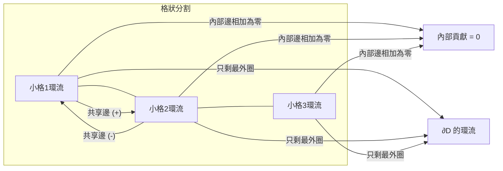

# 04.1 Green 定理：平面上的「邊界 = 內部」

## 本節目標

- 理解 Green 定理的敘述與幾何直覺：平面閉曲線上的線積分，等於內部某個「旋轉密度」的總和。
- 掌握面積公式 $`A=\frac{1}{2}\oint x\,dy - y\,dx`$ 的由來與用法。
- 用 SymPy 對多邊形與圓實際驗證 Green 定理。
- 動手畫出「內部小圈相消、只剩邊界貢獻」的示意圖。

---

## 定理敘述

設 $`P(x,y)`$ 、 $`Q(x,y)`$ 在平面區域 $`D`$ 及其邊界 $`\partial D`$ （取正向：沿邊界走，區域在左手邊）上有連續偏導數，則

$$
\oint_{\partial D} \left( P\,dx + Q\,dy \right) \;=\; \iint_D \left( \frac{\partial Q}{\partial x} - \frac{\partial P}{\partial y} \right) dA
$$

等號左邊是沿邊界繞一圈的線積分，右邊是對內部區域的二重積分。習慣上把

$$
\frac{\partial Q}{\partial x} - \frac{\partial P}{\partial y}
$$

稱為這個向量場的「（平面版的）旋度密度」：它是每一小塊面積上「漩渦強度」的量。

## 幾何直覺：小圈相消

想像把區域 $`D`$ 切成許多小方格。對每一小格計算 $`\oint P\,dx + Q\,dy`$ （沿著小格的邊界繞一圈）。關鍵觀察：

- 兩個相鄰的小格共享一條邊。
- 走這條共享邊時，甲格是從左到右走，乙格是從右到左走，兩次積分剛好差一個負號，**加起來為零**。
- 因此所有「內部」的邊互相抵消，最後只剩下最外圈的邊界上的貢獻。

所以「所有小格環流的總和」＝「大邊界的環流」。再把每個小格的環流用局部漩渦密度 $`Q_x - P_y`$ 近似（每格面積 $`dA`$ 乘上密度），取極限就得到二重積分。這就是 Green 定理的全部內容：

$$
\underbrace{\oint_{\partial D}}_{\text{只看邊界}} \;=\; \underbrace{\sum_{\text{小格}} \text{小格環流}}_{\text{內部愈算愈細}} \;=\; \iint_D (Q_x - P_y)\, dA
$$



## 面積公式

取 $`P = -y/2`$ 、 $`Q = x/2`$ ，則 $`Q_x - P_y = \frac{1}{2} - (-\frac{1}{2}) = 1`$ ，代入 Green 定理：

$$
\oint_{\partial D} \frac{x\,dy - y\,dx}{2} = \iint_D 1\, dA = A(D)
$$

這給出一個非常實用的面積公式（模式識別中「polygon area by shoelace」的微積分版本）：

$$
A = \frac{1}{2}\oint_{\partial D} x\,dy - y\,dx
$$

只要會沿著邊界參數化、積分兩個簡單的項，就能算出區域面積。

## SymPy 驗證 1：多邊形（梯形）

取梯形頂點 $`(0,0), (4,0), (3,2), (1,2)`$ ，正向（逆時針）繞行。一邊一邊算 $`\frac{1}{2}\oint x\,dy - y\,dx`$ ，並和幾何面積公式 $`\frac{(上底+下底)\cdot 高}{2}`$ 比對。

```python
import sympy as sp

t = sp.symbols('t', real=True)

def seg_integral(p0, p1):
    """沿線段 p0 -> p1 積分 (1/2)(x dy - y dx)"""
    x0, y0 = p0
    x1, y1 = p1
    x = x0 + (x1 - x0)*t
    y = y0 + (y1 - y0)*t
    integrand = sp.Rational(1, 2) * (x*sp.diff(y, t) - y*sp.diff(x, t))
    return sp.integrate(integrand, (t, 0, 1))

verts = [(0,0), (4,0), (3,2), (1,2)]
A_line = sum(seg_integral(verts[i], verts[(i+1) % len(verts)])
             for i in range(len(verts)))
A_geom = sp.Rational((4 + 2) * 2, 2)   # (上底4? 此處上底=3-1=2, 下底=4) 梯形面積 (2+4)*2/2 = 6
print("線積分面積 =", A_line)          # 6
print("幾何面積   =", A_geom)          # 6
assert sp.simplify(A_line - A_geom) == 0
```

輸出：

```text
線積分面積 = 6
幾何面積   = 6
```

## SymPy 驗證 2：圓與一般向量場

取半徑 $`R`$ 的圓 $`D`$ ，向量場 $`\mathbf{F} = (P, Q) = (-y,\ x)`$ （純旋轉場），先算兩邊再比較。

```python
import sympy as sp

x, y, t, R = sp.symbols('x y t R', positive=False, real=True)
R = sp.symbols('R', positive=True)

# 左邊：沿圓 x = R cos t, y = R sin t 的線積分
xt, yt = R*sp.cos(t), R*sp.sin(t)
P, Q = -y, x
line = sp.integrate(P.subs({x: xt, y: yt})*sp.diff(xt, t)
                  + Q.subs({x: xt, y: yt})*sp.diff(yt, t), (t, 0, 2*sp.pi))

# 右邊：二重積分 ∬ (Qx - Py) dA，用極座標
r, th = sp.symbols('r th', real=True, positive=True)
curl = sp.diff(Q, x) - sp.diff(P, y)      # = 2
double = sp.integrate(sp.integrate(curl*r, (r, 0, R)), (th, 0, 2*sp.pi))

print("線積分 =", sp.simplify(line))     # 2*pi*R**2
print("二重積分 =", double)               # 2*pi*R**2
assert sp.simplify(line - double) == 0
```

輸出：

```text
線積分 = 2*pi*R**2
二重積分 = 2*pi*R**2
```

純旋轉場在半徑 $`R`$ 的圓上，邊界環流 $`2\pi R^2`$ 恰好等於內部密度 $`2`$ 乘上面積 $`\pi R^2`$ 。直覺上這個場「每一點都等速打轉」，所以總環流 = 密度 × 面積，完全合理。

## 動手實驗：畫出「小圈相消」

把一個 $`3\times 3`$ 的格狀區域，畫上每個小格的順時針小箭頭，再觀察內部共享邊上的箭頭成對出現但方向相反。

```python
import matplotlib.pyplot as plt
import numpy as np

fig, ax = plt.subplots(figsize=(6, 6))

# 格線
for i in range(4):
    ax.plot([i, i], [0, 3], color='gray', lw=1)
    ax.plot([0, 3], [i, i], color='gray', lw=1)

# 每個小格畫一個順時針小圈（用四段箭頭示意）
for cx in range(3):
    for cy in range(3):
        s, m = 0.12, 0.5          # 半邊長比例、中點偏移
        x0, y0 = cx, cy
        pts = [(x0+s, y0+m), (x0+m, y0+s), (x0+1-s, y0+m),
               (x0+m, y0+1-s), (x0+s, y0+m)]
        for k in range(4):
            p, q = pts[k], pts[k+1]
            ax.annotate("", xy=q, xytext=p,
                        arrowprops=dict(arrowstyle="-|>", color='tab:blue'))

# 外邊界（逆時針，紅色粗線）
ax.plot([0,3,3,0,0],[0,0,3,3,0], color='red', lw=3)

ax.set_aspect('equal'); ax.axis('off')
ax.set_title("內部共享邊: 相鄰小格箭頭反向 → 相消\n只剩紅色外邊界的淨貢獻")
plt.savefig("green_cancellation.png", dpi=120, bbox_inches='tight')
plt.show()
```

把紅色外框想成 $`\partial D`$ ，藍色小箭頭想成每個小格自己的環流：內部每一條灰線兩側的藍箭頭一上一下、方向相反，總和為零；掃掉所有零貢獻後，就只剩下紅框。

## 常見陷阱

- **方向**：邊界必須取正向（逆時針、區域在左）。若反向，線積分差一個負號。
- **洞**：區域有洞（如環域）時，內洞邊界要反向（以總體而言仍保持「區域在左」）。此時邊界不只一條。
- **奇點**： $`P,Q`$ 或其偏導數在區域內有奇點時，Green 定理不能整塊套用，要先挖洞（例如點電荷的場繞原點一圈）。

## 小結與練習

本節的核心是一句話：**平面閉曲線的線積分 = 內部漩渦密度的總和**。內部小圈兩兩相消，是這句話的視覺版本；面積公式是取「密度恰為 1」的特例。

練習：

1. 用面積公式計算三角形 $`(0,0),(5,0),(2,3)`$ 的面積，並以 $`\frac{1}{2}|x_1(y_2-y_3)+x_2(y_3-y_1)+x_3(y_1-y_2)|`$ 驗證。
2. 對 $`\mathbf{F}=(x^2, xy)`$ 在單位圓上驗證 Green 定理（兩邊分別用 SymPy 算出）。
3. 對 $`\mathbf{F}=(-y/(x^2+y^2),\ x/(x^2+y^2))`$ 繞單位圓一圈，線積分是多少？ $`Q_x-P_y`$ 在原點外恆為 0，兩者為何不矛盾？（提示：原點是奇點，需挖洞。）
4. 修改實驗程式，把格狀分割改成 $`5\times 5`$ ，確認示意圖仍呈現內部相消的樣子。
