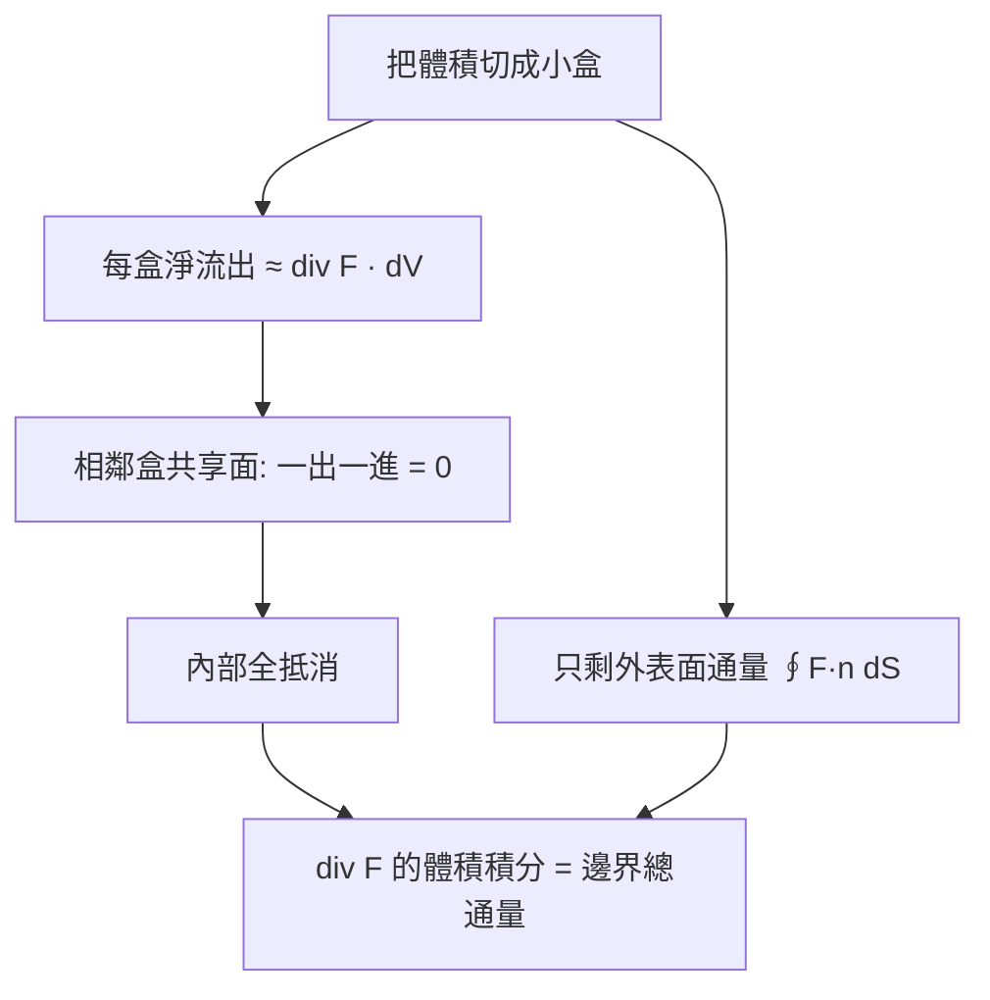

# 04.2 散度定理：通量從「體積」看與從「表面」看是一樣的

## 本節目標

- 說出並理解散度定理（Gauss 定理）： $`\iiint_V \nabla\cdot\mathbf{F}\,dV = \oiint_{\partial V} \mathbf{F}\cdot\mathbf{n}\,dS`$ 。
- 建立物理直覺： $`\nabla\cdot\mathbf{F}`$ 是「單位體積的淨流出率」，積分起來就是總通量。
- 用電學觀點理解：電荷產生通量，通量只看包住的電荷。
- 用 SymPy 驗證球面上的重力場通量 $`= -4\pi GM`$ ，並對立方體做通量對照實驗。

---

## 定理敘述

設 $`\mathbf{F}`$ 是區域 $`V`$ 及其邊界 $`\partial V`$ 上的光滑向量場， $`\mathbf{n}`$ 是指向**外側**的單位法向量：

$$
\iiint_V \nabla\cdot\mathbf{F}\, dV \;=\; \oiint_{\partial V} \mathbf{F}\cdot \mathbf{n}\, dS
$$

左邊稱為「發散量的體積積分」，右邊稱為「穿過邊界面的總通量」。散度定義為

$$
\nabla\cdot\mathbf{F} = \frac{\partial F_x}{\partial x} + \frac{\partial F_y}{\partial y} + \frac{\partial F_z}{\partial z}
$$

## 物理直覺：單位體積的淨流出

想像 $`\mathbf{F}`$ 是流體速度場。取一個很小的長方體，邊長 $`\Delta x, \Delta y, \Delta z`$ ：

- 從 $`x`$ 方向的兩個面流出的淨量約為 $`\dfrac{\partial F_x}{\Delta}\cdot`$ 的差，即 $`\dfrac{\partial F_x}{\partial x}\Delta x\,\Delta y\,\Delta z`$ （一格一階展開的直覺版）。
- 三個方向加起來，小盒子的淨流出 $`\approx (\nabla\cdot\mathbf{F})\,\Delta V`$ 。

也就是說：**散度 = 每單位體積的淨流出率**。把整個區域切成小盒子：

- 相鄰盒子之間：甲盒流出的正好流進乙盒，**互相抵消**（這是 Green 定理「小圈相消」的 3D 版）。
- 剩下無人抵消的，就是穿過**最外層邊界**的通量。

所以「內部所有小盒淨流出之和」＝「穿過外邊界的總通量」，取極限即散度定理。



## 電學直覺：電荷產生通量

靜電場 $`\mathbf{E} = \dfrac{q}{4\pi\varepsilon_0}\,\dfrac{\mathbf{r}}{r^3}`$ （點電荷），它的散度在 $`r\neq 0`$ 處為 0，但在原點集中了一個「散度源」：

$$
\nabla\cdot\mathbf{E} = \frac{q}{\varepsilon_0}\,\delta(\mathbf{r})
$$

代入散度定理：

$$
\oiint \mathbf{E}\cdot\mathbf{n}\, dS = \iiint \nabla\cdot\mathbf{E}\, dV = \frac{q}{\varepsilon_0}
$$

**這就是 Gauss 電學定律**。直覺版：把電荷想成水龍頭，通量是從水龍頭流出、穿過任何包住它的水面的總水量——不論包成球、包成方盒，總量都一樣，只由電荷總數決定。重力場同理，只是源為負（重力線是「吸入」）：

$$
\mathbf{g} = -\,GM\,\frac{\mathbf{r}}{r^3},\qquad \oiint_{\partial V}\mathbf{g}\cdot\mathbf{n}\,dS = -4\pi GM \quad(\text{當 } V \text{ 包住質量 } M)
$$

## SymPy 驗證：球面上的重力場通量

對半徑 $`a`$ 的球面與以質量 $`M`$ 為中心的球體，分別算兩邊。

```python
import sympy as sp

x, y, z, a, G, M = sp.symbols('x y z a G M', positive=True)

# 重力場 g = -GM * r / r^3
r2 = x**2 + y**2 + z**2
g = -G*M/sp.sqrt(r2)**3 * sp.Matrix([x, y, z])

# 左邊：div g 在 r > 0 處的值（奇點在原點，另行分析）
div_g = (sp.diff(g[0], x) + sp.diff(g[1], y) + sp.diff(g[2], z)).simplify()
print("在 r>0 處 div g =", div_g)          # 0

# 右邊：球面參數化，n 指向外側；在 r = a 上 F·n = -GM/a^2
th, ph = sp.symbols('th ph', real=True)
Fdotn = -G*M/a**2
flux = sp.integrate(Fdotn * a**2 * sp.sin(ph), (ph, 0, sp.pi), (th, 0, 2*sp.pi))
print("球面總通量 =", flux)                # -4*pi*G*M
assert sp.simplify(flux + 4*sp.pi*G*M) == 0
```

輸出：

```text
在 r>0 處 div g = 0
球面總通量 = -4*pi*G*M
```

注意：體積積分那邊按古典定理「逐點」皘分會得 0（奇點被跳過），而表面通量是 $`-4\pi GM`$ 。矛盾嗎？不——正是因為原點有奇點，嚴格處理需要把原點挖掉（第 5 章的微分形式/廣義函數會乾淨地吸收這件事），而物理上我們直接讀出結論：**通量只由包住的質量（電荷）決定**。

## 動手實驗：立方體 vs. 球的通量對照

取場 $`\mathbf{F}=(x, y, z)`$ ，散度為 3。對以原點為中心、邊長 $`2`$ 的立方體，逐一算六個面的通量，再與「散度 × 體積」對照；同法對半徑 $`1`$ 的球。

```python
import sympy as sp

x, y, z = sp.symbols('x y z', real=True)
F = sp.Matrix([x, y, z])
divF = sp.diff(F[0], x) + sp.diff(F[1], y) + sp.diff(F[2], z)
print("div F =", divF)                     # 3

cube_flux = 0
# 六個面：每面上固定一個座標為 ±1，n 為外法向，F·n 恆為 1，面積 = 4
for s in (1, -1):
    cube_flux += 4*1                        # x=±1 面
    cube_flux += 4*1                        # y=±1 面
    cube_flux += 4*1                        # z=±1 面
print("立方體總通量 =", cube_flux)          # 24
print("div F × 體積         =", sp.integrate(3, (x,-1,1), (y,-1,1), (z,-1,1)))  # 24
assert cube_flux == 24

# 球體對照：F·n = r·(r/r) = r = 1（在 r=1 上），面積 4π
import sympy as sp
th, ph = sp.symbols('th ph', real=True)
sphere_flux = sp.integrate(1*sp.sin(ph), (ph, 0, sp.pi), (th, 0, 2*sp.pi))
print("球面總通量 =", sphere_flux)          # 4*pi
print("div F × 球體積     =", sp.Rational(4,3)*sp.pi)   # 4*pi/3
assert sp.simplify(sphere_flux - sp.Rational(4,3)*sp.pi) == 0
```

輸出：

```text
div F = 3
立方體總通量 = 24
div F × 體積         = 24
球面總通量 = 4*pi
div F × 球體積     = 4*pi/3
```

形狀不同（立方體 24 對 24；球 $`4\pi`$ 對 $`\frac{4\pi}{3}`$ ），但「通量 = 散度 × 體積」在兩種形狀上都成立——定理不看形狀，只看內部。

## 常見陷阱

- **法向量方向**： $`\mathbf{n}`$ 必須指向區域外側，否則差一個負號。
- **奇點**：場在內部有奇點（點電荷、點質量）時不能直接逐點積分散度；要把奇點挖掉，對挖剩的區域用定理，再讓洞縮回奇點。
- **散度局部性**： $`\nabla\cdot\mathbf{F}=0`$ 只表示「無局部源」，不代表通量為零——通量由內部源的總量決定。

## 小結與練習

散度定理的一句話版本：**穿出邊界的總流量 = 內部各處「產生流量」的總和**。內部交通互相抵消是這句話的證明骨架；電學的 Gauss 定律是它最重要的應用。

練習：

1. 對 $`\mathbf{F}=(x^2, yz, z^2)`$ 與單位立方體 $`[0,1]^3`$ ，分別用 SymPy 算表面通量與體積積分並比對。
2. 半徑 $`a`$ 的球面、場 $`\mathbf{F}=\mathbf{r}`$ ，通量是多少？與 $`4\pi a^3`$ 對照。
3. 場 $`\mathbf{F}=\hat{\mathbf{r}}/r^2`$ 在**不含**原點的區域上，通量必為何？說明理由。
4. 修改實驗程式：把立方體改為 $`[0,2]\times[0,1]\times[0,1]`$ ，重新對照通量與散度積分。
