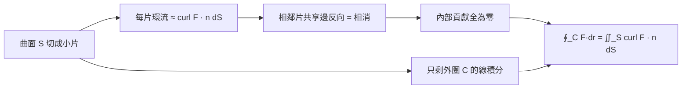

# 04.3 古典 Stokes 定理：環流 = 曲面上的旋度通量

## 本節目標

- 說出並理解古典 Stokes 定理： $`\oint_C \mathbf{F}\cdot d\mathbf{r} = \iint_S (\nabla\times\mathbf{F})\cdot\mathbf{n}\,dS`$ 。
- 建立「小圈相消」的視覺化直覺：曲面上每一小片的邊界環流，內部互相抵消，只剩外圈 $`C`$ 。
- 用 SymPy 在碟面與半球面上驗證，並用右手定則判斷方向。
- 實驗：計算磁場沿載流圓線的環流（安培定律 $`\oint \mathbf{B}\cdot d\mathbf{r}=\mu_0 I`$ ）。

---

## 定理敘述

設 $`C`$ 是空間中一條簡單閉曲線， $`S`$ 是以 $`C`$ 為邊界的曲面（ $`C`$ 的方向與 $`S`$ 的法向 $`\mathbf{n}`$ 滿足右手定則）， $`\mathbf{F}`$ 是光滑向量場，則

$$
\oint_C \mathbf{F}\cdot d\mathbf{r} \;=\; \iint_S (\nabla\times\mathbf{F})\cdot\mathbf{n}\, dS
$$

其中旋度為

$$
\nabla\times\mathbf{F} = \left(\frac{\partial F_z}{\partial y}-\frac{\partial F_y}{\partial z},\ \frac{\partial F_x}{\partial z}-\frac{\partial F_z}{\partial x},\ \frac{\partial F_y}{\partial x}-\frac{\partial F_x}{\partial y}\right)
$$

## 意義：環流等於旋度通量

沿 $`C`$ 繞一圈的線積分 $`\oint\mathbf{F}\cdot d\mathbf{r}`$ 稱為**環流**：向量場沿著這圈「推著你轉」的總力道。Stokes 定理說：這個整體的環流，等於該曲面每一小片「局部漩渦強度」 $`(\nabla\times\mathbf{F})\cdot\mathbf{n}`$ 的總和。

選不同的曲面 $`S`$ （同一條 $`C`$ 可以撐出很多曲面：平坦的碟、鼓脹的半球、皺巴巴的裙面），結果都一樣——因為定理看的是**共同的邊界**，不是曲面本身。這是本節的關鍵直覺，也預告 04.4 的「形式」統一。

## 視覺化：小圈相消（3D 版）

把曲面 $`S`$ 切成許多小片，每片沿自己的邊界繞圈（方向由 $`\mathbf{n}`$ 與右手定則決定）：

- 相鄰兩片的共享邊：一片正向走、另一片反向走，**積分相消**。
- 內部所有共享邊全部抵消，只剩最外圈 $`C`$ 上的貢獻。
- 而每一小片的環流 $`\approx (\nabla\times\mathbf{F})\cdot\mathbf{n}\,\Delta S`$ （一小片就是一個微小渦輪葉片），總和取極限即為旋度通量。



## 右手定則判方向

定界的方向約定：若你右手拇指指向 $`\mathbf{n}`$ ，四指自然彎曲的方向就是 $`C`$ 的正向。例如：

- $`S`$ 是 $`xy`$ 平面上的碟面、 $`\mathbf{n}=+\hat{\mathbf{k}}`$ ： $`C`$ 取**逆時針**（從上往下看）。
- 同一碟面、 $`\mathbf{n}=-\hat{\mathbf{k}}`$ ： $`C`$ 取順時針，等式兩邊同時變號，定理仍成立。
- 換到半球面（上方鼓起）： $`\mathbf{n}`$ 仍大致朝上， $`C`$ 仍是逆時針。

## SymPy 驗證 1：碟面

取 $`\mathbf{F} = (-y,\ x,\ 0)`$ （純旋轉場）， $`C`$ 是半徑 $`R`$ 的圓（ $`z=0`$ ）， $`S`$ 是碟面， $`\mathbf{n}=\hat{\mathbf{k}}`$ 。

```python
import sympy as sp

x, y, z, t, R = sp.symbols('x y t R', real=True)
R = sp.symbols('R', positive=True)
F = sp.Matrix([-y, x, 0])

# 左邊：C: (R cos t, R sin t, 0)
xt, yt, zt = R*sp.cos(t), R*sp.sin(t), 0
line = sp.integrate(
    F[0].subs({x:xt, y:yt, z:zt})*sp.diff(xt, t) +
    F[1].subs({x:xt, y:yt, z:zt})*sp.diff(yt, t) +
    F[2].subs({x:xt, y:yt, z:zt})*sp.diff(zt, t), (t, 0, 2*sp.pi))

# 右邊：旋度 = (0, 0, 2)，碟面上 n = k、dS = r dr dθ
r, th = sp.symbols('r th', real=True, positive=True)
curlF = sp.Matrix([
    sp.diff(F[2], y) - sp.diff(F[1], z),
    sp.diff(F[0], z) - sp.diff(F[2], x),
    sp.diff(F[1], x) - sp.diff(F[0], y)])
print("curl F =", curlF)                                   # (0, 0, 2)
flux = sp.integrate(curlF[2]*r, (r, 0, R), (th, 0, 2*sp.pi))

print("左(環流) =", sp.simplify(line))                     # 2*pi*R**2
print("右(旋度通量) =", sp.simplify(flux))                  # 2*pi*R**2
assert sp.simplify(line - flux) == 0
```

輸出：

```text
curl F = Matrix([[0], [0], [2]])
左(環流) = 2*pi*R**2
右(旋度通量) = 2*pi*R**2
```

## SymPy 驗證 2：半球面（不同的 S，同一條 C）

同一條圓 $`C`$ （半徑 $`R`$ 、 $`z=0`$ ），把 $`S`$ 換成上半球： $`\mathbf{r}(\phi,\theta)=R(\sin\phi\cos\theta,\ \sin\phi\sin\theta,\ \cos\phi)`$ ， $`\phi\in[0,\pi/2]`$ ，外法向朝上。用 SymPy 直接算旋度通量。

```python
import sympy as sp

phi, th, R = sp.symbols('phi th R', real=True)
R = sp.symbols('R', positive=True)

# 參數化上半球
sph = sp.Matrix([R*sp.sin(phi)*sp.cos(th),
                 R*sp.sin(phi)*sp.sin(th),
                 R*sp.cos(phi)])
sph = sp.Matrix([sph[0], sph[1], sph[2]])   # phi: 0..pi/2 (上半球)

F = sp.Matrix([-y, x, 0])
Fx = F[0].subs({sp.Symbol('x'): sph[0], sp.Symbol('y'): sph[1], sp.Symbol('z'): sph[2]})

# 正確做法：用變數代入
X, Y, Z = sp.symbols('X Y Z', real=True)
x_, y_, z_ = sph
Fx_ = (-y_).subs({}) ; Fy_ = x_ ; Fz_ = 0           # 在球面上 F = (-y, x, 0)

curlF_k = 2                                          # curl F = (0,0,2)

# 球面法向（外、朝上觀察）：n = (sinφ cosθ, sinφ sinθ, cosφ)
n = sp.Matrix([sp.sin(phi)*sp.cos(th), sp.sin(phi)*sp.sin(th), sp.cos(phi)])
dot = curlF_k * n[2]                                # (curl F)·n = 2*|cos phi| ≥ 0
dS  = R**2 * sp.sin(phi)

flux_hemi = sp.integrate(sp.integrate(dot*dS, (phi, 0, sp.pi/2)), (th, 0, 2*sp.pi))
print("半球上的旋度通量 =", sp.simplify(flux_hemi))   # 2*pi*R**2
assert sp.simplify(flux_hemi - 2*sp.pi*R**2) == 0
```

輸出：

```text
半球上的旋度通量 = 2*pi*R**2
```

同一條 $`C`$ 、兩種不同的 $`S`$ （碟面、半球），右邊都等於 $`2\pi R^2 =`$ 左邊的環流。這正是「Stokes 定理只看邊界」的實證。

## 動手實驗：磁場沿載流圓線的環流

一條無限長直導線沿 $`z`$ 軸、電流 $`I`$ ，磁場 $`\mathbf{B}=\dfrac{\mu_0 I}{2\pi r}\,\hat{\boldsymbol{\theta}}`$ 。取半徑 $`a`$ 的圓（平面 $`z=0`$ ，逆時針）計算環流，並與安培定律 $`\mu_0 I`$ 對照。

```python
import sympy as sp

mu0, I, a = sp.symbols('mu0 I a', positive=True)
t = sp.symbols('t', real=True)

# 圓線: (a cos t, a sin t, 0)，逆時針
xt, yt = a*sp.cos(t), a*sp.sin(t)
# B·dr = B_θ * a dt，B_θ = mu0*I/(2*pi*a)
circ = sp.integrate(mu0*I/(2*sp.pi*a) * a, (t, 0, 2*sp.pi))
print("∮ B·dr =", circ)        # mu0*I
assert sp.simplify(circ - mu0*I) == 0

# 用 Stokes 從碟面看：curl B 的 z 分量在 r>0 處為 0，
# 但電流在原點（奇點為 curl 的 delta 源），通量即 mu0*I。
```

輸出：

```text
∮ B·dr = mu0*I
```

方向判斷：右手四指沿逆時針（從 $`+z`$ 看下去），拇指朝 $`+\hat{\mathbf{k}}`$ ；電流沿 $`+\hat{\mathbf{k}}`$ 時磁場 $`\hat{\boldsymbol{\theta}}`$ 恰與繞行方向同向，故環流為正 $`\mu_0 I`$ 。若電流反向或繞行反向，環流變號——拇指與四指的約定（右手定則）就是這件事的幾何譯碼器。

## 常見陷阱

- **方向約定**： $`C`$ 的方向與 $`\mathbf{n}`$ 必須配套（右手定則）。任一反向，兩邊同時變號。
- **曲面任意性**：定理對「同一條 $`C`$ 的任一張 $`S`$ 」都成立，但 $`\mathbf{F}`$ 必須在整個 $`S`$ 上光滑。場有奇點時（如上面磁場的導線），要繞開奇點另行處理。
- **只閉才有定理**： $`\oint`$ 是閉曲線專用；非閉曲線的線積分一般依賴路徑。

## 小結與練習

Stokes 定理的一句話：**整體的環流 = 曲面上局部漩渦的總和**。內部共享邊相消是證明骨架；右手定則是把「轉的方向」與「面的方向」焊接起來的螺絲。

練習：

1. 對 $`\mathbf{F}=(z,\ x,\ y)`$ 與 $`xy`$ 平面上半徑 1 的圓，用 SymPy 算兩邊並比對。
2. 同一條 $`C`$ ，把 $`S`$ 換成 $`z=0`$ 上的碟面與 $`z = \sqrt{R^2-x^2-y^2}`$ 的上半球，確認通量相同（就像本節的半球驗證）。
3. 設 $`\mathbf{F}=\nabla f`$ （梯度場），說明 $`\oint_C \nabla f\cdot d\mathbf{r}=0`$ 與 $`\nabla\times\nabla f=\mathbf{0}`$ 的關係。
4. 改寫磁場實驗：讓圓線半徑從 0.5 變到 2（不同 $`a`$ ），確認環流始終為 $`\mu_0 I`$ ，不解釋「為什麼」，只觀察。
