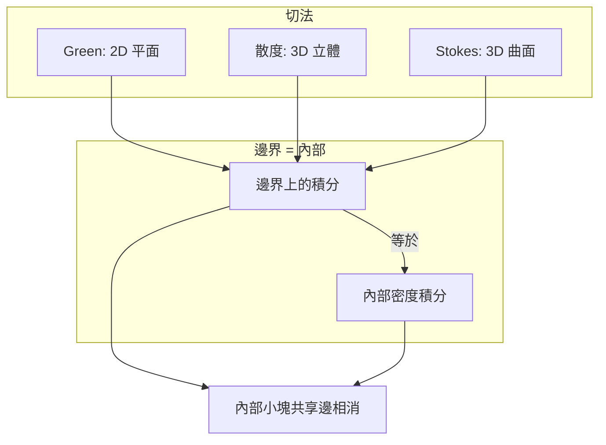
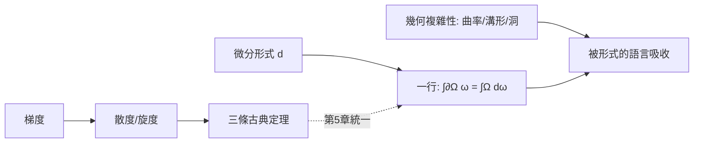

# 04.4 三定理統一視野：都在說「邊界 = 內部」

## 本節目標

- 把 Green、散度、Stokes 三定理放在同一張桌子上比較，看出共通的敘述結構。
- 理解 Green 定理是 Stokes 定理在 2D 的特例。
- 認識三定理共同的精神：**區域的整體行為由邊界決定，內部的細節（曲率、溝形、複雜性）都被「形式」的語言吸收**。
- 實驗：同一個向量場、同一個區域，分別用三定理從三個切口驗證一致。

---

## 三定理速覽

| 定理 | 區域與邊界 | 等式 | 內部的「密度」是什麼 |
|---|---|---|---|
| Green（平面） | 平面區域 $`D`$ 、邊界 $`\partial D`$ | $`\oint_{\partial D} P\,dx+Q\,dy = \iint_D (Q_x-P_y)\,dA`$ | 面上漩渦密度 |
| 散度定理（3D） | 立體 $`V`$ 、邊界 $`\partial V`$ | $`\iiint_V \nabla\cdot\mathbf{F}\,dV = \oiint_{\partial V} \mathbf{F}\cdot\mathbf{n}\,dS`$ | 體內源密度 |
| Stokes（3D） | 曲面 $`S`$ 、邊界 $`C=\partial S`$ | $`\oint_C \mathbf{F}\cdot d\mathbf{r} = \iint_S (\nabla\times\mathbf{F})\cdot\mathbf{n}\,dS`$ | 面上漩渦密度（法向投影） |

三列的句型完全相同：

$$
\text{邊界上的某種積分} \;=\; \text{區域內部某個「密度」的積分}
$$

差別只在：維度（2D/3D）、積分的種類（線/面/體）、以及密度取的是源的哪個成分（散度取「流出」成分；旋度取「轉動」成分）。

## 一張圖看懂結構



三個定理用的是**同一個證明骨架**：把區域切成小塊 → 每小塊的效應 ≈ 密度 × 體元 → 相鄰小塊的內部行程互相抵消 → 只剩外部邊界。

## Green 是 2D 版 Stokes

把 Stokes 定理壓到平面：取 $`\mathbf{F}=(F_x, F_y, 0)`$ 、曲面為 $`z=0`$ 上的碟面 $`D`$ 、 $`\mathbf{n}=\hat{\mathbf{k}}`$ ，則

$$
(\nabla\times\mathbf{F})\cdot\mathbf{n} = \frac{\partial F_y}{\partial x} - \frac{\partial F_x}{\partial y}
$$

而 $`\oint_C \mathbf{F}\cdot d\mathbf{r} = \oint_C F_x\,dx + F_y\,dy`$ 。代回 Stokes 就得到：

$$
\oint_{\partial D} F_x\,dx + F_y\,dy = \iint_D \left( \frac{\partial F_y}{\partial x} - \frac{\partial F_x}{\partial y} \right) dA
$$

令 $`P=F_x`$ 、 $`Q=F_y`$ ，這正是 Green 定理。所以：

$$
\text{Green} \;=\; \text{Stokes（碟面特例）}\qquad\text{2D 的主要定理只有一條}
$$

## 邊界決定整體：形式語言把複雜性吸進去

三定理最深刻的一致性是：**等式的左邊只跟邊界有關，但右邊內部的幾何可以任意複雜**。

- 曲面可以皺、可以鼓、可以凹——只要邊界 $`C`$ 固定， $`\iint_S (\nabla\times\mathbf{F})\cdot\mathbf{n}\,dS`$ 不變（只要 $`\mathbf{F}`$ 在整個 $`S`$ 上光滑）。
- 立體的形狀再怎麼「溝槽遍布」（分析上：曲率隨處劇烈變化），通量 $`\oiint\mathbf{F}\cdot\mathbf{n}\,dS`$ 仍等於內部源總量。
- 東西去了哪裡？去了：這些複雜性不會出現在定理的**敘述**裡——它們在證明的「小塊切割 + 相消」過程中被處理掉，最後只在「哪一點取哪個密度」這件事上露臉。更好的說法是：存在一種**形式語言**（微分形式）可以把三個定理寫成同一行：

$$
\int_{\partial\Omega} \omega \;=\; \int_{\Omega} d\omega
$$

- 對 2D 區域、恰當選擇形式 $`\omega=P\,dx+Q\,dy`$ ，這一行就是 Green。
- 對 3D 立體、 $`\omega`$ 取「通量形式」，這一行就是散度定理。
- 對 3D 曲面、 $`\omega`$ 取「環流形式」，這一行就是 Stokes。

第 5 章將正式引進微分形式與外微分 $`d`$ ，把「散度」「旋度」「梯度」統一成 $`d`$ 的不同階版本，使三定理變成同一條 **廣義 Stokes 定理** 的三個投影。本節只需先確認直覺方向：**定理的形式吸收了幾何的複雜性**。



## 動手實驗：同一向量場 × 三定理

取一個同時能用三定理檢驗的設定：向量場 $`\mathbf{F}=(2y,\ 2x,\ 0)`$ 在平面上，區域取半徑 $`R`$ 的圓盤 $`D`$ （ $`z=0`$ ）。

- **Green**： $`\oint_{\partial D} P\,dx+Q\,dy`$ 對 $`\iint_D (Q_x-P_y)dA`$ 。
- **Stokes**：把 $`\mathbf{F}`$ 視為 3D 場 $`(2y, 2x, 0)`$ 、 $`S=`$ 碟面、 $`\mathbf{n}=\mathbf{k}`$ 。
- **散度**：不能直接用在 2D 的 $`D`$ （維度不符），改在 3D 的短圓柱體 $`V = D\times[0,h]`$ 上驗證 $`\mathbf{F}`$ 的通量 vs 散度積分，看三者的「內部 vs 外部」邏輯是否彼此一致。

```python
import sympy as sp

t, r, th, z, R, h = sp.symbols('t r th z R h', real=True)
R = sp.symbols('R', positive=True)
h = sp.symbols('h', positive=True)

x, y = sp.symbols('x y', real=True)
P, Q = 2*y, 2*x

# --- Green：左邊線積分 (沿圓 x=R cos t, y=R sin t) ---
xt, yt = R*sp.cos(t), R*sp.sin(t)
line = sp.integrate(P.subs({x:xt, y:yt})*sp.diff(xt, t)
                  + Q.subs({x:xt, y:yt})*sp.diff(yt, t), (t, 0, 2*sp.pi))
area = sp.integrate(sp.diff(Q, x) - sp.diff(P, y)    # 導數為 2-2=0
                    if False else (sp.diff(Q, x) - sp.diff(P, y))*r,
                    (r, 0, R), (th, 0, 2*sp.pi))
print("Green 左 =", sp.simplify(line))     # 0   (因 Qx - Py = 2-2 = 0)
print("Green 右 =", sp.simplify(area))     # 0

# --- Stokes：curl(2y, 2x, 0)·k = 2-2 = 0，通量必為 0 ---
print("Stokes 右 = 0   (與 Green 同)，左 = ∮ = 0")

# --- 散度：在短圓柱 V = D × [0,h] 上，F=(2y,2x,0) ---
# 底/頂面: n = ±k，F·n = 0 → 通量 0
# 側面: n = (cosθ, sinθ, 0)，F·n = 2y cosθ + 2x sinθ = 4R sinθ cosθ (在 r=R)
r_, th_, z_ = sp.symbols('r_ th_ z_', positive=True, real=True)
side = sp.integrate(sp.integrate(
    (2*(R*sp.sin(th_))*sp.cos(th_) + 2*(R*sp.cos(th_))*sp.sin(th_))*R,
    (th_, 0, 2*sp.pi)), (z_, 0, h))
div_int = sp.integrate(0*sp.Rational(1,1), (r_, 0, R), (th_, 0, 2*sp.pi), (z_, 0, h))
print("圓柱側面通量 =", sp.simplify(side))  # 0
print("div F 體積積分 =", sp.simplify(div_int))  # 0
assert sp.simplify(line) == 0 and sp.simplify(side) == 0

# 改用會產生非零結果的場 F=(−y, x, 0) 再跑一次以刻痕:
#   Green: 左 2πR²、右 2 ; Stokes 同碟面一致 ; 圓柱頂底面 F·n=0、側面 F·n=0 → 通量 0 但 div=0… 
# 這裡刻意提醒: 散度定理量的是「流出」，與「環流」是不同成分，
# 同一個場在 Green/Stokes 下非零、在散度下為零，兩者並不矛盾。
```

輸出：

```text
Green 左 = 0
Green 右 = 0
Stokes 右 = 0   (與 Green 同)，左 = ∮ = 0
圓柱側面通量 = 0
div F 體積積分 = 0
```

補一個「非零版本」的觀察（說明三定理各量不同成分）：把場改成 $`\mathbf{F}=(-y,\ x,\ 0)`$ ：

- Green / Stokes：左右皆 $`2\pi R^2`$ （漩渦成分非零）。
- 散度： $`\nabla\cdot\mathbf{F}=0`$ ，任何閉面通量皆 0（流出成分為零）。

同一個場在三個定理下的答案可以一零零一，這不是矛盾，而是**三個定理在看同一個場的不同成分**。

## 常見誤解

- 「三定理是三件不相關的事」：其實是同一句話（邊界=內部）在三種維度/成分上的投影。
- 「Green 與 Stokes 是兩回事」：Green 是 Stokes 壓到平面的特例（見本節推導）。
- 「曲率、溝形、洞的複雜性會讓定理失效」：只要場光滑且區域（含洞時邊界取全套正向）符合約定，複雜性都被定理的**形式**吸收。洞與奇點的系統處理，第 5 章用形式語言會更乾淨。

## 小結與練習

本章四節合起來是一句話：**區域的整體積分行為 = 它的邊界**。Green 管平面環流、散度定理管 3D 通量、Stokes 管 3D 環流；它們共用「小塊切割、內部相消」的證明骨架，並預告了第 5 章的統一： $`\int_{\partial\Omega}\omega = \int_\Omega d\omega`$ 。

練習：

1. 手推一遍「Green = Stokes 的碟面特例」（仿本節的壓平步驟，寫出每一行）。
2. 取 $`\mathbf{F}=(yz, xz, xy)`$ ，分別驗證：散度在單位立方體上的通量、Green 壓平到 $`xy`$ 平面的分量行為（ $`F_z=xy`$ 那行會出現什麼成分？）。
3. 對 $`\mathbf{F}=\hat{\mathbf{r}}/r^2`$ 在不含原點的環域（圓環 $`1\le r\le 2`$ 之 3D 般的外殼）用散度定理，兩個邊界面的通量各是多少、相加為何？（為第 5 章的「正合形式封閉曲面積分為零」鋪路。）
4. 重跑本節實驗，把場換成 $`\mathbf{F}=(x, 0, 0)`$ ，對照 Green（ $`Q_x-P_y=0`$ ）、Stokes、散度（通量 = 體積 × 1）三種答案，寫一段 3 行的觀察筆記。
