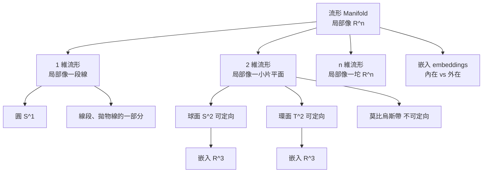

# 06.1 什麼是流形

## 本節目標

- 用直覺理解「流形」（manifold）：一個**局部**看起來像 $`\mathbb{R}^n`$ 的空間。
- 認識一維與二維流形的典型例子：圓、球面、環面、莫比烏斯帶。
- 區分**內在座標**與**外在（嵌入）座標**。
- 用 SymPy 的 `diffgeom` 模組寫出球面的參數化。

## 直覺：地球表面是最好的老師

你每天走路上學，腳下的地面感覺是平的：向前一步、向右一步，就像在平面座標系走動。太陽比你大多了，當你站在真正的大地上而不只是街區裡，你覺得還是平的。但搭上飛機、從太空看地球，它是球形的。

這就是流形的核心思想：

> **流形是一個整體上可能彎曲、但每一小塊局部都像 $`\mathbb{R}^n`$ 的空間。**

「局部像 $`\mathbb{R}^n`$ 」是什麼意思？意思是：在每一點附近，你都能找到一小塊鄰域，並在這塊鄰域上定義座標（幾個實數），使得這幾個實數唯一描繪這鄰域裡的點，而且鄰域的幾何在小尺度下與平坦空間幾乎沒有差別。

- 地球表面：局部像 $`\mathbb{R}^2`$ ，所以是 **2 維流形**。
- 圓周：局部像一小段直線（ $`\mathbb{R}^1`$ ），所以是 **1 維流形**。
- $`\mathbb{R}^n`$ 本身：最平凡的流形（一張圖就蓋住全部）。

注意流形不需要有一個「看得見」的彎曲藏在哪裡——只要你規定局部可用 $`n`$ 個數描述，流形本身**只知道維度與局部結構**。彎不彎、長什麼樣，那是「嵌入」的事，稍後再談。

## 一維流形：圓為什麼學會了壞脾氣

最簡單的非平凡一維流形是圓 $`S^1`$ 。我們想用**一個**參數描述它。

### 失敗的嘗試：一個參數的陷阱

直覺上，圓上每點可以用角度 $`\theta`$ 描述。但 $`\theta`$ 有個麻煩：

$$
\theta = 0 \quad \text{與} \quad \theta = 2\pi \quad \text{是同一個點！}
$$

角度從 $`0`$ 沿著圓走到 $`2\pi`$ 時，你回到起點。一個參數在一個**開區間**上連續地描述整個圓**做不到**——圓是「閉合」的，你會在某一點撞到重複或斷裂。

數學上這件事的陳述是：**沒有任何一個連續雙射能把整個圓映到 $`\mathbb{R}^1`$ 的開區間**。這其實就是拓樸的差異：圓在拓樸上和直線不同。

### 正確的做法：兩個座標卡

解決辦法（下一節詳述）是：**放棄一張圖，改用兩張**。例如圓的東半可以用 $`y`$ 當座標（因為 $`y`$ 在東半是單值），西半可以用 $`-y`$ 當座標。每一點至少落在一張圖裡，而兩張圖交疊的地方可以互相換算。

所以一維流形的定義就是：每點附近都有一段小鄰域，可被某個參數單值地描述。圓符合——只要你不堅持用同一個參數一張圖蓋住全部。

## 二維流形：球面、環面、莫比烏斯帶

二維流形的經典例子：

### 球面 $`S^2`$

$$
S^2 = \left\{ (x,y,z) \in \mathbb{R}^3 \mid x^2 + y^2 + z^2 = 1 \right\}
$$

局部像一小片平面，整體閉合。用經緯度 $`(\theta, \phi)`$ 描述，但北極點附近 $`(\theta, \phi)`$ 會失效（下一節細談），所以需要**兩張以上的座標卡**。

### 環面 $`T^2`$

甜甜圈的表面： $`T^2 = S^1 \times S^1`$ 。需要 $`(u, v)`$ 兩個角度參數，每個都像 $`S^1`$ 一樣有重複問題。

### 莫比烏斯帶

拿一條紙帶，扭半圈後黏合兩端。局部仍是平面，但整體「不可定向」：你沿著中央線走一圈回來，發現自己的左右互換了。這提醒我們：流形可以根據**可否定向**再分類。

### mermaid 分類圖



## 維度與嵌入：內在 vs 外在座標

「維度」在流形理論裡是**內在的**——不是你在外面看到的，而是這個空間本身的自由度。

### 內在座標

想像你是地球上的螞蟻，無法跳起來看三次。你只能用腳下的經緯度走動、測量：

$$
(\theta, \phi) \quad \text{、} \quad \theta \in (0, \pi), \quad \phi \in (-\pi, \pi)
$$

這些是**內在座標**：它們只用流形自己的資訊。

### 外在座標

如果你把它放進 $`\mathbb{R}^3`$ ，每個點還可以有外在座標：

$$
(x, y, z) \quad \text{滿足} \quad x^2 + y^2 + z^2 = 1
$$

**但外在座標有三個數，不是兩個**——因為有多餘約束 $`x^2+y^2+z^2=1`$ 。外在座標是嵌入（embedding）的副產品，不是流形的本質。同一個流形可以嵌入不同的環境空間（例如 $`S^2`$ 可以嵌 $`\mathbb{R}^3`$ ，也可以嵌 $`\mathbb{R}^4`$ ）。

> **微分幾何的態度**：我們盡量只用內在座標講事情。彎曲程度（曲率）不需要從外面看「你彎得像什麼形狀」，而是用內在量（如度量，見 06.4）直接算出來。這就是為什麼紙帶在字面上沒有「外面」也能彎。

## SymPy 實作：球面的參數化

SymPy 的 `sympy.diffgeom` 已經內建了一些常見流形。我們先用它取球面，再自己寫一個參數化示範內在座標如何產生外在座標。

```python
from sympy import symbols, sin, cos, pi
from sympy.diffgeom import Manifold, Patch, CoordSystem
from sympy.diffgeom import TensorProduct

# 建立一個 2 維流形與座標卡
m = Manifold('M', 2)
patch = Patch('P', m)
theta, phi = symbols('theta phi', real=True)
cs = CoordSystem('spherical', patch, [theta, phi])

# 用內在座標給出外在座標（嵌入到 R^3）
x = sin(theta)*cos(phi)
y = sin(theta)*sin(phi)
z = cos(theta)
print('嵌入公式：')
print('x =', x)
print('y =', y)
print('z =', z)

# 驗證 x^2+y^2+z^2 = 1（球面上，自動滿足）
from sympy import simplify
expr = simplify(x**2 + y**2 + z**2)
print('x^2 + y^2 + z^2 =', expr)   # 應印出 1
```

輸出：

```
嵌入公式：
x = sin(theta)*cos(phi)
y = sin(theta)*sin(phi)
z = cos(theta)
x^2 + y^2 + z^2 = 1
```

這段程式抓到一個關鍵：內在座標只要 2 個參數 $`(\theta, \phi)`$ ，而外在座標 3 個數要滿足一條方程。**差一個約束，正好差一維。**

> 提醒：較新版 sympy 的 `diffgeom` 介面有調整（例如 `CoordSystem` 直接接受 symbol 清單）。若你版本不同，跑起來語法有些差異時，看錯誤訊息微調即可，觀念不變。

## 動手實驗

**實驗 1：參數化球面的局部小片**

在北極 $`\theta=0`$ 附近，參數 $`(\theta, \phi)`$ 還沒失效（下一節會看到更精確的失效說明）。寫個小程式，在 $`\theta \in [0, 0.1]`$ 、 $`\phi`$ 各取值時印出 $`(x,y,z)`$ ，看看它們是不是像平面上一小塊格子：

```python
import numpy as np

for theta_v in [0.0, 0.05, 0.1]:
    for phi_v in [0.0, 0.5, 1.0]:
        x = np.sin(theta_v)*np.cos(phi_v)
        y = np.sin(theta_v)*np.sin(phi_v)
        z = np.cos(theta_v)
        print(f'theta={theta_v:.2f}, phi={phi_v:.1f} -> ({x:.4f}, {y:.4f}, {z:.4f})')
```

你會發現 $`z`$ 幾乎都是 1， $`x, y`$ 都非常小——**局部像平面**。

**實驗 2：發現圓的一參數失敗**

用角度 $`\theta`$ 描述圓，試著檢查一個參數的雙射性：

```python
from sympy import Symbol, sin, cos, Eq, simplify
th = Symbol('theta', real=True)
p1 = (cos(th), sin(th))
# 在 theta=0 與 theta=2*pi 時，點一樣嗎？
print('theta=0    :', (cos(0).evalf(), sin(0).evalf()))
print('theta=2*pi :', (cos(2*3.14159265358979).evalf(), sin(2*3.14159265358979).evalf()))
```

你會看到這兩個角度給出同一個點，證明**單一參數無法一對一描述整個圓**。

**實驗 3：莫比烏斯帶的參數化**

莫比烏斯帶參數化（需要 3 個外在座標，2 個內在參數 $`u, v`$ ）：

$$
\begin{aligned}
x &= \left(1 + \frac{v}{2}\cos\frac{u}{2}\right)\cos u,\\
y &= \left(1 + \frac{v}{2}\cos\frac{u}{2}\right)\sin u,\\
z &= \frac{v}{2}\sin\frac{u}{2},
\end{aligned}
\quad u \in [0, 2\pi], \; v \in (-1,1)
$$

請注意 $`u`$ 必須走到 $`2\pi`$ 且半扭的效果藏在 $`\cos\frac{u}{2}, \sin\frac{u}{2}`$ 的 $`\frac{u}{2}`$ 。試著讓 $`u`$ 從 $`0`$ 跑到 $`4\pi`$ 才回到自己，比較與一般環面的差別。

## 小結與練習

- **流形**：局部像 $`\mathbb{R}^n`$ 、整體可以彎曲的空間。
- **維度是內在的**：地球表面是 2 維，不管它嵌在哪個 $`\mathbb{R}^N`$ 。
- **一張圖常常不夠**：圓無法單參數描述整體，需要兩座標卡。
- **局部像平面是實驗可以驗證的事**：不是比喻而已。

練習：

1. 環面 $`T^2 = S^1 \times S^1`$ 。請寫出它嵌入 $`\mathbb{R}^3`$ 的參數化（用兩個角度 $`u, v`$ ），並在 SymPy 中驗證它滿足的方程不是一條式子，而是有兩個獨立參數（提示：外在座標 3 個，內在 2 個，多 1 個關係）。
2. 我們說 $`\mathbb{R}^n`$ 本身是一個流形。請問 $`\mathbb{R}^3`$ 中的單位球 $`S^2`$ 是幾維流形？所謂「2 維」和「外在座標有 3 個」如何同時成立？
3. 莫比烏斯帶為何不可定向？寫一段話用「沿著中央線走一圈，左右手交換」的比喻來解釋，並想想球面為什麼**可以**定向（提示：在球面上任何時候「左手邊」的定義都能一致延續）。
4. 用 SymPy 驗證：把 $`S^2`$ 的參數化代入 $`x^2 + y^2 + z^2`$ ，化簡後是否恆為 1？這說明外在座標多了一個什麼樣的約束？
