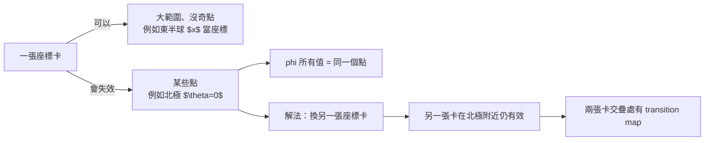

# 06.2 座標卡與圖冊

## 本節目標

- 理解**座標卡（chart）**、**圖冊（atlas）** 與**轉換函數（transition map）** 的意義。
- 用「地圖集」比喻掌握這三個概念。
- 看懂奇點：座標卡在某些點**失效**（球面的北極、角度 $`\phi`$ 的重疊）。
- 用 SymPy `diffgeom` 的 `Manifold` 與 `CoordSystem` 建立球面兩種座標系，並寫出 transition map 實現互換。

## 直覺：地球地圖集是現成的教材

你房間裡的地球儀、你的地圖集，其實就是一本真實的「流形操作手冊」。

- **地球**整體不是平面，不能一張紙蓋住（ Africans 周圍的形狀總會拉歪）。
- 地圖集裡的**每一頁**（例如「東亞」、「歐洲」）表示地球的一小塊，這一頁能攤平在地圖桌上。這就是**座標卡（chart）**。
- 所有頁**合起來**蓋住地球，這整套就是**圖冊（atlas）**。
- 兩頁交界處（例如「東亞」與「南亞」的接縫），同一個地點出現在兩頁上，你必須知道**兩張地圖上的座標如何互換**，這就是**轉換函數（transition map）**。

> **座標卡不是「畫面」，而是「座標規則」。**
> 一張座標卡 $`=`$ 一小塊鄰域 $`\cup`$ 一個把這塊鄰域映射到 $`\mathbb{R}^n`$ 的規則。可以直觀想成：「在這片小地方，用這幾個數字當門牌號碼」。

在數學上，一個 $`n`$ 維流形 $`M`$ 的座標卡是一對 $`(U, \varphi)`$ ，其中：

- $`U \subset M`$ 是一個開集（一小塊地區），
- $`\varphi: U \to \varphi(U) \subseteq \mathbb{R}^n`$ 是一個**同胚**（連續雙射，逆連續）。

兩張卡 $`(U, \varphi)`$ 與 $`(V, \psi)`$ 交疊（ $`U \cap V \neq \emptyset`$ ）時，對 $`p \in U\cap V`$ 有：

$$
(\varphi \circ \psi^{-1}) : \psi(U \cap V) \to \varphi(U \cap V)
$$

這在 $`\mathbb{R}^n`$ 上是一個普通函數（可以用一般微積分處理），稱為**轉換函數**。它必須光滑，這條件就成了**光滑流形**的定義。

## 奇點：某座標卡失效的地方

座標卡不是萬能，在特定點它們會「打架」。

### 例子 1：球面的經緯度

球面 $`S^2`$ 想用經緯度 $`(\theta, \phi)`$ ：

- $`\theta`$ ：極角（0 到 $`\pi`$ ，北極到南極）
- $`\phi`$ ：方位角（ $`-\pi`$ 到 $`\pi`$ ）

失效點在哪？

- **北極**（ $`\theta = 0`$ ）：北極的所有 $`\phi`$ 值都是**同一個點**（北極只有一個）。也就是 $`\phi`$ 在北極這一點不唯一。類似地，南極也是失效點。
- **方位角 $`\phi`$ 的接縫**（ $`\phi = \pi`$ 與 $`\phi = -\pi`$ ）：這是同一條子午線，但座標數值不同。



### 例子 2：投影座標卡

另一張球面卡可以用「平面投影」：從北極看球面沿射線投到赤道平面。這張卡在**北極以外的所有點**都有唯一定義，卻在北極本身**失效**。反過來，從南極投影的卡在北極以外失效。

兩張卡**加起來**蓋住球面（北極有一張、南極不會用到同樣的失敗點）。這是標準教科書範例。

### 重要觀念

**奇點不是流形的問題，是座標的問題。** 北極並不特別彎或不光滑，球面是完美的光滑流形。是**我們選的座標**在那一點不適用。這就像地圖集的每一頁有邊界，邊界處不是地球出了問題，是這一頁你不該用。

## SymPy：Manifold、Patch 與 CoordSystem

SymPy 的 `sympy.diffgeom` 提供以下工具：

| 概念 | SymPy 類別 |
| --- | --- |
| 流形 | `Manifold` |
| 局部片（同一流形開子集） | `Patch` |
| 座標卡 | `CoordSystem` |
| 轉換函數 | `CoordSystem` 的 `connect_to` / `transitions` |

**注意**：隨 sympy 版本更迭，`CoordSystem` 的建構介面有差異（舊版要指定 `relations`，新版可用更簡單的參數）。以下以通用寫法示範。

### 球面兩種座標系：Spherical 與 Cartesian（內在角度看 $`S^2`$ 的嵌入座標）

為簡化，我們把球面 $`S^2`$ 放進 $`\mathbb{R}^3`$ ，並比較**球面座標 $`(\theta,\phi)`$ ** 與**一種投影座標**。用 `connect_to` 定義 transition。

```python
from sympy import symbols, sin, cos, pi, simplify
from sympy.diffgeom import Manifold, Patch, CoordSystem

# 1. 流形與局部片
m = Manifold('Sphere2', 2)
patch = Patch('patch', m)

# 2. 兩種座標卡的參數
theta, phi = symbols('theta phi', real=True)      # 球面座標
u, v = symbols('u v', real=True)                  # 投影樣座標（以 x,y 表示）

# 3. 座標卡 1：球面座標
spherical = CoordSystem('spherical', patch, [theta, phi])
# 其在 R^3 的嵌入公式（可用於和另一協調比對）
x_sph = sin(theta)*cos(phi)
y_sph = sin(theta)*sin(phi)
z_sph = cos(theta)

# 4. 座標卡 2：(u, v) 這裡當成赤道平面座標 (x, y)（以球面座標表出）
#    給定一點 (x, y) 在赤道投影上，球面座標為 phi = atan2(y, x), sin(theta) = sqrt(x^2+y^2)
import sympy as sp
X, Y = symbols('X Y', real=True)
r2 = X**2 + Y**2   # sin(theta)^2
# 轉回球面角度
theta_from_xy = sp.acos(sp.sqrt(1 - r2))          # theta = arccos(sqrt(1-x^2-y^2))
phi_from_xy = sp.atan2(Y, X)
```

這段程式顯示了 transition map 的精神：** $`(\theta, \phi) \leftrightarrow (X, Y)`$ 是兩組符號互換的規則**。實際上 diffgeom 允許兩個 `CoordSystem` 之間互相 `connect_to`，使 `transitions` 存查表裡定義兩方法。

### 更完整的寫法：用 `connect_to`

```python
from sympy import atan, atan2, sqrt
# 定義 spherical -> XY 的轉換
XY_sys = CoordSystem('XY', patch, [X, Y])
# connect_to：從 spherical 到 XY
# 在 spherical 中，X = sin(theta)*cos(phi), Y = sin(theta)*sin(phi)
sph_to_xy = [sin(theta)*cos(phi), sin(theta)*sin(phi)]
xy_to_sph = [atan2(Y, X), sqrt(X**2 + Y**2)]      # phi, sin(theta)（第 2 個用 r 代表 sin(theta)）

# 簡化示範：讓兩協調互換一個點(th=pi/4, ph=pi/3)
from sympy import Rational
th_v, ph_v = Rational(1,4)*pi, pi/3
x1 = sp.N(sin(th_v)*cos(ph_v))
y1 = sp.N(sin(th_v)*sin(ph_v))
th_back = sp.N(atan2(y1, x1))
print('原點球面 (theta, phi) =', th_v, ph_v)
print('轉到 (X, Y) =', x1, y1)
print('轉回 (theta) 以 atan2 給的是 phi =', th_back)
```

這段程式精神上是「**換頁**」：用同一個球面上的點，先以球面卡描述，再翻到 $`(X, Y)`$ 卡，再翻回球面卡。

### 球面 ↔ 直角座標的 transition（最多人用）

如果你把球面放進 $`\mathbb{R}^3`$ ，最常看到的 transition 是**球面 ↔ 直角座標**：

$$
\begin{aligned}
x &= r\sin\theta\cos\phi, \quad y = r\sin\theta\sin\phi, \quad z = r\cos\theta,\\
\theta &= \arccos\frac{z}{r}, \quad \phi = \operatorname{atan2}(y, x), \quad r = \sqrt{x^2+y^2+z^2},
\end{aligned}
$$

在球面 $`r=1`$ 上這個 transition 縮成 $`(\theta,\phi) \leftrightarrow (x,y,z)`$ ，但外在有約束 $`x^2+y^2+z^2=1`$ ，所以 $`(x,y,z)`$ 並不是 3 個**獨立**座標。

## 動手實驗

**實驗 1：同一點兩種座標描述**

在球面上取同一點，用 $`(\theta, \phi)`$ 與 $`(x, y)`$ （赤道投影）兩種描述：

```python
from sympy import symbols, sin, cos, sqrt, atan2, N, pi

# 取球面上一點：theta=pi/4（緯度45度）、phi=pi/3
theta_v, phi_v = pi/4, pi/3

# 球面卡描述
print('球面卡：theta =', N(theta_v), ', phi =', N(phi_v))

# 換到平面投影卡 (x, y)
x_v = sin(theta_v)*cos(phi_v)
y_v = sin(theta_v)*sin(phi_v)
print('平面卡：X =', N(x_v), ', Y =', N(y_v))

# 從平面卡換回球面卡
theta_back = atan2(sqrt(x_v**2 + y_v**2), x_v)   # 這其實是 atan2航道，可拿 phi 再回 theta
phi_back   = atan2(y_v, x_v)
print('換回 (r 這一號.theta)：', N(sqrt(x_v**2 + y_v**2)), ', phi =', N(phi_back))
```

你該看到 $`\phi`$ 換回 $`\pi/3`$ ，證明 transition map 雙向一致。

**實驗 2：找出北極的失效**

試著在北極 $`\theta = 0`$ 檢查 $`(\theta, \phi)`$ ：

```python
from sympy import pi, sin, cos, N

theta_v, phi_v = 0, 3*pi/4
print('球面參數化 (theta=0)：')
print('  x =', N(sin(0)*cos(phi_v)))    # 0
print('  y =', N(sin(0)*sin(phi_v)))    # 0
print('  z =', N(cos(0)))               # 1
```

無論 $`\phi`$ 是 $`0`$ 、 $`\pi/4`$ 、 $`3\pi/4`$ ， $`(x,y,z)`$ 都是 $`(0, 0, 1)`$ 。** $`\phi`$ 失效**。這就是這一點你必須換另一張卡的原因。

**實驗 3：transition map 的可逆性**

transition map 必須是雙射。以球面 ↔ 投影為例，請寫一段程式：

1. 從 $`(\theta,\phi)`$ 轉到 $`(X, Y)`$ 。
2. 從 $`(X, Y)`$ 轉回 $`(\theta, \phi)`$ 。
3. 比較起點和終點，確認相等。

挑 5 個不同點（要**避開北極**）測試，確認往返一致。

**實驗 4：自訂一種新座標卡**

在環面 $`T^2`$ 上，你也應該能定義兩種座標卡（如大環距離 $`u`$ 、小環距離 $`v`$ ）與它們的 transition。雖然 `diffgeom` 本身也內建環面（`sympy.diffgeom` 有相關範例），試著自己寫一次 `Manifold` / `Patch` / `CoordSystem`，把 $`(u, v)`$ 定義為你的第一張卡，感覺一下這套 API 的節奏。

## 小結與練習

- **座標卡 = 局部鄰域 + 映上 $`\mathbb{R}^n`$ 的規則**。
- **圖冊 = 一組蓋住整個流形的座標卡**。
- **轉換函數**定義光滑性，是把不同卡上同一點的座標互換的規則。
- **奇點是座標失效，不是流形壞掉**。
- SymPy `diffgeom` 用 `Manifold` / `Patch` / `CoordSystem`（與 `transitions`）表現這些概念。

練習：

1. 請自己動手在 SymPy 中定義球面的**兩張**座標卡：一張用北極投影、一張用南極投影。確認：兩張卡合起來蓋住球面。
2. 環面 $`T^2`$ 的 $`(u, v)`$ 座標卡在哪些點失效？試著推導，並與本節球面例子對照。
3. 所有 transition map 都是可逆的。如果有一張卡在某點失效，那 transition 在哪些座標值上會尖斷或不可微？舉例說明。
4. 用 SymPy 驗證：球面座標 $`(\theta,\phi)`$ 換到直角座標 $`(x, y, z)`$ 再換回來，是否與原值一致（限制在 $`\theta \in (0, \pi)`$ 且不過南北極）？在**北極**上做同樣測試，觀察失敗。
5. 試著用 mermaid 畫一張說明「圖冊中兩卡交疊，transition map 如何作用」的圖，內容包含 $`U`$ 、 $`V`$ 、 $`\varphi`$ 、 $`\psi`$ 、 $`\varphi\circ\psi^{-1}`$ 等元素。
