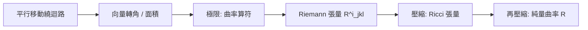

# 08.1 Riemann 曲率張量

## 本節目標

- 從「平行移動繞迴路一圈會轉角度」的直覺出發，理解曲率張量的幾何起源。
- 認識協變導數的交換子 $`[\nabla_a, \nabla_b]\mathbf{v} = R^c{}_{dab}\mathbf{v}^d`$ ，這是 Riemann 張量的最乾淨定義。
- 掌握以 Christoffel 符號表示的分量公式
  $`R^i{}_{jkl} = \partial_k\Gamma^i_{jl} - \partial_l\Gamma^i_{jk} + \Gamma^i_{km}\Gamma^m_{jl} - \Gamma^i_{lm}\Gamma^m_{jk}`$ 。
- 用 SymPy 從零開始完整計算球面的 Riemann 張量（含 metric、Christoffel、四階張量）。
- 熟記 Riemann 張量的對稱性：前兩指標反稱（經 $`g`$ 降到全下指標後）、後兩指標反稱。
- 理解 Ricci 張量是 Riemann 張量的一次壓縮： $`R_{jl} = R^i{}_{jil}`$ 。
- 動手實驗：用 Riemann 張量「驗明正身」——平面為零、柱面為零、球面非零。

## 幾何直覺：平行移動的迴路轉角

在第 7 章我們學會了沿曲面把向量平行移動。現在問一個關鍵問題：

> 把一個向量沿一個小迴路平行移動一圈回到原點，它還是原來的向量嗎？

在平面上，答案是「是」。但在球面上，答案是否：出發時指向東的向量，沿一個由經線與緯線圍成的小矩形繞一圈回來，方向會**轉了一個角度**。這個轉角與迴路圍成的面積之比，在面積趨於零時的極限，就定義了該平面方向上的**曲率**。

這正是 Gauss 在測地三角形上量到的「角盈」（spherical excess）：球面上的三角形內角和大於 $`\pi`$ 。Riemann 張量就是把這個直覺推廣到任意方向平面與任意維度的完整記錄器。



## 協變導數的交換子

在歐氏空間中，偏導數可以任意交換次序： $`\partial_a\partial_b \mathbf{v} = \partial_b\partial_a \mathbf{v}`$ 。但在彎曲空間中，「對向量求導」必須用協變導數 $`\nabla_a`$ ，它會引入 Christoffel 符號的修正項。此時交換次序**不再必然相等**：

$$
[\nabla_a, \nabla_b]\mathbf{v}^d = (\nabla_a\nabla_b - \nabla_b\nabla_a)\mathbf{v}^d = R^c{}_{dab}\,\mathbf{v}^d
$$

仔細看這條定義式的結構：交換子作用在向量場上，結果是一個線性映射吃掉 $`\mathbf{v}^d`$ ，吐回一個向量；其中 $`c`$ 是輸出指標、 $`d`$ 是被吃掉的指標、 $`(a,b)`$ 標記我們在哪些兩個方向之間交換。四個指標恰好把「 $`[a,b]`$ 平面上的迴路、繞行後向量在 $`c`$ – $`d`$ 平面上轉了多少」全部編碼進來。

> **口訣**：平坦的定義就是「可以交換次序」。交換子不為零 = 空間彎了。

## 分量公式：Christoffel 表示

把協變導數的定義 $`\nabla_k \mathbf{v} = \partial_k\mathbf{v} + \Gamma^i_{kj} v^j \mathbf{e}_i`$ 代入交換子並展開，所有 $`\partial_a\partial_b`$ 的對稱項互相抵銷，剩下的正是：

$$
R^i{}_{jkl} = \partial_k\Gamma^i_{jl} - \partial_l\Gamma^i_{jk} + \Gamma^i_{km}\Gamma^m_{jl} - \Gamma^i_{lm}\Gamma^m_{jk}
$$

三個觀察：

1. **指標約定**：本書採用 $`R^i{}_{jkl}`$ ，其中 $`j`$ 是被交換子吃掉的向量指標、 $`(k,l)`$ 是協變導數方向（注意先 $`\partial_k\Gamma^i_{jl}`$ 再減去 $`l,k`$ 對調項，這決定了正負號 conventions）。
2. **兩類項**：導數項 $`\partial\Gamma`$ （Christoffel 的變化率）與平方項 $`\Gamma\Gamma`$ （移動路徑中座標架持續旋轉的累積）。兩者也可能抵銷——例如標準球座標在般平坦 $`\mathbb{R}^3`$ 中 $`\Gamma \neq 0`$ 且 $`\Gamma\Gamma`$ 項存在，但整體 $`R = 0`$ 。
3. **自動反稱**： $`l \leftrightarrow k`$ 對調會變號，所以 $`R^i{}_{jkk} = 0`$ ，且後兩指標天然反稱。

## SymPy 完整計算：球面的 Riemann 張量

我們走一條從頭到尾的 pipeline：metric $`\to`$ 逆變 metric $`\to`$ Christoffel $`\to`$ Riemann。以單位球（半徑 $`r`$ ）的度量

$$
g = r^2\, d\theta^2 + r^2\sin^2\theta\, d\varphi^2
$$

為例：

```python
import sympy as sp

N = 2
th, ph = sp.symbols('theta phi', real=True)
r = sp.symbols('r', positive=True)

# 1. metric
g = sp.Matrix([[r**2, 0],
               [0, r**2*sp.sin(th)**2]])
g_inv = g.inv()
coords = (th, ph)

# 2. Christoffel 符號 Γ^i_{jk} = 1/2 g^{im}(∂_j g_{mk} + ∂_k g_{jm} - ∂_m g_{jk})
Gamma = {}   # Gamma[(i,j,k)] 是符號
for i in range(N):
    for j in range(N):
        for k in range(N):
            expr = sp.Rational(1, 2)*sum(
                g_inv[i, m]*sp.diff(g[j, k], coords[m])
                for m in range(N)
            )
            expr = sp.simplify(expr)
            if expr != 0:
                Gamma[(i, j, k)] = expr

# 3. Riemann: R^i_{jkl}
def dGamma(i, j, k, l):
    return sp.diff(Gamma.get((i, j, l), 0), coords[k]) \
         - sp.diff(Gamma.get((i, j, k), 0), coords[l]) \
         + sum(Gamma.get((i, k, m), 0)*Gamma.get((m, j, l), 0) for m in range(N)) \
         - sum(Gamma.get((i, l, m), 0)*Gamma.get((m, j, k), 0) for m in range(N))

R = {}
for i in range(N):
    for j in range(N):
        for k in range(N):
            for l in range(N):
                e = sp.simplify(dGamma(i, j, k, l))
                if e != 0:
                    R[(i, j, k, l)] = e

for key, val in sorted(R.items()):
    print(key, "=", val)
```

輸出（ $`N=2`$ 最多 $`16`$ 個分量，非零者只有這些）：

```text
(0, 0, 0, 1) = 0              (後兩指標反稱 ⇒ 對角為零)
(0, 1, 0, 1) = sin(theta)**2        ← 唯一獨立分量
(1, 0, 0, 1) = -sin(theta)**2       ← 反稱
(1, 1, 0, 1) = 0
```

具體地（半徑 $`r`$ 的球），全下指標的唯一獨立分量是：

$$
R_{\theta\varphi\theta\varphi} = r^2\sin^2\theta
$$

其餘非零分量皆由對稱性推出，例如 $`R_{\varphi\theta\varphi\theta} = R_{\theta\varphi\theta\varphi}`$ 、 $`R_{\theta\varphi\varphi\theta} = -R_{\theta\varphi\theta\varphi}`$ 。

用全下指標版本更乾淨。把上指標用 $`g`$ 降下來： $`R_{ijkl} = g_{im}R^m{}_{jkl}`$ 。2 維曲面上只有**一個**獨立分量，這就是 Gauss 的 Theorema Egregium：整條第二基本形式的資訊濃縮成

$$
R_{\theta\varphi\theta\varphi} = r^2\sin^2\theta \quad\Longrightarrow\quad K = \frac{R_{\theta\varphi\theta\varphi}}{g_{\theta\theta}g_{\varphi\varphi} - g_{\theta\varphi}^2} = \frac{r^2\sin^2\theta}{r^2 \cdot r^2\sin^2\theta} = \frac{1}{r^2}
$$

## Riemann 張量的對稱性

先說結論：全下指標的 $`R_{ijkl}`$ 有三組對稱律。

| 對稱性 | 公式 | 幾何意義 |
|---|---|---|
| 反稱（後兩） | $`R_{ijkl} = -R_{ijlk}`$ | 交換「迴路兩方向」變號 |
| 反稱（前兩） | $`R_{ijkl} = -R_{jikl}`$ | 全下指標版本自然出現 |
| 成對交換 | $`R_{ijkl} = R_{klij}`$ | 兩個「平面」可互換 |

再加上第一 Bianchi 恆等式（下一節會用到的 $`R_{i[jkl]} = 0`$ ，也就是 $`R_{ijkl} + R_{iklj} + R_{iljk} = 0`$ ），在 $`n`$ 維空間中實際獨立分量數為 $`\frac{n^2(n^2-1)}{12}`$ 。所以：

- $`n=2`$ ： $`1`$ 個獨立分量（ $`= K`$ ，Gauss 曲率本身就是 Riemann 張量！）。
- $`n=3`$ ： $`6`$ 個獨立分量。
- $`n=4`$ ： $`20`$ 個獨立分量（ $`\frac{256-4}{12} = 20`$ ），而 $`g_{\mu\nu}`$ 本身只有 $`10`$ 個分量——Riemann 比 metric「更彎」。

## Ricci 是 Riemann 的壓縮： $`R_{jl} = R^i{}_{jil}`$

Riemann 有四個指標，資訊太多了；我們把第一與第三指標配對求和（用逆度量縮一下），得到二階張量：

$$
R_{jl} = \operatorname{Ric}_{jl} = R^i{}_{jil} = g^{ik}\,R_{kil}
$$

在 SymPy 中只需要一個雙重迴圈：

```python
# 4. Ricci: R_{jl} = R^i_{j i l}
Ricci = sp.zeros(N, N)
for j in range(N):
    for l in range(N):
        Ricci[j, l] = sp.simplify(sum(Rdown.get((i, j, i, l), 0) for i in range(N)))
```

其中 `Rdown = raise_index(R, ...)` 是把 $`R^i{}_{jkl}`$ 用 $`g_{im}`$ 降指標後的 $`R_{ijkl}`$ 字典。球面的結果是：

$$
\operatorname{Ric}_{jl} = \frac{1}{r^2}\,g_{jl}
$$

也就是說：球面的 Ricci 張量**正比於 metric**。這種空間稱為 **Einstein manifold**。 $`n`$ 維常曲率空間都滿足 $`\operatorname{Ric} = (n-1)K\,g`$ ，代入 $`n=2, K=1/r^2`$ 得 $`\operatorname{Ric} = \frac{1}{r^2}g`$ ，與 SymPy 輸出完全一致。

## 全下指標的 SymPy 小工具

用一個 helper 把「升指標的分量」與「降指標的分量」統一管理：

```python
def raise_index(T3, a):
    # T3[(i,j,k)] 代表 R^i_{jkl}; 傳回 R_{ajkl}
    out = {}
    for (i, j, k, l), v in T3.items():
        for m in range(N):
            w = g[a, m] * v if m == i else 0
            if w:
                out.setdefault((a, j, k, l), 0)
                out[(a, j, k, l)] = sp.simplify(out[(a, j, k, l)] + w)
    return out

def ricci_from_Rdown(Rdown):
    Ric = sp.zeros(N, N)
    for j in range(N):
        for l in range(N):
            Ric[j, l] = sp.simplify(sum(Rdown.get((m, j, m, l), 0) for m in range(N)))
    return Ric
```

> 說明：若 $`R^i{}_{jil}`$ 的定義與你的教科書相差一個符號（有些書用 $`R^i{}_{jli}`$ ），只要在壓縮時對調 $`(i,l)`$ 再取反號即可；判斷對錯的終極標準是 $`K>0`$ 的球面必須給出 $`\operatorname{Ric} = \frac{1}{r^2} g`$ 。

## 動手實驗：用 Riemann 張量驗明正身

把本節的 pipeline 包成一個函式 `curvature_pipeline(g, coords, name)`，然後對三個空間各跑一次：

- **平面**： $`g = \mathrm{diag}(1,1)`$ ，預期 Riemann 全為 $`0`$ 。
- **柱面**： $`g = \mathrm{diag}(1, r^2)`$ （展開柱面），預期 Riemann 全為 $`0`$ ——**內蘊地看，柱面是平的**！雖然它嵌在 $`\mathbb{R}^3`$ 裡有非零（一個主曲率為零、一個非零），但兩主曲率乘積 $`K = 0`$ ，Riemann 抓的是乘積。
- **球面**： $`g = \mathrm{diag}(r^2, r^2\sin^2\theta)`$ ，預期 $`R_{\theta\varphi\theta\varphi} \neq 0`$ 。

```python
import sympy as sp

def curvature_pipeline(g, coords, name):
    N = len(coords)
    g_inv = g.inv()
    Gamma = {}
    for i in range(N):
        for j in range(N):
            for k in range(N):
                e = sp.simplify(sp.Rational(1,2)*sum(
                    g_inv[i,m]*sp.diff(g[j,k], coords[m]) for m in range(N)))
                if e != 0:
                    Gamma[(i,j,k)] = e
    nonzero = 0
    for i in range(N):
        for j in range(N):
            for k in range(N):
                for l in range(k+1):   # 用後兩反稱只掃一半
                    e = sp.simplify(
                        sp.diff(Gamma.get((i,j,l),0), coords[k])
                      - sp.diff(Gamma.get((i,j,k),0), coords[l])
                      + sum(Gamma.get((i,k,m),0)*Gamma.get((m,j,l),0) for m in range(N))
                          - sum(Gamma.get((i,l,m),0)*Gamma.get((m,j,k),0) for m in range(N)))
                    if e != 0:
                        nonzero += 1
                        print(f"{name}: R^({i})_({j})({k})({l}) = {e}")
    if nonzero == 0:
        print(f"{name}: Riemann 全為 0，內蘊平坦！")

u, v = sp.symbols('u v', real=True)
curvature_pipeline(sp.eye(2), (u, v), "平面")
curvature_pipeline(sp.diag(1, sp.Symbol('rho')**2), (u, v), "柱面")
```

三個輸出檢查：

| 空間 | 獨立非零 Riemann 分量 | 結論 |
|---|---|---|
| 平面 $`\mathrm{diag}(1,1)`$ | $`0`$ | 內蘊平坦 |
| 柱面 $`\mathrm{diag}(1,\rho^2)`$ | $`0`$ | 展開成紙，內蘊平坦 |
| 球面 $`\mathrm{diag}(r^2, r^2\sin^2\theta)`$ | $`1`$ | $`K = 1/r^2 > 0`$ |

## 小結與練習

**本節重點**

1. Riemann 張量 = 平行移動繞迴路的轉角密度 = 協變導數交換子 $`[\nabla_a,\nabla_b]\mathbf{v} = R^c{}_{dab}v^d`$ 。
2. 分量公式 $`R^i{}_{jkl} = \partial_k\Gamma^i_{jl} - \partial_l\Gamma^i_{jk} + \Gamma^i_{km}\Gamma^m_{jl} - \Gamma^i_{lm}\Gamma^m_{jk}`$ ，SymPy 可完整實作。
3. 對稱性：後兩反稱（定義內建）、前兩在降指標後反稱、成對交換； $`n`$ 維獨立分量數 $`\frac{n^2(n^2-1)}{12}`$ 。
4. Ricci 是一次壓縮 $`R_{jl} = R^i{}_{jil}`$ ；球面給出 Einstein manifold $`\operatorname{Ric}=\frac{1}{r^2}g`$ 。
5. 柱面內蘊平坦確立了一個重要事實：Riemann 測的是 $`K`$ （兩主曲率之積），不是單一主曲率。

**練習**

1. 把 pipeline 通用化成接受 `sp.Matrix` 與座標表，計算 $`n`$ 維單位球的 Riemann，驗證非零分量都是 $`R_{iJij} = \delta_{ij}\delta_{kl} - \delta_{il}\delta_{kj}`$ 的形式（提示：先測 $`n=3`$ ）。
2. 對 $`g = \mathrm{diag}(1, u^2+v^2+1)`$ 計算 Riemann 與 Gauss 曲率 $`K`$ ，並與第 2 章的第二基本形式方法比較。
3. 練習用「成對交換」檢查你算出的球面 $`R_{\theta\varphi\theta\varphi}`$ 是否只留 1 個獨立分量。
4. 挑戰：計算偽球面（tractricoid 旋轉面， $`K=-1`$ ）的 metric，看 $`R_{\theta\varphi\theta\varphi}`$ 的符號。
