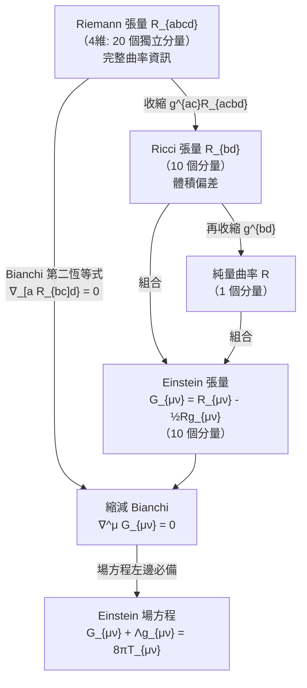

# 08.3 Einstein 張量與 Bianchi 恆等式

## 本節目標

- 定義 Einstein 張量 $`G_{\mu\nu} = R_{\mu\nu} - \frac12 R g_{\mu\nu}`$ ，理解它為什麼是「最適合寫進場方程左邊」的曲率量。
- 掌握 Bianchi 第二恆等式 $`\nabla_{[a}R_{bc]d} = 0`$ 的陳述與直覺，並推出**縮減 Bianchi 恆等式** $`\nabla^\mu G_{\mu\nu} = 0`$ 。
- 說明 $`\nabla^\mu G_{\mu\nu} = 0`$ 的物理意義：局部能量－動量守恆的幾何保證。
- 用 SymPy 對球面驗證 $`G_{\mu\nu}`$ 與散度為零；用 mermaid 圖整理 Riemann → Ricci → Einstein 的縮減關係。
- 動手實驗：完成一個自己的 Einstein tensor 計算 pipeline。

## Einstein 張量的定義與動機

第 8.2 節把 Riemann 縮減成 Ricci 張量與純量曲率。現在把兩者**組合**成新的對稱二階張量——**Einstein 張量** $`G_{\mu\nu} = R_{\mu\nu} - \frac12 R\, g_{\mu\nu}`$ 。它天然具有三個好性質：

1. **對稱**： $`G_{\mu\nu} = G_{\nu\mu}`$ （因為 $`R_{\mu\nu}`$ 對稱、 $`g_{\mu\nu}`$ 對稱）。
2. **無跡可尋的設計**：取跡 $`G^\mu{}_\mu = R - \frac12 R \cdot n = \left(1 - \frac{n}{2}\right)R`$ ，在 $`n = 4`$ 時 $`G^\mu{}_\mu = -R`$ ——跡剛好把 $`R`$ 反轉回來，使得場方程兩邊跡數一致。
3. **散度為零**（本節主角）： $`\nabla^\mu G_{\mu\nu} \equiv 0`$ **恆成立**，對任何流形、任何度量。

第 3 點是決定性的。Einstein 場方程 $`G_{\mu\nu} = 8\pi T_{\mu\nu}`$ （10.2 的主題）左邊必須散度為零，右邊 $`T_{\mu\nu}`$ 的散度為零恰好是能量－動量守恆。**幾何恆等式替物理守恆律背書**——這就是為什麼場方程的左邊非 $`G`$ 莫屬。

> 為什麼不用 $`\operatorname{Ric}_{\mu\nu}`$ 直接當左邊？因為 $`\nabla^\mu R_{\mu\nu} = \frac12 \partial_\nu R \neq 0`$ 一般成立——Ricci 的散度不為零，放進場方程會違反能量守恆。 $`-\frac12 R g_{\mu\nu}`$ 這一項正是用來「修掉」這個多餘散度的補償項。

## Bianchi 第二恆等式：邊界的邊界是零

**陳述**：對 Levi-Civita 聯絡，Riemann 張量滿足

$$
\nabla_{[a} R_{bc]d}{}^e = 0
\qquad\Longleftrightarrow\qquad
\nabla_a R_{bcd}{}^e + \nabla_b R_{cda}{}^e + \nabla_c R_{dab}{}^e = 0
$$

方括號 $`[abc]`$ 表示對三個指標**反對稱化**（取六個排列的帶符號平均）。兩條理解線索：**代數上**， $`\nabla_a\nabla_b - \nabla_b\nabla_a = R_{ab}`$ （作用在向量上）；把這個對易關係再對 $`c`$ 微分並對 $`(a,b,c)`$ 循環相加，相消使得所有項抵消——與 05.2 的 $`d^2 = 0`$ 精神同源：**邊界的邊界是空的**。**幾何上**，沿小立方體三個面方向輪流平行移動繞圈，三個微小迴圈的和樂互相抵消，總轉角為零。

## 縮減 Bianchi： $`\nabla^\mu G_{\mu\nu} = 0`$ 的推導輪廓

把第二 Bianchi 恆等式取跡兩次（先對 $`b, d`$ 縮，再用指標對稱性），得**縮減 Bianchi 恆等式**：

$$
\nabla^\mu R_{\mu\nu} = \frac12 \nabla_\nu R
\quad\Longrightarrow\quad
\nabla^\mu\!\left(R_{\mu\nu} - \frac12 R g_{\mu\nu}\right)
= \frac12 \nabla_\nu R - \frac12 \nabla_\nu R = 0
$$

第二項用了 $`\nabla^\mu(g_{\mu\nu} R) = (\nabla^\mu g_{\mu\nu}) R + g_{\mu\nu}\nabla^\mu R = 0 + \nabla_\nu R`$ （度量相容 $`\nabla g = 0`$ ）。兩項恰好抵消——** $`G`$ 的散度恆為零**。

物理意義： $`\nabla^\mu T_{\mu\nu} = 0`$ 表示物質的局部能量－動量守恆（能量不會憑空出現或消失）。場方程左邊必須自動滿足同一約束，否則方程組過度決定而不自洽。Einstein 張量是**唯一**（在對稱、二階、由度量的兩階導數構成的組合中，至多差一個 $`\Lambda g_{\mu\nu}`$ ）散度為零的自然候選。

## mermaid：曲率資訊的縮減關係圖



閱讀這張圖的重點：往下走是**壓縮**（丟資訊，見 8.2 的「 $`R=0`$ 不代表平坦」）；Einstein 張量與 Ricci 同層豐富度，但多了「散度恆為零」這條由 Bianchi 恆等式擔保的**約束**——正是把幾何接到物理的橋樑。

## SymPy 驗證：球面的 $`G_{\mu\nu}`$ 與散度為零

沿用 8.2 的 pipeline，末端加上 Einstein 張量與散度檢查。以單位球（ $`g = \mathrm{diag}(1, \sin^2\theta)`$ ）為例：

```python
import sympy as sp

th, ph = sp.symbols('theta phi', real=True)
coords = [th, ph]
g = sp.Matrix([[1, 0], [0, sp.sin(th)**2]])
N = len(coords)
ginv = g.inv()

# --- Christoffel ---
Gamma = {}
for i in range(N):
    for j in range(N):
        for k in range(N):
            e = sp.simplify(sp.Rational(1, 2)*sum(
                ginv[i, m]*(sp.diff(g[m, k], coords[j]) +
                            sp.diff(g[m, j], coords[k]) -
                            sp.diff(g[j, k], coords[m]))
                for m in range(N)))
            if e != 0:
                Gamma[(i, j, k)] = e

# --- Riemann（首指標升） ---
Rup = {}
for i in range(N):
    for j in range(N):
        for k in range(N):
            for l in range(N):
                e = sp.simplify(
                    sp.diff(Gamma.get((i, j, l), 0), coords[k]) -
                    sp.diff(Gamma.get((i, j, k), 0), coords[l]) +
                    sum(Gamma.get((i, k, m), 0)*Gamma.get((m, j, l), 0) for m in range(N)) -
                    sum(Gamma.get((i, l, m), 0)*Gamma.get((m, j, k), 0) for m in range(N)))
                if e != 0:
                    Rup[(i, j, k, l)] = e

# --- Ricci 與純量曲率 ---
Ricci = sp.zeros(N, N)
for j in range(N):
    for l in range(N):
        Ricci[j, l] = sp.simplify(sum(Rup.get((i, j, i, l), 0) for i in range(N)))
Rsc = sp.simplify(sum(ginv[j, l]*Ricci[j, l] for j in range(N) for l in range(N)))

# --- Einstein 張量 ---
G = sp.zeros(N, N)
for mu in range(N):
    for nu in range(N):
        G[mu, nu] = sp.simplify(Ricci[mu, nu] - sp.Rational(1, 2)*Rsc*g[mu, nu])
print("R =", Rsc)
print("G =", G)          # 球面：Ric = (1/r²)g ⇒ G = 0（2 維 Einstein 流形）

# --- 縮減 Bianchi：∇^μ G_{μν} = 0 ---
def div_up(T):
    """∇^μ T_{μν}：先用 g^{αμ} 升首指標（∇g = 0 使升降可穿過 ∇），
    再求 ∇_α T_{αν} = ∂_α T_{αν} + Γ^α_{ασ}T_{σν} - Γ^σ_{αν}T_{ασ}。"""
    T_up = sp.simplify(ginv * sp.Matrix(T))     # T_up[α, ν] = g^{αμ} T_{μν}
    out = []
    for nu in range(N):
        e = 0
        for a in range(N):
            e += (sp.diff(T_up[a, nu], coords[a])
                  + sum(Gamma.get((a, a, s), 0)*T_up[s, nu] for s in range(N))
                  - sum(Gamma.get((s, a, nu), 0)*T_up[a, s] for s in range(N)))
        out.append(sp.simplify(e))
    return out

print("∇^μ G_{μν} =", div_up(G))   # [0, 0] —— 縮減 Bianchi 通過
```

預期結果與解讀：

- 球面 $`R = 2`$ （半徑 1）， $`\operatorname{Ric} = g`$ ，因此 $`G_{\mu\nu} = g_{\mu\nu} - \frac12 \cdot 2 \cdot g_{\mu\nu} = 0`$ ——**二維常曲率空間的 Einstein 張量恆為零**（2 維中 $`\operatorname{Ric} = Kg`$ 恆成立，8.2）。這解釋了純 2 維引力理論為何沒有局域自由度。
- 散度兩個分量都印出 `0`——縮減 Bianchi 恆等式被 SymPy 認證。**此檢查對任何度量都應通過**，同時是 pipeline 正確性的強力測試（ $`\Gamma`$ 或 Riemann 算錯，散度幾乎不可能仍為零）。想看非零的 $`G`$ ，請換 3 維球面 $`S^3`$ （見實驗 1）。

## 動手實驗

**實驗 1：完成一個 Einstein tensor 計算（主實驗）**

把上面的 pipeline 包裝成函數 `einstein_pipeline(g, coords)`，回傳 `(Gamma, Ricci, R, G, divG)`，並加一行斷言讓散度檢查自動化：

```python
assert all(sp.simplify(d) == 0 for d in divG), "Bianchi check failed!"
print("✓ 縮減 Bianchi 恆等式通過")
```

跑三個案例並填表：

| 度量 | $`R`$ | $`G_{\mu\nu}`$ | $`\nabla^\mu G_{\mu\nu}`$ |
|---|---|---|---|
| 平面極座標 $`\mathrm{diag}(1, r^2)`$ | $`0`$ | $`0`$ | $`0`$ |
| 單位球面 $`\mathrm{diag}(1, \sin^2\theta)`$ | $`2`$ | $`0`$ | $`0`$ |
| 保角度量 $`e^{2\phi}(dx^2+dy^2)`$ ， $`\phi = -\ln\cos v`$ （偽球面） | $`-2`$ | $`0`$ | $`0`$ |

再對三維球座標 $`g = \mathrm{diag}(1, r^2, r^2\sin^2\theta)`$ 跑一次（平坦， $`G`$ 仍為零）；想看非零 $`G`$ ，改用 3 維球面 $`S^3`$ 度量 $`\mathrm{diag}(1, \sin^2\chi, \sin^2\chi\sin^2\theta)`$ ： $`R = 6`$ 、 $`G_{\mu\nu} = -2g_{\mu\nu}`$ 。

**實驗 2：宇宙學常數不改變守恆**

場方程的左邊實際是 $`G_{\mu\nu} + \Lambda g_{\mu\nu}`$ 。用 SymPy 驗證 $`\nabla^\mu(\Lambda g_{\mu\nu}) = \Lambda \nabla^\mu g_{\mu\nu} = 0`$ （度量相容性），因此加 $`\Lambda`$ 項不破壞散度為零——宇宙學常數是被 Bianchi 恆等式「允許」的唯一修改。

**實驗 3：Bianchi 第二恆等式的直接驗證**

對球面（或三維球座標）寫一個小迴圈，對所有組合 $`(a,b,c,d)`$ 檢查 $`\nabla_a R_{bcd}{}^e + \nabla_b R_{cda}{}^e + \nabla_c R_{dab}{}^e = 0`$ ，其中 $`\nabla_a R_{bcd}{}^e = \partial_a R^e{}_{bcd} + \Gamma^e_{af}R^f{}_{bcd} - \Gamma^f_{ab}R^e{}_{fcd} - \Gamma^f_{ac}R^e{}_{bfd} - \Gamma^f_{ad}R^e{}_{bcf}`$ 。注意**只有四項**（一個微分項加三個聯絡項），漏掉任何一項恆等式就會破裂——最好的除錯練習。

**實驗 4（挑戰）：Schwarzschild 真空區的 $`G`$ **

取 Schwarzschild 度量（10.3 會完整推導）： $`g = \mathrm{diag}\!\left(1-\tfrac{2M}{r},\ -\left(1-\tfrac{2M}{r}\right)^{-1},\ r^2,\ r^2\sin^2\theta\right)`$ 。跑 pipeline（座標符號改用合適的正性假設），確認真空區 $`r > 2M`$ 處 $`G_{\mu\nu} \equiv 0`$ （等價於 $`R_{\mu\nu} = 0`$ 與 $`R = 0`$ ），但 Riemann 張量的 Weyl 部分非零——呼應 8.2 的「 $`\operatorname{Ric}=0`$ 不代表平坦」。

## 小結與練習

**本節重點**

1. Einstein 張量 $`G_{\mu\nu} = R_{\mu\nu} - \frac12 R g_{\mu\nu}`$ ：對稱、與 Ricci 同層豐富度、由度量兩階導數構成。
2. Bianchi 第二恆等式 $`\nabla_{[a}R_{bc]d}{}^e = 0`$ 是「二次導數反對稱化為零」的曲率版本，與 $`d^2 = 0`$ 同源。
3. 縮減 Bianchi $`\nabla^\mu R_{\mu\nu} = \frac12 \nabla_\nu R`$ 直接導出 $`\nabla^\mu G_{\mu\nu} \equiv 0`$ ——幾何自動守恆。
4. $`\nabla^\mu G_{\mu\nu} = 0`$ 是場方程左邊的必要條件：它對應右邊 $`T_{\mu\nu}`$ 的局部能量－動量守恆； $`\Lambda g_{\mu\nu}`$ 是唯一被允許的修正。
5. 2 維常曲率空間（球面） $`G \equiv 0`$ ；SymPy pipeline 的散度檢查同時是計算正確性的測試。

**練習**

1. 手算：由 $`\operatorname{Ric} = Kg`$ （ $`n`$ 維常曲率）推出 $`G_{\mu\nu} = \frac{2-n}{2}K g_{\mu\nu}`$ ，並確認 $`n=2`$ 時 $`G \equiv 0`$ 、 $`n=3`$ 時 $`G = -\frac12 K g`$ 。
2. 用 SymPy 驗證 2 維的縮減 Bianchi 恆等式可由 $`R_{\mu\nu} = \frac12 R g_{\mu\nu}`$ 與 $`R`$ 的定義直接推出（不必動用完整 Riemann）。
3. 實作第二 Bianchi 恆等式的完整檢查程式（實驗 3），對三維球座標跑通；故意漏掉一個聯絡項，觀察哪些 $`(a,b,c,d)`$ 組合「爆掉」。
4. 證明：在 4 維中若要求 $`G_{\mu\nu} = 0`$ 且 $`T_{\mu\nu} = 0`$ ，則 Riemann 張量只剩 Weyl 部分——這是重力波可以在真空中傳播的代數原因。
5. （挑戰）Lovelock 定理的玩具版：假設 $`H_{\mu\nu}`$ 是由 $`g`$ 與其至多二階導數構成、對稱、散度為零的張量，驗證在 2 維中 $`H_{\mu\nu}`$ 只能是 $`c\, g_{\mu\nu}`$ 的形式——用 SymPy 對一般保角度量 $`e^{2\phi}(\mathrm{d}u^2+\mathrm{d}v^2)`$ 做量綱與結構分析。
