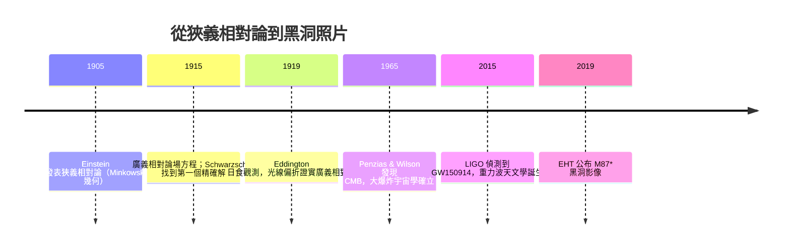

# 10.4 黑洞、重力波與宇宙學

## 本節目標

上一節我們在戰壕故事的尾聲拿到了史瓦西解。這一節是全書的終章：從那個解出發，看 Einstein 理論在之後一百多年裡長成了什麼樣子——旋轉黑洞、膨脹宇宙、重力波、黑洞照片，最後停在「量子重力」這道未解之牆前。計算會很少，敘事會很多，但每一段敘事背後都有前九章的幾何在撐腰。

本節目標：

1. 認識 Kerr 度量：旋轉黑洞與 EHT 影像的理論基礎。
2. 推導 FLRW 度量下的哈伯定律與光子紅移 $`1+z = a_0/a`$ 。
3. 理解 GW150914（2015）與 EHT M87 影像（2019）為什麼是廣義相對論的「決定性實驗」。
4. 用 SymPy 完成一個可執行的小實驗：FLRW 光子紅移與哈伯常數換算。

## 一、Kerr：真實的黑洞會旋轉

史瓦西解假設球對稱——但真實恆星都在轉。1963 年 Roy Kerr 找出了旋轉真空解，度量（Boyer–Lindquist 形式）在 $`a = J/(Mc) \to 0`$ 時退化回史瓦西：

$$
ds^2 = -\left(1 - \frac{2GM r}{\rho^2 c^2}\right) c^2 dt^2 + \frac{\rho^2}{\Delta} dr^2 + \rho^2 d\theta^2 + \left(r^2 + a^2 + \frac{2GM r a^2 \sin^2\theta}{\rho^2 c^2}\right)\sin^2\theta \, d\varphi^2
$$

其中 $`\rho^2 = r^2 + a^2\cos^2\theta`$ 、 $`\Delta = r^2 - r_s r + a^2`$ 。Kerr 幾何的幾個驚人特性：

- **有兩個視界**： $`\Delta = 0`$ 給出外視界 $`r_+`$ 與內視界 $`r_-`$ ，都由 $`\Delta`$ 的二次式決定。
- **能層**（ergosphere）：在外視界之外還有一層區域，那裡時空被拖曳得連「靜止」都不可能——所有觀察者被迫跟著黑洞轉（參考系拖曳，frame dragging）。
- **Penrose 過程**：掉進能層的物體可以把轉動動能丟給黑洞再逃逸——理論上黑洞是「可充電的電池」。

2019 年 EHT 公布 M87* 影像，那圈發光的光環半徑約 $`5.3\,GM/c^2`$ ，與 Kerr 預測的光子環高度吻合；影像中光環的明暗不對稱（Doppler beaming）甚至暗示了黑洞的旋轉方向。十年前只能出現在黑板上的解，如今有了照片。

## 二、FLRW：膨脹的宇宙

把「宇宙在夠大的尺度上是均勻且各向同性」翻譯成幾何語言，就是 **Friedmann–Lemaître–Robertson–Walker (FLRW)** 度量：

$$
ds^2 = -c^2 dt^2 + a(t)^2 \left[ \frac{dr^2}{1 - k r^2} + r^2 \left( d\theta^2 + \sin^2\theta\, d\varphi^2 \right) \right]
$$

唯一的未知數是**尺度因子** $`a(t)`$ （和一個常數 $`k = 0, \pm 1`$ ，對應平坦／封閉／開放空間）。代入 Einstein 場方程（第 8、10.2 節的機器），就得到 Friedmann 方程：

$$
H^2 \equiv \left( \frac{\dot a}{a} \right)^2 = \frac{8\pi G}{3}\rho - \frac{k c^2}{a^2} + \frac{\Lambda c^2}{3}
$$

哈伯常數 $`H_0`$ 就是「今天的」 $`\dot a / a`$ ，目前觀測值約 $`H_0 \approx 67 \sim 73\ \text{km/s/Mpc}`$ ——兩個陣營的差異（Hubble tension）正是當代宇宙學最熱的問題。注意單位換算： $`1\ \text{Mpc} \approx 3.086\times 10^{19}\ \text{km}`$ ，所以 $`H_0 \approx 70\ \text{km/s/Mpc}`$ 相當於每秒膨脹約 $`2.3\times 10^{-18}`$ 的比例——宇宙非常、非常緩慢地變大。

還有一個漂亮的推論：在膨脹宇宙中，光子的波長跟著空間一起被拉長。對共動光源發出的光，紅移滿足

$$
1 + z = \frac{\lambda_0}{\lambda_{\text{emit}}} = \frac{a_0}{a_{\text{emit}}}
$$

這就是我們說「看到了紅移 $`z = 1100`$ 的 CMB」時，真正的意思：光出發時宇宙只有今天的 $`\dfrac{1}{1+1100} \approx \dfrac{1}{1100}`$ 大。

## 三、SymPy 實驗：光子紅移與哈伯常數換算

```python
import sympy as sp

# ---- (1) 光子紅移 1 + z = a0/a_emit ----
z, a0, aem = sp.symbols('z a_0 a_emit', positive=True)
sol = sp.solve(sp.Eq(1 + z, a0/aem), aem)
print("CMB (z=1100) 時宇宙的相對大小：")
print(sp.simplify(1/(1+1100)))   # ⇒ 1/1101 ≈ 0.000908

# ---- (2) Hubble 常數單位換算：km/s/Mpc -> 1/s ----
H0 = 70            # km/s/Mpc
Mpc_km = 3.086e19  # 1 Mpc 等於多少 km
H0_inv_s = H0 / Mpc_km
print(f"H0 ≈ {H0_inv_s:.3e} 1/s")

# 哈伯時間（宇宙年齡的粗估，假設 H 近似常數）
sec_per_year = 3.156e7
print(f"1/H0 ≈ {1/H0_inv_s/sec_per_year/1e9:.2f} 十億年")  # ≈ 14 Gyr

# ---- (3) 哈伯定律：距離 d 處的星系退行速度 v = H0 * d ----
d = sp.Symbol('d', positive=True)  # 單位 Mpc
v = H0 * d          # km/s
print("100 Mpc 的星系退行速度 ≈", v.subs(d, 100), "km/s  (約光速的 2.3%)")
```

輸出要點：CMB 時代的宇宙只有今天的約 $`0.09\%`$ 大； $`H_0 = 70\ \text{km/s/Mpc}`$ 換算成頻率單位約 $`2.27\times 10^{-18}\ \text{s}^{-1}`$ ，其倒數（哈伯時間）約 140 億年——與宇宙年齡的實測值（約 138 億年）量級完全一致。這不是巧合：宇宙年齡本來就是 $`\int \dfrac{da}{a\,H(a)}`$ 的「近似」版本。

## 四、重力波：時空的漣漪

線性化場方程（把度量寫成 $`g = \eta + h`$ ， $`|h| \ll 1`$ ）允許波動解：**以光速傳播的時空應變波**。它通過時，會週期性地拉伸／壓縮垂直於傳播方向的距離——干涉儀的兩條臂會一長一短地呼吸。

2015 年 9 月 14 日，LIGO 的兩座探測器（相距 3000 km）記錄到 GW150914：兩個約 29 與 36 倍太陽質量的黑洞旋近、合併。關鍵數字：

- 探測到的應變只有 $`h \sim 10^{-21}`$ ——LIGO 的 4 km 臂長變化僅約 $`10^{-18}`$ m，比質子半徑還小一千倍。
- 合併瞬間約有 $`3\,M_\odot c^2`$ 的能量在不到一秒內以重力波輻射出去，功率一度超過全宇宙恆星發光功率的總和。
- 波形（頻率與振幅上升的「啁啾」chirp）與第 10.2 節場方程的數值解吻合到極高精度——這是對 Einstein 方程最直接的動力學檢驗。

從幾何的語言說：重力波就是 Riemann 曲率張量的波動——第 8.1 節那個四指標的怪物，在真空中有自己的生命，不需要物質做載體。

## 五、時間線：一百年的幾何



六個年份，一條主線：**幾何就是重力，而且可以被測量**。本書第 6～10 章走過的每一個數學結構——流形、度量、曲率、場方程——都在這條時間線上有對應的觀測驗證。

## 六、前沿一瞥：量子重力

廣義相對論的語言是光滑流形上的微分幾何；量子場論的語言是希爾伯特空間上的算符。兩者相遇時出現矛盾——最著名的是黑洞的 Hawking 輻射（黑洞有溫度、會蒸發）引出的**資訊悖論**：蒸發殆盡後，掉進去的資訊去哪了？

主流候選理論簡述：

- **弦論**：把粒子換成一維弦，重力子自然出現在譜中；代價是需要額外維度。
- **圈量子重力**：把面積與體積算符化，幾何本身是離散的。
- **全像原理**（AdS/CFT）：一個含重力的 $`d+1`$ 維理論等價於邊界上不含重力的 $`d`$ 維理論——空間本身可能是「投影」。

這些都還沒有實驗裁決。好消息是：不管最終答案為何，它必然建立在微分幾何之上——你已經擁有了那個語言。

## 動手實驗

1. **Kerr 視界**：用 SymPy 解 `sp.solve(r**2 - 2*M*r + a**2, r)`，得到 $`r_\pm = M \pm \sqrt{M^2 - a^2}`$ （取 $`G=c=1`$ ）。畫出 $`r_+`$ 對 $`a/M`$ 的圖，並思考：當 $`a \to M`$ （極端黑洞）時兩個視界會如何？
2. **Hubble tension 體驗**：把實驗程式中的 $`H_0`$ 分別換成 67 與 73，比較哈伯時間的差異。這 8% 的落差就是「Hubble tension」的具體份量。
3. **紅移練習**：JWST 已觀測到 $`z \approx 14`$ 的星系。用 $`a_0/a = 1+z`$ 算出當時宇宙的大小比例，再想像那張照片的「年齡」。
4. **進階**：查閱 `einpy` / `EinsteinPy`（第 8.4 節用過），嘗試用其內建模組算 FLRW 度量的 Christoffel 記號，與手推結果比對。

## 學習資源

- **Bernard Schutz, *A First Course in General Relativity***：最友善的入門，物理直覺優先，與本書風格接近。
- **Sean Carroll, *Spacetime and Geometry***：標準研究所入門，練習題品質極高；另有免費的線上講義版。
- **Robert Wald, *General Relativity***：數學最嚴謹，適合在讀完本書後回頭精讀（幾何語言最地道）。
- **MIT OCW 8.226 (Four Lectures on Gravitational Waves)** 與 8.962 (General Relativity)：免費講義與習題，重力波部分尤其值得。
- LIGO 開放資料中心（GWOSC）：可以下載真實的 GW150914 波形資料自己畫 chirp。

## 小結與練習

本書從一條曲線的弧長開始，走到了場方程、黑洞與宇宙。回頭看，這條路只有一個主旋律：**把幾何量（曲率）等同於物理量（物質與能量）**。SymPy 在路上的角色不是計算機，而是「能被驗證的敘事」——每一個號稱的推論，都能複製貼上重跑一次。

- Kerr 解描述旋轉黑洞，EHT 2019 的 M87* 影像直接對應其光子環。
- FLRW 度量把「均勻各向同性」變成單一函數 $`a(t)`$ ；紅移 $`1+z = a_0/a`$ 、哈伯定律 $`v = H_0 d`$ 都是其直接推論。
- GW150914 證實了 Riemann 曲率可以自持傳播；廣義相對論從「理論」變成「觀測科學」。
- 量子重力是下一座山；山腳下已鋪好微分幾何的地基。

**練習**

1. 用 SymPy 算 FLRW 度量在 $`k=0`$ 、 $`a(t) = t^{1/2}`$ （輻射主宰）時的純量曲率 $`R`$ ，驗證 $`R \propto t^{-2}`$ （提示：保留 $`a(t)`$ 為未定函數，最後代入）。
2. 由 $`v = H_0 d`$ 估計：多久之後，距離我們 4000 Mpc 的星系會因膨脹而「超光速」退行？（這不違反相對論——是空間在膨脹，不是物體在穿越空間。）
3. Kerr 極端黑洞 $`a \to M`$ 時外視界半徑為多少 $`GM/c^2`$ ？與史瓦西半徑比較，並解釋為何旋轉讓黑洞「變小」。
4. 讀完本書後的下一步建議：Carroll 第 5～8 章（黑洞與宇宙學）配上 MIT OCW 8.962；每讀一個度量，就用本書 10.3 節的 SymPy 機器重算一次。
