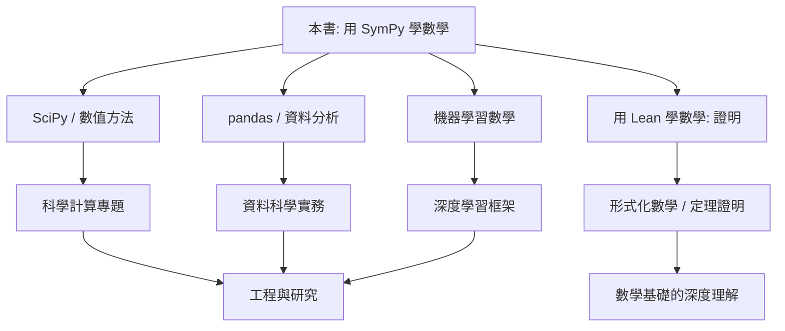

# 10.4 下一步的世界

## 本節目標

- 認識 SymPy 與 SciPy 的分工，知道何時該「交棒」
- 一窺 pandas 與資料科學的世界
- 看見機器學習背後的數學：用 SymPy 推導梯度下降
- 與《用 Lean 學數學》銜接：從計算走向證明
- 帶著學習路線圖與推薦資源離開本書

---

## SciPy：SymPy 的數值搭檔

SymPy 做**符號**計算，SciPy 做**數值**計算——兩者不是競爭，而是分工：

| 任務 | SymPy（符號） | SciPy（數值） |
|---|---|---|
| 解方程 | `sp.solve` 給精確根 | `scipy.optimize.fsolve` 給近似根 |
| 積分 | `sp.integrate` 給解析式 | `scipy.integrate.quad` 給數值 |
| 最佳化 | `sp.calculus.util.minimum`（有限） | `scipy.optimize.minimize`（豐富強大） |
| 微分方程 | `sp.dsolve`（有解析解才快） | `scipy.integrate.solve_ivp`（幾乎都能解） |
| 線性代數 | `sp.Matrix` 精確運算 | `scipy.linalg` 高速數值 |

**經驗法則**：先試 SymPy（要精確解與漂亮公式），
解不出來或太慢，就交給 SciPy。

```python
import sympy as sp
import numpy as np
from scipy import optimize, integrate

x = sp.Symbol('x')
f_expr = sp.sin(x) * sp.exp(-x/3)

# SymPy：推導與精確積分
F = sp.integrate(f_expr, (x, 0, sp.oo))
print(F)   # 3/10

# SciPy：數值驗證與擴展（SymPy 解不動的函數也能算）
val, err = integrate.quad(sp.lambdify(x, f_expr, 'numpy'), 0, np.inf)
print(val)   # 0.3

# SciPy 最佳化：SymPy 對含數值噪音的目標函數無能為力
res = optimize.minimize(lambda p: (p[0]-2)**2 + (p[1]+1)**2, [0, 0])
print(res.x)   # [ 2. -1.]
```

在 10.2 的 SIR 模型，若要擬合真實疫情數據找 $\beta, \gamma$，
`scipy.optimize` 就是標準工具——SymPy 負責建模與推導，SciPy 負責擬合。

---

## pandas 與資料科學

當資料不是乾淨的公式，而是 CSV 表格，pandas 接手：

```python
import pandas as pd

df = pd.read_csv('scores.csv')
print(df.describe())        # 敘述統計
print(df.groupby('class')['score'].mean())
```

它與本書工具鏈的關係：**pandas 整理資料 → NumPy 計算 →
Matplotlib 畫圖 → SymPy 推導背後的理論模型**。
資料科學的日常，就是這四件事的循環。

---

## 機器學習中的數學：梯度下降

神經網路訓練的核心只有一句話：
**沿著負梯度方向一小步一小步走，找函數最小值**。
梯度是微積分（偏導數）、方向是線性代數（向量）。

### 用 SymPy 推導梯度

目標：最小化 $f(x, y) = (x-2)^2 + (y+1)^2$。

```python
import sympy as sp

x, y = sp.symbols('x y', real=True)
f = (x - 2)**2 + (y + 1)**2

grad = [sp.diff(f, v) for v in (x, y)]
print(grad)   # [2*x - 4, 2*y + 2]
```

### 手工實作梯度下降

```python
import numpy as np

grad_func = sp.lambdify((x, y), grad, 'numpy')
p = np.array([0.0, 0.0])
lr = 0.1

for i in range(50):
    g = np.array(grad_func(*p), dtype=float)
    p = p - lr * g

print(p)   # 約 [2. -1.]，正是最小值點
```

**看見了嗎**：SymPy 推導 $\nabla f$，lambdify 轉函數，
NumPy 迭代下降——本書全部工具在機器學習的核心演算法裡會師。

### 練習看穿庫的內部

```python
# PyTorch 的自動微分（autograd）做的正是 SymPy diff 的事，
# 只是用計算圖而非符號式，為的是效率。
# 觀念相同：偏導數 → 鏈鎖律 → 逐層回傳。
```

---

## 與《用 Lean 學數學》銜接：計算之外，證明如何開始

本書一路用 SymPy **計算**數學；但數學還有另一半：**證明**。

- SymPy 告訴你 $\displaystyle\int_0^1 x\,dx = \frac{1}{2}$（這是**驗算**）
- 證明要回答：為什麼對**所有**可積函數都成立？（這是**定理**）

差異對照：

| | SymPy 計算 | Lean 證明 |
|---|---|---|
| 回答 | 「這題答案是幾？」 | 「為什麼永遠成立？」 |
| 驗證方式 | 代入、數值對照 | 邏輯檢查器逐行確認 |
| 弱點 | 無法窮舉所有情況 | 不會幫你猜答案 |

銜接建議：把你用 SymPy **觀察**到的規律，拿去 Lean 裡**證明**。
例如你用 SymPy 驗證了前 100 個偶數之和的公式，
在 Lean 裡寫出對所有 $n$ 成立的證明——
計算發現規律，證明確立真理，兩者相輔相成。

---

## 學習路線圖



---

## 全書總結

回顧我們走過的路：

1. **第 1–2 章**：符號計算的世界觀，多項式與運算式操作
2. **第 3–4 章**：方程求解、函數即物件、lambdify 橋梁
3. **第 5–9 章**：微積分、線性代數、微分方程的符號兵器庫
4. **第 10 章**：三個實戰專案 + 廣闊的下一步

你現在具備的能力：**把數學問題翻譯成符號程式，
求解、驗證、視覺化，並知道何時交棒給數值工具**。
這正是現代科學計算的基本功。

## 推薦資源

- **SymPy 官方文件**（docs.sympy.org）：教程與模組總覽，最權威的參考
- **SciPy Lecture Notes**：NumPy/SciPy/Matplotlib 的免費系統教材
- **3Blue1Brown**（YouTube）：《Essence of Calculus》《Essence of Linear Algebra》
  把本書的符號計算變成動畫直覺
- 《用 Lean 學數學》：本書的自然續作，從計算走向證明
- **Project Euler**（projecteuler.net）：用 SymPy + Python 解數學謎題的練功場

---

## 小結與練習

本節描繪了離開本書後的世界：SciPy 接手數值計算、
pandas 處理真實資料、機器學習是微積分與線代的應用、
Lean 則把「驗算」升級成「證明」。
數學工具會一直演化，但「建模 → 推導 → 計算 → 驗證」的心法不變。

**練習**

1. 用 `scipy.integrate.solve_ivp` 重解 10.2 的 logistic 方程，
   與 SymPy 的解析解畫在同一張圖比對誤差。
2. 用 pandas 讀一份你自己的資料（成績、記帳、運動紀錄），
   敘述統計 + 畫圖，並用 SymPy 推導一個擬合模型的極值。
3. 把梯度下降的例子改成 $f(x, y) = x^4 + y^4 - 4xy$，
   觀察學習率太大時會發散——理解 $\nabla f$ 大小與步長的關係。
4. 挑一個你用 SymPy 驗算過的恆等式（例如 $(a+b)^2 = a^2 + 2ab + b^2$），
   嘗試在 Lean（或紙上）寫出對所有數成立的證明，
   體會「計算」與「證明」的不同。
