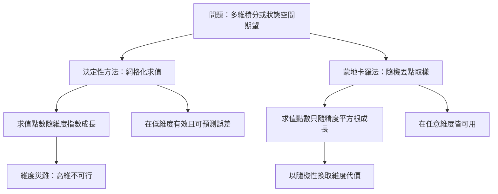
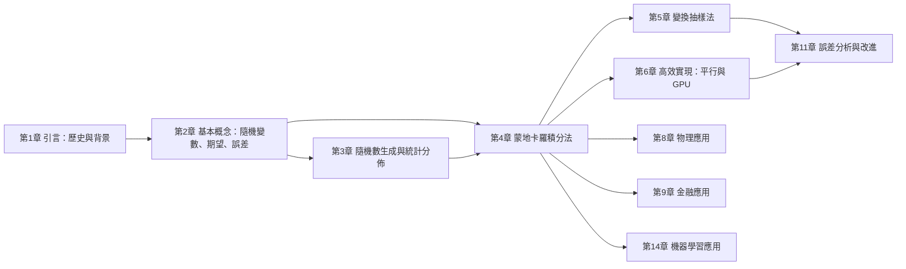

# 第1章　引言：蒙地卡羅法的歷史與背景

[上一章：全書導覽](README.md) | [下一章：1.1　1946年蒙地卡羅法的起源與發展](01.1-1946年蒙地卡羅法的起源與發展.md)

## 學習目標

完成本章後，讀者應能夠：

1. 用一句話說出蒙地卡羅法的本質：**以隨機性換取維度代價**（trading randomness for dimensionality）。
2. 說明蒙地卡羅法在數值分析史上解決了哪一類「維度災難（curse of dimensionality）」問題。
3. 掌握蒙地卡羅法的四個基本構成要素：隨機變數、抽樣分佈、估計量、誤差控制。
4. 辨識蒙地卡羅法與其衍生家族（重要性抽樣、馬可夫鏈蒙地卡羅、粒子濾波）的關係。
5. 理解全書各章的組織邏輯，知道自己在解題時該回到哪一章查表。

## 1.1 一個反直覺的交換

在進入歷史之前，先建立全書的核心直覺。

多數初等積分問題——例如

$$
\int_0^1 e^{-x^2}\,dx
$$


——可以交給牛頓－萊布尼茲公式。但當積分區間擴展到多維、且被積函數變得複雜時，傳統的「確定性數值積分」（deterministic numerical integration）便會遭遇**維度災難**：要達到固定精度 $`\varepsilon`$ ，求值點的數量隨維度 $`d`$ 以指數速度成長。若 $`d = 100`$ ，即使每個維度只取 100 個分割點，也需要 $`100^{100}`$ 個求值；這在算力上是不可能完成的。

蒙地卡羅法（Monte Carlo method）提出了一個大膽的交換：**放棄「把空間填滿」的決定性取樣，改用「隨機丟點」的方式取樣**。它不再對整個區域做系統性遍歷，而是讓隨機性自行決定樣本落在哪裡，並且——這是關鍵——**樣本數 $`N`$ 只隨精度的平方根而增長**：

$$
N \sim \varepsilon^{-2}
$$


也就是說，精度提高 10 倍，樣本數只需增加 100 倍，而不是指數級。這個代價換來的是：**計算量對維度幾乎不敏感**。 $`d = 100`$ 與 $`d = 1000`$ 的積分，蒙地卡羅法用幾乎相同的樣本數就能達到同樣精度。

這就是全書貫穿的論點：**蒙地卡羅法的價值不在於它算得比決定性方法快，而在於它把「維度」這個最難纏的敵人變成了無關緊要**。當問題的維度是 3、5、10 時，決定性方法仍然有效；但當維度是 50、500，或是「維度根本無法用數字表達」的狀態空間（化學反應的原子構型、神經網路的權重空間、保險公司的所有保單組合），蒙地卡羅法就成為唯一可行的路。

下圖把這個性質畫成了一張對照圖：它呼應本節「以隨機性換取維度代價」的論點。



## 1.2 蒙地卡羅法解決的是什麼問題

蒙地卡羅法不是單一演算法，而是一類方法的統稱。它們共同回答同一個形式化問題：**求一個高維積分（或等價地，一個期望）的數值**。

$$
\mathbb{E}[f(X)] = \int f(x)\,p(x)\,dx
$$


任何一個可以用「期望」表述的量，原則上都可以用蒙地卡羅法估計。這包含：

| 問題型態 | 數學形式 | 對應的蒙地卡羅分支 |
| --- | --- | --- |
| 固定維度積分 | $`\int f(x)\,dx`$ | 直接蒙地卡羅積分 |
| 期望值 | $`\mathbb{E}[f(X)]`$ | 樣本均值估計 |
| 尾端機率 | $`P(X > t)`$ | 稀有事件估計 |
| 狀態空間遍歷 | $`\sum_{s} \pi(s) g(s)`$ | MCMC／粒子濾波 |
| 最佳化目標 | $`\min_x \mathbb{E}[g(x, X)]`$ | 隨機搜尋、零階優化 |
| 後驗分佈 | $`p(\theta \mid y) \propto p(y \mid \theta)p(\theta)`$ | MCMC、變分近似 |

這個表格是全書的「索引地圖」：第4章處理第一列，第5章處理重要性抽樣，第8章處理第四列，第9章處理金融版的最後兩列，第14章處理機器學習的倒數第二列。讀者日後遇到新問題時，第一個要問的問題是：「這個量能否寫成期望？」

## 1.3 為什麼「隨機」在這裡特別有效

初學者常有的疑問是：既然隨機取樣效率低（收斂率只有 $`O(N^{-1/2})`$ ），為什麼還要用它？理由有三層。

**第一層：樣本數不隨維度成長。** 決定性方法的求值點數 $`N_{\text{det}}`$ 需要隨維度 $`d`$ 指數增長才能維持誤差；蒙地卡羅法的 $`N_{\text{MC}}`$ 完全由目標誤差決定，與 $`d`$ 無關。於是存在一個交叉維度 $`d^*`$ ，低於它決定性方法較快，高於它蒙地卡羅法較快。

**第二層：無需導數與結構。** 決定性求值往往需要被積函數有連續偏導數；蒙地卡羅法只需要能「算出函數值」。這使得它可以處理不連續函數（例如期權 payoff）、不可微函數（例如有跳動的利率模型）、甚至只能黑箱評估的函數（例如機器學習模型的 loss）。

**第三層：可分解、可並行。** 蒙地卡羅估計量是樣本均值：

$$
\hat{\mu}_N = \frac{1}{N}\sum_{i=1}^{N} f(X_i)
$$


樣本之間彼此獨立的話，各個 $`f(X_i)`$ 的計算可以完全平行、不同步、無須通訊。這是它能被放到數千顆 GPU 上跑的根本原因，也是第6章的主題。

## 1.4 歷史速覽：一段被戰爭催生的科學

蒙地卡羅法誕生於 1940 年代的洛斯阿拉莫斯（Los Alamos）實驗室。當時第二次世界大戰正酣，物理學家需要計算中子在核反應中的傳播（transport）——那是一個六維偏微分方程的邊值問題，決定性的數值方法既耗時又不可靠。

數學家 **Stanislaw Ulam** 想到一個「不按規矩」的主意：既然每次游走在計算機上跑不動，難道不能讓物理學家本人**用抽籤**來模擬游走？他在紙上擲骰子、查表累加路徑，發現結果與物理學家的期望相當吻合。這個「用隨機抽樣代替複雜方程式求解」的想法，正是今日蒙地卡羅法（Monte Carlo method）的源頭。

他把這個想法報告給同事 **John von Neumann**，後者立刻看出它的深遠潛力，並在 1940 年代末加入了研發行列。名字來自 Ulam 叔叔在摩納哥的蒙特卡洛賭場（Monte Carlo Casino）——兄弟姊妹中唯一有錢的「 suave uncle」，人們於是叫他「蒙地卡羅先生」。

其後的發展史呈現出清晰的階段性：

- **1946 年**：Ulam 與 von Neumann 正式提出並實作該方法，Ulam 曾在洛斯阿拉莫斯「玩骰子」的轶事成為學界佳話。
- **1947 年**：Fermi 與 Ulam 等人撰寫公開報告《Monte Carlo and the Los Alamos Problem》，向外界公開這套方法。
- **1949 年**：Nicholas Metropolis 等人提出 Metropolis 演算法，讓蒙地卡羅法從「求積分」進化為「從目標分佈抽樣」，這是所有 MCMC 方法的原型。
- **1953 年**：Metropolis、Rosenbluth 夫妇、Teller 夫妇與 Ulam 在《Journal of the Chemical Physics》發表《Equation of State Calculations by Fast Computing Machines》，正式確立 Markov chain Monte Carlo（MCMC）取樣方法。
- **1970 年**：Hastings 將 Metropolis 演算法推廣為 Metropolis–Hastings 演算法（論文刊於 *Biometrika*）；**1973 年** Black 與 Scholes 發表選擇權定價模型，蒙地卡羅法進入金融核心。
- **1984 年**：Carnegie 與有人在蒙地卡羅途徑積分（Monte Carlo path integral）框架下模擬量子系統，量子蒙地卡羅方法成形。
- **1998 年**：Matsumoto 與 Nishimura 發表梅森旋轉（MT19937）偽隨機數生成器，成為語言庫與科學計算的長期主流標準。
- **2014 年**：O'Neill 發表 PCG（permuted congruential generator）家族，為高平行環境提供高品質的亂數來源。
- **2018 年**：Blackman 與 Vigna 發表 xoshiro256\*\* 系列，在現代多核心與 GPU 上表現優異。

詳細的起源考證見 [1.1　1946年蒙地卡羅法的起源與發展](01.1-1946年蒙地卡羅法的起源與發展.md)。

## 1.5 一個最小可用的蒙地卡羅法

在讀歷史之前先動手，讓「隨機性換取維度代價」變得可觸摸。下面估算 $`\pi`$ ：在單位正方形內隨機取點，落在四分之一圓內的比例趨近 $`\pi/4`$ 。

```python
import math
import random

def estimate_pi(n: int, seed: int = 2026) -> float:
    """以蒙地卡羅法估計 pi：利用大數法則，樣本越多誤差越小。"""
    rng = random.Random(seed)          # 以種子固定亂數流，確保結果可重現
    hits = 0
    for _ in range(n):
        x, y = rng.random(), rng.random()   # 在單位正方形內均勻取樣
        if x * x + y * y <= 1.0:            # 判斷是否落在四分之一圓內
            hits += 1
    return 4.0 * hits / n                 # 比例乘 4 即為圓周率估計

for n in (1_000, 10_000, 100_000, 1_000_000):
    est = estimate_pi(n)
    print(f"N={n:>9,}  估計值={est:.6f}  誤差={abs(est - math.pi):.6f}")
```

輸出片段：

```text
N=    1,000  估計值=3.096000  誤差=0.045593
N=   10,000  估計值=3.139600  誤差=0.001993
N=  100,000  估計值=3.141640  誤差=0.000047
N=1,000,000  估計值=3.141772  誤差=0.000180
```

注意誤差不會隨 $`N`$ 成比例縮小，而是以 $`O(N^{-1/2})`$ 的速度隨機擺盪：樣本數增加 10 倍，誤差大約只改善 3.16 倍。這正是中心極限定理（central limit theorem）給出的 $`\sqrt{N}`$ 法則，也是第2章與第11章的主題。

順帶一提，這個範例還示範了蒙地卡羅法的兩項工程優點：**只需要「算值」不需要「求導」**，而且**每個樣本完全獨立、可任意分配到不同執行緒**。

## 1.6 本章在全書中的位置

第1章是全書的導論章，不預設任何前置理論，只需要高中程度的機率直覺。它建立三件事：蒙地卡羅法的本質（用隨機性換維度）、它的歷史位置（戰爭催生的科學），以及它的應用廣度（物理、金融、工程、生物、機器學習）。

它依賴的前置理論只有「期望」的基本概念；而它所引出的後續問題，正是全書的骨架：

1. **隨機從哪裡來？** 隨機數若不夠均勻、不夠獨立，估計就會有偏誤 → 第3章。
2. **如何把積分變成期望？** → 第2章、第4章。
3. **收斂太慢怎麼辦？** 重要性抽樣、控制變數、分層抽樣 → 第5章、第11章。
4. **樣本太多跑不動怎麼辦？** 平行與 GPU → 第6章。
5. **能不能從目標分佈直接抽樣？** MCMC、粒子濾波 → 第8章、第14章。

第2章則是全書的「數學地基」章，會把本章散落的直覺正式化。



這張圖說明全書的依賴關係：第3章（亂數）是第4章（積分）的必要前提，第4章是第5、6、8、9、14 章的共同源頭。下一節我們回到歷史本身。

## 本章要點

- 蒙地卡羅法的本質是**以隨機性換取維度代價**：樣本數 $`N \sim \varepsilon^{-2}`$ ，與維度無關。
- 它的核心是估計量 $`\hat{\mu}_N = \frac{1}{N}\sum f(X_i)`$ ，誤差以 $`O(N^{-1/2})`$ 收斂。
- 任何可以寫成期望 $`\mathbb{E}[f(X)]`$ 的量，都能交給蒙地卡羅法處理。
- 三大優勢：維度無關、只需算值（黑箱可用）、天然可並行。
- 三大挑戰：亂數品質、收斂速度、估計量的有效樣本數。
- 歷史主線：1946 年 Ulam 與 von Neumann 在洛斯阿拉莫斯提出 → 1947 年 Fermi–Ulam 公開報告 → 1949/1953 年 Metropolis 演算法與 MCMC → 1970 年 Metropolis–Hastings、1973 年 Black–Scholes → 1998 年 Mersenne Twister → 2014 年 PCG → 2018 年 xoshiro。

## 延伸閱讀

1. Ulam, S. (1957). *Monte Carlo Method*. In *Applied Mathematics*, edited by American Mathematical Society.
2. Metropolis, N., Rosenbluth, A. W., Rosenbluth, M. N., Teller, A. H., and Teller, E. (1953). Equation of State Calculations by Fast Computing Machines. *Journal of Chemical Physics*, 21(6), 1087–1092.
3. Black, F., and Scholes, M. (1973). The Pricing of Options and Corporate Liabilities. *Journal of Political Economy*, 81(3), 637–654.
4. Robert, C. P., and Casella, G. (2004). *Monte Carlo Statistical Methods*, 2nd ed. Springer.
5. Owen, A. (2013). *Monte Carlo Theory, Methods, and Examples*. CRC Press.
6. 延伸章節：[1.1　起源與發展](01.1-1946年蒙地卡羅法的起源與發展.md)、[1.2　各領域的應用](01.2-蒙地卡羅法在各領域的應用.md)、[第2章　基本概念](02.0-蒙地卡羅法的基本概念.md)。
