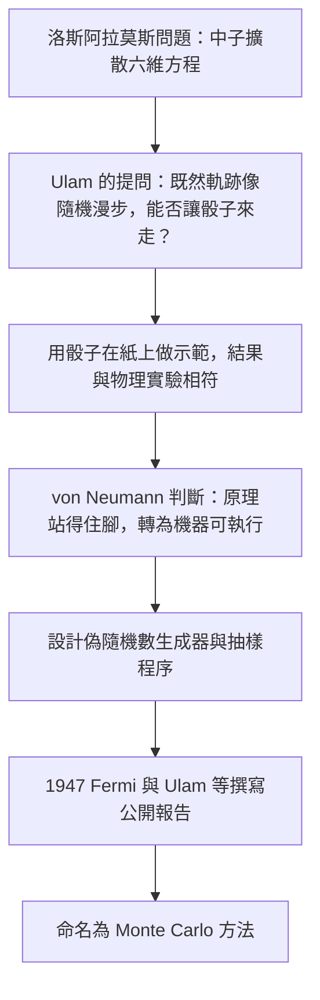
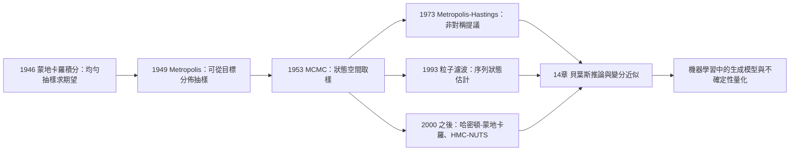

# 1.1　1946年蒙地卡羅法的起源與發展

[上一章：1.0　引言：蒙地卡羅法的歷史與背景](01.0-引言：蒙地卡羅法的歷史與背景.md) | [下一章：1.2　蒙地卡羅法在各領域的應用](01.2-蒙地卡羅法在各領域的應用.md)

## 學習目標

完成本節後，讀者應能夠：

1. 說出蒙地卡羅法在 1940 年代洛斯阿拉莫斯實驗室誕生時所面對的**真實工程難題**（中子擴散問題）。
2. 解釋 Ulam「用骰子模擬物理」的想法為何可行——背後是什麼數學原理（中心極限定理與大數法則）。
3. 說明「Monte Carlo」這個名稱的由來，並指出它帶來的行銷與學術雙重影響。
4. 依時間順序說出從 1946 年到 2018 年之間的關鍵節點：Fermi–Ulam 報告、Metropolis 演算法、1953 年 MCMC 論文、1973 年 Metropolis–Hastings 與 Black–Scholes、1998 年 Mersenne Twister、2014 年 PCG、2018 年 xoshiro。
5. 理解「蒙地卡羅法」這一名詞如何從一個積分技巧逐步擴張為一個涵蓋抽樣、優化、模擬的演算法家族。

## 1.1.1 背景：洛斯阿拉莫斯的難題

1943 年洛斯阿拉莫斯實驗室啟動。它要回答的問題是：核分裂鏈反應能否持續？這需要計算中子在物質中的**擴散（neutron transport）**——即中子每經歷一次碰撞後的位置、方向與能量如何演變。中子擴散方程是一個在位置（3 維）、方向（2 維角）、能量（1 維）共六維空間中的積分／微分方程，且材料幾何極其不規則。

當時可用的機器是 ENIAC 一類的真空管計算機，一次跳點運算需要數分鐘甚至數小時。物理學家 John von Neumann 與 Stanislaw Ulam 原本嘗試的「確定性」方法，是把空間切成格子並逐格計算——這種方法在物理上正確，卻因為格子邊界效應與計算量過大而不可行。

Ulam 的洞見在於：**這個問題本質上是隨機的**。單一中子的路徑無法預測，但大量中子的統計行為服從可預測的分佈。既然中子的軌跡本身像隨機漫步，那麼讓電腦擲骰子去生成隨機漫步路徑，再用統計平均去推估總體行為，應該可以得到同樣的答案。

他起初「手工」完成示範：用骰子擲出隨機漫步，把步數累加到一張紙上。這種「不靠計算機也能做」的粗糙方法，卻意外地與物理實驗相符——這說明方法背後的原理是穩健的，不是僥倖。

## 1.1.2 為什麼這個想法在數學上是成立的

Ulam 的直覺有嚴格的機率論支撐，這是本章要點，也是全書第一個重要的定理鏈。

設 $`X_1, X_2, \dots`$ 為獨立同分布的隨機變數，期望為 $`\mu`$ 、變異數為 $`\sigma^2 < \infty`$ 。由**大數法則（law of large numbers）**，樣本均值

$$
\hat{\mu}_N = \frac{1}{N}\sum_{i=1}^{N} X_i
$$

以機率 1 收斂到 $`\mu`$ 。更進一步，由**中心極限定理（central limit theorem）**，

$$
\frac{\hat{\mu}_N - \mu}{\sigma/\sqrt{N}} \;\Rightarrow\; N(0,1)
$$

因此 $`\hat{\mu}_N`$ 的誤差量級是 $`\sigma/\sqrt{N}`$ 。

把它套回積分：任何積分都能寫成期望。

$$
\int_{a}^{b} f(x)\,dx = (b-a)\,\mathbb{E}\big[f\big(a + (b-a)U\big)\big]
$$

其中 $`U \sim \mathrm{Uniform}(0,1)`$ 。於是積分問題被轉化為「對隨機樣本求平均」，而隨機樣本的誤差只以平方根速度收斂。**這正是第2章要系統化建立的核心等式**，本章先給出它的直覺版本。

關鍵的效率論證是：確定性網格法在 $`d`$ 維需要 $`m^d`$ 個求值點；蒙地卡羅法只求值 $`N`$ 點，而 $`N`$ 由誤差決定、與 $`d`$ 無關。所以當

$$
m^d \gg \varepsilon^{-2}
$$

蒙地卡羅法就取勝。 $`d`$ 越大，取勝門檻越早到來。

這張時序圖說明「一個好點子如何變成一門方法學」：Ulam 提供直覺、von Neumann 提供嚴謹性與實作、公開報告提供傳播途徑。

## 1.1.3 名稱的由來：一個賭場帶來的雙刃劍

「Monte Carlo」並非 Ulam 所取。據 Ulam 本人與同事的回憶，這個名字來自他叔叔在摩納哥蒙特卡洛（Monte Carlo）的賭場——他是兄弟姊妹中唯一有錢的「 suave uncle 」，人們於是以賭場的名字稱呼他。Ulam 起初對這個名字頗為不滿，因為「Monte Carlo」聽起來像與概率論無關的娛樂場所。

然而這個名字產生了出乎意料的效果。它讓蒙地卡羅法在二戰後迅速風靡：公眾第一次聽到一個聽起來像「好運氣」的方法，卻能用來解決中子擴散、核融合控制棒、統計力學這類極為艱深的問題。

名字帶來的好處是**易記與可傳播**；壞處是**容易讓人低估其嚴謹性**——它是完全確定的演算法，只要固定亂數種子，結果就完全可重現，與「運氣」無關。這一點在今天談蒙地卡羅法的可重現性（reproducibility）時仍常被誤解，本書會在 [3.3　生成高效隨機數的技術](03.3-生成高效隨機數的技術.md) 特別澄清。

## 1.1.4 發展年表

下表是蒙地卡羅法八十餘年演化的骨架，也是後續各章的索引。

| 年份 | 事件 | 意義 | 本書對應 |
| --- | --- | --- | --- |
| 1946 | Ulam 與 von Neumann 在洛斯阿拉莫斯提出並實作該方法 | 蒙地卡羅法誕生 | 本節 |
| 1947 | Fermi 與 Ulam 等撰寫《Monte Carlo and the Los Alamos Problem》 | 方法首次公開報告 | 本節 |
| 1949 | Metropolis 等提出 Metropolis 演算法 | 從「求積分」進化為「從目標分佈抽樣」 | [8.2](08.2-1953年Metropolis抽樣與粒子模擬.md) |
| 1953 | Metropolis、Rosenbluth、Teller 等發表《Equation of State Calculations by Fast Computing Machines》 | MCMC 取樣方法正式確立 | [8.2](08.2-1953年Metropolis抽樣與粒子模擬.md) |
| 1966 | Park 与 Miller 發表「最小標準」乘同餘隨機數生成器 | 隨機數品質的可攜性標準 | [3.1](03.1-隨機數的生成方法.md) |
| 1973 | Hastings 將 Metropolis 推廣為 Metropolis–Hastings 演算法 | 可對任意目標分佈抽樣 | [8.2](08.2-1953年Metropolis抽樣與粒子模擬.md) |
| 1973 | Black 與 Scholes 發表選擇權定價模型 | 蒙地卡羅法進入金融核心 | [第9章](09.0-蒙地卡羅方法在金融中的應用.md) |
| 1984 | 蒙地卡羅路徑積分框架用於模擬量子系統 | 蒙地卡羅法進入量子力學 | [8.3](08.3-1984年蒙地卡羅模擬量子系統.md) |
| 1993 | Gordon 等提出粒子濾波 | 蒙地卡羅法處理序列資料與貝葉斯追蹤 | [7.3](07.3-蒙地卡羅方法在隨機過程中的應用.md) |
| 1998 | Matsumoto 與 Nishimura 發表梅森旋轉 MT19937 | 偽隨機數品質的工業標準 | [3.1](03.1-隨機數的生成方法.md) |
| 2004 | Robert 與 Casella 的教科書《Monte Carlo Statistical Methods》出版 | 方法論體系化 | [A3](A3-參考文獻與推薦閱讀.md) |
| 2014 | O'Neill 發表 PCG 隨機數生成器家族 | 針對高平行度設計的亂數來源 | [3.1](03.1-隨機數的生成方法.md) |
| 2018 | Blackman 與 Vigna 發表 xoshiro256\*\* 系列 | 現代 CPU 與 GPU 上的高效亂數 | [3.1](03.1-隨機數的生成方法.md) |

值得注意的是，這張表的橫軸是「需求」而非「純技術」推動：金融定價需要大量獨立的隨機路徑（推動了平行蒙地卡羅）、機器學習需要可分層抽樣且能反轉的亂數（推動了 counter-based RNG）、高維貝葉斯推論需要低變異抽樣（推動了 MCMC 的所有改良）。這呼應了全書的主軸：**技術的演進總是被具體的應用需求拉著走**。

## 1.1.5 從積分到抽樣：Metropolis 的關鍵躍遷

1946 年的蒙地卡羅法只能處理「對某個分佈求平均」這類問題。但物理與統計中更常見的問題是：**我想要從某個給定的目標分佈 $`\pi(x) \propto e^{-U(x)}`$ 抽樣**，而不是從簡單的均勻分佈抽樣。這個能力缺口，正是 Metropolis 在 1949 年填上的。

Metropolis 演算法（第8章將詳述）允許人們構造一個以 $`\pi`$ 為不變分佈的馬可夫鏈：從當前狀態 $`x`$ 出發，先提出一個**對稱的**候選 $`y`$ ，然後以機率

$$
\alpha = \min\!\left(1,\; \frac{\pi(y)}{\pi(x)}\right)
$$

接受這個候選。這是一個極度簡潔的「接受／拒絕」規則，其正確性來自**詳細平衡（detailed balance）**條件。

這一步的意義在於：它把問題從「如何算一個期望值」升級為「如何從任意形狀的分佈取樣」。一旦能從任意分佈抽樣，取樣法（sampling）就成為整個統計推論的基礎操作——貝葉斯後驗的抽樣、統計力學的位形取樣、粒子濾波中的粒子分佈，都由此而生。

這張圖描繪蒙地卡羅法「從一條積分技巧長成一個方法家族」的過程，並指出血緣關係最密切的兩條支線：MCMC 與粒子濾波。

## 1.1.6 一個歷史教訓：好方法需要好亂數

蒙地卡羅法在洛斯阿拉莫斯能夠成功，仰賴於一件當時並不平凡的事：von Neumann 提出了 **von Neumann 乘同餘法**，用來取代昂貴的真隨機骰子。他證明了由此產生的序列在統計上看起來像均勻分佈——這是第一個嚴謹的偽隨機數分析。

但歷史也留下教訓：**低品質的亂數會讓蒙地卡羅法悄悄失效**。例如，經典線同餘生成器（LCG）在二維網格上會產生明顯可見的點陣結構（見 [3.1](03.1-隨機數的生成方法.md) 圖）。若用這類亂數做多維積分，樣本並非獨立均勻，估計量會有系統性偏差，而不僅僅是隨機誤差。

因此本 book's歷史脈絡與技術脈絡是同一條線：**蒙地卡羅法的每一次重大進步，都伴隨著亂數品質的同步提升**。這正是下一章（第3章）存在的理由。

## 1.1.7 蒙地卡羅法為什麼會贏

回顧整段歷史，蒙地卡羅法的勝出可以歸納為四個技術條件的疊加：

1. **問題維度高且難以結構化**：六維中子擴散、數百維的金融衍生品定價、數千維的神經網路權重——這些問題讓決定性方法的成本爆炸。
2. **只需要函數值**：物理模型往往沒有閉式解，甚至不可微。
3. **算力快速增長**：蒙地卡羅法是「用算力換統計效率」的典型，在 1950 年代算力稀缺時尚可與解析解競爭，但電腦普及後迅速佔據上風。
4. **存在可用的亂數**：von Neumann 的 LCG 提供了一個可攜、可重現的亂數來源。

第3點特別值得強調。蒙地卡羅法在物理學界最初並非壓倒性勝利：解析解（格林函數、狀態和、變分原理）在很多問題上仍更準確。真正的轉折點來自**需要複雜度極高的模型才能捕捉真實現象**的時代——如核融合裝置設計、疫情傳播、期權組合的尾部風險。這些模型複雜到沒有解析解，只有蒙地卡羅法一條路。

## 本章要點

- 蒙地卡羅法誕生於 1940 年代洛斯阿拉莫斯，解決的是六維中子擴散問題；Ulam 提出「用骰子模擬游走」，von Neumann 提供嚴謹化與實作。
- 名字來自 Ulam 叔叔在摩納哥的蒙特卡洛賭場，而非 Ulam 所取；名字帶來傳播力，也帶來「靠運氣」的誤解——實際上固定種子後結果完全可重現。
- 支撐原理是大數法則與中心極限定理，誤差以 $`O(N^{-1/2})`$ 收斂，樣本數與維度無關。
- 關鍵節點：1947 Fermi–Ulam 公開報告、1949 Metropolis 演算法、1953 MCMC 論文、1966 Park–Miller、1973 Hastings 與 Black–Scholes、1984 量子路徑積分、1993 粒子濾波、1998 MT19937、2014 PCG、2018 xoshiro。
- 演化的血緣：蒙地卡羅積分 → Metropolis 抽樣 → MCMC → 粒子濾波與貝葉斯推論；每一階段都伴隨亂數品質的提升。
- 歷史啟示：蒙地卡羅法不是因為「更精確」而勝出，而是因為在模型複雜度爆炸的時代，它是唯一能運算的方法。

## 延伸閱讀

1. Metropolis, N., and Ulam, S. (1949). The Monte Carlo Method. *Journal of the American Statistical Association*, 44(206), 335–341.
2. Metropolis, N., Rosenbluth, A. W., Rosenbluth, M. N., Teller, A. H., Teller, E., and Ulam, S. (1953). Equation of State Calculations by Fast Computing Machines. *Journal of Chemical Physics*, 21(6), 1087–1092.
3. Fermi, E., Ulam, S., and von Neumann, J. (1947). Monte Carlo and the Los Alamos Problem. *Los Alamos Report*.
4. Hastings, W. K. (1970). Monte Carlo Sampling Methods Using Markov Chains and Their Applications. *Biometrika*, 57(1), 97–109.
5. Talagrand, M. (1995). *The Probabilistic Method*. CRC Press.（含蒙地卡羅法與組合學的交會）
6. 本書延伸：[1.0　引言](01.0-引言：蒙地卡羅法的歷史與背景.md)、[8.2　1953年Metropolis抽樣與粒子模擬](08.2-1953年Metropolis抽樣與粒子模擬.md)、[3.1　隨機數的生成方法](03.1-隨機數的生成方法.md)。
