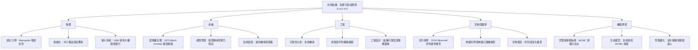
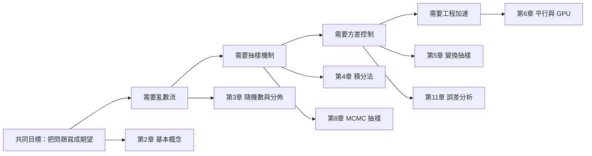

# 1.2　蒙地卡羅法在各領域的應用

[上一章：1.1　1946年蒙地卡羅法的起源與發展](01.1-1946年蒙地卡羅法的起源與發展.md) | [下一章：2.0　蒙地卡羅法的基本概念](02.0-蒙地卡羅法的基本概念.md)

## 學習目標

完成本節後，讀者應能夠：

1. 說出蒙地卡羅法在**物理、金融、工程、生物、機器學習**五大領域的代表性應用，並說明每個應用「為什麼必須用隨機性」。
2. 對每個應用辨認出它屬於哪一種蒙地卡羅分支：直接積分、抽樣、模擬、優化或誤差估計。
3. 說明「同一套方法在不同領域的數學形式為何高度雷同」，並指出抽象出的共同結構。
4. 理解平行蒙地卡羅在金融定價中的地位，以及為什麼它是蒙地卡羅法在工業界落地最成功的案例之一。
5. 為一個陌生的領域問題，判斷它是否適用蒙地卡羅法。

## 1.2.1 判準：什麼問題「必須」用蒙地卡羅法

在列舉應用之前，先建立判準。一個問題適合蒙地卡羅法，通常滿足以下至少兩項：

| 判準 | 說明 |
| --- | --- |
| **維度高** | 決策變數個數 $`d \ge 10`$ ，網格法成本 $`m^d`$ 不可行 |
| **無解析解** | 方程非線性、幾何不規則、邊界條件複雜 |
| **只需函數值** | 被評估的模型是黑箱（模擬器、實驗、機器學習模型） |
| **積分形式是期望** | 目標可寫成 $`\mathbb{E}[f(X)]`$ |
| **需要尾部資訊** | 關注的是罕見事件機率（破產、災損、極端天氣） |
| **路徑相依** | 目標是動態規劃的期望回報，需模擬完整時間序列 |
| **存在不確定性** | 參數本身不確定，需要對「分佈的不確定性」積分 |

下圖是全書應用地圖的骨架，它呼應本章的論點：應用橫跨領域，但底層只有「把什麼寫成期望」這個共同動作。

## 1.2.2 物理：最原始也最成功的家鄉

**統計力學。** 要計算一個分子系統的平衡性質，傳統方法要求解巨大的配分函數

$$
Z = \sum_{\text{組態}} e^{-U(\text{組態})/k_B T}
$$

組態數隨粒子數 $`N`$ 以 $`N!`$ 成長， $`N = 100`$ 時已經不可能列舉。1953 年 Metropolis 等人的解法是放棄列舉，改用馬可夫鏈在組態空間中**隨機遊走**，依 Boltzmann 因子接受或拒絕移動，長期停留在機率分佈 $`\pi(\text{組態}) \propto e^{-U/T}`$ 上。加權平均即得觀測量——這是 MCMC 的第一個大規模應用，也是 [第8章](08.0-蒙地卡羅方法在物理中的應用.md) 的主軸。

**核融合與中子物理。** 洛斯阿拉莫斯的原始動機。今天，蒙地卡羅法用於計算核反應堆的中子通量、評估等離子體裝置的反應率，以及追蹤高能中子在反應爐內的隨機漫步。

**量子力學。** 1984 年的蒙地卡羅路徑積分把量子力學的路徑積分改寫成「路徑集合的統計平均」，使得量子系統可以用古典蒙地卡羅概念處理——這是量子蒙地卡羅方法（quantum Monte Carlo）的起點，也是 [8.3](08.3-1984年蒙地卡羅模擬量子系統.md) 的主題。

物理領域的共同特徵是：**模型明確、維度高、內在隨機性明確**。因此蒙地卡羅法在物理中扮演的不是湊合的工具，而是第一選擇。

## 1.2.3 金融：工業級蒙地卡羅的標誌

**選擇權定價。** 1973 年 Black 與 Scholes 給出常數波動率下的解析解，但真實市場波動率是隨機的、期限結構是彎曲的、標的與波動率本身有相關性。於是自然的做法是對風險因子路徑做蒙地卡羅模擬。著名的「威尼克（Whipple）怪異波」案例顯示，2000 年代前的金融機構用數十萬條路徑估計出的「99.9% 風險值」，可能低估真實尾部風險數十億美元——正是因為離散抽樣沒能採到足夠的極端樣本。解法不是加樣本硬幹，而是改用**重要抽樣（importance sampling）** 與**分層抽樣（stratified sampling）**，見 [第5章](05.0-變換抽樣法.md)。

**風險管理與壓力測試。** 蒙地卡羅法用於計算違約機率、預期損失（expected loss）、風險價值（value at risk）與風險平價（risk parity）權重。

**信用風險。** 需對數百至數千筆交易的聯合違約機率積分，這類問題的維度使解析方法無望。

金融領域的特殊需求——**極高樣本數、低延遲、可重現、跨機器一致**——直接催生了整個平行蒙地卡羅工業（GPU、counter-based RNG、低變異抽樣），也就是 [第6章](06.0-蒙地卡羅積分的高效實現.md)。可以說，金融是蒙地卡羅法反過來推動演算法工程化的最大功臣。

## 1.2.4 工程：可靠度與決策支援

**系統可靠性。** 複數元件的串並聯系統，其可靠度是許多 Bernoulli 成功事件的聯合機率：

$$
R = P(\text{系統不失效})
$$

若各元件失效率彼此獨立，串聯系統 $`R = \prod_i r_i`$ 有封閉式；但加入共因失效、维修、溫度耦合後，便成為高維積分，蒙地卡羅法是標準解法。

**排程與佇列網路。** 模擬客戶到達、服務時間、資源競爭，用以估計等待時間與產能；這屬於**隨機模擬（stochastic simulation）**而非積分，但仍用同一套亂數與統計工具。

**工程設計。** 結構可靠度分析把材料強度、載荷、幾何公差視為隨機變數，求失效機率。傳統的 FORM／SORM（一次／二次可靠度分析法）只在失效面光滑且接近單一臨界點時有效，蒙地卡羅法則不需任何幾何假設，缺點是樣本數需求大——這正是 [第11章](11.0-蒙地卡羅方法的誤差分析與改進.md) 討論低變異抽樣的動機。

## 1.2.5 生物與醫學：把不確定性放進模型

**流行病學。** 2019 年 COVID-19 大流行期間，芝加哥大學的團隊建立了一個名為「Minecraft」的傳染病模型，把 Minecraft 遊戲中的人類行為（每日移動、接觸）當作隨機過程，與 SEIR 疾病模型結合，用蒙地卡羅法估計每日新增感染數與基本再生數。這個案例之所以重要，是因為它示範了**行為資料可以直接作為隨機過程的輸入**，並且示範了蒙地卡羅法在真實危機中做政策評估（例如比較隔離與社交距離措施）的能力。

**神經科學。** Hodgkin–Huxley 模型的膜電位是隨機微分方程，神經元放電是隨機過程；蒙地卡羅法（或其確定性近似如 Gillespie 演算法）用來計算放電統計。

**生物資訊。** 演化模型（Wright–Fisher 模型、Moran 過程）的固定點吸收機率、序列比對的後驗機率，都可用蒙地卡羅法估計。

生物領域的共同推力是**參數高度不確定**：傳染率、突變率、選擇壓力多來自不完整資料。蒙地卡羅法提供的不只是一個數字，更是一個「把不確定性整合進推論」的框架。詳見 [15.1](15.1-生物學與流行病學中的蒙地卡羅法.md)。

## 1.2.6 機器學習：近期最主要的增量領域

**貝葉斯後驗抽樣。** 深度模型的後驗分佈是極高維且不可標準化的；MCMC（含哈密頓-蒙地卡羅與 NUTS）與變分近似（variational inference）構成了現代貝葉斯深度學習的兩條主線。2014 年以來，變分推論因「一次前向傳播即得近似」而特別適合大資料；MCMC 則提供更強的後驗探索能力但代價高。

**生成模型。** 吉布斯抽樣（Gibbs sampling）可追溯到 1903 年的統計物理工作；深度生成模型中的 MCMC 採樣、擴散模型（diffusion model）的反向過程，也大量借用蒙地卡羅框架。

**隨機優化。** 模擬退火（simulated annealing）、演化策略（evolution strategy）等方法，用隨機性逃離局部極小值，並以 Metropolis 接受準則連結到統計物理——這是全書中「物理與機器學習交會」最漂亮的地方，詳見 [第10章](10.0-變數選擇與蒙地卡羅優化.md)。

**隨機梯度與 dropout。** 小批次梯度下降其實是對真實期望的隨機估計；dropout 可視為對網路結構的隨機抽樣。這說明蒙地卡羅法的思想已滲入機器學習的每一層。

## 1.2.7 抽象：跨領域的共同結構

把上述所有應用抽掉領域詞彙，剩下的骨架只有一個：

$$
\text{目標} = \mathbb{E}\big[f(\text{隨機變數})\big]
$$

- 物理的位形 → 隨機變數是組態；
- 金融的選擇權 → 隨機變數是價格路徑；
- 工程的可靠度 → 隨機變數是元件強度；
- 流行病學 → 隨機變數是個體行為與傳染鏈；
- 貝葉斯推論 → 隨機變數是參數。

因此，學會一種蒙地卡羅方法（如何從目標分佈抽樣、如何控制方差、如何平行化），就等於學會了全部。第2章將建立這套共通語言，第3章則處理所有應用共用的「燃料」——隨機數。

這張圖把全書的「依賴鏈」再串一次：亂數（第3章）是底層燃料，抽樣與積分（第4、8章）是核心機制，方差控制（第5、11章）決定效率，工程加速（第6章）決定能否落地。

## 1.2.8 什麼時候**不該**用蒙地卡羅法

好的教科書必須說明方法的邊界。下列情況蒙地卡羅法通常不是最佳選擇：

1. **低維且有高效解析或數值解**： $`d \le 5`$ 且被積函數光滑時，高斯求積（Gauss–Legendre）通常比蒙地卡羅法更準更快。
2. **需要極高精度**：蒙地卡羅法誤差以 $`O(N^{-1/2})`$ 收斂，要達到 $`10^{-10}`$ 需要 $`10^{20}`$ 個樣本——此時改用確定性求積或解析法。
3. **積分函數有強尖峰或窄支**：蒙地卡羅法在尖峰附近需要大量樣本才能捕捉，此時變換抽樣、Gauss–Jacobi 求積或自適應求積更有效。
4. **高維但只有少數維度重要**：此時降維、稀疏化或重要性抽樣比純蒙地卡羅更有效。
5. **要求嚴格單調收敛的確定性上界**：蒙地卡羅法給的是機率性保證。

這些判斷構成 [第12章](12.0-蒙地卡羅法可行性分析.md) 的主題。

## 本章要點

- 五大領域的共同判準：維度高、無解析解、只需函數值、可寫成期望、需要尾部資訊、路徑相依、參數不確定。
- 物理領域用 **Metropolis MCMC** 處理統計力學、用**中子輸送模擬**服務核工程、用 **1984 量子路徑積分** 進入量子力學。
- 金融領域以 **1973 Black–Scholes 路徑模擬** 為代表，是推動平行蒙地卡羅與低變異抽樣的工業界主力。
- 工程領域主攻可靠度、排程模擬與結構可靠度；生物領域主攻流行病學（含 2019 年「Minecraft」模型）與神經科學；機器學習領域主攻貝葉斯後驗抽樣、生成模型與隨機優化。
- 抽象後所有應用都是「估計一個期望」，因此方法可跨領域移植。
- 邊界：低維、高精度需求、尖峰積分、有效維度低等情況下，蒙地卡羅法未必是最佳選擇。

## 延伸閱讀

1. Robert, C. P., and Casella, G. (2004). *Monte Carlo Statistical Methods*, 2nd ed. Springer.
2. Owen, A. (2013). *Monte Carlo Theory, Methods, and Examples*. CRC Press.
3. Doucet, A., de Freitas, N., and Gordon, N. (2001). *Sequential Monte Carlo Methods in Practice*. Springer.
4. Kroese, D. P., and Rubinstein, R. Y. (2016). *Simulation and the Monte Carlo Method*, 3rd ed. Wiley.
5. 本書延伸：[第5章　變換抽樣法](05.0-變換抽樣法.md)、[第8章　物理中的應用](08.0-蒙地卡羅方法在物理中的應用.md)、[第9章　金融中的應用](09.0-蒙地卡羅方法在金融中的應用.md)、[第14章　機器學習中的應用](14.0-蒙地卡羅方法在機器學習中的應用.md)。
