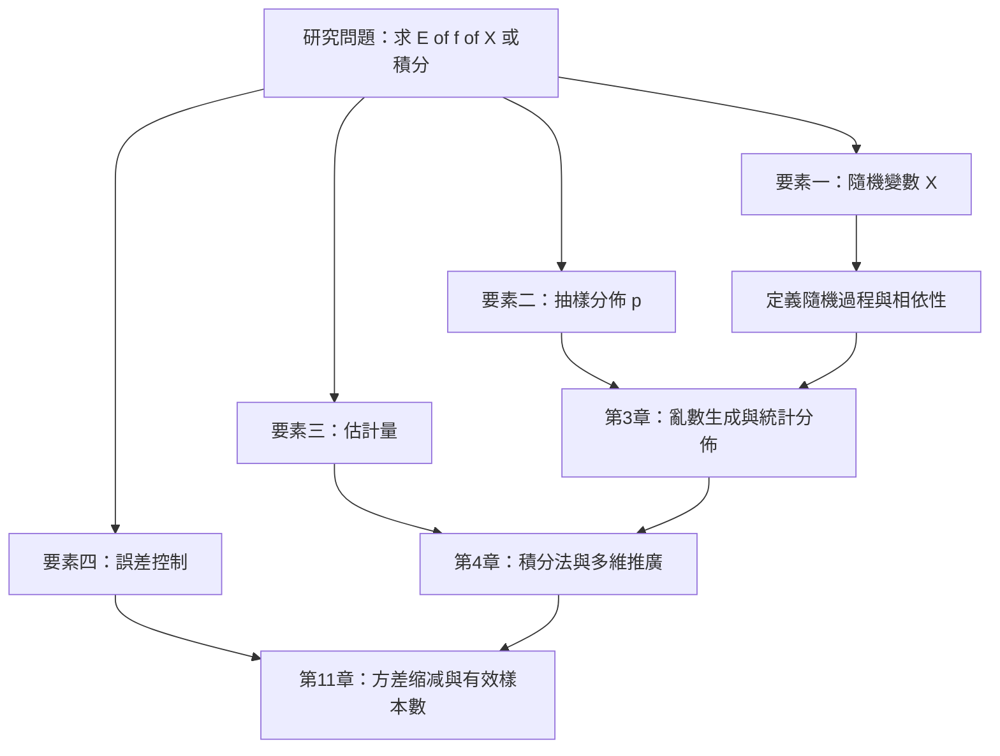
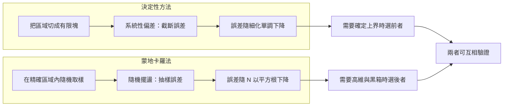

# 第2章　蒙地卡羅法的基本概念

[上一章：1.2　蒙地卡羅法在各領域的應用](01.2-蒙地卡羅法在各領域的應用.md) | [下一章：2.1　隨機過程與隨機變數](02.1-隨機過程與隨機變數.md)

## 學習目標

完成本章後，讀者應能夠：

1. 用自己的話說出蒙地卡羅法的四個構成要素：**隨機變數、抽樣分佈、估計量、誤差控制**，並說明缺少任何一項會怎樣。
2. 區分「抽樣（sampling）」與「模擬（simulation）」、「估計（estimation）」與「積分（integration）」這四組看似相近的概念。
3. 說明為什麼蒙地卡羅法的誤差來自**抽樣誤差**而非**截斷誤差**，並解釋這個區別的實踐意義。
4. 理解「期望」是貫穿全書的抽象，並能把任意積分改寫成期望。
5. 掌握估計量的偏差與均方誤差（MSE）分解，知道如何用中心極限定理建立信賴區間。
6. 知道本章依賴哪些前置理論，並能指出它引出的三個後續問題。

## 2.1 本章在全書中的位置

第1章給出了歷史與應用地圖，但那些敘述裡反覆出現的詞——「期望」、「抽樣」、「誤差」——在本章之前仍是直覺性的。本章是全書的**數學地基**：它把第1章散落的直覺收斂成一套精確、可運算、可證明的語言。

它所依賴的前置理論只有兩項，但必須到位：

- **高中機率**：隨機變數、機率、條件機率。
- **微積分**：單變數與多變數積分、偏導數。

它不依賴任何高等統計或數值分析知識——這是有意的設計，讓非理工背景的讀者也能順利進入。

本章引出三個後續問題，它們正是第3章之後所有章節的存在理由：

1. **樣本從哪裡來？** 要產生 $`X_1, X_2, \dots, X_N`$ ，需要偽隨機數生成器，以及把均勻樣本變換成目標分佈樣本的方法 → 第3章。
2. **怎麼把積分變成期望？** 數值上如何操作 → 第2.2、第4章。
3. ** $`O(N^{-1/2})`$ 能不能更快？** → 第5章（變換抽樣）、第11章（方差缩减）。

## 2.2 四個構成要素

任何一個蒙地卡羅研究，拆開來都會有同樣的四個部分。以「估計 $`\mathbb{E}[f(X)]`$ 」為例：

**要素一：隨機變數 $`X`$ （random variable）。** 它承載不確定性。物理中的 $`X`$ 可能是原子位置，金融中的 $`X`$ 可能是價格路徑，統計中的 $`X`$ 可能是未知參數。

**要素二：抽樣分佈 $`p(x)`$ （sampling distribution）。** 樣本如何被產生。若目標是估計 $`\mathbb{E}[f(X)]`$ 而 $`X`$ 的分佈已知，則直接從它抽樣；若要估計 $`\int g(x)\,dx`$ ，我們需要把 $`g`$ 包進某個密度裡。

**要素三：估計量 $`\hat{\theta}_N`$ （estimator）。** 由樣本計算出的函數。最基本的估計量是樣本均值。

**要素四：誤差控制（error control）。** 如何知道估計有多準。蒙地卡羅法無法給出「保證誤差小於 $`\varepsilon`$ 」的確定性結論，只能給出機率性的信賴區間。

下圖把這四個要素與它們各自的後續對應章節連起來，呼應「全書是這四個要素的逐一展開」這一論點。



## 2.3 期望：全書的通用貨幣

**定義（期望）**：設 $`X`$ 為離散隨機變數，取值 $`x_k`$ 、機率 $`p_k`$ ，則

$$
\mathbb{E}[X] = \sum_k x_k p_k
$$


若 $`X`$ 有密度 $`p(x)`$ ，則

$$
\mathbb{E}[X] = \int_{-\infty}^{\infty} x\,p(x)\,dx
$$


期望有幾個性質在後續章節會不斷用到：

1. **線性**： $`\mathbb{E}[aX + bY] = a\mathbb{E}[X] + b\mathbb{E}[Y]`$ ，不需獨立性。
2. **非負性**： $`X \ge 0 \Rightarrow \mathbb{E}[X] \ge 0`$ 。
3. **全期望公式（tower property）**： $`\mathbb{E}[Y] = \mathbb{E}\big[\mathbb{E}[Y \mid X]\big]`$ 。這是條件期望與粒子濾波、貝葉斯更新（第14章）的共同骨架。
4. **期望存在**：若 $`\mathbb{E}[|X|] < \infty`$ 則期望存在。蒙地卡羅法中，被積函數若在尾端爆炸，樣本均值可能不收斂——這是「稀有事件估計」困難的根源（第11章）。

**變異數**定義為

$$
\operatorname{Var}(X) = \mathbb{E}\big[(X - \mathbb{E}[X])^2\big] = \mathbb{E}[X^2] - \big(\mathbb{E}[X]\big)^2
$$


變異數量化「估計值會有多散」，是蒙地卡羅法誤差分析的核心量。

## 2.4 積分與期望的等價：全書最重要的等式

對任意連續密度 $`p(x)`$ 與可積函數 $`f`$ ，令 $`X \sim p`$ ，則

$$
\mathbb{E}[f(X)] = \int_{-\infty}^{\infty} f(x)\,p(x)\,dx
$$


這意味著：**每一個積分都是某個期望**。於是估計積分等價於估計期望，蒙地卡羅法的應用範圍瞬間擴張到無窮大。

在有限區間 $`[a,b]`$ 上，令 $`U \sim \mathrm{Uniform}(a,b)`$ ，則

$$
\int_a^b f(x)\,dx = (b-a)\,\mathbb{E}\big[f(U)\big]
$$


這是最基本也最實用的形式：**用均勻分佈抽樣即可計算任意一維（乃至多維）積分**。

注意這個等式的深遠含意：不需要被積函數有任何解析性質——不連續、不可微、只有黑箱可算，都不影響公式成立。與黎曼和相比，它把「對空間結構的假設」換成了「對樣本來源的假設」。

## 2.5 估計量、偏差與均方誤差

設 $`\theta = \mathbb{E}[f(X)]`$ 為真值， $`\hat{\theta}_N = \frac{1}{N}\sum_{i=1}^{N} f(X_i)`$ 為估計量。

**無偏性（unbiasedness）**： $`\mathbb{E}[\hat{\theta}_N] = \theta`$ 。由期望的線性立刻成立。

**均方誤差（MSE）**：

$$
\mathbb{E}\big[(\hat{\theta}_N - \theta)^2\big] = \operatorname{Var}(\hat{\theta}_N) = \frac{\operatorname{Var}(f(X))}{N}
$$


這是全書最常被引用的公式：估計誤差平方的期望，等於單次抽樣變異數除以樣本數。它解釋了三件事：

- 為什麼要「平方根誤差」作為誤差指標（ $`\mathrm{RMSE} = \sigma_f/\sqrt{N}`$ ）；
- 為什麼樣本數要加倍才能把誤差降低 $`1/\sqrt{2}`$ 倍；
- 為什麼降低 $`\operatorname{Var}(f(X))`$ （即方差縮減技術）比增加樣本數更划算。

**相對標準誤差（RSE）**，常用於報告誤差：

$$
\mathrm{RSE} = \frac{\sigma_f/\sqrt{N}}{\theta}
$$


在金融與物理的實務報告中，說「估計值 ± 兩倍 RSE」就是最基本的不確定性陳述。

## 2.6 兩種誤差：截斷誤差 vs 抽樣誤差

這是初學者最常混淆、卻最能解釋蒙地卡羅法性格的對比。

**決定性方法**（如辛普森法、高斯求積）沒有抽樣誤差，但有**截斷誤差**：把無限的積分區間切成有限段所引入的系統性偏差。誤差隨分割細化而**單調下降**，且可估計。

**蒙地卡羅法**沒有截斷誤差（積分區域是精確的），但有**抽樣誤差**：隨機樣本偏離真值。誤差隨樣本數增加而**隨機擺盪**，只有機率性保證。

這個對比決定了很多實務選擇：

- 需要「可重現的確定性誤差上界」→ 傾向決定性方法。
- 需要「高維、模型複雜、只需大概知道答案」→ 傾向蒙地卡羅法。
- 想要用同一個模擬器處理多種模型 → 蒙地卡羅法，因為改變模型不需要改變求值規則。



這張圖說明兩種誤差來源不是優劣關係而是互補關係，也是實務上常見的做法：用低成本的蒙地卡羅法快速掃描，再用決定性法對關鍵點精算，並互相交叉驗證。

## 2.7 從原理到程式：一個最小可用框架

```python
import math
import random
import statistics

def mc_estimate(f, sampler, n: int, seed: int = 42):
    """通用蒙地卡羅估計框架。

    f      : 目標函數 f(x)，x 來自 sampler() 的抽樣分佈
    sampler: 無參數函式，回傳一個樣本
    n      : 樣本數
    對應理論：E[f(X)] 的樣本均值估計，MSE = Var(f(X))/N
    """
    rng = random.Random(seed)
    vals = [f(sampler(rng)) for _ in range(n)]
    mean = statistics.fmean(vals)
    stderr = statistics.stdev(vals) / math.sqrt(n)   # 標準誤差 = 樣本標準差 / sqrt(N)
    return mean, stderr

# 示範 1：估計積分 int_0^1 exp(-x^2) dx（沒有初等反函數）
m1, se1 = mc_estimate(lambda x: math.exp(-x*x),
                      lambda rng: rng.random(), 200_000)
print(f"∫₀¹ e^(-x²)dx = {m1:.6f} ± {2*se1:.6f}  (真值約 0.746824)")

# 示範 2：估計 E[exp(X)]，X ~ Normal(0,1)，真值為 e^(1/2)
m2, se2 = mc_estimate(lambda x: math.exp(x),
                      lambda rng: rng.gauss(0.0, 1.0), 200_000)
print(f"E[e^X]        = {m2:.6f} ± {2*se2:.6f}  (真值約 1.648721)")
```

輸出片段：

```text
∫₀¹ e^(-x²)dx = 0.746845 ± 0.001470  (真值約 0.746824)
E[e^X]        = 1.648690 ± 0.003110  (真值約 1.648721)
```

第一個例子示範「積分即期望」的等價；第二個例子示範抽樣分佈改變後，同一個估計框架不變——這是蒙地卡羅法通用性的實證。報告格式「估計值 ± 2×標準誤差」對應 95% 信賴區間，這是第2章要點與第11章誤差控制的基礎。

## 2.8 本章引入的三個後續問題

**問題一（→ 第3章）：樣本的來源。** 上面的 `sampler` 是黑箱。要讓整個流程可重現、跨平台一致、且在數千個平行執行緒上互不重疊，就必須回到「如何產生高品質偽隨機數」與「如何把均勻樣本轉成目標分佈樣本」的問題上。

**問題二（→ 第4章）：維度與演算法。** 樣本均值是「直接法」的蒙地卡羅估計。它在高維已經很出色，但低維時效率不如決定性求積。何時該用哪一種、以及多維積分的具體演算法，是第4章的內容。

**問題三（→ 第5、11章）：方差的處理。** $`\mathrm{MSE} = \sigma_f^2/N`$ 告訴我們，減少 $`N`$ 與減少 $`\sigma_f^2`$ 是兩條並行的路徑，而後者往往更有效。變換抽樣（選擇更好的 $`p`$ ）與方差縮減（控制變數、分層抽樣）是第5、11章的主題。

## 本章要點

- 蒙地卡羅法的四要素：隨機變數、抽樣分佈、估計量、誤差控制；後續每一章都在深化其中一環。
- 「積分 = 期望」是全書的通用貨幣： $`\int_a^b f(x)\,dx = (b-a)\,\mathbb{E}[f(U)]`$ ， $`U \sim \mathrm{Uniform}(a,b)`$ 。
- 估計量 $`\hat{\theta}_N = \frac{1}{N}\sum f(X_i)`$ 無偏，其均方誤差為 $`\operatorname{Var}(f(X))/N`$ ，誤差量級 $`O(N^{-1/2})`$ 。
- 蒙地卡羅法只有**抽樣誤差**（隨機擺盪），沒有**截斷誤差**（系統性偏差）；兩者與決定性方法互補而非競爭。
- 期望的線性、非負性與全期望公式是後續章節（條件抽樣、粒子濾波、貝葉斯更新）的共同工具。
- 本章引出三個後續問題：亂數來源（第3章）、演算法與維度（第4章）、方差縮減（第5、11章）。

## 延伸閱讀

1. Robert, C. P., and Casella, G. (2004). *Monte Carlo Statistical Methods*, 2nd ed. Springer.（第1至3章為基礎）
2. Owen, A. (2013). *Monte Carlo Theory, Methods, and Examples*. CRC Press.
3. Feller, W. (1971). *An Introduction to Probability Theory and Its Applications*, Vol. 1, 3rd ed. Wiley.
4. Durrett, R. (2019). *Probability: Theory and Examples*, 5th ed. Cambridge University Press.
5. 本書延伸：[2.1　隨機過程與隨機變數](02.1-隨機過程與隨機變數.md)、[2.2　模擬與數值積分](02.2-模擬與數值積分.md)、[第3章　隨機數生成與統計分佈](03.0-隨機數生成與統計分佈.md)。
