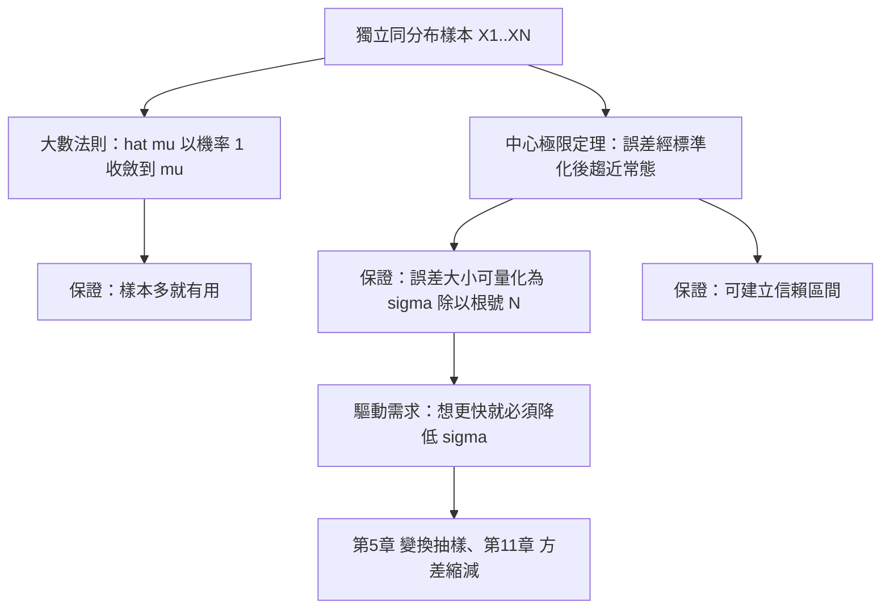
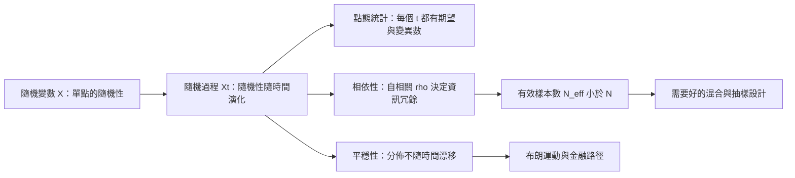

# 2.1　隨機過程與隨機變數

[上一章：2.0　蒙地卡羅法的基本概念](02.0-蒙地卡羅法的基本概念.md) | [下一章：2.2　模擬與數值積分](02.2-模擬與數值積分.md)

## 學習目標

完成本節後，讀者應能夠：

1. 定義**隨機變數、隨機變數函數、累積分佈函數（CDF）、機率密度函數（PDF）**，並說明 CDF 與 PDF 的關係。
2. 說明離散與連續分佈的差別，以及「密度可以大於 1」這個常見誤解。
3. 計算一階與二階矩，並理解它們如何決定誤差行為。
4. 陳述**弱大數法則、中心極限定理（CLT）**，並說明它們各自支撐蒙地卡羅法的哪一部分。
5. 定義**隨機過程**、說明它與隨機變數的關係，並理解**自相關函數**與**平穩性**的意義。
6. 說明「抽樣（sampling）」與「模擬（simulation）」的差異，並辨認隨機過程模擬在蒙地卡羅法中的角色。

## 2.1.1 隨機變數：把不確定性數學化

**定義（隨機變數）**：一個定義在樣本空間 $`\Omega`$ 上、取實數值的函數 $`X: \Omega \to \mathbb{R}`$ 。它是「在實驗之前不知道、實驗之後才知道」的量的數學化身。

隨機變數有三種表達形式，彼此等價但用途不同：

- **分布函數（CDF）**： $`F(x) = P(X \le x)`$ 。這是最完整的描述，任何隨機變數都有，且 $`F`$ 單調不減、右連續、 $`F(-\infty)=0`$ 、 $`F(+\infty)=1`$ 。
- **機率質量函數（PMF）**：離散情形， $`P(X = x_k) = p_k`$ 。
- **機率密度函數（PDF）**：連續情形， $`p(x) \ge 0`$ 且 $`\int p(x)\,dx = 1`$ ，且 $`P(a \le X \le b) = \int_a^b p(x)\,dx`$ 。

CFD 與 PDF 的關係是 $`F(x) = \int_{-\infty}^{x} p(t)\,dt`$ ，也就是說 $`F'(x) = p(x)`$ 。

**常見誤解**：許多人以為「密度值不能超過 1」，那是把機率與密度混為一談。密度是「每單位長度的機率」，長度不為 1 的區間上密度可以超過 1；真正受總和為 1 限制的是 $`\int p = 1`$ 。這個誤解在第3章實現抽樣演算法時會造成實際困擾，值得在此釐清。

```python
import random
import math

# 以數值方式檢驗「密度可大於 1」
mu, sigma = 0.0, 0.5
x = mu
p = math.exp(-((x - mu) ** 2) / (2 * sigma * sigma)) / (sigma * math.sqrt(2 * math.pi))
print(f"x={x} 的常態密度 = {p:.4f}  (>1，並不矛盾)")

rng = random.Random(7)
cnt = sum(1 for _ in range(200_000) if rng.gauss(mu, sigma) <= x)
print(f"P(X<=x) 估計 = {cnt/200_000:.4f}  （理論值 {0.5:.4f}）")
```

輸出片段：

```text
x=0.0 的常態密度 = 0.7978846  (>1，並不矛盾)
P(X<=x) 估計 = 0.4999  （理論值 0.5000）
```

## 2.1.2 期望、變異數與高階矩

一階矩（期望）與二階矩（變異數）已於 [2.0](02.0-蒙地卡羅法的基本概念.md) 定義，這裡補充它們在高階與分佈族中的角色。

**變異數的分解**（又稱全變異公式）：

$$
\operatorname{Var}(X) = \mathbb{E}\big[\operatorname{Var}(X \mid Y)\big] + \operatorname{Var}\big(\mathbb{E}[X \mid Y]\big)
$$


這條公式是理解「總體變異如何分解成條件內與條件間」的基礎，在混合模型、隨機效應模型與粒子濾波中反覆出現。

**偏度（skewness）與峰度（kurtosis）** 描述分佈形狀：

$$
\gamma_1 = \frac{\mathbb{E}[(X-\mu)^3]}{\sigma^3},\qquad
\gamma_2 = \frac{\mathbb{E}[(X-\mu)^4]}{\sigma^4} - 3
$$


它們對蒙地卡羅法的重要性在於：**CLT 給出的常態近似只是近似**。當 $`f(X)`$ 的分佈高度偏斜時（例如估計尾端機率），有限樣本的覆蓋率會偏離理論值，這是信賴區間需要修正的原因（見第11章）。

## 2.1.3 兩個支撐整個方法的定理

**定理（弱大數法則，WLLN）**：若 $`X_1, X_2, \dots`$ 獨立同分布且 $`\mathbb{E}[|X_1|] < \infty`$ ，則對任何 $`\varepsilon > 0`$ ，

$$
P\Big(\big|\hat{\mu}_N - \mu\big| > \varepsilon\Big) \to 0
$$


意義：**只要樣本夠多，樣本均值一定會逼近真值**。這保證了蒙地卡羅估計的「收斂性」，是第4章一切收斂結論的基礎。

**定理（中心極限定理，CLT）**：若 $`X_i`$ 獨立同分布、 $`\mu = \mathbb{E}[X_1]`$ 、 $`\sigma^2 = \operatorname{Var}(X_1) \in (0,\infty)`$ ，則

$$
\frac{\hat{\mu}_N - \mu}{\sigma/\sqrt{N}} \xrightarrow{d} N(0,1)
$$


意義：**誤差以 $`\sigma/\sqrt{N}`$ 的尺度被常態分佈描述**。這讓我們可以用「估計值 ± 1.96×標準誤差」建立 95% 信賴區間，也解釋了為什麼樣本數要除以 2 的平方根才換得到一半的誤差。

CLT 也解釋了一個實務現象：把 $`N`$ 從 1 萬增加到 10 萬，精度只改善 3.16 倍；但把 $`N`$ 從 1 萬增加到 100 萬，也只改善 3.16 倍。要真正突破這條曲線，必須降低 $`\sigma`$ ——這是第5章與第11章的整個動機。



這張圖把「定理 → 保證 → 新問題」的驅動鏈畫清楚：CLT 一方面給了蒙地卡羅法嚴謹性，另一方面也揭示了它的天花板，進而催生後續章節。

## 2.1.4 隨機過程：不確定性隨時間演化

**定義（隨機過程）**：定義在 $`[0,\infty)`$ 上的隨機變數族 $`\{X_t\}_{t \ge 0}`$ 。更正式地說，它是定義在 $`(\Omega, \mathcal{F}, P)`$ 上的 $`X_t: \Omega \to \mathbb{R}`$ 的集合。

隨機過程與隨機變數的關係是：**固定一個時間 $`t`$ ， $`X_t`$ 就是一個隨機變數**。因此前面所有的工具（期望、變異數、CDF、CLT）都逐點適用；新的東西是「時間之間的相依性」。

**自相關函數（autocorrelation function）**：

$$
\rho(t, s) = \frac{\mathbb{E}[(X_t - \mu(t))(X_s - \mu(s))]}{\sigma(t)\sigma(s)}
$$


$`\rho(t,t) = 1`$ ； $`\rho`$ 接近 1 表示高度相關。**有效樣本數**的公式

$$
N_{\text{eff}} \approx \frac{N}{1 + 2\sum_{k=1}^{\infty}\rho(k)}
$$


直接說明：**樣本之間若高度相關， $`N`$ 再大也提供不了多少獨立資訊**。這是 MCMC 中「混合（mixing）」與「有效樣本數（ESS）」概念的核心，也是為什麼我們需要 MCMC 演算法的改進（第8章）。

**平穩性（stationarity）**：
- **弱平穩**： $`\mathbb{E}[X_t] = \mu`$ 與 $`\operatorname{Var}(X_t) = \sigma^2`$ 不隨 $`t`$ 變，且自相關只依賴時間差 $`t-s`$ 。
- **強平穩**：整個分佈族只依賴時間差。

金融定價中，幾何布朗運動（GBM） $`dS_t = \mu S_t dt + \sigma S_t dW_t`$ 的解 $`S_t = S_0 e^{(\mu - \sigma^2/2)t + \sigma W_t}`$ 即為弱平穩，且正是 [第9章](09.0-蒙地卡羅方法在金融中的應用.md) 蒙地卡羅定價的基礎。

**隨機過程與蒙地卡羅的關係**：當目標期望涉及過程的整條軌跡（例如「到 $`T`$ 為止的最大回撤」）時，蒙地卡羅法必須模擬整條路徑，而不是抽樣單點。這個區別是第7章的主題。



這張圖說明隨機過程相對隨機變數多出來的那一維——時間相依性——如何直接影響蒙地卡羅估計的有效性。

## 2.1.5 抽樣與模擬：兩件相近但不同的事

這組術語經常被混用，值得正式區分。

**抽樣（sampling）**：從一個已知的目標分佈 $`p`$ 產生樣本，用來估計某個關於 $`p`$ 的量。目標分佈形式是已知的（例如已知 $`p(x) \propto e^{-U(x)}`$ ），未知的是 $`p`$ 的數值（例如配分函數）。

**模擬（simulation）**：建立一個能重現真實系統動態的模型，並用它產生軌跡，藉以估計系統的統計行為。模型本身即是被研究的對象，隨機性來自模型內含的隨機機制。

兩者的界線並非絕對，但在教科書中區分很有用：

| | 抽樣 | 模擬 |
| --- | --- | --- |
| 隨機性來源 | 已知的目標分佈 | 模型的內部機制 |
| 目的 | 估計 $`\mathbb{E}[f(X)]`$ | 重現系統動態與統計性質 |
| 典型方法 | Metropolis、重要性抽樣 | 隨機步行、Gillespie 演算法、事件驅動模擬 |
| 關鍵難題 | 如何收斂到目標分佈 | 如何建模與驗證 |

第2.2 節會說明「模擬」與「數值積分」的關係，第7章則專門處理隨機過程模擬。

## 2.1.6 協方差與相關性：控制變數法的地基

若 $`X`$ 與 $`Y`$ 協方差為

$$
\operatorname{Cov}(X, Y) = \mathbb{E}[(X - \mathbb{E}[X])(Y - \mathbb{E}[Y])]
$$


則由 Cauchy–Schwarz， $`|\rho_{XY}| \le 1`$ ，且 $`\operatorname{Var}(X + Y) = \operatorname{Var}(X) + \operatorname{Var}(Y) + 2\operatorname{Cov}(X,Y)`$ 。

這三行是**控制變數法（control variates）**的全部數學基礎：找一個與目標高度相關但期望已知的 $`Y`$ ，用它調整估計量以降低變異數。詳見 [11.2　精度提升的技術](11.2-精度提升的技術：低方差抽樣與控制變數法.md)。

同樣地，**分層抽樣（stratified sampling）**降低變異的機制也是協方差：把總體切成互斥的層，在每層內獨立抽樣，層間變異被分層抽樣本身消除。

## 本章要點

- 隨機變數的三種等價描述：CDF、PMF、PDF；密度值可大於 1，但 $`\int p = 1`$ 。
- 一階矩（期望）與二階矩（變異數）決定誤差行為；偏度與峰度影響常態近似的品質。
- 大數法則保證收斂，中心極限定理保證誤差可用 $`\sigma/\sqrt{N}`$ 量化並建立信賴區間；CLT 同時揭示了蒙地卡羅法的速度天花板。
- 隨機過程是隨機變數的時間索引族；自相關決定資訊冗餘，進而決定有效樣本數 $`N_{\text{eff}}`$ 。
- 弱平穩／強平 stationary 是金融與物理模型的基本假設。
- 抽樣（從已知分佈取樣）與模擬（重現系統動態）是兩件事；兩者共用同一套亂數與統計工具。
- 協方差是後續控制變數法與分層抽樣的共同地基。

## 延伸閱讀

1. Feller, W. (1971). *An Introduction to Probability Theory and Its Applications*, Vol. 2, 2nd ed. Wiley.（隨機過程專章）
2. Durrett, R. (2019). *Probability: Theory and Examples*, 5th ed. Cambridge University Press.
3. Grimmett, G. R., and Stirzaker, D. R. (2005). *Probability and Random Processes*, 3rd ed. Oxford University Press.
4. Øksendal, B. (2010). *Applied Stochastic Differential Equations*, 5th ed. Springer.
5. 本書延伸：[2.2　模擬與數值積分](02.2-模擬與數值積分.md)、[第7章　隨機過程與模擬](07.0-隨機過程與模擬.md)、[第11章　誤差分析與改進](11.0-蒙地卡羅方法的誤差分析與改進.md)。
