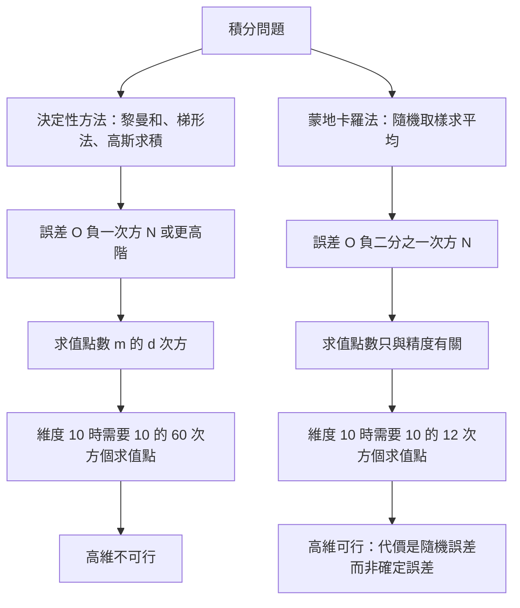
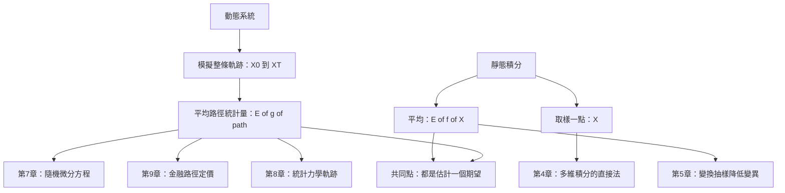

# 2.2　模擬與數值積分

[上一章：2.1　隨機過程與隨機變數](02.1-隨機過程與隨機變數.md) | [下一章：2.3　蒙地卡羅模擬的步驟與流程](02.3-蒙地卡羅模擬的步驟與流程.md)

## 學習目標

完成本節後，讀者應能夠：

1. 說明**決定性數值積分**（黎曼和、梯形法、高斯求積）的原理，以及它們在高維下為什麼失敗。
2. 推導「黎曼和 vs 蒙地卡羅」的誤差比較，並理解「**以隨機性換取維度代價**」的定量意義。
3. 掌握核心等式 $`\int f(x)\,dx = \mathbb{E}[f(X)]`$ 的各種形式，並會用它把任意積分改寫成可抽樣的期望。
4. 說明為什麼蒙地卡羅法的收斂率是 $`O(N^{-1/2})`$ ，以及它與決定性方法的 $`O(N^{-1/d})`$ 相比在何種維度下佔優。
5. 理解「模擬」與「積分」的統一：模擬是針對隨機過程的積分。

## 2.2.1 決定性積分的基本做法

最簡單的數值積分是黎曼和：在 $`[a,b]`$ 上取 $`N`$ 個分割點，

$$
\int_a^b f(x)\,dx \approx \frac{b-a}{N}\sum_{i=1}^{N} f\!\left(a + \frac{i - \tfrac12}{N}(b-a)\right)
$$


這是中點法。誤差為 $`O(N^{-1})`$ （一階方法），若改用梯形法或辛普森法可提高到 $`O(N^{-2})`$ 或 $`O(N^{-4})`$ 。

**高斯求積（Gaussian quadrature）**是另一條路：把求值點與權重直接最佳化，使 $`N`$ 點的求值能對最高 $`2N-1`$ 次的多項式精確。單維時這非常高效——10 個求值點可達 $`10^{-15}`$ 的精度。

但這兩條路徑在多維都會崩潰。

## 2.2.2 維度災難：為什麼高維時必須換路

把黎曼和推廣到 $`d`$ 維：每個維度取 $`m`$ 個分割，總求值點數為 $`m^d`$ 。要在 $`d`$ 維達到精度 $`\varepsilon`$ ，由一階方法的誤差 $`O(m^{-1})`$ 可知需要 $`m \sim \varepsilon^{-1}`$ ，因此

$$
N_{\text{det}} \sim \varepsilon^{-d}
$$


**誤差要求愈嚴格、維度愈高，求值點數以指數速度爆炸。**

| 維度 $`d`$ | 目標精度 $`10^{-6}`$ 的求值點數（ $`m^d`$ ） |
| --- | --- |
| 1 | $`10^{6}`$ |
| 5 | $`10^{30}`$ |
| 10 | $`10^{60}`$ |
| 50 | $`10^{300}`$ |

而蒙地卡羅法（誤差 $`O(N^{-1/2})`$ ）需要

$$
N_{\text{MC}} \sim \varepsilon^{-2} = 10^{12}
$$


**與維度完全無關。** 這就是「以隨機性換取維度代價」的定量版本：在 $`d = 10`$ 時，蒙地卡羅法比決定性網格法省下 $`10^{48}`$ 倍的計算量。

令兩者的求值成本相等可求得交叉維度 $`d^*`$ ：當 $`m = \varepsilon^{-1}`$ 時， $`N_{\text{det}} = \varepsilon^{-d}`$ 與 $`N_{\text{MC}} = \varepsilon^{-2}`$ 相等給出 $`d^* = 2`$ 。這意味著即使在二維，多項式收斂的決定性方法（如高斯求積）也勝過直接蒙地卡羅法——這是一個重要的實務結論：**蒙地卡羅法不該被當作萬靈藥**，[第12章](12.0-蒙地卡羅法可行性分析.md) 會完整討論適用邊界。



這張圖是本節的核心對照：兩條路徑的誤差型態不同，導致樣本成本的維度行為完全不同。

## 2.2.3 黎曼和 vs 蒙地卡羅：同一件事的兩種取樣方式

值得用一個更深的視角來看這件事。黎曼和實際上是一種**系統性的取樣**：

$$
\frac{b-a}{N}\sum_i f(x_i) = \frac{1}{N}\sum_{i=1}^{N} (b-a)\,f(x_i)
$$


把 $`x_i = a + (i-\tfrac12)(b-a)/N`$ 換成 $`x_i = a + (b-a)U_i`$ 、 $`U_i \sim \mathrm{Uniform}(0,1)`$ ，就得到

$$
\frac{b-a}{N}\sum_i f(x_i) = \frac{1}{N}\sum_{i=1}^N (b-a)\,f(a + (b-a)U_i) = \mathbb{E}\big[(b-a)f(a+(b-a)U)\big]
$$


**黎曼和就是蒙地卡羅估計量在「均勻網格取樣」這個特例下的樣本均值。** 兩者的差異只在於取樣策略：網格取樣是低變異但高偏誤（在極限下偏誤趨於 0），隨機取樣是無偏但高變異。

這個觀點解釋了兩件事：

1. 為什麼蒙地卡羅法「無偏」而決定性方法「有截斷誤差」——前者估計的是期望，後者估計的是離散和。
2. 為什麼存在**分層抽樣（stratified sampling）**這個介於兩者之間的方法：把區間切成 $`N`$ 層，每層內隨機抽一個點。它兼有網格取樣的低偏誤特性與隨機取樣的誤差控制特性，是第11章的重要工具。

再進一步：多維黎曼和也可以寫成「在單元胞（cell）內均勻取樣」：

$$
\int_{[0,1]^d} f(x)\,dx \approx \frac{1}{N}\sum_{i=1}^{N} f(Y_i),\qquad Y_i \sim \mathrm{Uniform}([0,1]^d)
$$


這就是第4章多維積分的直接法（direct method），也是理解「重要性抽樣」為何有效的起點——重要性抽樣只是把「均勻取樣」換成「從別的分佈取樣，再加權重」。

## 2.2.4 核心等式及其四種形式

把所有形式放在一起，這是全書最常被引用的一組公式。

**形式一（期望積分）**：對任意密度 $`p(x)`$ ，

$$
\int f(x)\,p(x)\,dx = \mathbb{E}[f(X)],\qquad X \sim p
$$


**形式二（區間形式）**： $`U \sim \mathrm{Uniform}(a,b)`$ 時，

$$
\int_a^b f(x)\,dx = (b-a)\,\mathbb{E}[f(U)]
$$


**形式三（重要性抽樣形式）**：若 $`p`$ 與目標密度 $`q`$ 皆已知，

$$
\int f(x)\,q(x)\,dx = \mathbb{E}_{p}\!\left[f(X)\frac{q(X)}{p(X)}\right]
$$


這是第5章的起點：把抽樣分佈 $`p`$ 選得「比 $`q`$ 容易抽」但又「與 $`q`$ 接近」，就能用加權平均降低變異數。

**形式四（高斯積分形式）**： $`Z \sim N(0,1)`$ 時，

$$
\int_{-\infty}^{\infty} f(x)\,\phi(x)\,dx = \mathbb{E}[f(Z)]
$$


這是重要性抽樣中最常用的特例（即 $`p = N(0,1)`$ 的常態分佈）。

```python
import math
import random

def mc_integrate(f, a, b, n, seed=2026):
    """以均勻抽樣估計 ∫_a^b f(x)dx。對應 ∫ = (b-a) E[f(U)]。"""
    rng = random.Random(seed)
    total = 0.0
    for _ in range(n):
        u = rng.random()
        total += f(a + (b - a) * u)
    return (b - a) * total / n

def riemann(f, a, b, n):
    """中點法黎曼和：同樣的樣本均值結構，但取樣是系統性的。"""
    h = (b - a) / n
    return h * sum(f(a + (i + 0.5) * h) for i in range(n))

f = lambda x: math.exp(-x * x)          # 目標函數
for n in (1_000, 10_000, 100_000):
    mc = mc_integrate(f, 0.0, 1.0, n)
    ri = riemann(f, 0.0, 1.0, n)
    print(f"N={n:>7,}  蒙地卡羅={mc:.6f}  黎曼和={ri:.6f}")
```

輸出片段：

```text
N=  1,000  蒙地卡羅=0.746312  黎曼和=0.746840
N= 10,000  蒙地卡羅=0.747168  黎曼和=0.746824
N=100,000  蒙地卡羅=0.746906  黎曼和=0.746824
```

注意黎曼和隨 $`N`$ 增加**單調逼近**真值 0.746824，而蒙地卡羅值**隨機擺盪**——這正是 2.0 節「截斷誤差 vs 抽樣誤差」的實證。

## 2.2.5 收斂率 $`O(N^{-1/2})`$ 的來源與代價

由 CLT：

$$
P\Big(\big|\hat{\mu}_N - \mu\big| \le \varepsilon\Big) \approx 2\Phi\!\left(\frac{\varepsilon\sqrt{N}}{\sigma}\right) - 1
$$


要讓失敗機率不超過 $`\alpha`$ ，需要

$$
N \ge \left(\frac{z_{1-\alpha/2}\,\sigma}{\varepsilon}\right)^2
$$


其中 $`z_{1-\alpha/2}`$ 是標準常態分位數（95% 信賴時為 1.96）。

** $`N`$ 與 $`\varepsilon^{-2}`$ 成正比**，這就是 $`O(N^{-1/2})`$ 收斂率的來源。

這個速率是「資訊理論式」的上限：對無偏估計量而言，CLT 的常態近似不可超越。因此想加速只有兩條路：

1. **降低 $`\sigma`$ **（ $`\operatorname{Var}(f(X))`$ ）：變換抽樣、控制變數、分層抽樣、重要性抽樣 → 第5、11章。
2. **放棄無偏**（接受少量偏誤換取巨大方差下降）：Rao–Blackwell 化、隨機優化中的變異遺傳演算法 → 第10章。

這是全書後半段的技術路線圖。

## 2.2.6 模擬：把積分推廣到動態系統

到目前為止，我們處理的是靜態的積分。但很多問題的本質是「對一條隨機軌跡做累積」。此時積分的對象是整條路徑 $`\omega`$ ：

$$
\mathbb{E}\big[g(X_{0:T})\big] = \int g(x_{0:T})\,p(x_{0:T})\,dx_{0:T}
$$


以概率微分方程

$$
dX_t = \mu(X_t, t)\,dt + \sigma(X_t, t)\,dW_t
$$


為例，其解的存在性與唯一性是確定的，但 $`\mathbb{E}[g(X_T)]`$ 通常沒有解析解。此時要**模擬一條路徑**（Euler、Milstein、Gillespie 等方法），再對路徑做平均。

因此：

$$
\text{蒙地卡羅積分} + \text{隨機過程模擬} = \text{對動態系統的期望估計}
$$


這正是第7章的內容，也是金融定價（第9章）與統計力學（第8章）的共同骨架。



這張圖說明「模擬」與「積分」在本質上是同一件事——都是估計期望；差別只在於被平均的隨機變數是「一點」還是「一整條路徑」。

## 本章要點

- 決定性積分在低維且被積函數光滑時非常有效（高斯求積 $`N`$ 點可達 $`10^{-15}`$ ），但多維時求值點數以 $`\varepsilon^{-d}`$ 爆炸。
- 蒙地卡羅法求值點數為 $`\varepsilon^{-2}`$ ，與維度無關——這是「以隨機性換取維度代價」的定量表述。
- 交叉維度約為 $`d^* = 2`$ ：低維時決定性方法更優，蒙地卡羅法不是萬靈藥。
- 黎曼和可視為蒙地卡羅估計量在「系統性均勻取樣」下的特例；分層抽樣是兩者之間的折衷。
- 核心等式的四種形式：期望積分、區間形式、重要性抽樣形式、高斯積分形式。
- 收斂率 $`O(N^{-1/2})`$ 是無偏估計的理論上限，加速只能靠降低變異數或放棄無偏。
- 模擬是「對隨機過程路徑取期望」，與積分在數學上是同一件事。

## 延伸閱讀

1. Robert, C. P., and Casella, G. (2004). *Monte Carlo Statistical Methods*, 2nd ed. Springer.（第3至4章）
2. Owen, A. (2013). *Monte Carlo Theory, Methods, and Examples*. CRC Press.
3. Davis, P. J., and Rabinowitz, W. (1984). *Methods of Numerical Integration*, 2nd ed. Academic Press.
4. Glasserman, P. (2004). *Monte Carlo Methods in Financial Engineering*. Springer.
5. 本書延伸：[2.3　蒙地卡羅模擬的步驟與流程](02.3-蒙地卡羅模擬的步驟與流程.md)、[第4章　蒙地卡羅積分法](04.0-蒙地卡羅積分法.md)、[第7章　隨機過程與模擬](07.0-隨機過程與模擬.md)。
