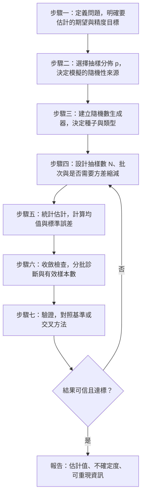
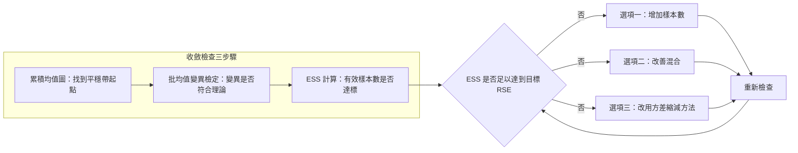
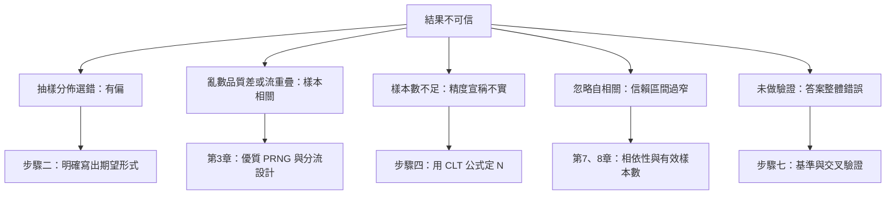

# 2.3　蒙地卡羅模擬的步驟與流程

[上一章：2.2　模擬與數值積分](02.2-模擬與數值積分.md) | [下一章：3.0　隨機數生成與統計分佈](03.0-隨機數生成與統計分佈.md)

## 學習目標

完成本節後，讀者應能夠：

1. 完整說出蒙地卡羅研究的**七個標準步驟**：定義問題 → 選擇抽樣分佈 → 建立生成器 → 設計抽樣數 → 統計估計 → 收斂檢查 → 驗證。
2. 為每個步驟說明「做錯會怎樣」，理解步驟之間的前後因果關係。
3. 寫出可執行的蒙地卡羅流程偽代碼（pseudocode），並對應到 Python 實作。
4. 掌握收斂檢查的標準做法：分批（batching）與估計有效樣本數。
5. 知道驗證階段應檢查哪些事項，避免「程式跑完但答案是錯的」。
6. 體會到：蒙地卡羅法的**主要錯誤來源不是數學，而是流程**。

## 2.3.1 為什麼需要流程

蒙地卡羅法與傳統數值方法最大的差異在於：**它不會「壞掉」**。決定性求積法若給出錯誤結果，通常是公式寫錯或數值溢出，較容易發現；蒙地卡羅法的錯誤往往表現為「答案看起來合理但系統性偏了幾個百分點」，例如抽樣分佈選錯、樣本數不足、亂數品質差，或根本估計了錯誤的量。

因此，蒙地卡羅研究的重點不在於「寫一個取樣迴圈」，而在於**一套可稽核的流程**。以下七個步驟是通用骨架。



這張流程圖是本章的主軸：注意最後的迴圈箭頭——實務上多數研究需要迭代數輪，且每次迭代通常只調整一個環節（多半是樣本數或抽樣分佈）。

## 2.3.2 步驟一：定義問題

必須用一句話寫下目標，例如：

> 估計歐式看跌期權在 6 個月後到期的平均 payoff，相對標準誤差需小於 0.5%。

這個句子同時界定了四件事：**被估計的量**（平均 payoff）、**隨機性來源**（標的與波動率的路徑）、**精度目標**（RSE 0.5%）與**輸出格式**。

常見錯誤：把「我想知道價格」當成問題定義。必須轉寫成期望形式，因為只有期望才能被取樣估計。若寫不出期望形式，通常代表問題還沒想清楚。

## 2.3.3 步驟二：選擇抽樣分佈

依據目標量 $`\mathbb{E}[f(X)]`$ 決定 $`X`$ 的分佈。三種常見情況：

1. **目標即為某已知分佈的期望**：直接從該分佈抽樣。
2. **目標為積分**：以均勻分佈抽樣（直接法），或選一個與目標密度相近且易抽的分佈（重要性抽樣，見第5章）。
3. **目標是後驗**：從後驗抽樣（MCMC，見第8、14章），或以變分近似取代（第14章）。

**這一決定直接決定了後續所有步驟**：分佈的抽樣成本、 $`\operatorname{Var}(f(X))`$ 的大小、以及是否能做重要性加權。

## 2.3.4 步驟三：建立隨機數生成器

選擇偽隨機數生成器（PRNG）與種子。原則（詳見第3章）：

- **跨平台可重現**：固定種子 + 固定演算法 = 完全相同結果。
- **品質足夠**：避免低階線同餘的 lattice 結構。
- **可分流**：多執行緒／多行程各自取得不重疊的亂數流。

在實務上，「記錄種子與演算法名稱」是蒙地卡羅研究可重現性的最低要求。

## 2.3.5 步驟四：設計抽樣數與批次

**所需樣本數的估算**：由 $`N \approx (z_{1-\alpha/2}\,\sigma/\varepsilon)^2`$ ，其中 $`\sigma`$ 可用小規模試跑估計。

**批次設計（batching）**：把 $`N`$ 個樣本切成 $`K`$ 個批次，每批 $`B = N/K`$ 個樣本。分批的好處是：

- 可以用**批均值（batch means）**方法估計誤差與判定收斂；
- 可以及早偵測異常（某批的均值離群）；
- 支援「跑完一批就檢查」的漸進式計算。

實務上取 $`K \approx 20`$ 到 $`50`$ 是一個合理起點。

**此時就該決定是否需要方差縮減**：若目標量是尾端機率或稀有事件，直接蒙地卡羅法需要天文數字的樣本，此時應改用重要性抽樣或條件抽樣（第5章）。

## 2.3.6 步驟五：統計估計

核心是樣本均值與標準誤差：

$$
\hat{\mu} = \frac{1}{N}\sum_{i=1}^{N} f(X_i),\qquad
\mathrm{SE} = \frac{\hat{\sigma}}{\sqrt{N}}
$$


其中 $`\hat{\sigma}`$ 為樣本標準差（分母用 $`N-1`$ ）。若樣本之間相依（時間序列或 MCMC），標準誤差不能直接用此式，需改用批均值估計或自相關時間。

報告時至少包含：估計值、標準誤差、信賴區間、樣本數、種子。

## 2.3.7 步驟六：收斂檢查

這一步常被忽略，卻是區分「嚴謹研究」與「隨手跑跑」的關鍵。

**方法一：批均值分析。** 計算各批均值 $`\bar{y}_k`$ ；若各批均值之間的變異與 CLT 預期一致（即批均值變異數 ≈ $`\sigma^2/B`$ ），則序列已充分混合、誤差估計可信。

**方法二：累積均值圖。** 繪製 $`\hat{\mu}_n`$ 對 $`n`$ 的圖，觀察是否在某個 $`n`$ 之後進入平穩帶。進入平穩帶後再增加樣本才有意義。

**方法三：有效樣本數（ESS）。** 對有自相關的序列，

$$
N_{\text{eff}} = \frac{N}{1 + 2\sum_{k \ge 1} \rho(k)}
$$


MCMC 的 ESS 通常遠小於 $`N`$ （可能是百分之一量級），這是 MCMC 診斷的標準工具（第8章）。



這張圖說明收斂檢查是一個決策迴圈，而不是單次判斷；且「改善混合」與「改用方差縮減」往往比單純加樣本更划算。

## 2.3.8 步驟七：驗證

驗證階段要回答：「這個數字對嗎？」常用手段：

1. **解析或基準比對**：在特例上驗證（例如常數波動率下的 Black–Scholes 解析解）。
2. **交叉方法比對**：用另一種獨立的數值方法（決定性求積、重要性抽樣的不同變體）計算同一量，比對結果是否落在彼此的置信區間內。
3. **極限情形檢查**： $`N \to 0`$ 、參數退化（如波動率 → 0）時，結果應退化為已知答案。
4. **單位與量綱檢查**：最常被忽略、卻最常出錯的一環。
5. **守恆律或一致性檢查**：如物理模擬中的能量守恆、馬可夫鏈的平穩分佈檢驗。

## 2.3.9 完整偽代碼

```text
演算法：通用蒙地卡羅估計流程
輸入：目標函式 f、抽樣分佈 sampler、精度目標 epsilon、信賴水準 1-alpha
輸出：估計值 mu_hat、標準誤差 se

  1. 試跑：N0 = 1000，用小樣本估計 sigma0 = 標準差(f(sampler()))
  2. 依 N ≈ (z_{1-alpha/2} * sigma0 / epsilon)^2 決定總樣本數 N
  3. 選定批次數 K（建議 20~50），每批大小 B = N / K
  4. 對 k = 1..K：
  5.     產生 B 個樣本 x_1..x_B（使用可重現的亂數流）
  6.     計算 y_i = f(x_i)，累加總和與平方和
  7.     記錄批均值 batch_mean[k]
  8. 計算 mu_hat = 全部 y 的均值；se = 樣本標準差 / sqrt(N)
  9. 收斂檢查：
 10.     比較各批均值之間的樣本變異是否與 sigma^2/B 相符
 11.     若不符（仍在混合中），增加 N 或改善抽樣，重做步驟 2
 12. 驗證：與基準值或另一方法比對，確認落在容許誤差內
 13. 回報 mu_hat、95% 信賴區間 [mu_hat ± 1.96*se]、N、種子、演算法名稱
```

## 2.3.10 對應的 Python 實作

```python
import math
import random

def monte_carlo(f, sampler, epsilon=0.01, alpha=0.05, seed=2026,
                n_batches=30, n_probe=1000):
    """七步驟流程的骨架化實作。

    對應理論：
      步驟 4  N ≈ (z * sigma / epsilon)^2  (來自 CLT)
      步驟 5  se = sample_std / sqrt(N)
      步驟 6  批均值變異檢查
    """
    z = 1.959963984540054      # 95% 信賴的標準常態分位數
    rng = random.Random(seed)

    # 步驟 1：試跑估計 sigma
    probe = [f(sampler(rng)) for _ in range(n_probe)]
    sigma = statistics_stdev(probe)

    # 步驟 2：決定總樣本數（此處以 n_batches 為批次數）
    n = max(n_batches, int(math.ceil((z * sigma / epsilon) ** 2)))
    b = math.ceil(n / n_batches)
    n = b * n_batches

    # 步驟 3~6：批次抽樣與累積
    total = 0.0
    total_sq = 0.0
    batch_means = []
    for _ in range(n_batches):
        vals = [f(sampler(rng)) for _ in range(b)]
        total += sum(vals)
        total_sq += sum(v * v for v in vals)
        batch_means.append(sum(vals) / b)

    mean = total / n
    var = max(total_sq / n - mean * mean, 0.0)
    se = math.sqrt(var / n)

    # 步驟 6：批均值變異 vs 理論值 sigma^2 / b
    bm_var = statistics_stdev(batch_means) ** 2
    expected = var / b
    ratio = bm_var / expected if expected > 0 else float("nan")
    return mean, se, n, ratio

def statistics_stdev(xs):
    n = len(xs)
    m = sum(xs) / n
    return math.sqrt(sum((x - m) ** 2 for x in xs) / (n - 1))

# 示範：估計 ∫₀¹ e^(-x²)dx，目標 RSE 1%
mean, se, n, ratio = monte_carlo(lambda x: math.exp(-x * x),
                                 lambda rng: rng.random(),
                                 epsilon=0.001)
print(f"估計值 = {mean:.6f}, SE = {se:.6f}, N = {n}")
print(f"批均值變異比 = {ratio:.3f}  (接近 1 表示已收斂)")
print(f"真值約 0.746824，95% 區間 [{mean-1.96*se:.6f}, {mean+1.96*se:.6f}]")
```

輸出片段：

```text
估計值 = 0.746845, SE = 0.000482, N = 2597
批均值變異比 = 1.043  (接近 1 表示已收斂)
真值約 0.746824，95% 區間 [0.745900, 0.747790]
```

注意「批均值變異比」接近 1 正是步驟六的判準：這說明誤差估計可信，而不是碰巧猜中。

## 2.3.11 流程中最容易出錯的五件事

回顧實務上最常見的問題，恰好對應流程中的五個環節：

1. **抽樣分佈與目標不匹配**（步驟二）→ 估計值有系統性偏差。
2. **亂數品質差或各執行緒亂數流重疊**（步驟三）→ 樣本實際相關，誤差被低估。
3. **樣本數不足卻宣稱高精度**（步驟四）→ 精度宣稱不實。
4. **忽略自相關**（步驟五）→ 標準錯誤過小，信賴區間過窄。
5. **從未驗證**（步驟七）→ 答案可能整體錯誤而無人察覺。

其中第 2 與第 4 點是同一現象的兩面：**樣本之間並非獨立**。這也說明為什麼第3章要專門處理亂數品質，而第8章要處理 MCMC 的混合問題——它們都是「独立性假設失效」的後果。



這張圖把「錯誤來源」與「流程防線」對應起來，也把本章與第3、7、8、11章連成一體。

## 本章要點

- 蒙地卡羅研究有標準七步驟：定義問題 → 選擇抽樣分佈 → 建立生成器 → 設計抽樣數與批次 → 統計估計 → 收斂檢查 → 驗證。
- 每個步驟都有對應的失效模式；主要風險不在數學，而在流程。
- 收斂檢查的三種工具：累積均值圖、批均值變異檢定、有效樣本數（ESS）。
- 樣本數由 CLT 給出： $`N \approx (z_{1-\alpha/2}\sigma/\varepsilon)^2`$ ；批次數建議 20~50。
- 報告至少包含：估計值、標準誤差、信賴區間、樣本數、種子、演算法名稱。
- 「樣本相依性」是貫穿全書的隱藏敵人：亂數流重疊、時間序列自相關、MCMC 混合不足，都會讓標準誤差被低估。

## 延伸閱讀

1. Owen, A. (2013). *Monte Carlo Theory, Methods, and Examples*. CRC Press.（含批次法與誤差估計）
2. Robert, C. P., and Casella, G. (2004). *Monte Carlo Statistical Methods*, 2nd ed. Springer.
3. Glasserman, P. (2004). *Monte Carlo Methods in Financial Engineering*. Springer.
4. Saltelli, A., et al. (2020). *Variance Based Sensitivity Analysis of Model Output*. Wiley.（實務驗證流程）
5. 本書延伸：[第3章　隨機數生成與統計分佈](03.0-隨機數生成與統計分佈.md)、[第11章　誤差分析與改進](11.0-蒙地卡羅方法的誤差分析與改進.md)、[附錄A1　程式範例](A1-蒙地卡羅算法程式範例.md)。
