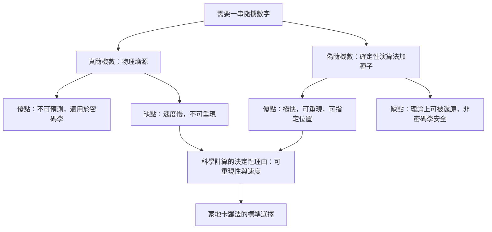
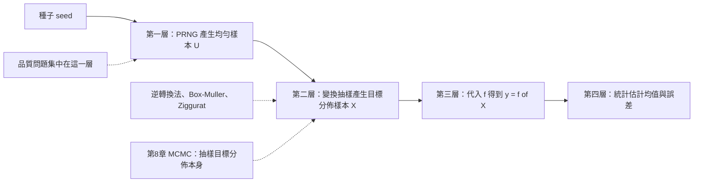
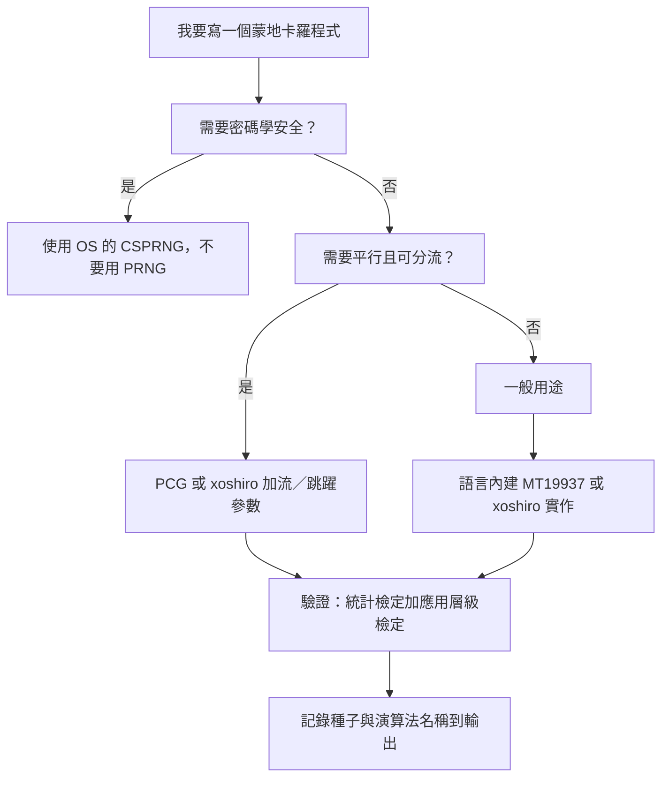

# 第3章　隨機數生成與統計分佈

[上一章：2.3　蒙地卡羅模擬的步驟與流程](02.3-蒙地卡羅模擬的步驟與流程.md) | [下一章：3.1　隨機數的生成方法](03.1-隨機數的生成方法.md)

## 學習目標

完成本章後，讀者應能夠：

1. 說明為什麼蒙地卡羅法需要「偽隨機數」而不是真隨機數，並解釋偽隨機數與真隨機數在實務上的取捨。
2. 描述一個偽隨機數生成器（PRNG）必須具備的四項性質：均勻性、獨立性、效率、可重現性。
3. 區分「均勻隨機數」與「目標分佈隨機數」兩個層次，並說明第二層的建立方式（逆轉換法、Box–Muller、Ziggurat 等）。
4. 理解**品質與速度的取捨**，並知道常見生成器（LCG、MT19937、PCG、xoshiro）各自的定位。
5. 掌握統計檢定（卡方、Kolmogorov–Smirnov、序列化檢定）的原理與適用情境。
6. 理解平行與 counter-based 亂數生成的必要性，並掌握種子與亂數流管理的原則。

## 3.1 本章在全書中的位置

第2章建立了蒙地卡羅法的語言，但它把「樣本從哪裡來」當成黑箱。本章把這個黑箱打開。

本章依賴的前置理論：

- **第2章的期望與變異數**——因為亂數品質的定義正是「產生的樣本在統計上像不像理想均勻抽樣」。
- **模算術（modular arithmetic）與整數分解**——這是所有 PRNG 的數學基礎。

本章引出的後續問題：

1. **抽樣分佈只有「理想」的解析式時，如何產生樣本？** → 3.2 節。
2. **如何在數千個平行執行緒上取得互不重疊的亂數流？** → 3.3 節。
3. **如何兼顧跨平台一致性與速度？** → 3.3 節的 PCG 與 xoshiro。

如果說第2章是語法、第4章是動詞，那麼**第3章是材料**：沒有高品質的隨機數，第4章的所有收斂理論都只是紙上談兵。

## 3.2 為什麼是「偽」隨機數

**真隨機數（true random number）** 來自物理過程：電子熱噪聲、放射性衰變、同態光子成對產生。它的優點是統計上無法被預測；缺點是：

- **速度慢**：光學量子亂數源每秒數百 MB，硬碟熵池更慢，而蒙地卡羅法每秒需要數百 MB 到數 GB 的亂數。
- **不可重現**：一旦寫入就無法復現同一串數字。
- **不可重現性破壞科學研究**：同一組程式碼在別人機器上跑出不同結果，無法除錯。
- **無法產生「特定」的數字**：有時需要第 10 個樣本而不要前 9 個（例如用相同亂數流比較兩個估計量），真亂數做不到。

**偽隨機數（pseudo random number, PRN）** 由確定性演算法從種子產生。關鍵在於：**對大多數統計目的而言，只要序列的行為「像」獨立均勻抽樣，它與真隨機數沒有可區分的差別**。這是統計學的一個基本信念。

兩者的取捨如下圖，它呼應「偽隨機數是實務上唯一可行選擇」這個論點。

這張圖說明：科學計算選偽隨機不是妥協，而是深思熟慮後的正確決定；只有密碼學場景才需要真隨機。

**一個必須澄清的誤解**：偽隨機數是「確定性」的，因此兩次使用相同種子與相同演算法，會得到**完全相同**的序列。這不是缺陷，而是蒙地卡羅法能做嚴格基準比較（例如計算方差縮減技術的改善幅度）的前提。實務上蒙地卡羅實驗通常要做「共同隨機數（common random numbers）」：用同一串亂數流比較兩個估計量，以消除兩者之間的相關噪声，讓差異的估計更精確。

## 3.3 偽隨機數生成器的四項性質

一個合格的 PRNG 應具備：

**性質一：均勻性（uniformity）**。產生的樣本在 $`[0,1)`$ 上大致均勻。更精確地說，任一區間 $`[0,x)`$ 中的點數比例應接近 $`x`$ 。

**性質二：獨立性（independence）**。任意相鄰或不相鄰的樣本之間應無可察覺的相關。這是最難達成的性質——只要生成器是有限狀態的，理論上總能找到相關結構。

**性質三：效率（efficiency）**。產生一個樣本的成本要低，通常是一個整數乘加與位元運算。蒙地卡羅法是「亂數密集」的：一次積分估計可能需要數百萬甚至數億個樣本。

**性質四：可重現性與可移植性（reproducibility and portability）**。相同種子 → 相同序列，且在不同語言、不同平台、不同編譯器最佳化設定下都相同。這正是為什麼標準語言都內建 Mersenne Twister（見 3.1 節），也是為什麼蒙地卡羅研究必須記錄種子與演算法名稱。

## 3.4 兩個層次：均勻亂數與目標分佈亂數

這是本章最重要的概念區分，也是初學者最常混淆的地方。

**第一層：均勻隨機數。** 產生 $`U_1, U_2, \dots \sim \mathrm{Uniform}(0,1)`$ 。所有 PRNG 都只做這件事。

**第二層：目標分佈隨機數。** 產生 $`X \sim p`$ （例如常態、指數、Gamma）。做法是：先取均勻亂數，再透過**變換**把它映射到目標分佈。

第二層的方法分兩大類：

1. **直接法**：把 $`U`$ 代入反函數，例如指數分佈 $`X = -\ln(1-U)/\lambda`$ （逆轉換法，inverse transform method）。
2. **拒絕取樣法**：產生候選值，若落在接受區域則接受，否則重抽（例如 Ziggurat、Metropolis 的接受準則）。

區分這兩層的實務意義：**PRNG 的品質問題只在第一層**。第二層的演算法是確定性的數學變換，其正確性與 PRNG 品質無關，但它的「效率」（每個樣本需要幾次均勻亂數）與「數值穩定性」會影響模擬速度。

這張圖是第2.3 節七步驟流程的細部展開，並點出三層各自的技術焦點。

## 3.5 亂數品質為什麼會「悄悄」破壞結果

最危險的失敗模式是：**結果看起來合理，但實際上有偏或誤差被低估**。原因有二：

**其一，樣本相關性（correlation）。** 若生成器的序列有長程相關（例如某些低階 LCG），則「樣本數 $`N`$ 」所含的獨立資訊遠少於 $`N`$ ，標準誤差被嚴重低估。

**其二，格子結構（lattice structure）。** 某些二維投影會顯示明顯的直線或平行四邊形。蒙地卡羅積分在 $`d`$ 維時，樣本實際落在一組超平面上，導致某些區域永遠抽不到樣本——這是系統性偏差，而非隨機誤差。

因此，評估一個生成器需要**統計檢定**。本章介紹三種最常用的：

**卡方檢定（chi-square test）**：把 $`[0,1)`$ 分成 $`k`$ 個等區間，檢驗各區間的觀測次數是否與期望次數 $`N/k`$ 顯著偏離。

$$
\chi^2 = \sum_{i=1}^{k} \frac{(O_i - E_i)^2}{E_i}, \qquad E_i = \frac{N}{k}
$$

在虛無假設「均勻」下， $`\chi^2`$ 近似服從自由度 $`k-1`$ 的卡方分佈。

**Kolmogorov–Smirnov 檢定**：比較經驗分佈函數 $`F_N`$ 與理論分佈 $`F`$ 的最大偏差，

$$
D_N = \sup_{x} \big| F_N(x) - F(x) \big|
$$

比卡方檢定更敏銳，且不需分箱。

**序列化檢定（serial test）**：檢定序列中相鄰元素的相關性。例如計算滯後 1 的自相關

$$
\hat{\rho}_1 = \frac{\sum_{i=1}^{N-1}(U_i - \bar U)(U_{i+1} - \bar U)}{\sum_{i=1}^{N}(U_i - \bar U)^2}
$$

對 $`N`$ 個樣本， $`\hat{\rho}_1`$ 的近似標準誤為 $`1/\sqrt{N}`$ ；若落在 $`\pm 3/\sqrt{N}`$ 之外，則有可察覺的相關。

這些檢定的局限必須明說：**它們是「無法拒絕」而非「證明均勻」**。通過所有檢定的生成器仍可能有罕見的相關結構。真正的驗證是「在真實應用中不失效」，這也是 3.3 節強調理論品質（如 PCG 的嚴格統計檢定結果）的原因。

## 3.6 亂數生成器的演進與歷史

| 年份 | 事件 | 意義 |
| --- | --- | --- |
| 1940s | von Neumann 的乘同餘法（LCG） | 第一個有嚴格分析的 PRNG，蒙地卡羅法得以實作 |
| 1951 | Lehmer 的乘法同餘法 | 中期過渡方案 |
| 1966 | Park 與 Miller 發表「最小標準」Lehmer 生成器 | 跨平台可攜的品質標準 |
| 1988 | L'Ecuyer 的多流（multiple streams）方法 | 平行亂數流的系統化分流 |
| 1998 | Matsumoto 與 Nishimura 發表梅森旋轉 MT19937 | 工業標準，語言庫內建 |
| 2011 | L'Ecuyer 等提出「隨機矩陣獨立測試」 | 統計檢定方法的現代化 |
| 2014 | O'Neill 發表 PCG 家族 | 針對高平行度，品質/速度比大幅提升 |
| 2018 | Blackman 與 Vigna 發表 xoshiro256\*\* | 現代 CPU/GPU 上的高效選擇 |

值得注意的是，這張表呈現出一個反覆出現的驅動模式：**新的應用需求（平行、GPU、統計品質要求）推動新的生成器**。例如 PCG 的設計目標就是「在多執行緒環境中提供高品質亂數」——而這正是金融業平行蒙地卡羅的直接需求。

## 3.7 本章的實務守則

給出可以直接套用的檢查清單：

1. **不要自己寫 LCG。** 使用語言內建或成熟函式庫的生成器。
2. **記錄種子與演算法名稱。** 只記錄種子是不夠的——換了函式庫版本，序列就變了。
3. **不要用 `random.random()` 做需要流式一致性的平行計算。** 要用可分流（streamable）的生成器。
4. **先做一次統計檢定。** 特別是自相關檢定與二維點陣視覺化。
5. **不要用同一串亂數比較兩個不同估計量後直接相減**，除非刻意使用共同隨機數設計（那正是它的用法）。
6. **加密用途另請高明。** 蒙地卡羅的 PRNG 不是密碼學安全的。

這張圖是本章的決策樹總結：安全性與平行分流是兩個最常被忽略的岔路口。

## 本章要點

- 蒙地卡羅法使用偽隨機數：速度與可重現性是決定性理由；安全用途須另用 CSPRNG。
- PRNG 的四項性質：均勻性、獨立性、效率、可重現性與可移植性。
- 兩個層次必須分清：PRNG 只負責均勻樣本；目標分佈樣本由變換抽樣（逆轉換法、Box–Muller、Ziggurat）產生。
- 亂數品質不良造成的失敗是隱性的：相關性與格子結構帶來系統性偏差與被低估的誤差。
- 統計檢定（卡方、Kolmogorov–Smirnov、序列化檢定）是必要防線，但「無法拒絕」不等於「證明均勻」。
- 演進史：von Neumann LCG → Park–Miller 1966 → MT19937 1998 → PCG 2014 → xoshiro 2018，每一步都由新的應用需求推動。
- 實務守則：用成熟實作、記錄種子與演算法、需要平行時用可分流生成器。

## 延伸閱讀

1. L'Ecuyer, P. (2017). *Random Number Generation*. In *Handbook of Simulation*, edited by S. M. Ross et al., 3rd ed. CRC Press.
2. L'Ecuyer, P. (2001). Uniform Random Number Generation with Arbitrary Strides. *ACM Transactions on Mathematical Software*, 27(1), 49–57.
3. Matsumoto, M., and Nishimura, M. (1998). Mersenne Twister: A 62303-bit Equidistributed PRNG. *ACM Transactions on Mathematical Software*, 24(1), 12–56.
4. O'Neill, M. E. (2014). PCG: A Family of Simple Fast Space-Efficient Statistically Good Algorithms for Random Number Generation.
5. L'Ecuyer, P., and D'Hont, J. (2022). *Uniform Random Number Generation: Theory and Practice.* (arXiv preprint.)
6. 本書延伸：[3.1　隨機數的生成方法](03.1-隨機數的生成方法.md)、[3.2　常見的統計分佈](03.2-常見的統計分佈.md)、[3.3　生成高效隨機數的技術](03.3-生成高效隨機數的技術.md)。
