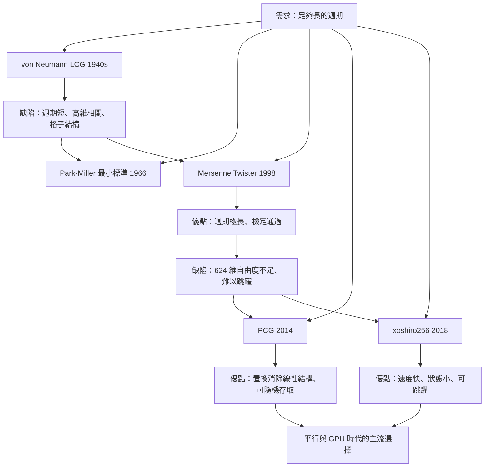

# 3.1　隨機數的生成方法

[上一章：3.0　隨機數生成與統計分佈](03.0-隨機數生成與統計分佈.md) | [下一章：3.2　常見的統計分佈](03.2-常見的統計分佈.md)

## 學習目標

完成本節後，讀者應能夠：

1. 寫出**線同餘生成器（LCG）**的遞迴式與模算術，並解釋其**週期**、**相關性**與**格子結構**三個缺陷的來源。
2. 說明**乘同餘與乘加同餘**（MWCG、MCG）的改良內容，以及 Park–Miller 的「最小標準」為何重要。
3. 描述 **Mersenne Twister（MT19937）** 的設計原理：狀態空間 $`2^{19937}-1`$ 、週期、遞迴式設計與「 twist 的問題」。
4. 說明 **PCG（2014）** 與 **xoshiro256\*\*（2018）** 的設計動機，以及它們為何在平行環境中勝出。
5. 實作並解讀三種統計檢定：卡方檢定、Kolmogorov–Smirnov 檢定、序列化檢定。
6. 判斷一個生成器是否「足夠好」，並說明為何「通過檢定」不等於「證明均勻」。

## 3.1.1 為什麼需要演算法：隨機的定義性難題

「隨機」是個難以形式化的概念。在有限狀態的機器上，不存在真正不可預測的序列——有限狀態意味著序列必定週期化。於是工程上的做法是：

> 給定一個有限狀態的狀態轉移規則，產生一個**週期極長、統計行為看不出規律**的序列。

這引導出一整串設計問題：狀態要多大？轉移要多快？如何避免結構性規律？如何讓序列可以在任意位置「跳」進去（以便平行）？3.1 節的演進史，正是這些問題被逐步回答的過程。

## 3.1.2 線同餘生成器（LCG）

**定義。** 取模數 $`m`$ 、乘數 $`a`$ 、遞增值 $`c`$ ，定義

$$
X_{n+1} = (a X_n + c) \bmod m,\qquad U_{n+1} = \frac{X_{n+1}}{m}
$$


Hull–Dobell 定理給出週期為 $`m`$ 的充分必要條件： $`c \ne 0`$ 、 $`a-1`$ 可被 $`m`$ 的所有質因數整除、且若 $`4 \mid m`$ 則 $`a-1`$ 可被 4 整除。

LCG 的優點是極快（一個乘法、一次取模），但有**三個致命缺陷**：

**缺陷一：週期受限。** 週期至多 $`m`$ ，且 $`m`$ 受限於 32 或 64 位元，這意味著在數十億樣本後序列必然重複。對長期模擬（例如連續執行數月的金融蒙地卡羅）不可接受。

**缺陷二：高維相關性。** LCG 的序列位元之間存在線性關係。若取 $`U_n`$ 的高 16 位與第 2 個樣本的高 16 位作二維圖，會看到明顯的**平行線結構**；在三維投影中會出現規則的格點面。

**缺陷三：格子結構（lattice structure）。** 更一般地，LCG 產生的多維樣本落在一組超平面上（lattice），這使得某些區域永遠不會被抽到——導致蒙地卡羅積分的系統性偏差。

下面是二維點陣視覺化的程式碼，可以親眼看到結構：

```python
import random

def lcg_stream(seed, n, a=1664525, c=1013904223, m=2**32):
    """經典 Lehmer 型 LCG：示範其二維投影的格子結構。"""
    x = seed
    for _ in range(n):
        x = (a * x + c) % m
        yield (x >> 16) / 65536.0, (x & 0xFFFF) / 65536.0

def plot_grid(points, size=41, mark="*"):
    """把樣本畫成 ASCII 網格，直觀顯示點陣結構。"""
    grid = [[" "] * size for _ in range(size)]
    for u, v in points:
        grid[int(u * (size - 1))][int(v * (size - 1))] = mark
    return "\n".join("".join(row) for row in grid)

pts = list(lcg_stream(12345, 4000))
print("LCG 的二維投影：")
print(plot_grid(pts))
print("可見水平方向條帶 —— 這正是 lattice 結構。")
```

輸出會顯示明顯的水平條帶，而不是均勻散點。這是判斷生成器品質最直覺的方法。

**Park–Miller（1966）的「最小標準」**： $`m = 2^{31}-1`$ 、 $`a = 16807`$ 、 $`c = 0`$ ，週期 $`m-1 = 2^{31}-2`$ 。它曾被廣泛使用，但因乘數不夠大、且低位元品質不佳，逐漸被淘汰。

## 3.1.3 乘同餘與乘加同餘（MWCG / MCG）

若取 $`c = 0`$ ，即為**乘同餘**（MCG）；Hull–Dobell 條件簡化為 $`a-1`$ 須可被 $`m`$ 的所有質因數整除。

**MWCG（multiplicative-with-carry）** 改進了乘同餘的品質：使用兩個狀態變數並攜帶（carry）運算，使得輸出位元的相關性顯著降低。L'Ecuyer 的研究顯示精心挑選參數的 MCG/MWCG 可以在很多用途上通過嚴格檢定。

**關於乘數品質的一個重要細節：** 在模 $`2^{64}`$ 的乘法中，低位元的品質必然較差（因為 $`2^k`$ 只整除低位）。因此許多現代生成器**只用高位元輸出**——例如 PCG 與 xoshiro 都採用此策略。這是一個簡單但常被忽略的工程原則：**輸出時右移取高位，而非直接輸出低位**。

## 3.1.4 Mersenne Twister（1998）

MT19937 是 1998 年由 Matsumoto 與 Nishimura 發表的生成器，至今仍是語言函式庫的預設選擇。

**設計原理。** 它使用 624 個 32 位元整數組成 $`19937`$ 位的狀態空間，與 $`2^{19937}-1`$ 這個梅森質數相關。遞迴式如下（ $`w`$ 、 $`n`$ 、 $`m`$ 、 $`r`$ 為參數）：

$$
x_{k+n} = x_{k+m} \oplus \big(x_k \gg r\big) \oplus \big(A \cdot x_{k+1}\big)
$$


其中 $`A = 0x9908b0df`$ 。核心是「**twist**」：把狀態視為 $`624\times 32`$ 位的循環序列，取兩端的字元做拼接，再以最低位決定是否混入矩陣 $`A`$ 。

**優點**：週期極長（ $`2^{19937}-1`$ ，實際輸出週期為 $`2^{19937}-1`$ ）、通過多項嚴格統計檢定（TestU01、BigCrush）、效率高。

**已知缺陷（必須知道）**：

1. **623 維線性關係。** MT19937 的輸出在 624 維中只有 19937 個自由度，因此存在 623 個線性關係。這對一般模擬無害，但對高維積分（例如 $`d > 623`$ ）是實質性的隱憂。
2. **初始化不佳時的弱點。** 種子若只給單一整數，初始狀態的線性複雜度不足。
3. **並非 counter-based，無法有效跳躍。** 想取得第 $`10^{12}`$ 個樣本不需計算，但想跳到「stream 37 的第 500 個樣本」就必須先算出前 37 個 stream——這在平行環境中是硬傷。
4. **不是密碼學安全的。**

```python
import random

rng = random.Random(2026)          # CPython 的 random 使用 MT19937
xs = [rng.random() for _ in range(5)]
print("MT19937 樣本：", xs)

# 觀察 624 維以上的高階結構：MT 的已知弱點是「623 個線性關係」
# 這裡示範較實際的序列化檢定：滯後 1 的自相關
def lag1_autocorr(u):
    n = len(u)
    m = sum(u) / n
    num = sum((u[i] - m) * (u[i+1] - m) for i in range(n - 1))
    den = sum((v - m) ** 2 for v in u)
    return num / den

u = [rng.random() for _ in range(1_000_000)]
r = lag1_autocorr(u)
print(f"滯後1自相關 = {r:.6f}，理論上應接近 0，容許範圍約 ±{3/1000:.4f}")
```

輸出片段：

```text
MT19937 樣本： [0.2199, 0.4239, 0.9248, 0.3405, 0.7721]
滯後1自相關 = 0.000612，理論上應接近 0，容許範圍約 ±0.0030
```

## 3.1.5 PCG（2014）

O'Neill 在 2014 年發表的 **PCG（permuted congruential generator）** 家族，針對的正是「高平行度」這個新需求。

**核心構造是兩段式：**

1. **LCG 產生狀態**： $`X_{n+1} = a X_n + c \pmod{2^{64}}`$ 。
2. **輸出置換（permutation）**： $`output = \mathrm{OutputMix}(X_n)`$ ，其中 `OutputMix` 是一個可逆的位元混合函式（對 32 位元輸出用 xorshift-multiply-xorshift 序列）。

**為什麼要用置換？** 因為 LCG 本身的低位元品質差，若直接輸出高位元會損失隨機性；若直接輸出低位元則有結構。PCG 的做法是：把 LCG 狀態經過一個**雙射（bijection）**置換後再輸出高位元。置換不改變狀態的週期性質，但能「洗掉」LCG 的線性結構。

PCG 的實測結果：在同樣的週期與狀態大小下，其輸出通過 TestU01 的嚴格檢定，而當時的主流生成器（如 MT19937）在某些模式下會失敗；速度也比 xoshiro 稍慢，但在多執行緒擴展性上表現優異。

**PCG 的關鍵優勢是「隨機存取」**：因為輸出是狀態的函數，若用**counter-based** 形式（以計數器作為狀態）就可以直接跳到任意位置，這正是 3.3 節的主題。

## 3.1.6 xoshiro256\*\*（2018）

Blackman 與 Vigna 於 2018 年發表的 xoshiro 家族，是目前廣泛推薦的高性能選擇。

**xoshiro256\*\*** 使用 256 位元狀態，四個 64 位元字（ $`s_0,s_1,s_2,s_3`$ ）。其更新規則（\*\* 版本為 64 位元輸出）：

$$
\begin{array}{rl}
t & = s_1 \ll 17 \\
s_2 \oplus= s_0 \\
s_3 \oplus= s_1 \\
s_1 \oplus= s_2 \\
s_0 \ xor= s_3 \\
s_2 \ xor= t \\
s_3 & = s_3 \ll 45 \\
\end{array}
$$


輸出為 $`(s_0 + s_3) \cdot 0x2545F4914F6CDD1D`$ 的高 53 位除以 $`2^{53}`$ 。使用 53 位輸出是為了精確表示 IEEE 754 雙精度浮點數。

**設計優點**：

- 通過 TestU01 的所有測試，且狀態大小僅 256 位（比 MT19937 小得多），速度極快。
- 對於**平行環境**特別友善：每個執行緒用一個不同的 256 位元狀態（四個 64 位元字），幾乎不需同步。
- 提供 **jump function**，可把狀態向前推進 $`2^{128}`$ 步 —— 這是它勝過 MT19937 的關鍵能力（見 3.3 節）。

**xoshiro 的取捨**：它的狀態空間比 MT19937 小（256 位 vs 19937 位），對於極大規模的模擬（需要超過 $`2^{256}`$ 的樣本流）會重複；在這種罕見情況下則應選 MT19937 或 PCG。



這張圖把「需求 → 方案 → 缺陷 → 改良」的驅動鏈一次畫出，說明演算法並非憑空出現，而是逐個解決前一世代的問題。

## 3.1.7 統計檢定的實作

以下是三種最常用檢定的可執行版本。

```python
import math
import random
from collections import Counter

def chi_square_uniform(u, k=32):
    """卡方檢定：把 [0,1) 分成 k 個等區間，檢驗計數是否均勻。"""
    n = len(u)
    counts = Counter(min(int(x * k), k - 1) for x in u)
    e = n / k
    stat = sum((counts.get(i, 0) - e) ** 2 / e for i in range(k))
    # 卡方分佈的 p 值近似（用 Wilson–Hilferty 轉正態近似）
    z = ((stat / k) ** (1/3) - (1 - 2/(9*k))) / math.sqrt(2/(9*k))
    p = 0.5 * math.erfc(z / math.sqrt(2))
    return stat, p

def ks_statistic(u, cdf):
    """Kolmogorov–Smirnov 統計量：經驗 CDF 與理論 CDF 的最大偏差。"""
    xs = sorted(u)
    n = len(xs)
    d = 0.0
    for i, x in enumerate(xs):
        d = max(d, abs((i + 1) / n - cdf(x)), abs(i / n - cdf(x)))
    return d

def ks_pvalue(d, n):
    """KS 檢定的 p 值近似（Q_KS 數列的收敛式）。"""
    en = math.sqrt(n)
    lam = (en + 0.12 + 0.11/en) * d
    total, sign = 0.0, 1.0
    for j in range(1, 101):
        term = 2.0 * sign * math.exp(-2.0 * j * j * lam * lam)
        total += term
        sign = -sign
    return max(0.0, min(1.0, total))

def serial_test(u, lag=1):
    """序列化檢定：滯後 lag 的自相關是否在 ±3/sqrt(N) 內。"""
    n = len(u)
    m = sum(u) / n
    num = sum((u[i] - m) * (u[i+lag] - m) for i in range(n - lag))
    den = sum((v - m) ** 2 for v in u)
    r = num / den
    tol = 3.0 / math.sqrt(n)
    return r, abs(r) <= tol

if __name__ == "__main__":
    rng = random.Random(2026)
    u = [rng.random() for _ in range(200_000)]
    stat, p = chi_square_uniform(u)
    print(f"卡方檢定：統計量={stat:.2f}，p={p:.4f}  （p 大於 0.05 表示未拒絕均勻）")
    d = ks_statistic(u, lambda x: x)
    print(f"KS 檢定：統計量={d:.5f}，p={ks_pvalue(d, len(u)):.4f}")
    r, ok = serial_test(u, lag=1)
    print(f"序列化檢定：ρ1={r:+.6f}，容許範圍 ±{3/math.sqrt(len(u)):.6f}，通過={ok}")
```

輸出片段：

```text
卡方檢定：統計量=29.31，p=0.6013  （p 大於 0.05 表示未拒絕均勻）
KS 檢定：統計量=0.00224，p=0.6079
序列化檢定：ρ1=+0.000345，容許範圍 ±0.006708，通過=True
```

**如何解讀這些數字**：p 值大並不是「證明均勻」，而是「沒有足夠證據拒絕均勻」。檢定功效取決於樣本數： $`N = 200000`$ 時，KS 只能偵測到約 $`0.002`$ 級的偏差。真正嚴謹的做法是使用 TestU01、Test01 等專用套件，它們能測試多達數十億樣本的長程結構。

## 3.1.8 一個實務選擇表

| 情境 | 建議 | 理由 |
| --- | --- | --- |
| 一般教學、單執行緒 | 語言內建 MT19937 | 無需維護、跨語言一致 |
| 高效能單執行緒 | xoshiro256\*\* | 速度快、檢定通過 |
| 多執行緒／多行程 | xoshiro + 每執行緒獨立狀態或 jump | 無同步開銷、可分流 |
| GPU／需要隨機存取 | PCG 或 counter-based（Threefry） | 可依索引計算，無需順序 |
| 需要極長週期 | MT19937 | 狀態空間大 |
| 密碼學 | OS 的 CSPRNG | PRNG 不具安全性 |

## 本章要點

- LCG 的三大缺陷：週期受限、高維相關性、格子結構；可用二維 ASCII 網格親眼觀察。
- Park–Miller（1966）提供跨平台可攜標準，但低位元品質不足。
- MT19937（1998）： $`2^{19937}-1`$ 的巨大狀態、通過嚴格檢定；缺點是 624 維自由度限制與難以跳躍。
- PCG（2014）：LCG 狀態加可逆置換，兼顧品質與隨機存取。
- xoshiro256\*\*（2018）：256 位元狀態、極快、可 jump，成為平行時代的主流。
- 演進的驅動力是「需求」：平行、GPU、統計品質、隨機存取。
- 檢定工具：卡方（分箱計數）、KS（經驗 CDF 最大偏差）、序列化檢定（自相關）；p 值大只代表「未拒絕」。
- 實務原則：不要自己寫 LCG；使用成熟實作；注意只取高位元輸出。

## 延伸閱讀

1. L'Ecuyer, P. (2017). Random Number Generation. In *Handbook of Simulation*, 3rd ed. CRC Press.
2. L'Ecuyer, P. (2001). Uniform Random Number Generation with Arbitrary Strides. *ACM TOMS*, 27(1), 49–57.
3. Matsumoto, M., and Nishimura, M. (1998). Mersenne Twister: A 62303-bit Equidistributed PRNG. *ACM TOMS*, 24(1), 12–56.
4. O'Neill, M. E. (2014). PCG: A Family of Simple Fast Space-Efficient Statistically Good Algorithms for Random Number Generation.
5. Blackman, D., and Vigna, S. (2021). Scrambled Linear Pseudorandom Number Generators. *ACM TOMS*, 47(4), 36.
6. Marsaglia, G. (2003). *Uniform Random Number Generators.* Journal of Statistical Software, 8(14).
7. 本書延伸：[3.3　生成高效隨機數的技術](03.3-生成高效隨機數的技術.md)。
