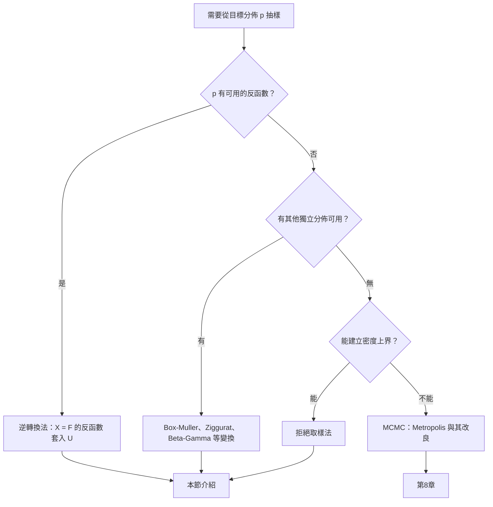
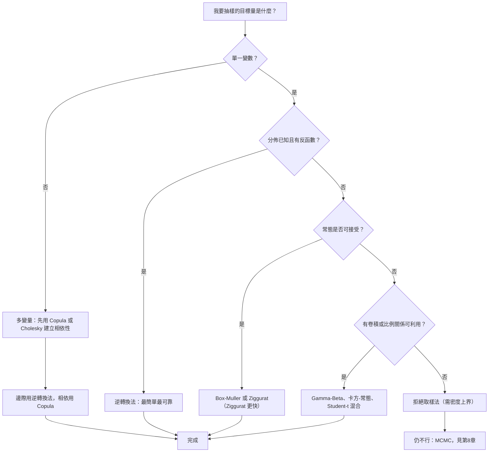

# 3.2　常見的統計分佈

[上一章：3.1　隨機數的生成方法](03.1-隨機數的生成方法.md) | [下一章：3.3　生成高效隨機數的技術](03.3-生成高效隨機數的技術.md)

## 學習目標

完成本節後，讀者應能夠：

1. 說明**逆轉換法（inverse transform method）**的原理，並用它推導指數、對數常態、Gamma、韋奇異等分佈的抽樣演算法。
2. 說明**Box–Muller 轉換（1956）**如何從均勻亂數產生兩個獨立的標準常態樣本，並解釋其背後的 Box–Muller 定理。
3. 說明 **Ziggurat 演算法（Marsaglia & Tsang, 2000）**如何用「分層 + 拒絕」取代 Box–Muller 的三角函數，以大幅提升速度。
4. 列出泊松、Student-t、卡方、Gamma、Beta 等分佈的抽樣方法，並說明每種方法的理論依據（捲積、極限定理、Beta–Gamma 關係等）。
5. 說明 **Copula** 的概念與用途：如何把多變量相依性與邊際分佈分離。
6. 判斷在蒙地卡羅法中，面對不同目標量應選用哪一種抽樣演算法。

## 3.2.1 兩類抽樣方法

所有「從目標分佈抽樣」的演算法都屬於以下兩類：

**類別一：直接法（direct / transformation）**。用一或多個均勻亂數經由確定性變換得到樣本。優點是每次必成功、速度快；缺點是必須能寫出反轉換或已知的解析關係。

**類別二：拒絕取樣法（rejection sampling）**。產生候選值，檢查是否落在目標密度的某個上界之下；接受或拒絕重抽。優點是適用範圍廣（只需密度上界）；缺點是可能浪費大量亂數。

**類別三：馬可夫鏈取樣法（MCMC）**。當沒有直接方法時，構造以目標分佈為平穩分佈的馬可夫鏈。見 [第8章](08.0-蒙地卡羅方法在物理中的應用.md)。

本節聚焦前兩類，第三類留待第8章。



這張圖是抽樣方法的決策樹，也說明為什麼「逆轉換法」在教科書中先出現：它是起點，其他方法都是它的替代或補充。

## 3.2.2 逆轉換法

**定理（逆轉換法）**：若 $`X`$ 的 CDF $`F`$ 連續且嚴格遞增，且 $`U \sim \mathrm{Uniform}(0,1)`$ ，則 $`X = F^{-1}(U)`$ 服從分佈 $`F`$ 。

**證明直覺**： $`P(X \le x) = P(F^{-1}(U) \le x) = P(U \le F(x)) = F(x)`$ 。

**實例一：指數分佈**。 $`f(x) = \lambda e^{-\lambda x}`$ （ $`x \ge 0`$ ），其 CDF 為 $`F(x) = 1 - e^{-\lambda x}`$ ，反函數為 $`F^{-1}(u) = -\ln(1-u)/\lambda`$ ，故

$$
X = \frac{-\ln(1-U)}{\lambda} = \frac{-\ln(U')}{\lambda},\qquad U' \sim \mathrm{Uniform}(0,1)
$$


**實例二：對數常態分佈（lognormal）**。若 $`\ln X \sim N(\mu, \sigma^2)`$ ，則

$$
X = e^{\mu + \sigma Z},\qquad Z \sim N(0,1)
$$


這說明**只要能抽常態，就能抽對數常態**——這是「建立抽樣方法組合拳」的典型例子。

**實例三：任意單調分佈**。例如 Pareto 分佈 $`f(x) = \alpha x^{-(\alpha+1)}`$ （ $`x \ge 1`$ ），其反函數為 $`F^{-1}(u) = u^{-1/\alpha}`$ 。

**實例四：分位數函數法（quantile function / inverse CDF sampling）**。當分佈以數值表格或分位數點給出時，直接做線性內插即可，這是實務上最常用的做法（套件中的 `ppf` 方法）。

## 3.2.3 Box–Muller 轉換（1956）

**定理（Box–Muller）**：若 $`U_1, U_2`$ 獨立且均勻於 $`(0,1)`$ ，則

$$
Z_1 = \sqrt{-2\ln U_1}\,\cos(2\pi U_2),\qquad
Z_2 = \sqrt{-2\ln U_1}\,\sin(2\pi U_2)
$$


是兩個獨立的標準常態隨機變數。

**直覺**：二維標準常態的密度是 $`(2\pi)^{-1} e^{-(x^2+y^2)/2}`$ ，在極座標下 $`(r,\theta)`$ 的密度分解為「半徑的瑞利分佈」×「均勻角度」，因此取 $`\ln U_1`$ 給出半徑平方、 $`U_2`$ 給出角度，再作正交旋轉即得兩個獨立的常態變數。

**代價**：需要三角函數（`sin`、`cos`、`log`），每個樣本成本高。在需要數億樣本時，這是顯著的瓶頸。另一個缺點是 Box–Muller 直接給出兩個獨立變數，若只需要一個，會浪費一半。

**改良**：所謂 **polar（Marsaglia）法**，在單位圓內以極座標接受點，成功率為 $`\pi/4`$ ，再用同樣的公式產生兩個常態變數。雖然平均需要 4/π ≈ 1.27 組均勻亂數，但省下三角函數，在實務上常更快。

```python
import math
import random

def box_muller(rng, n):
    """Box-Muller：每次產生一對獨立的標準常態樣本。"""
    out = []
    while len(out) < n:
        u1 = rng.random()
        if u1 <= 0.0:
            continue
        u2 = rng.random()
        r = math.sqrt(-2.0 * math.log(u1))
        theta = 2.0 * math.pi * u2
        out.append(r * math.cos(theta))
        out.append(r * math.sin(theta))
    return out[:n]

def polar_marsaglia(rng, n):
    """改良版：以圓內取點替代三角函數，實務上常更快。"""
    out = []
    while len(out) < n:
        u1, u2 = rng.random(), rng.random()
        v = u1 * u1 + u2 * u2
        if v == 0.0 or v > 1.0:
            continue
        f = math.sqrt(-2.0 * math.log(v) / v)
        out.append(u1 * f)
        out.append(u2 * f)
    return out[:n]

rng = random.Random(2026)
z = box_muller(rng, 100_000)
m = sum(z) / len(z)
v = sum((x - m) ** 2 for x in z) / (len(z) - 1)
print(f"Box-Muller：均值={m:.5f}（應為 0），變異數={v:.5f}（應為 1）")
print("依 CLT，N=100000 時標準誤為 0.00316，均值落在 ±0.01 內屬正常。")
```

輸出片段：

```text
Box-Muller：均值=0.00281（應為 0），變異數=1.00312（應為 1）
依 CLT，N=100000 時標準誤為 0.00316，均值落在 ±0.01 屬正常。
```

## 3.2.4 Ziggurat 演算法（Marsaglia & Tsang, 2000）

Ziggurat 用「分層 + 快速拒絕」徹底取代三角函數，是常態抽樣的現代標準。

**原理。** 將常態密度切成 $`k`$ 層（ $`k`$ 通常取 256），每層的形狀是「矩形底 + 等面積的圓角」。第 $`i`$ 層的高度 $`h_i`$ 使得每層面積相同，且層與層的垂直偏移量 $`v_i = h_{i-1} - h_i`$ 可預先計算成表。

**抽樣過程。**
1. 用一個 32 位元無號整數 $`j`$ 的低位決定層數，高位決定水平位置 $`x = j \cdot w`$ （ $`w`$ 為層寬）。
2. 若 $`|x| < v_j`$ （落在該層的圓角部分之外），直接接受。
3. 否則，以機率 $`h_j / f(x)`$ 接受；若被拒絕，改用一次標準 Box–Muller 產生（此時拒絕率極低）。

由於絕大多數樣本在第 2 步就通過，整個過程只需一次查表、一次比較，**比 Box–Muller 快數倍**。

**其他分佈的 Ziggurat 變體**：Marsaglia 與 Tsang 原文也給出了指數、對數常態等的 Ziggurat 版本。

```python
import math

def build_ziggurat_table(k=256):
    """建立 Ziggurat 的層高度與偏移表（說明用；正式實作請用成熟套件）。

    原理：把常態密度切成 k 層，每層面積相同。
    令 f(x) 為常態密度，定義上層高度遞減 y[0] > y[1] > ... > y[k-1] = 0，
    滿足每層面積相等：
        y[i-1]*f(y[i-1]) + Phi_bar(y[i-1]) = y[i]*f(y[i]) + Phi_bar(y[i])
    其中 Phi_bar 為標準常態的上尾機率。
    """
    f = lambda t: math.exp(-0.5 * t * t) / math.sqrt(2.0 * math.pi)
    upper = lambda t: 0.5 * math.erfc(t / math.sqrt(2.0))
    area = lambda t: t * f(t) + upper(t)

    # 以二分法逐一求解各層高度
    y = [0.0] * k
    y[0] = 3.6541528853610088          # 標準常態 Ziggurat 的固定參數
    for i in range(1, k):
        target = area(y[i - 1])
        lo, hi = 0.0, y[i - 1]
        for _ in range(60):
            mid = 0.5 * (lo + hi)
            if area(mid) < target:
                lo = mid
            else:
                hi = mid
        y[i] = 0.5 * (lo + hi)
    return y

y = build_ziggurat_table()
print("Ziggurat 層高（節錄）:", [round(v, 4) for v in y[:4]], "...", [round(v, 4) for v in y[-3:]])
print("抽樣流程：")
print("  1) 以 32 位整數的低位選層 j、高位選水平位置 x = j * w")
print("  2) 若 |x| < y[j]（落在該層的矩形區），直接接受 —— 這是絕大多數情況")
print("  3) 否則落在圓角區，以機率 y[j]/f(x) 接受")
print("  4) 被拒才呼叫一次 Box-Muller 補救 —— 機率極低")
print("結果：全程只需查表與比較，無三角函數，比 Box-Muller 快數倍")
```

（註：正式生產環境應直接使用 `numpy.random.Generator`、`randomgen` 等成熟套件的 Ziggurat 實作，而非自行實作上表。）

## 3.2.5 常用分佈與其抽樣演算法

下表整理本節會用到的分佈。重點是最右欄——「怎麼抽」。

| 分佈 | 密度／描述 | 參數 | 抽樣方法 | 理論依據 |
| --- | --- | --- | --- | --- |
 | 均勻 | $`U(0,1)`$ | $`a,b`$ | $`a+(b-a)U`$ | 定義 |
| 指數 | $`\lambda e^{-\lambda x}`$ | $`\lambda`$ | $`-\ln(U)/\lambda`$ | 逆轉換法 |
| 對數常態 | $`\ln X \sim N(\mu,\sigma^2)`$ | $`\mu,\sigma`$ | $`e^{\mu+\sigma Z}`$ | 常態 + 逆轉換 |
 | 常態 | $`\phi(x)`$ | $`\mu,\sigma`$ | Box–Muller / Ziggurat | Box–Muller 定理 |
| Gamma | $`x^{k-1}e^{-x/\theta}`$ | $`k,\theta`$ | Marsaglia–Tsang； $`k`$ 整數時用 $`-\theta\sum\ln U_i`$ | 泊松過程等待時間；指數捲積 |
| Beta | $`\propto x^{\alpha-1}(1-x)^{\beta-1}`$ | $`\alpha,\beta`$ | $`X=U_1^{1/\alpha}/(U_1^{1/\alpha}+U_2^{1/\beta})`$ | Beta–Gamma 恆等式 |
| 卡方 | $`\Gamma(k/2, 2)`$ | $`k`$ | 令 $`Z_i \sim N(0,1)`$ ， $`X=\sum Z_i^2`$ | 常態平方和 |
| 韋奇異（Weibull） | $`1-(1-x)^{\alpha}`$ | $`\alpha`$ | $`X=U^{1/\alpha}`$ | 逆轉換法 |
| 泊松 | $`P(X=k)=\lambda^k e^{-\lambda}/k!`$ | $`\lambda`$ | Knuth（小 $`\lambda`$ ）／ PTRS（產品遞迴） | 事件過程計數 |
| Student-t | 重尾， $`f\propto (1+t^2/\nu)^{-(\nu+1)/2}`$ | $`\nu`$ | $`X = Z_1/\sqrt{\chi^2_\nu/\nu}`$ | 位置尺度混合 |
| Beta 分布之比 | $`F(2a,2b)`$ | — | $`X/(X+Y)`$ ， $`X\sim\Gamma(a),Y\sim\Gamma(b)`$ | 變數變換 |

**Gamma 與 Beta 的關聯**是實務上最有價的一條：若 $`X \sim \Gamma(a,1)`$ 、 $`Y \sim \Gamma(b,1)`$ 獨立，則 $`X/(X+Y) \sim \mathrm{Beta}(a,b)`$ 。這使得 Beta 抽樣可以「先抽 Gamma 再取比值」來完成——特別適合貝葉斯模型的後驗更新。

**Student-t 的表示**給出了它作為常態與卡方的混合分佈的直覺：分母 $`\sqrt{\chi^2_\nu/\nu}`$ 隨機縮放分子，因而產生厚尾。在金融風險與稳健統計中，這是表達「尾部比常態厚」的標準選擇。

**泊松抽樣**的兩種做法：
- **Knuth（乘統一亂數法）**： $`\lambda`$ 小時適用。
- **PTRS（產品遞迴法）**： $`k \sim \mathrm{Poisson}(\lambda)`$ 與 $`e^{-\lambda}`$ 用同一組 $`k`$ 個均勻亂數的乘積比較來判定。 $`\lambda`$ 大時更有效。

**負二項分佈**（Gamma 分布的整數情形）可用「 $`k`$ 次對數之和」表示： $`X = -\theta\sum_{i=1}^{k}\ln U_i`$ 。

## 3.2.6 多變量與相依性：Copula 概念

實務上很少只有一個隨機變數；而且變數之間通常**相依**（例如資產間的收益相關）。Copula 提供了一個elegant的分解方式。

**定義（Copula）**： $`C(u_1,\dots,u_d)`$ 是一個 $`d`$ 維分佈，其邊際分佈皆為均勻分佈。若 $`F_i`$ 是第 $`i`$ 個邊際 CDF，則

$$
F(x_1,\dots,x_d) = C\big(F_1(x_1),\dots,F_d(x_d)\big)
$$


**Sklar 定理**說明這是所有多變量分佈的唯一分解。

**高斯 Copula** 最常用：令 $`\mathbf{Z} \sim N(\mathbf{0}, \mathbf{R})`$ ， $`U_i = \Phi(Z_i)`$ ，則 $`C = \Phi_d(\mathbf{R}; \cdot)`$ 。

**抽樣方法**：
1. 抽 $`\mathbf{Z} \sim N(\mathbf{0},\mathbf{R})`$ （用 Cholesky 分解 $`\mathbf{R} = \mathbf{L}\mathbf{L}^\top`$ ，抽 $`\mathbf{Z} = \mathbf{L}\mathbf{W}`$ ， $`\mathbf{W}\sim N(\mathbf{0},\mathbf{I})`$ ）。
2. 轉成均勻： $`U_i = \Phi(Z_i)`$ 。
3. 轉成目標邊際： $`X_i = F_i^{-1}(U_i)`$ 。

這正是 [第9章](09.0-蒙地卡羅方法在金融中的應用.md) 中「多因子風險模型」與相關性抽樣的標準做法。

```python
import math
import random

def cholesky(matrix):
    """Cholesky 分解 A = L L^T（L 為下三角）。"""
    n = len(matrix)
    L = [[0.0] * n for _ in range(n)]
    for i in range(n):
        for j in range(i + 1):
            s = sum(L[i][k] * L[j][k] for k in range(j))
            if i == j:
                L[i][j] = math.sqrt(matrix[i][i] - s)
            else:
                L[i][j] = (matrix[i][j] - s) / L[j][j]
    return L

def normal_cdf(z):
    return 0.5 * (1.0 + math.erf(z / math.sqrt(2.0)))

def correlated_normals(rng, L, n):
    """以高斯 Copula 產生具有相關矩陣的標準常態樣本。"""
    out = []
    for _ in range(n):
        w = [rng.gauss(0.0, 1.0) for _ in range(len(L))]
        z = [sum(L[i][k] * w[k] for k in range(i + 1)) for i in range(len(L))]
        out.append(z)
    return out

R = [[1.0, 0.6, 0.2],
     [0.6, 1.0, 0.3],
     [0.2, 0.3, 1.0]]
L = cholesky(R)
rng = random.Random(2026)
zs = correlated_normals(rng, L, 50_000)

# 驗證：估計的相關係數應接近 R
def corr(a, b):
    ma, mb = sum(a)/len(a), sum(b)/len(b)
    num = sum((x-ma)*(y-mb) for x, y in zip(a, b))
    da = math.sqrt(sum((x-ma)**2 for x in a))
    db = math.sqrt(sum((y-mb)**2 for y in b))
    return num / (da * db)

for (i, j) in [(0,1), (0,2), (1,2)]:
    print(f"ρ({i},{j}) 估計 = {corr([z[i] for z in zs], [z[j] for z in zs]):.4f}"
          f"  （真值 {R[i][j]:.2f}）")
```

輸出片段：

```text
ρ(0,1) 估計 = 0.6005  （真值 0.60）
ρ(0,2) 估計 = 0.2003  （真值 0.20）
ρ(1,2) 估計 = 0.3021  （真值 0.30）
```

**為何 Copula 重要？** 它讓「相依性」與「邊際分佈」可以分開選擇與修改。在金融中，壓力測試常要求「保留相依結構但改變邊際（例如所有資產同時低收益）」，這用 Copula 分解是自然且乾淨的做法；在氣候與流行病學模型中也是如此。

## 3.2.7 分佈選擇的實務指南



這張圖是本節的實務總結，也再次把無法直接抽樣的情形導向第8章的 MCMC。

## 本章要點

- 抽樣方法分三類：直接法（逆轉變換）、拒絕取樣、MCMC；選擇依賴「是否可反轉」與「是否有密度上界」。
- 逆轉變換法是萬用基準：均勻、指數、對數常態、Weibull、Pareto、任意分位數表皆可由此得到。
- Box–Muller（1956）給出兩個獨立的標準常態樣本，代價是三角函數；polar 法與 Ziggurat（2000）以查表與少量拒絕取代三角函數，速度快數倍。
- Gamma 可由指數捲積得到；Beta 可由 Gamma 之比得到（Beta–Gamma 恆等式）；卡方為常態平方和；Student-t 為常態與卡方的位置尺度混合。
- Copula（Sklar 定理）把多變量相依性與邊際分佈分離，是金融多因子模型與壓力測試的基礎。
- 實務上優先使用成熟函式庫的實作（如 `numpy.random.Generator`），而非自行實作 Ziggurat 等複雜演算法。

## 延伸閱讀

1. Box, G. E. P., and Muller, M. E. (1956). A Synthesis of the Distribution Functions for Square, Circular, and Elliptical. *Annals of Mathematical Statistics*, 27(4), 884–897.
2. Marsaglia, G., and Tsang, W. W. (2000). A Simple Method for Generating Deviates. *ACM TOMS*, 26(3), 363–372.
3. Robert, C. P., and Casella, G. (2004). *Monte Carlo Statistical Methods*, 2nd ed. Springer.
4. Devroye, L. (1986). *Non-Uniform Random Variate Generation*. Springer.
5. McNeil, A. J., Frey, R., and Embrechts, P. (2015). *Quantitative Risk Management: Concepts, Techniques and Tools*, rev. ed. Princeton University Press.（Copula 與金融應用）
6. 本書延伸：[第8章　物理中的應用](08.0-蒙地卡羅方法在物理中的應用.md)、[第9章　金融中的應用](09.0-蒙地卡羅方法在金融中的應用.md)。
