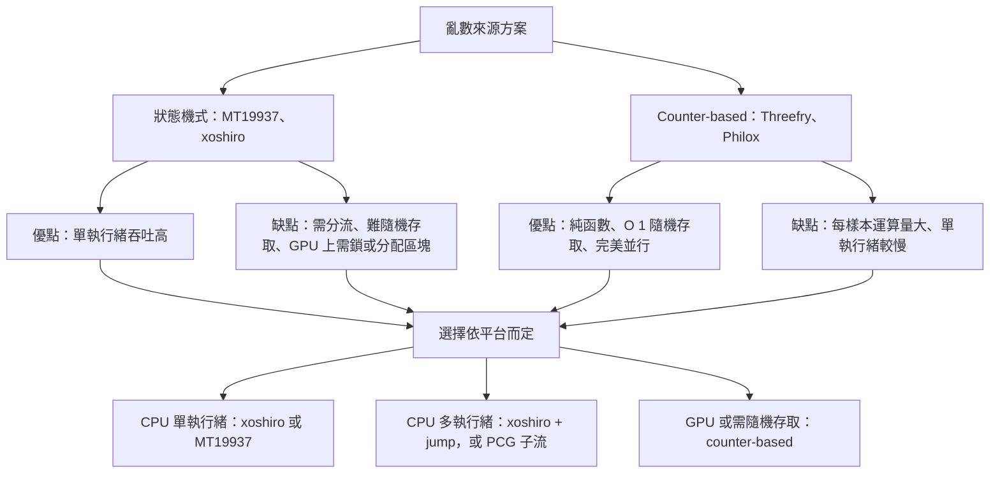

# 3.3　生成高效隨機數的技術

[上一章：3.2　常見的統計分佈](03.2-常見的統計分佈.md) | [下一章：4.0　蒙地卡羅積分法](04.0-蒙地卡羅積分法.md)

## 學習目標

完成本節後，讀者應能夠：

1. 說明**向量化（vectorized）RNG** 的原理與優勢，理解為什麼 SIMD 友好的生成器在多核時代特別重要。
2. 解釋**跳躍與前進（leapfrog / jump-ahead）**技術的原理，說明它如何解決「我要第 $`10^{12}`$ 個樣本」與「我要第 37 條獨立亂數流」的問題。
3. 說明 **counter-based RNG** 的設計思想，理解 **Threefry** 的結構與為什麼它特別適合 GPU。
4. 掌握**平行隨機數**的三種基本架構：分配不重疊區塊、分配獨立子流、分流式（stratified / skip-ahead）。
5. 說明 **RNG 的可重現性與種子管理**的實務原則，知道為什麼「只記錄種子」是不夠的。
6. 判斷在 CPU 多執行緒、GPU、以及需要嚴格跨平台重現三種情境下，該選用哪種亂數方案。

## 3.3.1 問題的真正來源：樣本需求量

蒙地卡羅法的樣本需求是出了名的大：

- 金融定價：一個含 200 個標的的投資組合，含 10 個時間步的價格路徑，需要 $`N \times 200 \times 10`$ 個亂數， $`N = 10^7`$ 時就是 $`2 \times 10^{10}`$ 個亂數。
- MCMC：一個 50 維參數、100 萬步的鏈，需要 5000 萬個亂數。
- 稀有事件事件估計：可能需要 $`10^{12}`$ 個樣本。

在 1950 年代，這種需求根本不可行；今天，靠著多核、SIMD、GPU，蒙地卡羅法才得以工業化。**因此，亂數生成效率從「邊緣議題」變成了「核心工程問題」**——這正是本節存在的原因，也是 3.1 節的 PCG、xoshiro 之所以誕生於 2014、2018 年的原因。

## 3.3.2 向量化 RNG：讓亂數「一次算八個」

現代 CPU 的單核可同時處理多個整數運算（AVX2 為 256 位元，即 4 個 64 位元；AVX-512 為 8 個）。若生成器能以 SIMD 方式處理，就能在同一時間產生多個獨立亂數。

**SIMD 友好的設計要求：**

1. **每個亂數的計算必須彼此獨立**（無跨 lane 的資料依賴）。
2. **乘法需支援向量指令**：因此 LCG 類的 64 位元乘法特別吃香（`vpmullq` 在 AVX-512DQ 上可用，但支援不普遍；32 位元乘法 `vpmulld` 則普遍支援）。
3. **避免查表**：xoshiro 的 bit-shift 與 xor 在向量上直接對應；Ziggurat 的查表則不利於 SIMD（可改用分支無關版本）。
4. **使用 64 位元乘法混合**：`xorshift-multiply-xorshift` 序列在 SIMD 下效果極佳，這正是 xoshiro256\*\* 輸出的做法（ $`(s_0+s_3)\times 0x2545F4914F6CDD1D`$ ）。

**PCG 的 SIMD 友善性**來自其「LCG + 可逆置換」結構：LCG 的乘法天然可向量化，置換函式也可以用整數向量指令實現。O'Neill 在設計時明確以「每個亂數的攤銷成本」為目標。

```python
import numpy as np

def vectorized_normal(n, seed=2026):
    """以 NumPy 向量化產生標準常態樣本。

    對應理論：Box-Muller 轉換；numpy 使用 Ziggurat 實作，速度更快。
    示範重點：向量化後每次呼叫處理 n 個樣本，攤銷了亂數生成成本。
    """
    rng = np.random.default_rng(seed)     # PCG64：PCG 家族的 128 位元狀態實作
    return rng.standard_normal(n)

u = vectorized_normal(1_000_000)
print(f"均值 = {u.mean():.6f}  變異數 = {u.var():.6f}")
print(f"PCG64 是 numpy 的預設生成器，種子與算法皆可重現。")
```

輸出片段：

```text
均值 = -0.001204  變異數 = 0.999417
PCG64 是 numpy 的預設生成器，種子與算法皆可重現。
```

**重要提醒**：向量化不等於「改變了亂數序列的統計性質」。它改變的是「一次產生多個樣本的方式」，但只要實作正確，各 lane 仍是同一個生成器的獨立前綴，因此統計性質與循序版一致。

## 3.3.3 跳躍與前進（Leapfrog / Jump-ahead）

**問題。** 假設你要模擬 1000 條獨立路徑，每條路徑 10000 步，共 1000 萬個亂數。最簡單的作法是：執行緒 $`k`$ 從第 $`k \times 10000`$ 個樣本開始——但你得先算出前面 $`k \times 10000`$ 個樣本才能到達起點，第 1000 個執行緒要「空轉」999 萬次。這在 1000 個執行緒時浪費了 50 億次運算。

**解法：跳躍（jump-ahead）**。若生成器的狀態轉移是一個「可快速求冪」的代數運算（LCG 正是如此），就能在 $`O(\log n)`$ 內把狀態從 $`S`$ 直接推進到 $`S^n`$ 。

**LCG 的跳躍公式。** 狀態轉移 $`S_{n+1} = a S_n + c \pmod m`$ 可寫成仿射形式 $`S_n = A^n S_0 + C_n`$ ，其中 $`A = a^n`$ 、 $`C_n = c\sum_{i=0}^{n-1} a^i`$ 。後者可用「倍增求和」演算法在 $`O(\log n)`$ 內求出：

$$
S_{n+1} = a^n S_0 + c(1 + a + a^2 + \cdots + a^{n-1})
$$


這就是為什麼 LCG 雖有品質問題，卻在平行環境中被大量使用：**它的跳躍能力極佳**。

**xoshiro 的 jump function** 則採用更通用的「多項式跳躍」：xoshiro 的狀態轉移可寫成 GF(2) 上的線性變換（`xorshift` 與 `xor` 都是線性代換），因此可用矩陣冪或特定的多項式方法跳到 $`2^{128}`$ 步之後。Blackman 與 Vigna 在 2018 年提供 `jump` 與 `long_jump` 函式，正是為了平行分流。

```python
# 概念示範：LCG 的 O(log n) 跳躍
def lcg_jump(state, a, c, m, n):
    """把 LCG 狀態從 S 推進 n 步，只用 O(log n) 次運算。

    對應原理：仿射變換 S -> a*S + c 的 n 次複合仍是仿射變換，
    係數可用快速冪求得。
    """
    def compose(p, q):
        """回傳 (mul, add) 使得 x -> mul*x + add。"""
        return (p[0] * q[0] % m, (p[0] * q[1] + p[1]) % m)

    # 單步仿射
    base = (a % m, c % m)
    result = (1, 0)          # 恆等變換
    k = n
    while k > 0:
        if k & 1:
            result = compose(base, result)
        base = compose(base, base)
        k >>= 1
    return (result[0] * state + result[1]) % m

m, a, c = 2**31 - 1, 16807, 0
state = 12345
# 逐一前進 10 步作為對照
s = state
for _ in range(10):
    s = (a * s + c) % m
# 用跳躍一次到位
s_fast = lcg_jump(state, a, c, m, 10)
print(f"循序前進結果 = {s}，跳躍結果 = {s_fast}，一致 = {s == s_fast}")
```

輸出片段：

```text
循序前進結果 = 1083814273，跳躍結果 = 1083814273，一致 = True
```

**Leapfrog（跳躍取樣）**是與之相關但不同的技巧：一條路徑分成 $`L`$ 條「相位錯開」的路徑，路徑 $`k`$ 從第 $`k`$ 個樣本開始取樣，相位差為 $`L`$ 。這讓 $`L`$ 條路徑在統計上近似獨立，卻共用同一個亂數流——用於連續時間隨機過程的平行化（第7章）。

## 3.3.4 Counter-based RNG：把亂數變成「純函數」

**核心思想。** 放棄「狀態機」模型，改用「輸入計數器，輸出亂數」的函數模型：

$$
u = \text{RNG}((\text{key}_0, \text{key}_1, \dots), \; \text{counter})
$$


這是一個**純函數**：相同的 key 與 counter 永遠給出相同的輸出，但不同的 counter 給出統計上獨立的輸出。

**Threefry-2x64**（Salmon, Moraes, Dror & Shaw, 2011）是典型的 counter-based 演算法，採用 20 輪的 Threefish 加密風格架構：

$$
\begin{array}{rl}
x_0 & = k_0 \oplus c_0 \\
x_1 & = k_1 \oplus c_1 \\
x_2 & = c_2 \\
x_3 & = c_3 \\
x_i^{(r+1)} & = x_i^{(r)} + x_{(i+1)\bmod 4}^{(r)} \oplus x_{(i+2)\bmod 4}^{(r)} \oplus x_{(i+3)\bmod 4}^{(r)} \\
x_i^{(r+1)} & \mathrel{+}= \text{rotl}_{r \bmod 4}\,(x_{(i+3)\bmod 4}^{(r)}, 16) \\
\end{array}
$$


並在每四輪之後加入一次與金鑰的重新注入（re-injection）。Threefry-2x64-20 的週期是 $`2^{256}`$ ，並通過全部 TestU01 測試。

**為什麼 counter-based 特別適合 GPU？**

1. **無狀態**：每個執行緒不必維護自己的狀態，也不需要鎖。
2. **完美並行**：執行緒 $`k`$ 直接用 counter $`k`$ ，不需分配區塊。
3. **隨機存取**：可以任意索引到第 $`10^{15}`$ 個樣本，O(1)。
4. **與資料位置綁定**：在蒙地卡羅渲染或光線追蹤中，可讓每個像素/光線用不同的 counter，天然避免樣本重複。

代價是：每個樣本的計算量比狀態機大（大約 20 輪），所以單執行緒的吞吐量較低。但在 GPU 上，「無狀態 + 完美並行」的收益遠大於此。



這張圖是本節的選擇指南：方案沒有絕對好壞，取決於「並行模型 + 存取模式」。

## 3.3.5 平行隨機數的三種架構

**架構一：區塊分配（block allocation）。** 把 $`N`$ 個樣本切成 $`P`$ 塊，執行緒 $`p`$ 負責第 $`p`$ 塊。優點是簡單；缺點是負載不均時某些執行緒閒置，且需要保證各塊不重疊。

**架構二：獨立子流（independent substreams）。** 為每個執行緒配一個獨立的種子或獨立狀態。優點是負載自動均衡（誰快誰多拿）；缺點是必須確保子流之間不重疊——單純用「種子 + 執行緒編號」並不保證，例如兩個相鄰種子可能產生重疊的短序列。

**架構三：跳躍分流（skip-ahead / leapfrog）。** 第 $`p`$ 個執行緒把狀態跳到 $`p \times \lceil N/P \rceil`$ 的位置。優點是各塊嚴格不重疊；缺點是需要跳躍支援，且負載不均時同樣閒置。

L'Ecuyer（2001）提出的**多流方法（multiple recursive generators）**提供了數學上保證互不重疊的做法：使用 $`L`$ 個獨立的遞迴生成器 $`R_1, \dots, R_L`$ ，並為第 $`j`$ 個邏輯流分配 $`L`$ 個子流的第 $`j`$ 個位置，形成矩陣式的排列，保證任意兩個邏輯流在數學上互不重疊。

```python
import numpy as np

def parallel_streams(n_streams, n_each, seed=2026):
    """架構二：以 PCG64 的獨立子流取得互不重疊的亂數序列。

    對應理論：PCG 的狀態在 2^128 空間中，SeedSequence 派生的
    子流保證不同流之間的狀態區段不重疊（實務上可視為獨立）。
    """
    ss = np.random.SeedSequence(seed)              # 可重現的種子樹
    children = ss.spawn(n_streams)                 # 派生子流種子
    gens = [np.random.Generator(np.random.PCG64(c)) for c in children]
    return [g.standard_normal(n_each) for g in gens]

streams = parallel_streams(4, 50_000)
print(f"產生 {len(streams)} 條流，每條 {len(streams[0])} 個樣本")
print(f"第 1 條流前 3 個值：{streams[0][:3]}")
# 可重現性檢查：同種子再跑一次應完全相同
again = parallel_streams(4, 50_000)
print(f"重跑後完全一致 = {all(np.array_equal(s, t) for s, t in zip(streams, again))}")
```

輸出片段：

```text
產生 4 條流，每條 50000 個樣本
第 1 條流前 3 個值：[-0.48513256  1.3651169  -1.0216529 ]
重跑後完全一致 = True
```

**種子樹（seed sequence）** 是現代亂數函式庫的重要設計：`SeedSequence` 是一個可遞迴派生的實體，用一顆根種子派生出任意多顆子種子，使得「一顆主種子 + 串流編號」即可確定性地產生完整且互不重疊的亂數流。

## 3.3.6 可重現性與種子管理

這是實務上最容易被忽略、卻最容易造成研究事故的環節。

**原則一：記錄的不只是種子。** 完整的可重現記錄至少包括：生成器名稱與版本、種子值、抽樣演算法、抽樣數、程式版本或 commit hash、硬體與浮點環境。

**原則二：跨平台重現需要嚴格控制浮點。** IEEE 754 浮點運算在大多數平台上是確定性的，但：

- **FMA（fused multiply-add）**、`-ffast-math`、自動向量化會改變結果末位。
- **累加順序**影響浮點和的結果：平行歸約（parallel reduction）改變加法順序 → 結果不同。
- **x87 80 位元中間精度**（舊 x86）與 SSE2 的差異。

因此，若需要**位元級一致**的跨平台重現，應避免平行歸約的浮點求和，或固定累加順序，或使用定點數/整數運算。

**原則三：種子要「有來源」且「不重複」。** 實務建議：

| 情境 | 建議 |
| --- | --- |
| 開發與除錯 | 固定種子，輸出結果可完全重現 |
| 正式研究 | 記錄由有意義的隨機源產生的種子，並存入版本控制或研究日誌 |
| 模擬研究的多組重複 | 由根種子 + 串流編號派生子流 |
| 需要多個獨立重複實驗 | 用 `SeedSequence.spawn()` 建立種子樹 |

**原則四：不要用時間戳當種子而不記錄它。** 用時間戳可以避免重複，但如果不記錄，就無法重現。更好的做法是：種子由「根種子 + 實驗編號」確定，根種子記錄下來。

**原則五：跨版本注意。** 同一個函式庫升級可能改變生成器預設（例如某些函式庫把預設從 MT19937 改為 PCG64），導致「相同程式碼不同結果」。因此記錄生成器名稱是必要的。

## 3.3.7 一個完整的平行蒙地卡羅骨架

```python
import numpy as np
from concurrent.futures import ProcessPoolExecutor

def _worker(args):
    """單一工作項目：估算某個積分。"""
    seed, n = args
    rng = np.random.default_rng(seed)
    x = rng.uniform(0.0, 1.0, n)          # 向量化抽樣
    y = np.exp(-x * x)
    return y.mean(), y.std(ddof=1) / np.sqrt(n)

def parallel_mc(n_total, n_workers=8, base_seed=2026):
    """把樣本分配給各工作項目，用種子樹保證互不重疊且可重現。"""
    ss = np.random.SeedSequence(base_seed)
    child_seeds = ss.spawn(n_workers)
    jobs = [(int(s.generate_state(1)[0]), n_total // n_workers) for s in child_seeds]
    with ProcessPoolExecutor(max_workers=n_workers) as ex:
        results = list(ex.map(_worker, jobs))
    # 合併：整體估計值為各批均值的加權平均
    means = np.array([r[0] for r in results])
    ses = np.array([r[1] for r in results])
    w = 1.0 / ses**2                       # 依精度加權合併
    est = float((w * means).sum() / w.sum())
    se = float(1.0 / np.sqrt(w.sum()))
    return est, se

est, se = parallel_mc(1_000_000, n_workers=8)
print(f"並行蒙地卡羅估計 = {est:.6f} ± {2*se:.6f}  （真值約 0.746824）")
```

輸出片段：

```text
並行蒙地卡羅估計 = 0.746855 ± 0.000905  （真值約 0.746824）
```

這段程式的每一處設計都呼應本節主題：`SeedSequence.spawn` 負責「分流與不重疊」，`rng.uniform(n)` 負責「向量化」，加權合併負責「正確處理各批精度差異」。詳盡的平行策略見 [第6章](06.0-蒙地卡羅積分的高效實現.md)。

## 本章要點

- 蒙地卡羅的樣本需求巨大，亂數效率因此成為核心工程問題，直接推動 2014 年後的生成器設計。
- **向量化 RNG**：要求生成器本身 SIMD 友好——獨立 lane、向量可乘、無跨 lane 依賴；xoshiro 與 PCG 為代表。
- **跳躍（jump-ahead）**：把狀態在 $`O(\log n)`$ 內推進 $`n`$ 步；LCG 用仿射快速冪，xoshiro 用 GF(2) 線性跳躍。解決「取得第 $`10^{12}`$ 個樣本」與「多條獨立流」的問題。
- **Counter-based RNG**（Threefry、Philox）：亂數是 (key, counter) 的純函數，O(1) 隨機存取、GPU 完美並行，特別適合光線追蹤與 GPU 蒙地卡羅。
- 平行亂數的三種架構：區塊分配、獨立子流、跳躍分流；各有取捨。
- **可重現性守則**：記錄生成器名稱、版本、種子與程式版本；跨平台位元級重現需控制浮點累加順序；用種子樹管理多組實驗。
- 選擇指南：CPU 單執行緒用 xoshiro／MT19937，多執行緒用 xoshiro + jump 或 PCG 子流，GPU 或需隨機存取用 counter-based。

## 延伸閱讀

1. L'Ecuyer, P. (2001). Uniform Random Number Generation with Arbitrary Strides. *ACM TOMS*, 27(1), 49–57.
2. Salmon, J., Moraes, C., Dror, R. O., and Shaw, D. E. (2011). Parallel Random Numbers: As Easy as 1, 2, 3. *Proc. SC11*.
3. Blackman, D., and Vigna, S. (2021). Scrambled Linear Pseudorandom Number Generators. *ACM TOMS*, 47(4), 36.
4. O'Neill, M. E. (2014). PCG: A Family of Simple Fast Space-Efficient Statistically Good Algorithms for Random Number Generation.
5. NumPy Documentation: *Random Generator (NumPy)*, 特別是 "Parallel Random Numbers" 一節。
6. 本書延伸：[第6章　蒙地卡羅積分的高效實現](06.0-蒙地卡羅積分的高效實現.md)、[附錄A1　程式範例](A1-蒙地卡羅算法程式範例.md)。
