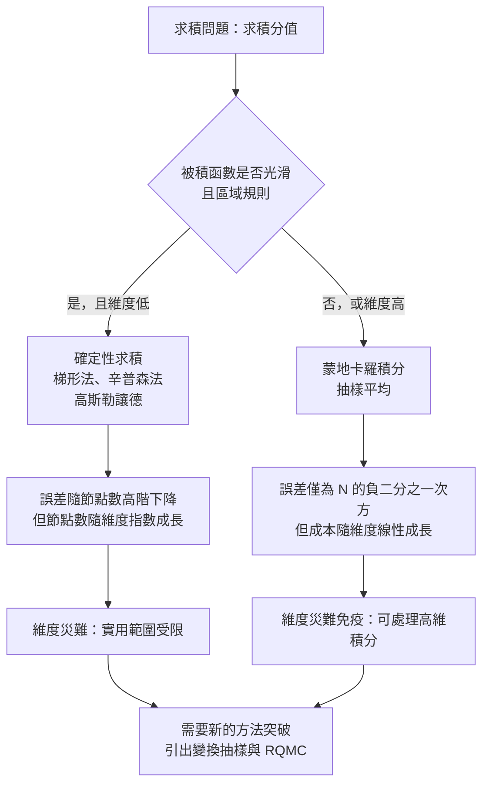

# 第4章　蒙地卡羅積分法

[上一章：第3章　隨機數生成與統計分佈](03.0-隨機數生成與統計分佈.md) | [下一章：第5章　變換抽樣法](05.0-變換抽樣法.md)

蒙地卡羅積分法（Monte Carlo integration）是整本書的理論核心。前三章鋪陳了隨機數生成器與統計分佈的技術基礎，本章要回答一個更根本的問題：**當我們面對一個「算出數值」的問題時，什麼時候、為什麼應該改用「抽樣」來解？**

## 學習目標

完成本章後，你應該能夠：

1. 說明為什麼把「求值問題」轉換成「抽樣問題」能夠繞過高維度瓶頸。
2. 理解蒙地卡羅積分與傳統確定性數值積分（梯形法、辛普森法、高斯－勒讓德）在本質上的差異。
3. 掌握估計量 $`\hat{\mu}_N`$ 的無偏性、中心極限定理誤差 $`O(N^{-1/2})`$ 與標準誤的估計方式。
4. 理解維度災難（curse of dimensionality）如何決定方法的適用邊界。
5. 辨認何時應該使用蒙地卡羅積分，何時應該改用其他方法。
6. 為後續的變換抽樣（第5章）、並行與 GPU 加速（第6章）建立概念上的接點。

## 4.1 一個轉換：從「求值」到「抽樣」

考慮一個積分問題：


$$
I = \int_{\Omega} f(x)\,dx
$$


其中 $`\Omega`$ 是一個有界區域， $`f`$ 是可積函數。若我們知道一個機率密度函數 $`p(x)`$ ，且 $`\int_{\Omega} p(x)\,dx = 1`$ ，那麼由期望的定義立刻得到


$$
I = \int_{\Omega} f(x) p(x) \frac{1}{p(x)}\,dx = \mathbb{E}\!\left[\frac{f(X)}{p(X)}\right]
$$


這是一個關鍵的等式。它的直覺意義是：**任何確定性的積分，都可以被改寫成某個隨機變數的期望**。於是「算積分」變成「做抽樣並取平均」。

最簡單的情形是均勻分佈 $`p(x) = 1/|\Omega|`$ ，此時


$$
I = |\Omega| \cdot \mathbb{E}[f(X)], \qquad X \sim \mathrm{Uniform}(\Omega)
$$


也就是：抽 $`N`$ 個點，算它們的函數值平均，再乘上區域體積。這正是「撞擊法」（hit-or-miss）的想法，也是第2章所介紹的蒙地卡羅模擬最直接的數值用途。

這個轉換的價值不在於數學上更優雅，而在於**計算複雜度的結構徹底改變了**。傳統數值積分是「把區域切成格子、逐格累加」，成本隨維度呈指數成長；蒙地卡羅積分是「抽 N 個點、求 N 個函數值、平均」，成本隨維度**線性**成長。這是本章所有後續內容的驅動力。

## 4.2 為什麼傳統數值積分會在高維失效

要理解蒙地卡羅的價值，必須先看它要解決的對手。

**一維或低維時**，確定性方法非常出色。梯形法用 $`n`$ 個節點可達 $`O(h^2)`$ 的截斷誤差；辛普森法（複合辛普森）達 $`O(h^4)`$ ；高斯－勒讓德（Gauss–Legendre）求積用 $`n`$ 個節點對多項式達到 $`2n-1`$ 階精確，若被積函數光滑則誤差以「超越指數」的速度下降。

**但在多維時**，這一切都崩潰了。取 $`d`$ 維超立方體 $`[0,1]^d`$ ，用 $`n`$ 個節點的**乘積型（tensor-product）求積規則**，需要 $`n^d`$ 個函數值。節點數必須是維度的 $`d`$ 次方：

| 維度 $`d`$ | 1 | 2 | 3 | 6 | 10 | 20 | 100 |
| --- | --- | --- | --- | --- | --- | --- | --- |
| 每維節點數 $`n`$ | 10 | 10 | 10 | 10 | 10 | 10 | 10 |
| 總節點數 $`n^d`$ | 10 | 100 | 1,000 | 10⁶ | 10¹⁰ | 10²⁰ | 10¹⁰⁰ |

這是**維度災難（curse of dimensionality）**的第一個面貌：維度增加，計算量指數爆炸。

即使採用稀疏格點（sparse grid）把 $`n^d`$ 降到多項式級別，仍有第二個問題：稀疏格點需要被積函數具備「各方向光滑度均勻且可分離」的假設。一旦積分區域形狀不規則、或被積函數有奇點、層狀結構（常見於物理與金融模型），稀疏格點的效率會大幅衰退。

而蒙地卡羅方法——哪怕是最樸素的均勻抽樣——其誤差只隨 $`N`$ 的平方根下降，與維度 $`d`$ **完全無關**：


$$
\text{誤差} \sim \sigma \cdot N^{-1/2}
$$


也就是說，蒙地卡羅用「精度較差但維度無關」的估計，換取了「成本隨維度線性」的優雅。在 $`d \ge 5`$ 左右，這筆交易開始划算； $`d \ge 20`$ 時，傳統方法在實用上已經不可能。



上圖呈現本章的核心論點：蒙地卡羅積分不是「確定性方法的劣化版」，而是**針對高維問題的替代解法**。它把精度從高階收斂降為平方根收斂，卻換來維度上的可處理性。圖中的最後一個節點也標示了本章的下一個驅動：即使平方根收斂，在需要十進位甚至更多有效位數時樣本數仍然龐大，這就引出了第5章的變換抽樣（用更好的抽樣分佈壓低方差）與第6章的硬體加速（用更多硬體換取更多樣本）。

## 4.3 誤差：隨機方法的統計學代價

蒙地卡羅積分不是「精確求值」，而是「帶隨機誤估計的求值」。因此它必須回答統計學問題。

令 $`X_1, X_2, \dots, X_N`$ 為獨立同分布（i.i.d.）且 $`X_i \sim p`$ 的抽樣，則估計量


$$
\hat{\mu}_N = \frac{1}{N}\sum_{i=1}^{N} f(X_i)
$$


**無偏性**： $`\mathbb{E}[\hat{\mu}_N] = \mathbb{E}[f(X)] = I`$ 。也就是不論抽多少點，估計的平均值都對準真值——這是蒙地卡羅積分最迷人的性質：沒有系統偏差，只有隨機抖動。

**誤差量級**：由中心極限定理（central limit theorem），當 $`N`$ 夠大時


$$
\frac{\sqrt{N}\,(\hat{\mu}_N - I)}{\sigma} \;\Rightarrow\; \mathcal{N}(0,1), \qquad \sigma^2 = \mathrm{Var}[f(X)]
$$


因此 $`\hat{\mu}_N`$ 的標準誤為 $`\sigma/\sqrt{N}`$ ，誤差以 $`O(N^{-1/2})`$ 收斂。要把誤差從 $`10^{-1}`$ 降到 $`10^{-3}`$ ，樣本數要乘上 $`100`$ ；要降到 $`10^{-6}`$ ，要乘上 $`10^{6}`$ 。這是平方根收斂的殘酷處，也是後續章節不斷追問的問題。

**置信區間**：由 CLT 與正態分位數 $`z_{1-\alpha/2}`$ ，我們可寫出


$$
I \in \left[ \hat{\mu}_N - z_{1-\alpha/2}\frac{\hat{\sigma}}{\sqrt{N}},\; \hat{\mu}_N + z_{1-\alpha/2}\frac{\hat{\sigma}}{\sqrt{N}} \right]
$$


以樣本標準差 $`\hat{\sigma}`$ 代替 $`\sigma`$ ，在 $`N`$ 較大時近似為 $`95\%`$ 置信區間。

```python
import numpy as np

def mc_integrate(f, dim, n, rng=None):
    """一維與多維皆可：以均勻分佈抽樣做蒙地卡羅積分。
    對應理論：E[f(X)] = 積分值，標準誤為 sigma/sqrt(N)。"""
    rng = rng or np.random.default_rng()
    x = rng.random((n, dim))          # 每列為一個樣本點，落在 [0,1]^dim
    vals = f(x)                        # 函數向量化求值
    mu = vals.mean()                   # 估計量：無偏
    se = vals.std(ddof=1) / np.sqrt(n) # 標準誤估計：sigma/sqrt(N)
    return mu, se

# 範例：估計 pi（半徑 1 四分之一圓面積，即 pi/4）
rng = np.random.default_rng(2026)
x = rng.random((1_000_000, 2))
hit = (x[:,0]**2 + x[:,1]**2 <= 1.0)
pi_hat = 4.0 * hit.mean()
se = 4.0 * np.sqrt(hit.var(ddof=1) / len(hit))
print(f"pi ≈ {pi_hat:.5f} ± {1.96*se:.5f}")   # pi ≈ 3.14159 ± 0.00138
```

這段程式碼對應 CLT 導出的標準誤公式： $`95\%`$ 置信區間的半寬為 $`1.96\,SE`$ 。注意 $`N = 10^6`$ 時誤差仍在 $`10^{-3}`$ 量級——平方根收斂的實感。

## 4.4 本章在全书脉络中的位置

從全書視角看，各章之間存在一條清晰的因果鏈：

- **第2、3章**提供了「如何產生可用的隨機數」這個前提。若隨機數品質不佳，蒙地卡羅估計會出現隱性的系統偏差，所有後續理論都失效。
- **第4章（本章）**建立蒙地卡羅積分的核心定理與誤差尺度，並指出其兩大痛點：**平方根收斂太慢**、**高維下確定性方法不可行**。
- **第5章**針對第一個痛點，用變換抽樣（importance sampling）在**不增加樣本數**的前提下壓低方差 $`\sigma^2`$ 。
- **第6章**針對第二個痛點與工程現實，用並行、GPU、分散式把 $`N`$ 推上去，並讓平方根收斂的每一分努力都更便宜。
- **第11章**再系統地回頭處理誤差來源與精度提升。

因此第4章的定位是：**理論地基與問題定義**。它不追求立刻給出最強的估計器，而是先誠實地說明「隨機方法的數學代價是什麼」，後面的章節才逐一償還這筆代價。

## 本章要點

- 蒙地卡羅積分的本質是恆等式 $`I = \mathbb{E}[f(X)/p(X)]`$ ，把「求值」轉成「抽樣」。
- 確定性數值積分（梯形、辛普森、高斯－勒讓德）在低維光滑問題上精度極高，但乘積型求積的節點數為 $`n^d`$ ，高維時遭遇維度災難。
- 蒙地卡羅估計量 $`\hat{\mu}_N`$ 無偏，其誤差以 $`O(N^{-1/2})`$ 收斂，與積分維度無關。
- 平方根收斂是蒙地卡羅的根本瓶頸：精度每提升一位數字，樣本數要乘上 $`100`$ 。
- 這兩大痛點分別由後續的變換抽樣（第5章）與硬體加速（第6章）回應。

## 延伸閱讀

- Monte Carlo Methods in Statistical Physics, 第2章（Krauth & Krauth, Springer, 1998）——以物理直覺說明蒙地卡羅積分。
- Numerical Recipes, 第7章（Press et al., Cambridge University Press, 3rd ed., 2007）——數值積分的實務對照。
- Owen, A. (2013). *Monte Carlo Theory, Methods, and Examples*. Wiley.——ESS、方差診斷與重要性抽樣的權威參考。
- [第4.1節：基本積分方法介紹](04.1-基本積分方法介紹.md)、[第4.2節：多維積分的蒙地卡羅方法](04.2-多維積分的蒙地卡羅方法.md)、[第4.3節：誤差分析與精度提升](04.3-誤差分析與精度提升.md)
