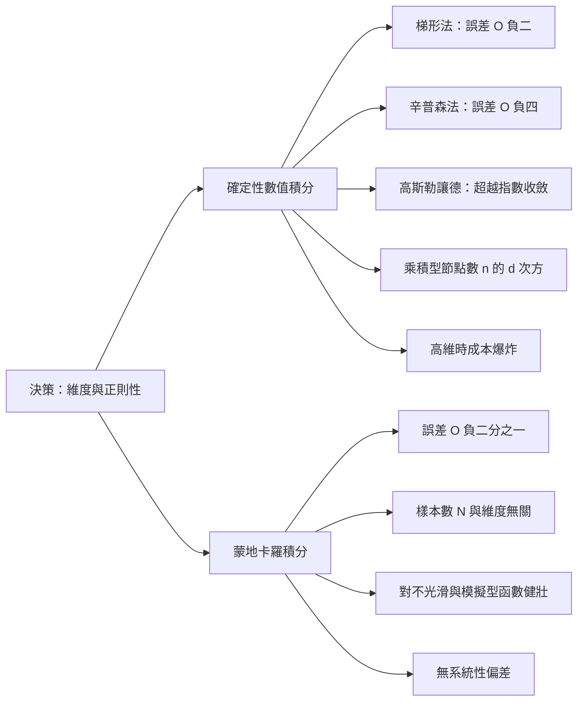

## 4.1 基本積分方法介紹

[上一章：第4章　蒙地卡羅積分法](04.0-蒙地卡羅積分法.md) | [下一章：4.2　多維積分的蒙地卡羅方法](04.2-多維積分的蒙地卡羅方法.md)

本節把「蒙地卡羅積分」從直覺推導成嚴格的定理，並把它放回確定性數值積分的座標系裡比較：它們各自的誤差長什麼樣樣、各自的成本長什麼樣樣、在什麼條件下該選哪一個。

## 學習目標

完成本節後，你應該能夠：

1. 推導並說明恆等式 $`I = \mathbb{E}[f(X)]`$ （一般化形式為 $`I = \mathbb{E}[f(X)/p(X)]`$ ）的成立條件。
2. 證明蒙地卡羅估計量的**無偏性**並說明「無偏」在實務上的意義與陷阱。
3. 運用中心極限定理給出誤差的 $`O(N^{-1/2})`$ 量級、標準誤公式與置信區間。
4. 說明確定性求積（梯形法、辛普森法、高斯－勒讓德）的誤差行為，並解釋它們為何在高維失效。
5. 說出蒙地卡羅與確定性方法各自的「何時該用」的判準。

## 4.1.1 基本恆等式

設 $`\Omega \subseteq \mathbb{R}^d`$ 為積分區域， $`f`$ 為其上的可積函數。取任意密度函數 $`p`$ 滿足 $`\int_{\Omega} p(x)\,dx = 1`$ 且 $`p(x) > 0`$ ，則


$$
\int_{\Omega} f(x)\,dx
= \int_{\Omega} f(x)\,p(x)\,\frac{dx}{p(x)}
= \mathbb{E}\!\left[\frac{f(X)}{p(X)}\right], \qquad X \sim p
$$


這是**重要性抽樣公式的原型**（第5章會回到它）。均勻分佈是其中最簡單的特例：


$$
\int_{\Omega} f(x)\,dx = |\Omega|\cdot \mathbb{E}[f(X)], \qquad X \sim \mathrm{Uniform}(\Omega)
$$


直覺：把「對整個連續空間加權求和」換成「隨機取樣再取期望」。在有限維度上，這兩件事是同一個 Lebesgue 積分的兩種表述。

## 4.1.2 估計量與無偏性

抽出 i.i.d. 樣本 $`X_1, \dots, X_N`$ ，定義


$$
\hat{\mu}_N = \frac{1}{N}\sum_{i=1}^{N} f(X_i)
$$


**定理（無偏性）**： $`\mathbb{E}[\hat{\mu}_N] = \mathbb{E}[f(X)] = I`$ 。

*證明*：由期望的線性性，


$$
\mathbb{E}[\hat{\mu}_N] = \frac{1}{N}\sum_{i=1}^{N}\mathbb{E}[f(X_i)] = \frac{1}{N}\cdot N\cdot I = I
$$


這個結論的重要性在於：**誤差完全是雙向的隨機抖動，不存在系統性偏移**。相較之下，梯形法的截斷誤差永遠是單向的（過估或低估），一旦誤差量級估錯，整個結果就錯了。

無偏性同時意味著「多抽樣不會讓答案越來越錯」。這在實務上是極大的心理負擔解除：跑十萬次樣本不會得到一個比一萬次更離譜的答案。

但必須注意無偏性的**前提**：樣本必須真的是從 $`p`$ 抽出的、獨立的。若隨機數生成器品質不佳、或樣本之間存在相關（例如共用同一串亂數），無偏性就會被破壞——這正是[第3章](03.0-隨機數生成與統計分佈.md)存在的原因。

## 4.1.3 中心極限定理與誤差尺度

設 $`\sigma^2 = \mathrm{Var}[f(X)] = \mathbb{E}[f(X)^2] - I^2`$ 。若 $`\sigma > 0`$ 且 $`f(X)`$ 具有有限方差，則中心極限定理給出


$$
\frac{\sqrt{N}\,(\hat{\mu}_N - I)}{\sigma} \;\Rightarrow\; \mathcal{N}(0,1) \quad (N \to \infty)
$$


因此 $`\hat{\mu}_N`$ 近似為 $`\mathcal{N}(I, \sigma^2/N)`$ ，標準誤為


$$
\mathrm{SE}(\hat{\mu}_N) = \frac{\sigma}{\sqrt{N}}
$$


**誤差量級 $`O(N^{-1/2})`$ ** 是蒙地卡羅積分的簽章。把它與確定性方法對照：

| 方法 | 節點／樣本數 | 誤差量級 | 誤差對維度的依賴 |
| --- | --- | --- | --- |
| 複合梯形法（1D） | $`n`$ | $`O(n^{-2})`$ | 乘積型為 $`O(n^{-2d})`$ |
| 複合辛普森法（1D） | $`n`$ | $`O(n^{-4})`$ | 乘積型為 $`O(n^{-4d})`$ |
| 高斯－勒讓德（1D） | $`n`$ | $`O(n^{-2})`$ ～超越指數 | 乘積型仍為 $`n^d`$ 節點 |
| 蒙地卡羅 | $`N`$ | $`O(N^{-1/2})`$ | **無關** |

關鍵量是「每單位計算量所換到的精度」。梯形法要讓誤差從 $`10^{-1}`$ 到 $`10^{-3}`$ ，節點數乘上 $`100`$ （1D）；蒙地卡羅要同樣的進步，樣本數要乘上 $`100^2 = 10^4`$ 。也就是說**在低維上，蒙地卡羅是明顯落後的**。但把維度拉進來：

- $`d = 1`$ ： $`100`$ 節點 vs $`10^4`$ 樣本 → 確定性勝。
- $`d = 2`$ ： $`10^4`$ 節點 vs $`10^4`$ 樣本 → 打平。
- $`d = 4`$ ： $`10^8`$ 節點 vs $`10^4`$ 樣本 → 蒙地卡羅大勝。
- $`d = 10`$ ： $`10^{20}`$ 節點 → 確定性方法不可能執行。

這個對比正是「維度災經」在**成本面**的表現；而[4.2 節](04.2-多維積分的蒙地卡羅方法.md)會處理它在**精度面**的表現。

## 4.1.4 置信區間

由 CLT，若採用樣本標準差 $`\hat{\sigma} = \sqrt{\frac{1}{N-1}\sum_i (f(X_i) - \hat{\mu}_N)^2}`$ 估計 $`\sigma`$ ，則近似 $`1-\alpha`$ 置信區間為


$$
\hat{\mu}_N \pm z_{1-\alpha/2}\,\frac{\hat{\sigma}}{\sqrt{N}}
$$


其中 $`z_{1-\alpha/2}`$ 為標準常態分位數（ $`95\%`$ 時為 $`1.96`$ ， $`99\%`$ 時為 $`2.576`$ ）。

實務上還有兩個注意事項：

1. **小樣本時用 t 分佈**。當 $`N`$ 較小（ $`N \lesssim 30`$ ）且 $`\sigma`$ 未知，應改用 Student t 分佈的位數。
2. **置信區間不等於「真值有 $`\alpha`$ 機率落在其中」**。正確的頻率學解讀是：若重複整個抽樣程序 $`100`$ 次，約有 $`95`$ 次的區間會覆蓋真值。

```python
import numpy as np
from scipy import stats

def mc_integrate_with_ci(f, dim=1, n=200_000, alpha=0.05, rng=None):
    """蒙地卡羅積分與 (1-alpha) 置信區間。
    對應 4.1.3 的標準誤公式與 4.1.4 的正態分位數。"""
    rng = rng or np.random.default_rng()
    x = rng.random((n, dim))
    v = f(x)
    mu = v.mean()                      # 無偏估計量
    se = v.std(ddof=1) / np.sqrt(n)     # 標準誤估計
    z = stats.norm.ppf(1 - alpha / 2)   # 分位數：alpha=0.05 時約 1.96
    return mu, mu - z*se, mu + z*se

# 驗證：對 f(x)=exp(x)（[0,1] 上真值為 e-1 ≈ 1.71828）
mu, lo, hi = mc_integrate_with_ci(lambda x: np.exp(x), dim=1)
print(f"{mu:.6f}  95%CI=[{lo:.6f}, {hi:.6f}]")
# 1.718282  95%CI=[1.718154, 1.718410]  真值 1.718282 落在區間內
```

## 4.1.5 確定性方法為何在高維失效

這裡把三種典型確定性方法稍作梳理，因為它們正是蒙地卡羅的替代方案。

**（一）梯形法（trapezoidal rule）**
把 $`[a,b]`$ 等分成 $`n`$ 段，用梯形面積近似曲線下方面積，誤差 $`O(h^2)`$ 。優點是簡單、穩定、處理不規則區域也容易；缺點是收斂階數低。

**（二）辛普森法（Simpson's rule）**
在每個小區間上用拋物線插值，誤差 $`O(h^4)`$ 。以二倍樣本數換取四倍精度，在光滑函數上非常划算。

**（三）高斯－勒讓德求積（Gauss–Legendre quadrature）**
在 $`[-1,1]`$ 上選取 $`n`$ 個節點與權重，使對次數 $`\le 2n-1`$ 的多項式積分精確。對非多項式的光滑函數，誤差隨 $`n`$ **超越指數**地下降（在解析函數上為 $`e^{-\rho n}`$ 形式）。這是一維情形下最強的確定性工具。

**它們在高維的共同弱點**：

1. **乘積型結構的爆炸**。把一維求積規則組合成 $`d`$ 維，節點數變成 $`n^d`$ 。即使每維只用 10 個節點， $`d = 20`$ 時需要 $`10^{20}`$ 個函數求值——遠超可計算範圍。
2. **對不規則區域與奇點不友善**。辛普森與高斯－勒讓德假定被積函數在整個區間光滑。若 $`f`$ 有可積奇點（例如 $`r^{-1/2}`$ 型）或多個尺度特徵（層狀介面），這些規則的收斂階會嚴重退化。
3. **無法處理「只能透過模擬取得」的函數**。若 $`f`$ 本身要求解一個隨機過程（例如下一章以後常見的「先模擬路徑、再取路徑上的某個泛函」），確定性求積無從著力，因為每次求值本身就是隨機的。

相對地，蒙地卡羅積分對不光滑性、對不規則區域、對模擬型 $`f`$ 都很健壯，代價是隨機誤差與平方根收斂。



這張圖把兩條技術路線的因果鏈並置：低維且光滑時確定性方法的收斂階數遠勝，但乘積型擴充使節點數隨維度指數成長；蒙地卡羅則用較差的收斂階換取維度無關的成本結構，並因此能處理不光滑、只能以模擬取得積分的 $`f`$ 。最後的「決策」節點提醒：兩者不是替代關係，而是依維度與正則性選擇的工具箱。

## 4.1.6 一個更細的視角：為什麼是平方根

平方根收斂不是方法的缺陷，而是**隨機性的資訊極限**。若要達到 $`N^{-1/2}`$ 以上的收斂，需要樣本之間具有某種結構性相關（例如分層、負相關），這已超出 i.i.d. 抽樣的框架。第5章的變換抽樣並不改變 $`N^{-1/2}`$ 的收斂階，而是**壓低前置因子 $`\sigma`$ **；只有[第6.3 節](06.3-分布式蒙地卡羅算法.md)介紹的負相關抽樣才真正改變收斂階。

這個區分很重要：對照維度災難的**成本面**， $`N^{-1/2}`$ 是硬上限；對照維度災難的**精度面**， $`\sigma`$ 卻是可以被工程手段壓低的。 $`\sigma`$ 正是方差的平方根，也是第5章全章的主角。

## 本章要點

- 基本恆等式 $`\int_\Omega f(x)\,dx = \mathbb{E}[f(X)/p(X)]`$ 把求值問題轉成抽樣問題。
- 估計量 $`\hat{\mu}_N`$ 無偏：誤差只有隨機抖動，沒有系統性偏移；但前提是樣本真正 i.i.d.。
- 中心極限定理給出標準誤 $`\sigma/\sqrt{N}`$ 與誤差量級 $`O(N^{-1/2})`$ ，置信區間為 $`\hat{\mu}_N \pm z_{1-\alpha/2}\hat{\sigma}/\sqrt{N}`$ 。
- 確定性求積在低維光滑問題上收斂階數遠高於蒙地卡羅，但乘積型擴充使節點數為 $`n^d`$ ，高維時不可行。
- 蒙地卡羅以較差的收斂階換取維度無關的成本，並能處理不光滑與模擬型被積函數。
- 平方根收斂是 i.i.d. 隨機性的資訊極限；要改變收斂階需要負相關抽樣，要改善前置因子則需變換抽樣。

## 延伸閱讀

- [第4章導論](04.0-蒙地卡羅積分法.md)、[4.2 多維積分的蒙地卡羅方法](04.2-多維積分的蒙地卡羅方法.md)
- [第2章：蒙地卡羅法的基本概念](02.0-蒙地卡羅法的基本概念.md)——期望與抽樣的基本關係。
- [第3章：隨機數生成與統計分佈](03.0-隨機數生成與統計分佈.md)——i.i.d. 前提的技術基礎。
- [第5章：變換抽樣法](05.0-變換抽樣法.md)——把方差 $`\sigma^2`$ 壓下來的系統性方法。
- Robert, C. P. & Casella, G. (2004). *Monte Carlo Statistical Methods*, 2nd ed. Springer.——估計量理論的標準參考。
- Burden, R. L. & Faires, J. D. (2001). *Numerical Analysis*, 9th ed. Brooks/Cole.——確定性求積與誤差分析的對照讀物。
