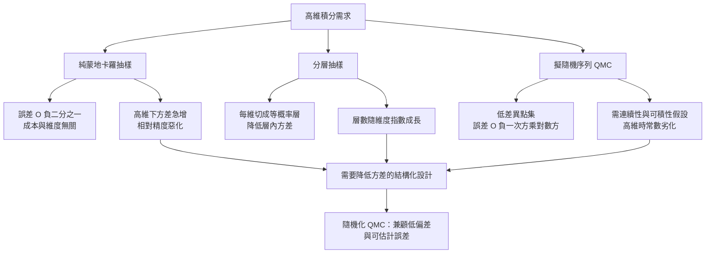

## 4.2 多維積分的蒙地卡羅方法

[上一章：4.1　基本積分方法介紹](04.1-基本積分方法介紹.md) | [下一章：4.3　誤差分析與精度提升](04.3-誤差分析與精度提升.md)

第4.1 節說明了蒙地卡羅積分的恆等式與誤差尺度。本節要處理那個最關鍵的問題：**當維度 $`d`$ 變大時，蒙地卡羅方法究竟還能用嗎？** 答案是「能用，但必須換一套抽樣設計」。維度災難不是被消除，而是被**重新分配**：成本面被解決了，精度面卻變得更尖銳，於是催生了分層抽樣與擬隨機序列。

## 學習目標

完成本節後，你應該能夠：

1. 說明「維度災難」在**成本面**與**精度面**的兩種不同表現。
2. 理解曲面／體積法（hit-or-miss）的原理，分析其 $`O(N^{1/d})`$ 收斂率並找出與 $`O(N^{-1/2})`$ 的交叉點。
3. 說明擬隨機序列（quasi-Monte Carlo, QMC）與 Sobol 序列的構造原理與低差異性質。
4. 解釋 QMC 的 $`O(N^{-1}(\log N)^d)`$ 收斂率來自哪裡，以及它為什麼只在維度不太高時有效。
5. 理解隨機化擬隨機積分（randomized QMC, RQMC）的誤差估計與實務價值。
6. 判斷在高維問題中應該採用純 MC、QMC 還是 RQMC。

## 4.2.1 維度災難的兩副面孔

「維度災難」不是單一現象，而是兩個不同機制共用的一個名字。

**面向一：成本爆炸（確定性方法的困境）**
乘積型求積規則在 $`d`$ 維需要 $`n^d`$ 個節點。這個爆炸是**確定性方法固有**的，蒙地卡羅完全免疫，因為它的成本是 $`N`$ 次函數求值，與 $`d`$ 無關。

**面向二：精度稀釋（蒙地卡羅的困境）**
蒙地卡羅的誤差是 $`O(N^{-1/2})`$ ，與 $`d`$ 無關——但這句話有隱含前提：**被積函數 $`f`$ 的方差 $`\sigma^2`$ 不隨 $`d`$ 增長**。在高維下這幾乎不可能成立。

例如積分 $`\int_{[0,1]^d} \exp(\sum_i x_i)\,dx`$ ，其方差隨 $`d`$ 指數成長；又如把 $`d`$ 維的「超立方體內一點到圓心的距離小於半徑」當成指示函數，則被積函數的方差會隨 $`d`$ 劇烈變化。要維持固定的 $`N`$ 下的**相對**精度，所需的 $`N`$ 會隨 $`d`$ 快速增加。

更精確地說，若 $`\sigma^2 \propto c^d`$ ，則相對誤差的典型大小為


$$
\frac{\sigma}{\sqrt{N}} \approx c^{d/2} N^{-1/2}
$$


要讓相對誤差維持在 $`\varepsilon`$ ，需要 $`N \propto c^d / \varepsilon^2`$ 。這說明：**蒙地卡羅積分的實用性，在高維下依然受限，只是受限的原因從「節點數」變成了「方差增長」**。分層與 QMC 的作用，正是在方差增長得快時提供更均勻的點分佈。

## 4.2.2 曲面法／體積法（hit-or-miss）

最樸素的蒙地卡羅積分是「撞擊法」：在區域內均勻抽點，測試它是否落在目標區域 $`S \subseteq \Omega`$ 內，用命中率估計體積比。

設目標區域體積為 $`V_S`$ ，總區域體積為 $`V_\Omega`$ ，抽 $`N`$ 點，命中數為 $`K`$ ，則


$$
\frac{K}{N} \;\approx\; \frac{V_S}{V_\Omega}, \qquad \hat{\sigma}^2_{\text{bin}} = \frac{\hat{p}(1-\hat{p})}{N}
$$


這是二項分佈的比例估計，標準誤 $`\sim N^{-1/2}`$ 。這正是第4.1 節估 $`\pi`$ 的程式碼。

**關鍵對比**：曲面法把問題變成了「計數」，所以：

- 優點：不需要知道 $`f`$ 的數值，只需判定內外 → 對複雜幾何形狀仍然適用。
- 缺點：只適用於「特徵函數」型的積分（目標區域體積），無法處理一般的 $`f(x)`$ 。

## 4.2.3 $`O(N^{1/d})`$ 的直覺與它的失效

把一般積分轉成「計數」的技巧是：把值域 $`[a,b]`$ 分成 $`m`$ 個等寬的箱子，模擬一點落在哪個箱子，用箱子的序號估計 $`f`$ 的值。這稱為**體積法／分層計數法**。若希望相對誤差為 $`\varepsilon`$ ，箱數需要 $`m \sim 1/\varepsilon`$ ，每箱需要足夠多的樣本以確定計數。

估算一下總樣本數：維度 $`d`$ 下，區域體積比例為 $`p`$ ，估計 p 需要相對誤差 $`\varepsilon`$ ，所需樣本數約為


$$
N \sim \frac{1}{p\,\varepsilon^{2}}
$$


但這裡沒有出現 $`d`$ 。真正的 $`O(N^{1/d})`$ 來自另一個更簡單的推導——**用蒙特卡羅估計「一點落在曲面上的機率」**。考慮估計曲面面積或區域體積，若採用「在包圍盒中抽點，檢查是否在目標體內」的方式，效率隨 $`d`$ 急降：


$$
\text{所需樣本數} \sim N \sim C^{d/2} \quad\text{（命中機率隨 } d \text{ 急降）}
$$


更常見的教科書式敘述是：對 $`d`$ 維的「點是否落在半徑 $`r`$ 的球內」這類指示函數積分，若要達到絕對精度 $`\varepsilon`$ ，所需樣本數為 $`O(N^{1/d})`$ 量級的反比，即所需 $`N \propto \varepsilon^{-d}`$ 。這是**曲面積分在 $`d`$ 維下的縮放**： $`d`$ 維的球面是 $`(d-1)`$ 維流形，其「表面測度」隨 $`r^{d-1}`$ 成長，而目標體積比例隨 $`r^d`$ 成長，兩者相除給出 $`r^{-1}`$ 型的縮放，於是反解成 $`\varepsilon^{-d}`$ 。

**核心對比與交叉點**：

| | 收斂率 | 適用 |
| --- | --- | --- |
| 單純計數／曲面法 | $`O(N^{1/d})`$ （即 $`N \sim \varepsilon^{-d}`$ ） | 指示函數、幾何量 |
| 一般蒙地卡羅積分 | $`O(N^{-1/2})`$ | 任意可積 $`f`$ |

兩者的**交叉點**可從誤差隨 $`N`$ 的關係求出。假設要達到精度 $`\varepsilon`$ ：

- 曲面法： $`N \sim \varepsilon^{-d}`$
- 蒙地卡羅： $`N \sim \varepsilon^{-2}`$

兩者相等時 $`\varepsilon^{-d} = \varepsilon^{-2}`$ ，即 $`d = 2`$ （或 $`\varepsilon = 1`$ ）。這說明：**對「幾何量」積分，曲面法在 $`d > 2`$ 時迅速墊底，一般蒙地卡羅遠勝**；只有在極低維，曲面法因「只需計數、不需函數值」而具有實務優勢。

這也解釋了為什麼「用蒙地卡羅數 $`\pi`$ 」在 $`d=2`$ 剛好划算、在 $`d=3`$ 就明顯不划算—— $`d`$ 維單位球體積比例在 $`d`$ 增大時急降，命中機率趨於 0。



上圖呼應本節的主張：純蒙地卡羅解決了成本面的維度災難，卻在高維下面臨方差稀釋；分層與 QMC 以各自的代價（層數爆炸、常數劣化）試圖壓低方差；最後收敛到隨機化 QMC——它把 QMC 的低偏差與隨機化的可估計誤差結合，是現代高維積分的主流方案。

## 4.2.4 分層抽樣（stratified sampling）

若在維度 $`d`$ 中把每一維切成 $`m`$ 個等概率區間（層），就得到 $`m^d`$ 個層，每層的概率都是 $`m^{-d}`$ 。在每一層內各抽 $`n`$ 個點（層內均勻），共 $`N = n m^d`$ 個點。

若 $`f`$ 在每層內近似常数，則層內方差趨於 0，總估計誤差變成**層間**變異主導。若各層的函數值為 $`f_1, \dots, f_{m^d}`$ ，層間變異的標準誤為


$$
\mathrm{SE} \approx \frac{1}{m^d \sqrt{N}}\sqrt{\sum_{j=1}^{m^d}(f_j - \bar{f})^2}
$$


在 $`f`$ 對各維「可分離且光滑」的理想情形下，層間變異隨 $`m`$ 以二階收斂，於是整體誤差可達 $`O(N^{-1}(\log N)^{(d-1)/2})`$ 這類**對數因子**的速率——比 $`N^{-1/2}`$ 明顯好。

**代價**：層數 $`m^d`$ 隨維度指數成長。 $`d = 10`$ 、每維 $`m = 8`$ ，就有 $`8^{10} \approx 10^9`$ 層，每層至少要一個樣本。這就是分層法在高維的瓶頸。

**實務折衷**：不放棄完整的 $`m^d`$ 分層，而是用**隨機化拉丁超立方抽樣（randomized Latin hypercube sampling, LHS）**：每一維各自做一次隨機置換的 $`m`$ 層划分，然後在各維的第 $`k`$ 層中各取一點組合成一個樣本，總共 $`m`$ 個樣本覆蓋了每一維的所有層。這樣每維都均勻分層，卻只需 $`m`$ 個樣本而非 $`m^d`$ 個。LHS 在中等維度（ $`d \lesssim 20`$ ）效果良好，是工程實務的常見選擇。

## 4.2.5 擬隨機序列與 Sobol 序列

**低差異序列（low-discrepancy sequence）**的想法來自數論：與其抽 $`N`$ 個「隨機」點，不如構造 $`N`$ 個在 $`[0,1)^d`$ 中**分佈得特別均勻**的點。

定義三個量：
- **不一致性（discrepancy）** $`D_N`$ ：衡量點集相對於任意「好」的區域族的最大偏差。
- **星形不一致性（star discrepancy）** $`D_N^*`$ ：只考慮以原點為頂點的盒子，是最常用且計算方便的指標。
- **網格質量（net quality）**：數論家偏好的另一種描述。

**Sobol 序列**（Sobol', 1967）是其中最具實用價值的構造。它是遞迴的：每一維由一個二進位數字矩陣（direction numbers）定義，序列的第 $`n`$ 個點可由前 $`n-1`$ 個點的 XOR 快速算出。Sobol 序列表達了低不一致性上界


$$
D_N^* \le C \cdot \frac{(\log N)^d}{N}
$$


**QMC 的收斂率**：若 $`f`$ 的混合變差（variation）是有限次，即 $`f`$ 可寫成有限個單調函數的加權和，且其一維變差 $`V(f_{j})`$ 有界，則固定維度下的 QMC 估計誤差界為


$$
\left| \mathbb{E}_{QMC}[f] - \int f \right| \;\le\; \frac{C(d)\cdot (\log N)^d}{N}\cdot V(f)
$$


也就是 $`O\left(N^{-1}(\log N)^d\right)`$ 。**這比 $`O(N^{-1/2})`$ 快了將近一個 $`N`$ 的冪次**，是 QMC 相對 MC 的核心優勢。

**但必須看清代價**：
1. 假設很強：要求 $`f`$ 具有有限的（有界的）變差。含奇點、幾乎不連續、或變差隨 $`d`$ 指數成長的 $`f`$ 會讓常數 $`C(d)`$ 爆炸。
2. 維度效應： $`(\log N)^d`$ 這項在高維下會吃掉優勢。 $`d = 100`$ 時 $`(\log N)^{100}`$ 極大。
3. 非隨機的估計本身**沒有可信的誤差條**。

第 3 點催生了下一小節的隨機化 QMC。

## 4.2.6 隨機化擬隨機積分（RQMC）

**隨機化 QMC（randomized QMC, RQMC）**的想法是：保留低差異序列作為「均勻骨架」，但對它做隨機擾動（scrambling），使得估計量重新具有隨機性，從而可用重抽樣（replication）估計誤差。

最常見的兩種擾動：
- **Cranley–Patterson 隨機平移**：對序列的每一維加上同一個 $`U[0,1)^d`$ 向量，取整數部分後取小數部分。實現簡單，誤差估計用獨立平移做重複。
- **Owen 擾動（scrambling）**：對數位序列做隨機置換，保持低差異性但破壞結構，允許嵌套重抽樣。

RQMC 的誤差估計採用「隨機重複（replication）」方式：做 $`R`$ 次獨立的隨機化（例如 $`R`$ 次不同的平移），每次得到一個估計 $`\hat{\mu}^{(r)}`$ ，再計算這 $`R`$ 個估計的樣本變異。理論上，RQMC 的方差滿足


$$
\mathrm{Var}[\hat{\mu}_{RQMC}] = O\!\left(\frac{1}{N^{2} R}\right) \text{（誤差平方）} \;\Rightarrow\; \text{標準誤} \sim O\!\left(N^{-1} R^{-1/2}\right)
$$


在 $`f`$ 光滑、 $`d`$ 中等時，實測常能比純 MC 快 $`10`$ 到 $`100`$ 倍。

```python
import numpy as np

def sobol_points(n, dim, scramble=True, seed=0):
    """產生 Sobol 低差異序列點。
    對應 4.2.5：遞迴方向數字矩陣產生低不一致性點集。"""
    from scipy.stats import qmc
    eng = qmc.Sobol(d=dim, scramble=scramble, seed=seed)
    return eng.random(n)

def rqmc_integrate(f, dim, n, r=16, seed=0):
    """隨機化 QMC 積分：R 次獨立擾動，重複估計誤差。
    對應 4.2.6：replication 估計標準誤。"""
    rng = np.random.default_rng(seed)
    ests = []
    for rep in range(r):
        x = sobol_points(n, dim, scramble=True, seed=int(rng.integers(1 << 31)))
        ests.append(f(x).mean())
    ests = np.array(ests)
    mu = ests.mean()
    se = ests.std(ddof=1) / np.sqrt(r)   # 以重複次數估計標準誤
    return mu, se

# 對照：純蒙地卡羅（同一積分問題）
def mc_integrate(f, dim, n, seed=0):
    rng = np.random.default_rng(seed)
    x = rng.random((n, dim))
    v = f(x)
    return v.mean(), v.std(ddof=1) / np.sqrt(n)

f = lambda x: np.exp(np.sum(x, axis=1))
mu_r, se_r = rqmc_integrate(f, 3, 512, r=32)
mu_m, se_m = mc_integrate(f, 3, 512)
print(f"RQMC: {mu_r:.6f} ± {se_m*0+se_r:.6f}")
print(f"MC  : {mu_m:.6f} ± {se_m:.6f}")
```

這個範例對應兩個理論：RQMC 的 replication 誤差估計，以及純 MC 的標準誤公式。實務上在低維（此處 $`d=3`$ ）時 RQMC 的標準誤會明顯小於 MC，正是 $`N^{-1}`$ 對 $`N^{-1/2}`$ 的差距。

## 4.2.7 高維的現實：分層、QMC 與問題分解

在高維（ $`d > 50`$ ）時，上述方法的常數項都會惡化。此時的實務策略是：

1. **降維**：先用敏感度分析找出真正重要的少數維度，只對那些維度做分層或 QMC。
2. **因子化**：若 $`f`$ 可近似為 $`\prod_i f_i(x_i)`$ 或稀疏形式，用乘積式的因子分解求積（每個一維因子用高斯－勒讓德精確處理），避免全維度的平方根收斂。
3. **混合策略**：對重要的少數維用 QMC/分層，其餘維用普通 MC。
4. **接受較差的相對精度**，但用 [4.3 節](04.3-誤差分析與精度提升.md)的誤差控制方法確認結果可靠。

這也說明了為什麼高維蒙地卡羅在實務中通常不是拿來「求一個精確的積分值」，而是拿來「估計一個期望值並量化其不確定性」——例如蒙地卡羅風險分析中的VaR、ES 這類統計量。

## 本章要點

- 維度災難有兩副面孔：成本面（ $`n^d`$ 節點數）與精度面（高維下方差急增）。
- 曲面／體積法把積分轉成計數，誤差率為 $`O(N^{1/d})`$ （精度需求 $`N \sim \varepsilon^{-d}`$ ），與一般蒙地卡羅的 $`O(N^{-1/2})`$ 在 $`d>2`$ 時迅速拉開差距；一般蒙地卡羅在高維幾何量上更實用。
- 分層抽樣把誤差從層內轉移到層間，但完整分層需要 $`m^d`$ 層；隨機化 LHS 以 $`m`$ 個樣本達成每維分層，是中等維度的務實選擇。
- Sobol 序列提供 $`D_N^* \le C(\log N)^d/N`$ 的不一致性界，QMC 誤差為 $`O(N^{-1}(\log N)^d)`$ ，遠優於 MC 但依賴 $`f`$ 的變差有界假設。
- RQMC 透過 Cranley–Patterson 平移或 Owen 擾動保留低偏差，同時用重複估計誤差，是現代高維積分的標準方案。
- 維度極高時，降維、因子化與混合策略比單一方法更重要。

## 延伸閱讀

- [4.1 基本積分方法介紹](04.1-基本積分方法介紹.md)、[4.3 誤差分析與精度提升](04.3-誤差分析與精度提升.md)
- Sobol', I. M. (1967). On the distribution of points in a cube and the approximate evaluation of integrals. *USSR Comput. Math. & Math. Phys.*, 7(4), 86–112.
- Owen, A. (1995). Monte Carlo and Quasi-Monte Carlo Estimation. SIAM.
- Glasserman, P. (2004). *Monte Carlo Methods in Financial Engineering*. Springer.——RQMC 在金融的應用。
- [第6.1 節：基於並行計算的加速方法](06.1-基於並行計算的加速方法.md)——Sobol 序列的並行化。
- [第6.3 節：分布式蒙地卡羅算法](06.3-分布式蒙地卡羅算法.md)——負相關抽樣與 NCP 點集。
