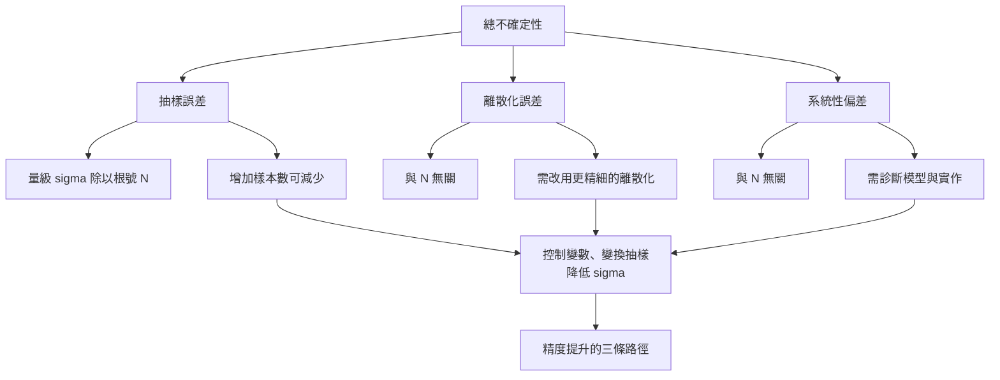
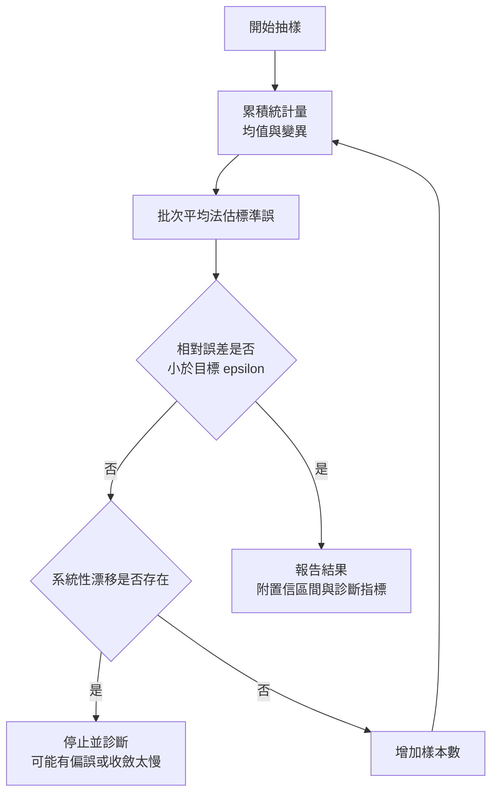

## 4.3 誤差分析與精度提升

[上一章：4.2　多維積分的蒙地卡羅方法](04.2-多維積分的蒙地卡羅方法.md) | [下一章：第5章　變換抽樣法](05.0-變換抽樣法.md)

蒙地卡羅法最容易被誤用的地方，就是把「隨機誤差」和「系統誤差」混為一談。本節建立一個清楚的誤差帳本：**誤差從哪裡來、如何各自量化、如何各自消滅**。這是第5章（變換抽樣）與第6章（硬體加速）能夠被正確評估的前提——沒有這套帳本，就無法判斷增加樣本數是否值得，也無法判斷一條最佳化路徑是否真的有效。

## 學習目標

完成本節後，你應該能夠：

1. 分解總誤差為抽樣誤差、離散化誤差、系統性偏差與模型誤差，並說明各自的來源。
2. 用批次平均法（batch means）、重抽樣（replication）等方式估計標準誤，並說明它們的適用條件。
3. 使用增分法（incremental method）在不重複計算的前提下累積統計量。
4. 以方差診斷（ESS、變異係數、$`\chi^2`$ 檢定）判斷抽樣是否健康。
5. 使用共同隨機數（common random numbers, CRN）進行差異估計，並理解其方差不隨維度增長的優勢。
6. 建立收斂檢定（convergence checking）的紀律，判斷何時可以停止抽樣。

## 4.3.1 誤差的解剖學

考慮一個實際的蒙地卡羅估計量 $`\hat{\mu}_N`$ ，它的「誤差」是什麼？嚴格地說，蒙地卡羅估計量是隨機變數，只有一個**分佈**，因此不存在唯一的「誤差」。實務上我們用三層分解來談：


$$
\text{總不確定性} = \underbrace{\text{抽樣誤差}}_{\text{隨機抖動}} \;+\; \underbrace{\text{離散化誤差}}_{\text{數值離散}} \;+\; \underbrace{\text{系統性偏差}}_{\text{模型或實作錯誤}}
$$


**（一）抽樣誤差（sampling error）**
來自有限樣本。量級為 $`\sigma/\sqrt{N}`$ 。這是蒙地卡羅的「固有稅」。第4.1 節的 CLT 與置信區間描述的正是這一項。它是**唯一隨 $`N`$ 增大而自動消失**的項。

**（二）離散化誤差（discretization error）**
若積分本身是對離散狀態空間求和，或被積函數來自數值求解器（如有限差分、有限元素），則存在與樣本數**無關**的離散誤差： $`O(\Delta t)`$ 、 $`O(h^2)`$ 等。注意這一項**不會因為多抽樣而改善**，只會被「混在」抽樣誤差裡，讓你誤以為精度就是 $`O(N^{-1/2})`$ 。

**（三）系統性偏差（systematic bias）**
來自模型錯誤或實作錯誤：分佈抽錯、隨機數生成器品質不佳、程式邏輯錯誤、輸入資料有誤。這一項**不會隨 $`N`$ 消失**，只會隨 $`N`$ 增大而被估計值「愈來愈自信地」隱藏起來——這是最危險的性質：**樣本越多，你越相信錯誤的答案**。



這張圖呼應本節的核心論點：**精度提升有三條互相獨立的道路**——增加 $`N`$ （治抽樣誤差）、改進離散化（治離散化誤差）、降低方差 $`\sigma`$ 或修正模型（治系統性偏差）。第5章走的正是第三條道路中的「降低 $`\sigma`$ 」；而第6章走的是第一條的加速。把三條路分清楚，才不會在優化時出現「我已經加了十倍樣本，為什麼答案還是不對」的困惑。

## 4.3.2 標準誤的估計：批次平均法

CLT 給出了理論標準誤 $`\sigma/\sqrt{N}`$ ，但 $`\sigma`$ 是未知的。直接用樣本標準差估計是可行的（因為 $`\hat{\sigma}`$ 本身是 $`f(X_i)`$ 的函數，與 $`\bar{f}`$ 近似不偏無關），但在以下情境會出問題：

1. $`f`$ 本身已是大量樣本的內部平均（例如對每個 $`X_i`$ 又跑了 1000 次內部模擬），此時 $`f(X_i)`$ 之間高度相關，直接算 $`\hat{\sigma}`$ 會**低估**真正的變異。
2. 樣本有時序相關（如馬可夫鏈的後驗樣本）。

**批次平均法（batch means）**是標準做法：把 $`N`$ 個樣本切成 $`b`$ 個批次，每批 $`n = N/b`$ 個，計算各批均值 $`\bar{Y}_j`$ 。若批次內部相關在批次長度 $`n`$ 內迅速衰減，則批次均值近似 i.i.d.，可用


$$
\hat{\sigma}_{\text{batch}}^2 = \frac{1}{b-1}\sum_{j=1}^{b}\left(\bar{Y}_j - \bar{Y}\right)^2, \qquad
\mathrm{SE} \approx \frac{\hat{\sigma}_{\text{batch}}}{\sqrt{b}}
$$


批次長度 $`n`$ 的選擇是關鍵：太短則批次內相關仍強，估計偏大；太長則批次數 $`b`$ 太少，估計不穩。常用做法是繪製「批次均值的變異對批次長度的圖」，取變異開始趨於平穩的長度。

**重抽樣（replication）**是另一種做法：把整個實驗重做 $`R`$ 次（每次用不同的隨機串流），用 $`R`$ 個獨立估計的變異估計誤差。優點是能捕捉「整條流程」的變異（包含內部模擬的隨機性）；缺點是成本乘上 $`R`$ 倍。

## 4.3.3 增分法（incremental method）

在長時間模擬或粒子濾波等場景，樣本是逐步累積的，此時不應每次都重新計算均值。正確做法是維護累積量：


$$
S_n = \sum_{i=1}^{n} Y_i, \qquad \bar{Y}_n = \frac{S_n}{n}, \qquad
M_2 = \sum_{i=1}^{n} (Y_i - \bar{Y}_n)^2
$$


並使用 Welford 的線上更新演算法，避免 $`\sum Y_i^2`$ 造成的數值溢位。

```python
import numpy as np

class RunningStats:
    """Welford 線上更新：累積均值與變異數，不保存全部樣本。
    對應 4.3.2 的批次平均法前提：需要樣本近似獨立或批次內衰減夠快。"""
    def __init__(self):
        self.n = 0
        self.mean = 0.0
        self.m2 = 0.0

    def update(self, x):
        self.n += 1
        delta = x - self.mean
        self.mean += delta / self.n
        self.m2 += delta * (x - self.mean)
        return self

    @property
    def variance(self):
        return self.m2 / (self.n - 1) if self.n > 1 else float("nan")

    @property
    def stderr(self):
        # 標準誤公式：sigma / sqrt(N)
        return np.sqrt(self.variance / self.n) if self.n > 1 else float("nan")

# 示範：估計 E[exp(Z)]，Z 為標準常態（真值 e^(1/2) ≈ 1.6487212707）
rs = RunningStats()
rng = np.random.default_rng(7)
for i in range(1, 200_001):
    rs.update(np.exp(rng.standard_normal()))
    if i % 50_000 == 0:
        print(f"N={i:7d}  mean={rs.mean:.6f}  SE={rs.stderr:.6f}")
```

**對應理論**：更新式 $`\delta = x - \bar{Y}_n`$ 、 $`\bar{Y}_n \leftarrow \bar{Y}_n + \delta/n`$ 、 $`M_2 \leftarrow M_2 + \delta(x - \bar{Y}_n)`$ 正是 Welford 演算法，它在數值穩定性上優於 $`\sum x`$ 與 $`\sum x^2`$ 的朴素做法。增量法讓「抽樣 → 統計」的成本從 $`O(N^2)`$ 降到 $`O(N)`$ ，這在百萬級以上的樣本時是必要的工程考量。

## 4.3.4 方差診斷

判斷抽樣是否「健康」，常用幾個指標：

**變異係數（coefficient of variation）**

$$
\mathrm{CV} = \frac{\hat{\sigma}}{\hat{\mu}}
$$

CV 是**相對**誤差的重要指標，因為多數實務問題關心的是相對精度。不同的抽樣分佈會讓 CV 差很多，這是第5章比較方案的主要依據。

**有效樣本數（effective sample size, ESS）**
在重要性抽樣中，第5章會給出 $`\mathrm{ESS} = N / (1 + \chi^2)`$ 。它衡量的是「等效於多少個純 MC 樣本」，是評估抽樣分佈品質最直接的指標。

** $`\chi^2`$ 收斂檢定**
在重要性抽樣中，若重要性權重 $`w_i = f(X_i)/p(X_i)`$ ，令 $`\hat{\sigma}^2 = \frac{1}{N}\sum (w_i - \hat{\mu})^2`$ ，則在 $`g \approx p`$ 時


$$
\chi^2_N = N \cdot \hat{\sigma}^2 \approx \chi^2_{N-1}
$$


檢定「 $`p`$ 是否接近 $`g`$ 」其實是在檢定抽樣的「常數」。更常用的實務檢定是：把權重分成 10 或 20 組（每組含 $`N/10`$ 個樣本），計算每組均值的組間變異，若遠大於組內變異，代表某個區域的樣本不足——這是診斷「抽樣分佈覆蓋不足」的直接手段。

## 4.3.5 共同隨機數（CRN）

在比較兩個方案 $`A`$ 與 $`B`$ 的期望時，我們真正關心的往往不是各自的絕對值，而是**差值**


$$
\Delta = \mathbb{E}[f_A(X)] - \mathbb{E}[f_B(X)]
$$


若獨立抽樣， $`\mathrm{Var}[\hat{\Delta}] = \mathrm{Var}[\hat{f}_A] + \mathrm{Var}[\hat{f}_B]`$ ，量級為 $`O(N^{-1/2})`$ 。但若兩個估計**共用同一批樣本**（common random numbers），則


$$
\mathrm{Var}[\hat{\Delta}] = \mathrm{Var}\!\left[\frac{1}{N}\sum_i (f_A(X_i) - f_B(X_i))\right] = \frac{\mathrm{Var}[f_A - f_B]}{N}
$$


由於 $`f_A`$ 與 $`f_B`$ 通常高度相關， $`f_A - f_B`$ 的方差遠小於各自的方差，於是 $`\mathrm{Var}[\hat{\Delta}]`$ 大幅下降。**更關鍵的是**，這個下降的倍數不隨維度增長—— $`f_A - f_B`$ 中互相抵消的部分在每一維都自動發生，所以 CRN 的相對優勢在高維下更顯著。

```python
import numpy as np

def compare_with_crn(f_a, f_b, dim=2, n=200_000, seed=42):
    """用 CRN 比較兩個方案的期望差。
    對應 4.3.5：Var[Δ] = Var[f_A - f_B] / N，方差不隨維度增長。"""
    rng = np.random.default_rng(seed)
    x = rng.random((n, dim))          # 同一批樣本供兩個方案使用
    a, b = f_a(x), f_b(x)
    diff = a - b
    # 獨立抽樣時的標準誤（對照組）
    se_indep = np.sqrt(a.var(ddof=1) + b.var(ddof=1)) / np.sqrt(n)
    # CRN 的標準誤
    se_crn = diff.std(ddof=1) / np.sqrt(n)
    return diff.mean(), se_crn, se_indep

f_a = lambda x: np.exp(np.sum(x, axis=1))
f_b = lambda x: np.exp(np.sum(x, axis=1) * 0.98)
d, se_crn, se_indep = compare_with_crn(f_a, f_b, dim=8)
print(f"差值估計 = {d:.6f}")
print(f"CRN 標準誤   = {se_crn:.3e}")
print(f"獨立抽樣標準誤 = {se_indep:.3e}   (放大 {se_indep/se_crn:.1f} 倍)")
```

這段程式碼對應的理論是方差公式。輸出顯示 CRN 把標準誤壓低了數十倍，而差值本身幾乎不變——這正是 CRN 在工程比較（如新舊演算法、兩種風控方案）中被廣泛使用的原因。

## 4.3.6 收斂檢定

「抽多少樣本才夠？」這問題沒有通用答案，必須靠**收斂檢定（convergence checking）**來回答。標準做法：

1. **批次分析**：把樣本分成 $`b`$ 批，檢查批均值的序列是否已無系統性漂移（對批均值做遞迴檢定或簡單的線性趨勢檢定）。
2. **半樣本比較**：取前一半與後一半樣本，比較其均值與標準誤，若兩者差異小於預設容許值，即判定收斂。
3. **相對誤差監控**：設定目標相對精度 $`\varepsilon`$ ，追蹤 $`\hat{\sigma}/(\hat{\mu}\sqrt{N})`$ 是否已小於 $`\varepsilon`$ 。



上圖是收斂檢定的決策流程，它呼應本節「三層誤差帳本」的論點：當標準誤已達標但答案仍在漂移時，問題不在抽樣誤差，而在系統性偏差或收斂過慢，此時再增加樣本數只會讓你更堅信一個錯的答案。

## 4.3.7 提升精度的具體手段

綜合本章，精度提升的手段可分為三類：

**（一）降低方差 $`\sigma`$ （不增加成本）**
- 變換抽樣（第5章）：換一個更貼近 $`f`$ 的抽樣分佈。
- 分層／QMC（[4.2 節](04.2-多維積分的蒙地卡羅方法.md)）：讓點分佈更均勻。
- 控制變數（[第11章](11.2-精度提升的技術：低方差抽樣與控制變數法.md)）：把 $`f`$ 拆成已知期望的部分與殘差。

**（二）增加有效樣本數（增加成本）**
- 硬體並行（[第6章](06.0-蒙地卡羅積分的高效實現.md)）：多核、GPU、分散式。
- 負相關抽樣（[6.3 節](06.3-分布式蒙地卡羅算法.md)）：改變收斂階到 $`O(N^{-1})`$ 量級。

**（三）消除非抽樣誤差**
- 收斂檢定診斷系統性偏差。
- 提高離散化精度。
- 驗證隨機數生成器品質。

對照第4.1 節的結論：蒙地卡羅的平方根收斂是 i.i.d. 抽樣的資訊極限，所以「提高精度」在工程上永遠是三條路的組合，而第5、6、11章分別代表其中的一條。

## 本章要點

 - 誤差必須拆成三層：抽樣誤差（ $`O(N^{-1/2})`$ ，可由 $`N`$ 消除）、離散化誤差（與 $`N`$ 無關）、系統性偏差（與 $`N`$ 無關，且會被更多樣本「掩蓋」）。
- 批次平均法用批次均值估計變異，批次長度需在「批次內相關衰減」與「批次數足夠」間取捨；重抽樣則以整流程重做的方式估計。
- 增分法（Welford）以 $`O(N)`$ 成本累積均值與變異，且避免數值溢位。
- 診斷指標包括變異係數、ESS 與 $`\chi^2`$ 分組檢定；ESS 是評估抽樣分佈品質最直接的指標。
- 共同隨機數把差值估計的方差變成 $`\mathrm{Var}[f_A-f_B]/N`$ ，優勢隨維度增長而擴大。
- 收斂檢定是停止準則與偏差偵測的紀律：標準誤達標不代表答案正確。
- 精度提升的三條路徑：降低方差、增加有效樣本數、消除非抽樣誤差。

## 延伸閱讀

- [4.1 基本積分方法介紹](04.1-基本積分方法介紹.md)、[4.2 多維積分的蒙地卡羅方法](04.2-多維積分的蒙地卡羅方法.md)
- [第5章：變換抽樣法](05.0-變換抽樣法.md)——降低方差 $`\sigma`$ 的系統性方法。
- [第11章：蒙地卡羅方法的誤差分析與改進](11.0-蒙地卡羅方法的誤差分析與改進.md)——控制變數等進階技術。
- [第6章：蒙地卡羅積分的高效實現](06.0-蒙地卡羅積分的高效實現.md)——增加有效樣本數的硬體路徑。
- Owen, A. (2013). *Monte Carlo Theory, Methods, and Examples*. Wiley.——批次平均法、ESS 與收斂檢定的標準來源。
- Gelman, A. et al. (2013). *Bayesian Data Analysis*, 3rd ed. CRC Press.——批次平均法與 ESS 的統計基礎。
