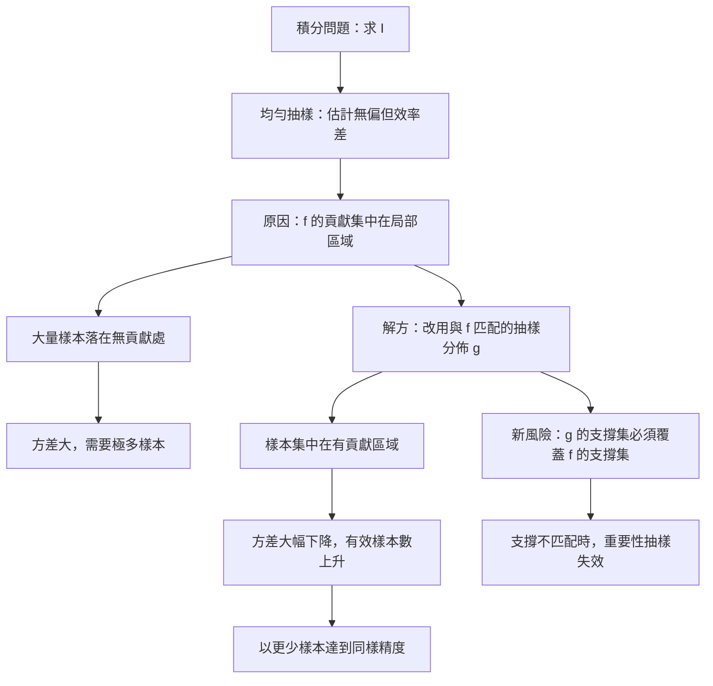

# 第5章　變換抽樣法

[上一章：第4章　蒙地卡羅積分法](04.0-蒙地卡羅積分法.md) | [下一章：第6章　蒙地卡羅積分的高效實現](06.0-蒙地卡羅積分的高效實現.md)

第4章建立了蒙地卡羅積分的理論地基，也明確指出了它的核心瓶頸：誤差只以 $`O(N^{-1/2})`$ 收斂，而且前置因子 $`\sigma`$ （函數值的標準差）完全由被積函數與抽樣分佈「碰運氣」決定。本章要解決的就是「碰運氣」這一部分：**如果我們能挑選一個更好的抽樣分佈，是否可以在不增加任何計算成本的前提下大幅提升精度？**

答案是肯定的，而且幅度往往驚人。但代價是：要設計這個更好的分佈，你需要「知道一些關於 $`f`$ 的資訊」——而這個資訊需求，正是本章後半段「實務挑戰」的根源。

## 學習目標

完成本章後，你應該能夠：

1. 說明重要性抽樣（importance sampling）的基本公式及其成立條件。
2. 理解變換抽樣在「被積函數集中在分佈尾部」時的必要性，並說明「重要性」這個名字的由來。
3. 計算有效樣本數（ESS）與 $`1+\chi^2`$ 指標，並用它評估抽樣分佈的品質。
4. 說明自適應重要性抽樣、分層抽樣與系統抽樣的差異。
5. 理解 defensive importance sampling（Owen & Zhou, 2000）與 multiple importance sampling（Veach, 1994）解決的問題。
6. 掌握選擇重要性分佈的準則：KL 散度最優、Chernoff bound 的保證。
7. 診斷實務上的典型失效模式：support mismatch、ESS 崩潰、尾部不穩。

## 5.1 問題的提出：為什麼需要「變換」？

第4章的蒙地卡羅積分是「均勻抽樣 + 取平均」。它的致命弱點可以用一個例子說清楚。

假設要估計

$$
I = \int_0^1 x^{100}\,dx = \frac{1}{101} \approx 0.00990099
$$

用均勻抽樣 $`U \sim \mathrm{Uniform}(0,1)`$ ， $`f(U) = U^{100}`$ 的期望值確實是 $`1/101`$ ，估計量無偏。但 $`f(U)`$ 的方差是

$$
\mathrm{Var}[U^{100}] = \frac{1}{201} - \left(\frac{1}{101}\right)^2 \approx 0.004975 - 0.000098 = 0.004877
$$

標準差 $`\sigma \approx 0.0698`$ ，而真值只有 $`0.0099`$ ——**變異係數高達 7.05**。原因是什麼？因為 $`f`$ 幾乎全部集中在 $`x`$ 靠近 1 的區域（那裡 $`x^{100} \approx 1`$ ），而靠近 0 的區域貢獻幾乎為零。均勻抽樣卻在整個區域平均用力，把大量樣本丟在完全沒有貢獻的地方。

**這就是「變換抽樣」要解決的問題**：把抽樣資源重新分配到真正有貢獻的區域。

用一個更極端的例子：若 $`f(x) = e^{-1000x}`$ 在 $`[0,1]`$ 上，真值約 $`0.000999`$ ，但 $`f`$ 的值只在 $`x \lesssim 0.01`$ 處才有意義。均勻抽樣 $`10^6`$ 個點，只有大約 $`10^4`$ 個落在有效區域，其餘全是浪費。所需的樣本數暴增至 $`O(10^9)`$ 。而如果改用密度 $`p(x) \propto e^{-1000x}`$ （截斷的指數分佈）來抽樣，所有樣本都落在有貢獻的地方，精度立刻提升數個數量級。

這個對比確立了本章的邏輯鏈：

1. 均勻抽樣的效率取決於 $`f`$ 在整個區域的「分佈均勻程度」。
2. 當 $`f`$ 集中時，均勻抽樣浪費大量樣本。
3. 因此我們要**替換抽樣分佈**，讓樣本集中在貢獻大的地方。
4. 但替換不是免費的：新的分佈必須能被抽樣，且必須與 $`f`$ 有足夠的「重疊」，否則會出現更糟的問題。

上圖呼應本章導論的核心論點：變換抽樣不是「另一種抽樣法」，而是**在精度與穩健性之間做交易**。左半邊是效率的提升路徑，右半邊是穩健性的代價，而第5.3 節將專門處理右半邊。

## 5.2 本章的數學骨架

重要性抽樣的核心公式是第4.1 節恆等式的一般化。若目標是

$$
I = \mathbb{E}_p[f(X)], \qquad X \sim p
$$

而我們改從密度 $`g`$ 抽樣，則

$$
I = \int f(x)\,p(x)\,dx = \int f(x)\,\frac{p(x)}{g(x)}\,g(x)\,dx = \mathbb{E}_g\!\left[f(X)\frac{p(X)}{g(X)}\right]
$$

令重要性權重 $`w(x) = p(x)/g(x)`$ ，得

$$
\hat{I} = \frac{1}{N}\sum_{i=1}^{N} w(X_i) f(X_i), \qquad X_i \sim g
$$

這個公式是**整個第5章的骨幹**。第5.1 節說明它的各種變體，第5.2 節說明怎麼選 $`g`$ ，第5.3 節說明實務上的坑。權重比值 $`w`$ 不為 1 是這個方法風險與機會的根源。

## 5.3 內容地圖

- **5.1　變換抽樣的基本概念**：核心公式、ESS、 $`1+\chi^2`$ 、自適應重要性抽樣、分層／系統抽樣、defensive IS 與 multiple IS。
- **5.2　如何選擇重要性分佈**：選擇準則（KL 散度最優、Chernoff bound）、邊界層抽樣、分層抽樣、proposal matching、auto proposal、橋接抽樣、粒子濾波中的退化與重抽樣。
- **5.3　實際應用中的挑戰與優勢**：診斷表、常見陷阱、案例分析。

## 5.4 與後續章節的銜接

第5章的產出是「更高效的抽樣」，但抽樣再高效，每個樣本的成本仍然存在。第6章處理的是**每個樣本的成本**——並行、GPU、分散式。兩章的關係是互補的：變換抽樣減少「需要多少樣本」，並行加速減少「每個樣本多貴」。

實務上兩者常一起使用：一個好的重要性分佈配合 GPU 上百萬次平行抽樣，往往比均勻抽樣配合 CPU 有效數個數量級。反過來，若重要性分佈設計得很糟，再好的硬體也只是在加速製造垃圾資料。

## 本章要點

- 變換抽樣解決的是「 $`f`$ 的貢獻集中在局部，但抽樣卻是均勻」的資源錯配問題。
- 核心公式為 $`I = \mathbb{E}_g[f(X)\,p(X)/g(X)]`$ ；抽樣分佈 $`g`$ 越貼近 $`p`$ ，估計越準確。
- 變換抽樣不改變收斂階（仍是 $`O(N^{-1/2})`$ ），但能大幅改變前置因子 $`\sigma`$ ——這是它與 QMC、負相關抽樣的根本差異。
- 設計 $`g`$ 需要對 $`f`$ 的先驗了解，而「先驗了解從哪來」正是 5.2 節的課題。
- 新的抽樣分佈帶來新的失效模式：支撐集不匹配會讓估計量失去無偏性甚至發散。
- 第5章減少所需樣本數，第6章降低每樣本成本，兩者互補。

## 延伸閱讀

- [5.1　變換抽樣的基本概念](05.1-變換抽樣的基本概念.md)、[5.2　如何選擇重要性分佈](05.2-如何選擇重要性分佈.md)、[5.3　實際應用中的挑戰與優勢](05.3-實際應用中的挑戰與優勢.md)
- [第4章：蒙地卡羅積分法](04.0-蒙地卡羅積分法.md)
- [第6章：蒙地卡羅積分的高效實現](06.0-蒙地卡羅積分的高效實現.md)
- Robert, C. P. & Casella, G. (2004). *Monte Carlo Statistical Methods*, 2nd ed. Springer.——重要性抽樣的理論標準來源。
- Owen, A. (2013). *Monte Carlo Theory, Methods, and Examples*. Wiley.——ESS、 $`1+\chi^2`$ 與 defensive importance sampling。
