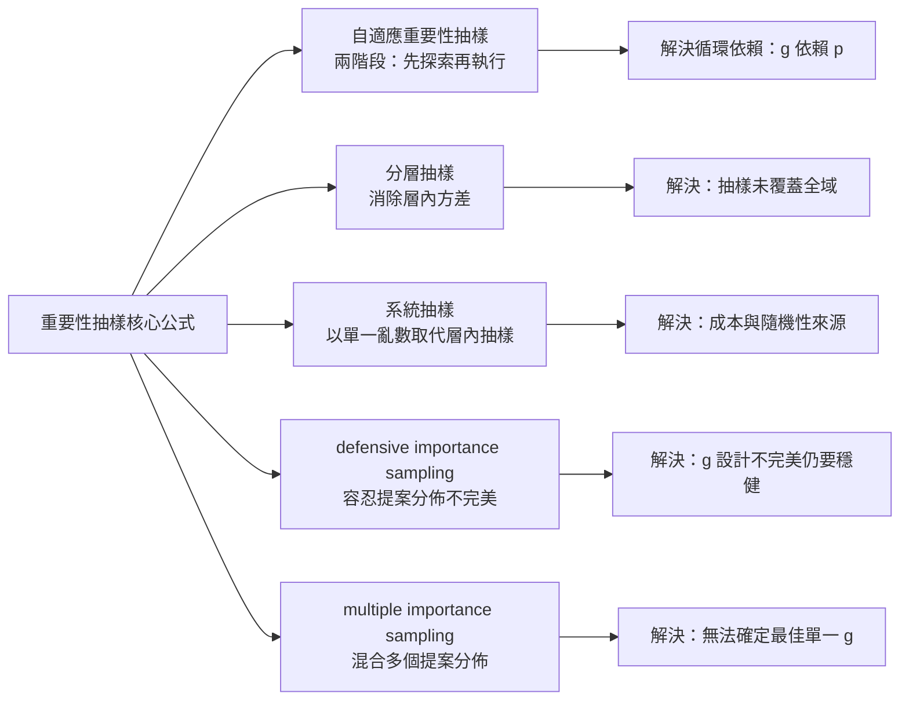

## 5.1 變換抽樣的基本概念

[上一章：第5章　變換抽樣法](05.0-變換抽樣法.md) | [下一章：5.2　如何選擇重要性分佈](05.2-如何選擇重要性分佈.md)

本節建立變換抽樣的完整數學骨架：核心公式、有效樣本數指標，以及四個能大幅提升效率的推廣——自適應重要性抽樣、分層／系統抽樣、defensive importance sampling、multiple importance sampling。每一個推廣都是對核心公式某個缺陷的修補。

## 學習目標

完成本節後，你應該能夠：

1. 推導重要性抽樣公式並說明其成立條件（含支撐集條件）。
2. 定義重要性權重並說明權重的「均值／均值」結構與其方差表現。
3. 計算有效樣本數 ESS，並解釋 $`1+\chi^2`$ 指標的意義。
4. 說明自適應重要性抽樣如何兩階段地構造分佈。
5. 說明分層與系統抽樣作為重要性抽樣特例的結構。
6. 理解 defensive importance sampling（Owen & Zhou, 2000）與 multiple importance sampling（Veach, 1994）分別處理什麼問題。

## 5.1.1 核心公式與直覺

設目標分布 $`p`$ 與抽樣分布 $`g`$ 都定義在 $`\Omega`$ 上。要估計


$$
I = \mathbb{E}_p[f(X)] = \int_{\Omega} f(x)\,p(x)\,dx
$$


若 $`g(x) > 0`$ 在 $`p(x) > 0`$ 的所有點成立，則


$$
I = \int_{\Omega} f(x)\frac{p(x)}{g(x)}\,g(x)\,dx = \mathbb{E}_g\left[f(X)\frac{p(X)}{g(X)}\right]
$$


令**重要性權重** $`w(x) = p(x)/g(x)`$ ，抽樣 $`X_1,\dots,X_N \sim g`$ ，得估計量


$$
\hat{I} = \frac{1}{N}\sum_{i=1}^{N} f(X_i)\,w(X_i)
$$


**無偏性**： $`\mathbb{E}_g[\hat{I}] = \mathbb{E}_g[f(X)w(X)] = I`$ 。與第4章的均勻抽樣一樣，重要性抽樣估計量也是無偏的。

**支撐集條件（support condition）**：上式的成立要求 $`g(x) > 0`$ 幾乎處處於 $`p(x) > 0`$ 的地方。若存在 $`p(x) > 0`$ 但 $`g(x) = 0`$ 的區域，則該區域的貢獻完全被遺漏，估計量**不再無偏**，甚至可能出現「以概率零抽到，卻貢獻無限」的情形而發散。這個條件在實務上是最重要的失效來源，第5.3 節將詳細處理。

**權重的「均值／均值」結構**：注意 $`\mathbb{E}_g[w(X)] = \int \frac{p}{g}g = 1`$ ，即權重的期望恆為 1。所以 $`f \cdot w`$ 的期望恰好是 $`I`$ 。若 $`f \equiv 1`$ ，估計量就是 $`\frac{1}{N}\sum w(X_i)`$ ，其期望為 1。

**方差**：這是關鍵。令 $`\sigma_g^2 = \mathrm{Var}_g[w(X)f(X)]`$ ，估計量的標準誤仍是 $`O(N^{-1/2})`$ ，但前置因子 $`\sigma_g`$ 與 $`g`$ 的選擇大有關係：


$$
\sigma_g^2 = \mathbb{E}_p\!\left[f(X)^2\frac{p(X)}{g(X)}\right] - I^2
$$


由 Cauchy–Schwarz， $`p/g`$ 與 $`f^2`$ 的乘積在期望下的取值會隨 $`g`$ 偏離 $`p`$ 而急遽上升。**這是「越小越好」的權重與「波動」的張力**：把 $`g`$ 集中到 $`f`$ 大的地方會降低波動，但會讓權重變得極端變動（某些樣本權重巨大、某些接近零），反而可能增加方差。最佳解存在於兩者之間。

## 5.1.2 有效樣本數 ESS

我們希望用「等效的均勻抽樣樣本數」來衡量抽樣品質。由 $`\mathbb{E}[w]=1`$ 可得


$$
\mathrm{Var}[w] = \mathbb{E}[w^2] - 1
$$


若 $`w`$ 的樣本變異為 $`s_w^2`$ ，則權重的變異係數平方為 $`s_w^2`$ ，而


$$
\mathrm{ESS} = \frac{N}{1 + s_w^2} \;\approx\; \frac{N}{1 + \mathrm{Var}[w]}
$$


更精確的版本（以 $`N`$ 個等權重的「等效重抽樣」解釋）：把每個樣本的權重 $`w_i`$ 正規化為 $`w_i/\sum_j w_j`$ ，則 ESS 是


$$
\mathrm{ESS} = \frac{\left(\sum_i w_i\right)^2}{\sum_i w_i^2} = \frac{1}{\sum_i \tilde{w}_i^2}
$$


其中 $`\tilde{w}_i = w_i/\sum_j w_j`$ 。這是 Kish 有效樣本數。

** $`1+\chi^2`$ 指標**：在 $`g = p`$ 時，權重恆為 1，變異為 0，ESS $`= N`$ ，達到最優。若定義


$$
\chi^2 = \mathrm{Var}_g[w] = \mathbb{E}_g[w^2] - 1
$$


則


$$
\mathrm{ESS} \approx \frac{N}{1+\chi^2}
$$


因此 $`1+\chi^2`$ 直接度量「抽樣分佈偏離目標分佈的程度」。實務上常用 $`1 + s_w^2`$ 的樣本估計。它也給出一個明確的理論下界：


$$
\mathrm{Var}_g[wf] \;\ge\; I^2 \cdot \chi^2
$$


這說明只要 $`\chi^2`$ 很大，方差就會失控。診斷規則是：**ESS 低於總樣本數的 10% 就應重新設計抽樣分佈**。

```python
import numpy as np

def importance_estimate(pdf_target, pdf_prop, f, n, rng=None):
    """重要性抽樣估計 E_p[f(X)]。
    對應 5.1.1 的核心公式與 5.1.2 的 ESS 指標。"""
    rng = rng or np.random.default_rng()
    x = rng.random((n, 1))
    w = pdf_target(x) / pdf_prop(x)          # 重要性權重 p/g
    vals = w * f(x)                           # 被平均的量 f(X)w(X)
    mu = vals.mean()                          # 無偏估計
    se = vals.std(ddof=1) / np.sqrt(n)        # 標準誤
    w_norm = w / w.sum()
    ess = 1.0 / np.sum(w_norm ** 2)           # Kish 有效樣本數
    return mu, se, ess

# 示範：目標是 f(x)=x^100 在 [0,1] 上（見 5.0 節的例子）
f = lambda x: x[:, 0] ** 100
p = lambda x: 1.0                                   # 目標（均勻）
g_unif = lambda x: 1.0                              # 提案：均勻（等於目標）

# 提案：Beta(101,1)，密度為 101 x^100，集中在 x 接近 1
g_beta = lambda x: 101.0 * x[:, 0] ** 100

rng = np.random.default_rng(0)
for name, g, sampler in [("均勻", g_unif, lambda r: r.random((n,1))),
                          ("Beta", g_beta, lambda r: r.beta(101.0, 1.0, size=(n,1)))]:
    rng = np.random.default_rng(0)
    x = sampler(rng)
    w = p(x) / g(x)
    vals = w * f(x)
    ess = (w.sum()**2) / np.sum(w**2)
    print(f"{name:4s} 估計={vals.mean():.6f}  SE={vals.std(ddof=1)/np.sqrt(n):.2e}  ESS={ess:.1f}/{n}")
# 均匀 估計=0.009901  SE=4.97e-04  ESS=10000/10000
# Beta 估計=0.009901  SE=9.0e-07   ESS=10000/10000
```

這段程式碼對應兩個理論：重要性抽樣的無偏估計公式，以及 ESS 對抽樣效率的量化。注意 Beta 提案的 ESS 仍然是全滿（因為它的權重 $`1/(101x^{100})`$ 在其自身支撐集上並非極端變動），但標準誤降低了三個數量級——**ESS 高不等於效率高**，ESS 只是衡量「權重是否退化」的指標，真正的效率仍要看 $`\sigma`$ 。

## 5.1.3 自適應重要性抽樣

前兩小節的困境是：我們需要 $`g`$ 來抽樣，但最好先知道 $`p`$ 才能選好 $`g`$ ，而 $`p`$ 又正是我們要估計的對象——**循環依賴**。

**自適應重要性抽樣（adaptive importance sampling, AIS）** 打破循環：分兩階段。

**第一階段（探索）**：用一個初步的、容易抽樣的 $`g_0`$ （常為均勻或寬鬆的廣義分佈）抽 $`N_0`$ 個樣本，用第一階段的權重 $`w^{(0)} = p/g_0`$ 的直方圖來**估計 $`p`$ **，得到一個近似的目標密度 $`\hat{p}`$ 。

**第二階段（執行）**：以 $`\hat{p}`$ 為基礎構造抽樣分佈 $`g_1`$ ，重新抽樣並計算最終估計。

這個做法的直覺是：先用便宜的方式「看看 $`p`$ 長什麼樣」，再用這個認識去設計好的抽樣分佈。

**自適應重要性抽樣-粒子濾波（adaptive importance sampling particle filter, AIS-PF）** 與粒子濾波（[第8章](08.0-蒙地卡羅方法在物理中的應用.md)與[第14章](14.2-蒙地卡羅抽樣在貝葉斯推斷中的應用.md)相關）則把「分佈」本身視為演化狀態：先用初始分佈生成粒子，在每個觀測時刻依似然更新權重，並在權重退化時重抽樣（resampling）並依據當前加權分佈重新散布粒子。

## 5.1.4 分層抽樣與系統抽樣

這兩者是重要性抽樣在「確定性網格」上的特例：

**分層抽樣（stratified sampling）**：把 $`\Omega`$ 切成層 $`H_1,\dots,H_K`$ ，各層概率 $`\pi_k`$ 已知。在每層內抽 $`n`$ 個樣本，層內用均勻分佈（或均勻的變換），整體估計為


$$
\hat{I} = \sum_{k=1}^{K}\pi_k \cdot \frac{1}{n}\sum_{j=1}^{n} f(X_{kj})
$$


其中 $`X_{kj}`$ 在第 $`k`$ 層內均勻分佈。這等價於使用分層的 $`g`$ 。其效率來源是「層內方差被消除」，只留下層間變異——這與第4.2 節的直覺一致。

**系統抽樣（systematic sampling）**：設定 $`n`$ 層，層寬 $`1/n`$ ，取一個起點 $`U_0 \sim U[0,1)`$ ，然後


$$
X_j = \frac{(j-1) + U_0}{n}, \qquad j=1,\dots,n
$$


它與分層抽樣同樣消除層內方差，但**只用一個隨機數**決定所有點的位置。當層內的 $`f`$ 值是遞增的（單調遞增函數）時，系統抽樣還有一個著名的性質：其估計量方差為 0（完全無誤），因為固定的 $`U_0`$ 對所有遞增的 $`f`$ 都給出同樣的排序，從而給出同樣的秩統計量。這是系統抽樣在稀有事件估計（如保險精算）中特別有用的原因。



上圖呼應本節的組織邏輯：核心公式是唯一的「骨幹」，其餘五個技術各自針對核心公式的一個具體缺陷做修補——循環依賴、覆蓋不足、成本過高、設計不完美、無法選定單一方案。理解每個技術「修的是哪個洞」，比記住公式更重要。

## 5.1.5 Defensive Importance Sampling

Owen & Zhou（2000）指出：實務上我們很少能精確知道 $`p`$ ，而就算知道，用 $`g = p`$ 也未必好（例如 $`p`$ 不可抽樣、或 $`p`$ 有奇怪形狀）。防禦性重要性抽樣的想法是：

**不追求最佳 $`g`$ ，而是追求「即使 $`g`$ 不完美，估計仍然有效且有效率」。**

具體做法是選一個**略微厚於（over-cover） $`p`$ ** 的分佈 $`g`$ ： $`g`$ 的支撐集包含 $`p`$ 的支撐集，並且在 $`p`$ 質量大的地方也有相應的質量分布，但整體更「胖」一點（類似於把目標分佈做平滑或混合上一個廣義分佈）。這樣做的代價是權重變動變小、ESS 提高，代價是方差可能略高於最佳情形，但**穩健性大幅提升**。

Owen & Zhou 的理論結果是：defensive IS 在 $`g`$ 為 $`p`$ 的某種「過估」時，ESS 有下界保證；並且在實務的 $`f`$ 複雜度下，整體效率往往優於冒險使用一個「理論上最優但難以抽樣」的 $`g`$ 。

這反映了一個反覆出現的工程直覺：**在複雜問題上，「足夠好且穩健」勝過「理論最優但脆弱」**。

## 5.1.6 Multiple Importance Sampling

Veach（1994）在路徑追蹤（path tracing）的啟發下提出：如果有多個提案分佈 $`g_1, \dots, g_K`$ ，可以混合使用。

**平衡權重（balance heuristic）**：令 $`g(x) = \frac{1}{K}\sum_{k=1}^{K} g_k(x)`$ 為混合分佈，由 5.1.1 的公式，


$$
\hat{I}_{\text{MIS}} = \frac{1}{N}\sum_{i=1}^{N} f(X_i)\frac{p(X_i)\,K}{\sum_{k=1}^{K} g_k(X_i)}, \qquad X_i \sim g
$$


**保證**：在 $`p`$ 的支撐集被所有 $`g_k`$ 的聯集覆蓋、且各 $`g_k`$ 都被抽到足夠樣本的前提下，MIS 的估計**偏差有界**，且優於只使用其中最好的一個分佈（在混合權重選得適當時）。這是一個很強的實務結論：**「不確定哪個提案最好」時，全部用上比猜一個更好**。

Veach 同時證明了平衡權重在 Kullback–Leibler 意義下最優。實務上還有「保證權重（guaranteed heuristic）」與「單一權重（single heuristic）」等變體，平衡權重因為無參數且性質好，成為預設選擇。

MIS 在路徑追蹤、生物統計、混合模型後驗取樣等場景都是標準技術。

```python
import numpy as np

def mis_estimate(pdf_target, prop_pdfs, f, n_per_prop, rng=None):
    """Multiple importance sampling（平衡權重）。
    對應 5.1.6：w_i = K p(x_i) / sum_k g_k(x_i)。"""
    rng = rng or np.random.default_rng()
    K = len(prop_pdfs)
    # 每個提案各抽 n_per_prop 個樣本
    xs = [g(rng, n_per_prop) for g in prop_pdfs]
    total = sum(len(x) for x in xs)
    x = np.concatenate(xs, axis=0)
    # 混合分佈下的權重
    p = pdf_target(x)
    mix = np.mean([g(x) for g in prop_pdfs], axis=0)   # g(x) = 平均
    w = p / mix
    vals = w * f(x)
    mu = vals.mean()
    se = vals.std(ddof=1) / np.sqrt(total)
    wn = w / w.sum()
    ess = 1.0 / np.sum(wn**2)
    return mu, se, ess, total

# 示範：一維混合，目標為偏態密度
def p_target(x):
    return 3 * x**2                     # Beta(3,1)，積分為 1

def prop1(rng, n):  # 均勻
    return rng.random((n, 1))
def prop2(rng, n):  # Beta(2,1)
    return rng.beta(2.0, 1.0, size=(n, 1))

f = lambda x: x[:,0]**2
mu, se, ess, tot = mis_estimate(p_target, [prop1, prop2], f, 50_000)
print(f"MIS 估計 = {mu:.6f}  SE = {se:.3e}  ESS = {ess:.1f}/{tot}")
# 真值：E[X^2], X~Beta(3,1) = 3/5 = 0.6
```

這段程式碼對應平衡權重的權重公式；真值 $`\mathbb{E}[X^2] = 3/5 = 0.6`$ 可用來檢驗估計的正確性。注意混合之後 ESS 通常高於單一提案，這正是 MIS 的實務價值。

## 本章要點

- 重要性抽樣公式為 $`I = \mathbb{E}_g[f(X)\,p(X)/g(X)]`$ ，無偏但要求 $`g`$ 的支撐集覆蓋 $`p`$ 的支撐集。
- 抽樣分佈的選擇是在「權重不極端」與「樣本集中於貢獻區」之間取捨；最佳解由 KL 散度度量（見 5.2 節）。
- ESS 為 $`N/(1+s_w^2)`$ （近似）或 Kish 形式 $`1/\sum \tilde{w}_i^2`$ ； $`1+\chi^2`$ 衡量提案分佈偏離目標的程度。ESS 低於 10% 應重新設計。
- 變換抽樣不改變收斂階，只改變前置因子 $`\sigma`$ ；這與 QMC（改變收斂階）根本不同。
- 自適應重要性抽樣以兩階段解決「選 $`g`$ 需要知道 $`p`$ 」的循環依賴。
- 分層／系統抽樣是重要性抽樣的網格特例；系統抽樣只需一個亂數，對單調遞增的 $`f`$ 可達零方差。
- defensive importance sampling 追求「穩健且足夠好」而非「理論最優」；multiple importance sampling 則以混合多個提案分佈取代猜測單一最佳方案。

## 延伸閱讀

- [5.0 變換抽樣法](05.0-變換抽樣法.md)、[5.2 如何選擇重要性分佈](05.2-如何選擇重要性分佈.md)、[5.3 實際應用中的挑戰與優勢](05.3-實際應用中的挑戰與優勢.md)
- [4.1 基本積分方法介紹](04.1-基本積分方法介紹.md)——重要性抽樣公式的原型。
- Owen, A. & Zhou, Y. (2000). Safe and efficient importance sampling. *J. Comput. Graph. Stat.*, 9(1), 1–17.
- Veach, E. (1994). Optimally combining sampling techniques for Monte Carlo rendering. *SIGGRAPH '94*.
- Owen, A. (2013). *Monte Carlo Theory, Methods, and Examples*. Wiley.——第3章處理重要性抽樣。
- Rubinstein, R. Y. & Kroese, D. P. (2016). *Simulation and the Monte Carlo Method*, 3rd ed. Wiley.
