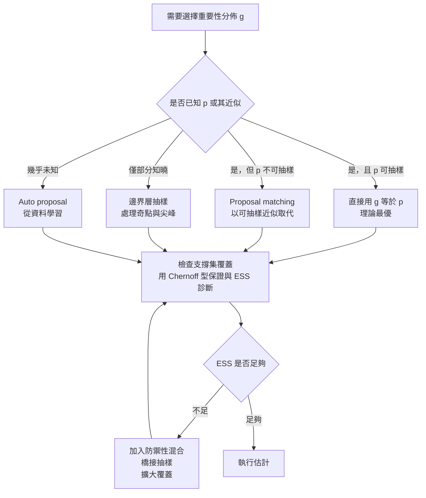

## 5.2 如何選擇重要性分佈

[上一章：5.1　變換抽樣的基本概念](05.1-變換抽樣的基本概念.md) | [下一章：5.3　實際應用中的挑戰與優勢](05.3-實際應用中的挑戰與優勢.md)

上一節給出了重要性抽樣的公式與評估指標，但留下了一個核心問題：**抽樣分佈 $`g`$ 到底該怎麼選？** 本節回答這個問題。回答的方式有三層：先給出理論上的最佳準則（KL 散度最優、Chernoff bound 的保證），再給出一系列可操作的工程方法（邊界層抽樣、分層抽樣、proposal matching、auto proposal、橋接抽樣），最後處理粒子濾波這類「分佈本身是未知對象」的極端情形。

## 學習目標

完成本節後，你應該能夠：

1. 說明重要性抽樣方差最小化與 KL 散度最小化之間的關係，並解釋為何最優 $`g`$ 通常不可抽樣。
2. 說明 Chernoff bound 如何給出「抽不到重要區域」的機率保證。
3. 掌握邊界層抽樣（boundary layer / endpoint sampling）的原理與適用場景。
4. 說明 proposal matching 與 auto proposal（自動產生提案分佈）的做法。
5. 理解橋接抽樣（bridging / defensive mixture）在兩端分布皆難抽樣時的作用。
6. 解釋粒子濾波中的樣本退化（particle degeneracy）與重抽樣（resampling）的必要性。

## 5.2.1 最佳分佈：KL 散度的觀點

我們希望選擇 $`g`$ 使


$$
\sigma_g^2 = \mathbb{E}_p\!\left[f(X)^2\frac{p(X)}{g(X)}\right] - I^2
$$


最小。取 $`g`$ 的對數導數並令其為零，可得（在不考慮 $`f`$ 時，即純粹針對權重變動）最優解為


$$
g^*(x) \;\propto\; p(x)
$$


這就是「抽樣分佈應與目標分佈成比例」的直覺來源。但更精確的說，若目標是估計 $`\mathbb{E}_p[f]`$ ， $`g`$ 的選擇不應只依賴 $`p`$ ，也依賴 $`f`$ ：直覺上理想的 $`g`$ 應該集中在 $`|f|`$ 大且 $`p`$ 質量大之處。

**KL 散度觀點**：若我們把問題理解為「用 $`g`$ 去近似 $`p`$ 」，則 KL 散度


$$
\mathrm{KL}(p\|g) = \int p(x)\log\frac{p(x)}{g(x)}\,dx
$$


最小化時的最優解就是 $`g = p`$ 。而重要性抽樣的相對方差可以寫成


$$
\frac{\sigma_g^2}{I^2} = \mathbb{E}_p\!\left[\left(\frac{p(X)}{g(X)}\right)^2\right]\cdot\frac{\mathbb{E}_p[f^2]}{I^2} - 1
$$


其中第一項就是「重要性權重在 $`p`$ 下的平方均值」。這解釋了為何 $`g`$ 應當盡量貼近 $`p`$ ：KL 散度越小，權重越集中於 1，方差越小。

**關鍵的實務落差**： $`g^* \propto p`$ 往往**不可抽樣**——這正是我們要用重要性抽樣的原因（因為 $`p`$ 難以抽樣）。所以真實目標是找一個「可抽樣且接近 $`p`$ 」的替代品，而不是找最優解。

## 5.2.2 Chernoff bound：失敗機率的量化保證

在設計 $`g`$ 時，除了「希望它好」，我們還想要「即使不好，也不會太糟」的保證。Chernoff bound 提供這樣的保證。

若 $`g`$ 與 $`p`$ 的差異可以用一個非負函數 $`h(x) \ge 0`$ 界定，即 $`p(x) \ge c\,h(x)`$ ， $`g(x) \ge c\,h(x)`$ 對常數 $`c>0`$ 成立（意思是兩者在某個「重疊區域」都有質量），則


$$
\mathbb{P}_g\!\left(\text{抽到的樣本落在低密度區}\right) \;\le\; \exp(-c N)
$$


這是 Chernoff 型不等式最簡單的形式。其意義是：**只要兩個分佈有足夠的重疊，抽 $`N`$ 個樣本全都落空的事件機率是指數衰減的**。這給了「 $`N`$ 要多大才夠」的理論指引。

更精確的表述是：令 $`w = p/g`$ ，則在 $`w`$ 的下界 $`\epsilon > 0`$ 成立的區域 $`A`$ 上，

$$
\mathbb{P}_g[X \notin A] \;\le\; \exp(-N\,\mathrm{KL}\text{-型差距})
$$


在實務上的用法是：設計 $`g`$ 時，刻意讓它在 $`p`$ 質量大的區域「有足夠覆蓋」，並用此類不等式（或實務上更常見的 ESS 診斷）來確認設計是安全的。

## 5.2.3 邊界層抽樣

**問題**：很多積分的貢獻集中在區域邊界附近，例如

$$
```
\int_0^1 \frac{1}{\sqrt{x}}\,\mathrm{e}^{-x}\,dx

$$


其中 $f$ 在 $x \to 0$ 處有奇點 $x^{-1/2}$，但積分收斂。均勻抽樣會有大量樣本落在 $x$ 極小處，函數值極大且變動劇烈，導致方差爆炸。

**解法**：對 $x$ 做變換 $x = t^2$，則

$$
\int_0^1 \frac{1}{\sqrt{x}}\,\mathrm{e}^{-x}\,dx = 2\int_0^1 \mathrm{e}^{-t^2}\,dt

$$


被積函數變得完全光滑。這就是**邊界層抽樣（boundary layer sampling）**：在奇點附近使用變換後的座標抽樣。

一般化的做法是：對被積函數做變數變換 $x = \phi(u)$，使得 $f(\phi(u))|\phi'(u)|$ 對 $u$ 平滑，然後在 $u$ 上抽樣。等價地，抽樣分佈 $g$ 被設計為在奇點附近自動加密。

在貝葉斯計算中，這對應到「對先驗做變換」：若後驗在參數空間的某個角落有尖峰，先對參數做非線性變換再抽樣，往往比直接抽樣有效得多。

## 5.2.4 分層抽樣作為重要性分佈

把第5.1.4 節的分層抽樣從「重要性抽樣的特例」角度再看一次：分層抽樣等價於使用分層後的混合分佈

$$
g(x) = \sum_{k=1}^{K} \pi_k \,\mathbb{1}_{H_k}(x)\, g_k(x)

$$


其中 $g_k$ 是第 $k$ 層內的分佈（通常是均勻）。此時權重 $w = p/g$ 在層內是常數 $p/\pi_k$（若 $p$ 在層內近似常數），因此權重的變異只來自層間，而層數 $K$ 越大，層間變異越小。

**選擇分層數的原則**：
- $K$ 太小：層內 $p$ 變動大，權重不準確。
- $K$ 太大：需要更多樣本才能在每層內得到穩定的層均值。
- 常用啟發式：讓每層包含足夠樣本（實務上常取每層 10–50 個），並用 ESS 或診斷圖檢查。

**隨機化拉丁超立方（randomized LHS）** 是最常用的實務變體：每一維獨立隨機化分層，再在維度間以隨機置換配對。它以 $O(K)$ 的樣本數達到每維 $K$ 層的均勻性，且可以用重複（replication）估計誤差。

## 5.2.5 Proposal Matching 與 Auto Proposal

**Proposal matching**（Ogata, 1988；Geyer 1992 的研究應用版本）是統計物理中的經典做法：

1. 先用粗略方法（如等間隔網格）對 $p$ 做數值估計。
2. 設計一個與該估計成比例、且**可以直接抽樣**的分佈（例如分段常數直方圖 → 取樣本時先選段、再在段內均勻抽）。
3. 必要時再反覆改進（迭代）。

這是「用近似 $p$ 造一個可抽樣的替代品」的直接實作，也是防禦性重要性抽樣的具體化。

**Auto proposal / 自動重要性抽樣（automatic proposal）**：現代的做法是**從資料學習**提案分佈。例如用一個小型神經網路或混合模型去擬合 $p$，把它的輸出當作 $g$，因為這類模型可以用變分下界（ELBO）訓練並直接抽樣。相關的技術名稱包括 "Automatic Monte Carlo"（Gerber, Chopin & Whiteley, 2012）與 "Adaptive Monte Carlo"（與 AIS 結合）。

在機器學習的貝葉斯推斷中，變分推論（variational inference）可以視為重要性抽樣的攝影版本：用變分分佈 $q$ 同時扮演「提案分佈」與「近似後驗」的角色，用重要性加權（self-normalized importance sampling）修正其偏差。

## 5.2.6 橋接抽樣

**問題情境**：有兩個分佈 $p_0$（初始）與 $p_1$（目標）都很難抽樣，但它們的「中間分佈」比較容易抽樣。

**橋接抽樣（bridging / defensive mixture / defensive importance sampling）** 的做法是構造一系列

$$
p_0 = \pi_0,\; \pi_1,\; \dots,\; \pi_K = p_1

$$


使相鄰分佈重疊良好，然後用「路徑」上的抽樣把 $p_0$ 逐步演化到 $p_1$。這與[第8章](08.0-蒙地卡羅方法在物理中的應用.md)的退火／Metropolis 方法、以及[第14章](14.2-蒙地卡羅抽樣在貝葉斯推斷中的應用.md)的粒子濾波同源。

在重要性抽樣的框架下，最簡單的「防禦性混合（defensive mixture）」是取

$$
g_{\text{mix}}(x) = \alpha\, g_1(x) + (1-\alpha)\, g_2(x)

$$


其中 $g_1$ 是精心設計的提案、$g_2$ 是寬鬆的廣義分佈（如均勻）。混合保證 $g_{\text{mix}}$ 的支撐集包含 $g_2$ 的支撐集，只要 $g_2$ 覆蓋 $p$ 的支撐集，就滿足支撐條件；而 $g_1$ 則提供了效率。$\alpha$ 是可調的取捨參數。Owen & Zhou（2000）的理論正是為這類構造提供 ESS 下界。

## 5.2.7 粒子濾波中的退化與重抽樣

粒子濾波（particle filter）是重要性抽樣最戲劇性的應用場景，也是它最困難的場景。

**設定**：目標分佈 $\pi_t$ 隨時間演化（$\pi_t \propto p(y_{1:t}\mid x_{1:t})$），我們想估計 $\mathbb{E}_{\pi_t}[f]$。做法是維持一組粒子 $\{x_i\}$，其權重為

$$
\tilde{w}_i^{(t)} \;\propto\; \tilde{w}_i^{(t-1)}\,p(y_t \mid x_i)
```tex
$$


這是**序貫重要性抽樣（sequential importance sampling, SIS）**。注意這裡的「重要性分佈」就是粒子群自身。

**退化（degeneracy）問題**：隨著時間演化，權重會越來越集中——少數粒子壟斷全部權重。理由是每次乘上一個似然因子，等於對粒子做「偏好選擇」，這是一個乘積過程，會自然導致集中。文獻稱此為「粒子枯竭（particle impoverishment）」或「退化」。其後果是：有效樣本數 ESS 趨近於 1，也就是「你其實只有一個有效樣本」。

**重抽樣（resampling）** 是標準解法：當 $`\mathrm{ESS} < N/2`$ （常用門檻）時，依權重重新抽樣並複製粒子，把權重重置為均等。代價是引入「粒子複製」帶來的額外方差（稱為 resampling degeneracy）。

**改進方向**（也呼應本章的效率主題）：
- **Regularized particle filter**（與 MCMC 結合）：重抽樣後加一步 MCMC 移動，減少重複粒子的問題。
- **Residual / stratified resampling**：以低方差的抽樣方式取代多項抽樣。
- **Effective sample size 監控**：把 ESS 當為演算法的一級指標。



上圖呼應本節的核心論點：**重要性分佈的選擇不是「找出最佳 $`g`$ 」，而是「在已知資訊下構造一個足夠好、且可診斷的 $`g`$ 」**。圖中最右側的「ESS 診斷 → 防禦性混合」迴路，正是第5.3 節「實務挑戰」的直接對策。

## 5.2.8 選擇準則的總覽

把上面所有方法放在同一張表裡，可以清楚看到「資訊量」與「效率」的關係：

| 方法 | 需要的先驗知識 | 典型效率提升 | 主要風險 |
| --- | --- | --- | --- |
| 均勻抽樣 | 無 | 基準 | 貢獻集中時效率差 |
| 邊界層抽樣 | 知道奇點位置 | 數個數量級 | 變換推導錯誤 |
| Proposal matching | 能粗估 $`p`$ | 數十到數百倍 | 近似誤差 |
| 分層／LHS | 能分層 | 數十倍 | 維度高時層數爆炸 |
| 自適應 IS | 兩階段可行 | 視情況 | 探索階段浪費 |
| Auto proposal | 有資料可學習 | 可能數百倍 | 訓練成本與偏差 |
| 防禦性混合 | 知道大致區域 | 穩健 | 略低於最優 |
| MIS | 多個候選分佈 | 穩健且高 | 需管理多個分佈 |
| 粒子濾波 | 序貫似然模型 | 領域專用 | 退化問題 |

**實務建議的起點**：先做均勻抽樣並診斷（看 $`f`$ 的值分佈圖、CV），只有在 CV 明顯偏大時才投入複雜方案。這是因為複雜方案本身有實作與驗證成本。

## 本章要點

- 重要性抽樣的方差最小化與 KL 散度最小化一致；最優 $`g \propto p`$ 通常不可抽樣，故實務目標是「可抽樣且接近 $`p`$ 」。
- Chernoff 型不等式給出「抽不到重要區域」的機率隨 $`N`$ 指數衰減，是 $`g`$ 設計的安全保證。
- 邊界層抽樣透過變數變換消除奇點帶來的方差爆炸。
- 分層抽樣把重要性分佈設計成分層混合，權重變異只來自層間；隨機化 LHS 是實務標準。
- Proposal matching 以可抽樣的近似取代目標分佈；auto proposal 則從資料中學習提案。
- 防禦性混合與橋接抽樣在資訊不足時保證支撐集覆蓋，代價是略低於最優的效率。
- 粒子濾波是重要性抽樣的序貫版本，退化問題與重抽樣是其核心工程內容。
- 選擇流程應從簡單起步，以 ESS 與 CV 診斷為決策依據。

## 延伸閱讀

- [5.1 變換抽樣的基本概念](05.1-變換抽樣的基本概念.md)、[5.3 實際應用中的挑戰與優勢](05.3-實際應用中的挑戰與優勢.md)
- [第14章：蒙地卡羅方法在機器學習中的應用](14.0-蒙地卡羅方法在機器學習中的應用.md)——變分推論與自適應抽樣。
- [第8章：蒙地卡羅方法在物理中的應用](08.0-蒙地卡羅方法在物理中的應用.md)——退火與粒子方法。
- Robert, C. P. & Casella, G. (2004). *Monte Carlo Statistical Methods*, 2nd ed. Springer.——第4章處理分層與重要性抽樣。
- Doucet, A., de Freitas, N. & Gordon, N. (2001). *Sequential Monte Carlo Methods in Practice*. Springer.——粒子濾波與重抽樣。
- Gerber, J., Chopin, J. & Whiteley, P. (2012). Efficient Markov chain Monte Carlo proposal algorithms. *Biometrika*, 99(2), 316–335.
- Owen, A. & Zhou, Y. (2000). Safe and efficient importance sampling. *J. Comput. Graph. Stat.*, 9(1), 1–17.

$$
```