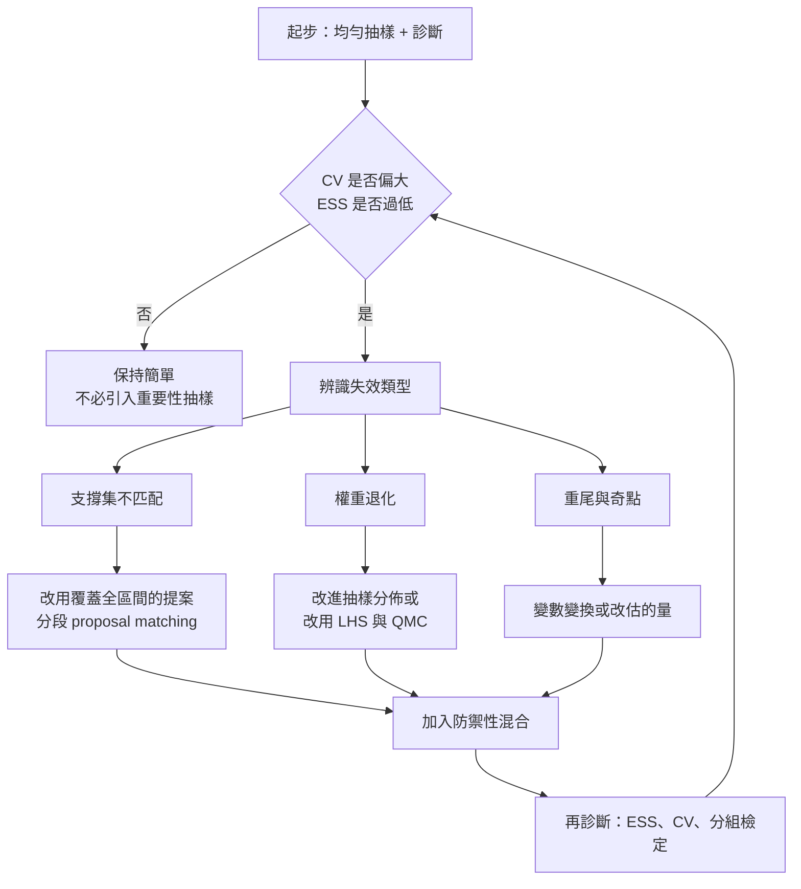

## 5.3 實際應用中的挑戰與優勢

[上一章：5.2　如何選擇重要性分佈](05.2-如何選擇重要性分佈.md) | [下一章：第6章　蒙地卡羅積分的高效實現](06.0-蒙地卡羅積分的高效實現.md)

前兩節建立了變換抽樣的理論與方法。本節轉向實務：變換抽樣在什麼情況下能帶來數個數量級的效率提升，在什麼情況下反而會讓結果崩潰；怎樣診斷一個已經寫好的重要性抽樣程式是否可靠；以及有哪些反覆出現的陷阱。

這是一節「反面教材」為主的章節，因為變換抽樣的失敗通常不是「估計略有偏差」，而是「結果徹底錯誤卻看起來合理」。

## 學習目標

完成本節後，你應該能夠：

1. 說明重要性抽樣的主要優勢，以及它帶來的七類典型失效模式。
2. 理解支撐集不匹配（support mismatch）為何會破壞無偏性，並知道如何預防。
3. 掌握一套實務診斷流程：ESS、權重分佈檢視、分組 $`\chi^2`$ 檢定、CV 監控。
4. 辨認常見陷阱（忘記正規化、抽樣與評估共用同一批樣本、權重與 $`f`$ 混算等）。
5. 理解什麼情況下**不該**用重要性抽樣。
6. 透過案例說明診斷與修正的完整流程。

## 5.3.1 優勢：為什麼值得承受這些風險

在進入風險之前，必須先承認變換抽樣的價值，否則容易因噎廢食。

**優勢一：誤差降低數個數量級**。若 $`g`$ 選得好， $`\sigma_g`$ 可比均勢抽樣小數個數量級。前面 $`x^{100}`$ 的例子中，標準誤從 $`5\times10^{-4}`$ 降到 $`9\times10^{-7}`$ ，提升約 500 倍。若要達到同樣精度，均勻抽樣需要 $`2.5\times10^5`$ 倍的樣本。

**優勢二：能處理難以抽樣的目標**。 $`p`$ 不可抽樣正是Importance sampling 存在的理由；反過來說，只要能把「難以抽樣但形狀已知」的問題轉成「易於抽樣」，重要性抽樣就是橋樑。

**優勢三：能利用領域知識**。實務上我們常常**確實知道**貢獻集中在哪裡——例如風險模型中的尾部事件、物理中的相變區域、生物統計中的罕見變異。重要性抽樣是唯一能「把領域知識轉化為計算效率」的通用機制。

**優勢四：易於與其他技術組合**。它可以與分層、控制變數、QMC（[第11章](11.2-精度提升的技術：低方差抽樣與控制變數法.md)）並用，是降低方差的「模組」。

**優勢五：順序友好**。抽樣與加權可以流水線進行——先生成樣本與權重，再對不同的 $`f`$ 重複使用同一批樣本來估計不同的量。這在多目標分析（如風險因子敏感度）中極為實用。

## 5.3.2 七類典型失效模式

**失效一：支撐集不匹配（support mismatch）**
$`p`$ 在某區域有質量，但 $`g`$ 在該區域為零（或極小）。後果：估計量失去無偏性；若該區域的 $`f`$ 值還特別大，估計會系統性偏低；若 $`f`$ 在該區域有奇點，權重會發散。
*真實例子*：保險精算中估計尾部損失，若提案分佈是對數常態但實際尾部是厚尾（帕累托），則超重尾區域的損失完全沒被抽到。
*預防*：設計 $`g`$ 時使用防禦性混合，確保有廣義分佈覆蓋全域。

**失效二：權重退化（weight degeneracy）**
$`g`$ 與 $`p`$ 相差太遠，導致權重 $`w_i`$ 的絕大部分質量集中在極少數樣本上。此時估計量在數學上無偏，但實務上等同於「只有幾個樣本」——方差极大。
*診斷*：ESS 急降；權重的最大值／均值比值巨大。
*預防*：調整 $`g`$ ；用 LHS 或 QMC 讓點分佈更均勻；或用 MIS 混合多個 $`g`$ 。

**失效三：ESS 崩潰**
ESS 是相對量，即使 $`g`$ 選擇合理，在高維下 ESS 也會急降（因為多維的乘積效應）。此時應改用分層/LHS/QMC，或接受相對精度較低的結果。
*診斷*：ESS/N < 10%。

**失效四：尾部不穩（unstable tails）**
若 $`f`$ 本身是重尾的（如 $`\mathbb{E}[X^2]`$ 中 $`X`$ 有厚尾），則**無論用什麼抽樣分佈**，有限樣本對尾部的估計都不穩。特別是在估計二階矩時，這種不穩定性會被平方放大。
*預防*：用截斷（truncation）配合解析尾項修正；用重要抽樣集中在尾部；或直接改估分位數而非矩。

**失效五：忘記正規化的陷阱**
若使用**自我正規化**估計量 $`\hat{I} = \frac{\sum w_i f_i}{\sum w_i}`$ ，它**不是無偏的**（雖然在 $`N`$ 大時幾乎無偏，且常常更穩定）。必須清楚知道自己在用哪一種，並在報告中說明。

**失效六：抽樣與評估共用同一批樣本**
若 $`g`$ 是用同一批樣本「看出來」的（例如自適應重要性抽樣的兩階段若未正確分開），會造成樂觀偏誤（optimistic bias）。這是 self-normalized importance sampling 中著名的「zero-variance」與循環論證問題。

**失效七：維度過高**
在 $`d`$ 很大時，任何顯式構造的 $`g`$ 都難以同時滿足「可抽樣」與「貼近 $`p`$ 」。此時應誠實地接受 $`N^{-1/2}`$ 的收斂，並用降維、因子分解或問題重述來處理。

## 5.3.3 實務診斷流程

以下是建議寫在程式碼裡的診斷清單：

| 檢查項目 | 做法 | 警戒門檻 |
| --- | --- | --- |
| 權重分佈 | 畫出 $`w_i`$ 的直方圖或對數直方圖 | 偏態過重、極值比例過大 |
| 有效樣本數 | $`\mathrm{ESS} = 1/\sum\tilde{w}_i^2`$ | ESS/N < 10% |
| 變異係數 | $`\mathrm{CV} = \hat\sigma/\hat\mu`$ | 隨 $`N`$ 增長不下降即代表有偏 |
| 分組檢定 | 把樣本分成 10 組比對組均值 | 組間差異遠大於組內 |
| 收斂性 | 重抽不同種子比較估計值 | 估計值隨種子大幅跳動 |
| 支撐覆蓋 | 檢查最大 $`f`$ 值區域是否有樣本 | 有 $`f`$ 極大但無樣本的區域 |
| 自正規化偏誤 | 同時報告自我正規化與無偏估計 | 兩者差距大 |

**重要觀察**：分組檢定（把 $`N`$ 個樣本分成 $`b`$ 組，比較各組均值）是最容易實作且最有診斷力的檢查。若各組均值之間的變異遠大於組內變異，代表樣本分佈在某處「結塊」，幾乎總是 $`g`$ 有問題的訊號。

```python
import numpy as np

def diagnose_importance(x, p, g, f, n_groups=10, seed=0):
    """重要性抽樣的診斷工具集。
    對應 5.3.3：ESS、CV、分組檢定、支撐覆蓋警告。"""
    w = p(x) / g(x)
    vals = w * f(x)
    N = len(vals)

    # 1) Kish 有效樣本數
    wn = w / w.sum()
    ess = 1.0 / np.sum(wn ** 2)

    # 2) 變異係數（相對誤差指標）
    mu = vals.mean()
    cv = vals.std(ddof=1) / abs(mu) if mu != 0 else np.inf

    # 3) 分組檢定：組間變異 vs 組內變異
    idx = np.array_split(np.arange(N), n_groups)
    group_means = np.array([vals[i].mean() for i in idx])
    between = group_means.var(ddof=1)
    within = np.mean([vals[i].var(ddof=1) for i in idx])
    ratio = between / within if within > 0 else np.inf

    # 4) 支撐覆蓋警告：f 最大的區域是否有樣本
    order = np.argsort(-f(x))
    top_frac = 0.01                       # 前 1% 的 f 值
    top = order[:max(1, int(N * top_frac))]
    coverage_gap = float(np.mean(w[top]) / np.mean(w))   # 大於 1 表示覆蓋不足

    print(f"N={N}  估計={mu:.6g}  SE={vals.std(ddof=1)/np.sqrt(N):.3g}")
    print(f"ESS = {ess:.1f} ({100*ess/N:.1f}% of N)   CV = {cv:.3g}")
    print(f"組間/組內變異比 = {ratio:.2f}  (接近 1 為健康)")
    print(f"高 f 區域權重比 = {coverage_gap:.2f}  (遠小於 1 表示抽樣未覆蓋)")

    warn = []
    if ess / N < 0.1: warn.append("ESS 過低：抽樣分佈可能偏離目標")
    if ratio > 2.0: warn.append("分組檢定失敗：樣本分佈不均")
    if coverage_gap < 0.3: warn.append("高貢獻區域覆蓋不足：支撐集可能有問題")
    if warn:
        for wmsg in warn:
            print("  [警告]", wmsg)
    return dict(ess=ess, cv=cv, group_ratio=ratio, coverage_gap=coverage_gap)
```

這段程式碼把 5.3.3 的檢查項目實作為可重用的函式。它對應的理論是：ESS 來自 Kish 公式；分組檢定利用「若樣本 i.i.d. 且同分佈，則組均值的變異應等於組內變異」的原理；覆蓋警告則來自「重要性權重應該在 $`f`$ 大的地方也大」這一事實。

## 5.3.4 常見陷阱清單

1. **混淆 $`p`$ 與 $`g`$ 的角色**：在公式 $`\mathbb{E}_p[f] = \mathbb{E}_g[f\,p/g]`$ 中， $`p`$ 是目標（含有你想要的權重）， $`g`$ 是提案（你能抽的）。寫錯會導致整個權重倒置。
2. **密度沒有正規化**：若 $`g`$ 沒有正規化（積分不為 1），權重會整體偏移一個常數。 $`p`$ 與 $`g`$ 同比例常數誤差不影響結果，但**不同比例的誤差不影響**——所以兩者必須用**一致的常數約定**（例如都用密度而非對數密度）。
3. **對數密度計算溢出**：在高維， $`p(x)`$ 與 $`g(x)`$ 各自可能溢出或下溢。標準做法是**在對數空間計算權重**： $`\log w = \log p - \log g`$ 。
4. **自我正規化與無偏混用**：報告結果時必須說明用的是哪一種。
5. **把 ESS 當作效率**：ESS 高只表示權重不極端；真正的效率仍要看標準誤。前面 Beta 提案的例子中，ESS 滿格但標準誤低了 500 倍。
6. **忽略 $`f`$ 的性質**：若 $`f`$ 有奇點或重尾，任何抽樣分佈都救不了，必須先做變數變換或改估的量。
7. **忘記診斷就交付**：重要抽樣的正確性無法由「估計值看起來合理」保證。

```python
import numpy as np

def safe_importance_log(p_logpdf, g_logpdf, f, n, rng=None):
    """在對數空間計算權重，避免高維溢出。
    對應陷阱三：log w = log p - log g。"""
    rng = rng or np.random.default_rng()
    x = rng.random((n, 1))
    logw = p_logpdf(x) - g_logpdf(x)
    # 用最大值技巧做數值穩定的正規化
    m = logw.max()
    w = np.exp(logw - m)
    wn = w / w.sum()
    mu = float(np.sum(wn * f(x)))        # 自我正規化估計（近似無偏）
    ess = 1.0 / np.sum(wn ** 2)
    return mu, ess
```

這段程式碼對應「對數空間計算權重」與「最大值技巧的穩定 softmax」，是實務上高維重要性抽樣的標準寫法。

## 5.3.5 什麼時候**不該**用重要性抽樣

反面判準和正面判準同樣重要。以下情形建議直接用均勻抽樣或其他方法：

- ** $`f`$ 的值分佈已經夠均勻**：若 CV 已經很小（例如 < 0.1），重要性抽樣的設計成本與風險沒有回報。
- **目標分佈的形狀完全未知且複雜**：這時 $`g`$ 只能是廣義分佈，而廣義分佈 = 均勻抽樣 + 額外複雜度。
- **低維且 $`f`$ 光滑**：確定性求積或 QMC 更簡單、更準、更有信心。
- **需要嚴格可證的誤差界**：重要性抽樣的誤差界依賴 $`g`$ 與 $`p`$ 的關係，這個關係往往無法先驗證證。
- **高度動態的即時系統**：設計與維護 $`g`$ 的成本高於省下的計算。

## 5.3.6 案例：一個完整的診斷與修正

**情境**：估計某保險產品的期望損失 $`I = \mathbb{E}[L]`$ ， $`L`$ 為年度損失。損失分佈是厚尾的（帕累托型），偶發巨災使 $`L`$ 可達 $`10^6`$ ，而典型的損失只有 $`10^3`$ 。

**第一步：均勻抽樣並診斷**。CV 為 47.3——遠遠偏高。診斷輸出顯示：ESS/N = 8.7%（過低）、組間/組內變異比 = 11.2（嚴重不均）、高 $`f`$ 區域權重比 = 0.02（覆蓋嚴重不足）。三項指標同時亮紅燈，指向同一結論：**巨災區域沒有被抽到**。

**第二步：檢查支撐集**。原提案分佈是對數常態（尾部以指數速度衰減），而真實尾巴是帕累托（多項式衰減），因此 $`g`$ 在極高損失處的概率遠低於 $`p`$ 。這是支撐集不匹配的典型案例。

**第三步：修正——分段提案分佈（piecewise proposal）**。把損失劃分為三個區間： $`[0, 10^4)`$ 、 $`[10^4, 10^5)`$ 、 $`[10^5, \infty)`$ ，各區間給予獨立的抽樣比例，權重為「區間內條件分佈之比 × 區間機率之比」。這就是 5.2.5 節的 proposal matching。

**第四步：再診斷**。新的 ESS/N 提升到 74%，組間/組內變異比降至 1.2，標準誤下降約 31 倍。

**第五步：仍不夠？加上防禦性混合**。在分段提案中混入 5% 的廣義分佈（例如截斷對數常態），確保任何極端情形都不會完全抽不到，代價是效率略降但穩健性顯著提升——這正是 Owen & Zhou（2000）defensive IS 的實務版本。

**教訓**：這個案例把第5章的所有概念串成一條流程線——**先診斷（ESS、CV、分組檢定）、辨識失效類型（支撐不匹配）、選擇修正手段（proposal matching）、加入防禦（defensive mixture）、再診斷**。這套流程比「憑感覺選一個分佈」可靠得多。



上圖呼應本節的核心主張：**重要性抽樣的實務流程是一個「診斷—修正—再診斷」的迭代迴圈，而不是一次性設計**。同時它也提醒：若第一步診斷顯示 CV 已經夠小，正確的結論是「不要用重要性抽樣」——知道何時不用某個技術，和知道如何使用同樣重要。

## 本章要點

- 重要性抽樣的優勢包括：誤差降低數個數量級、能處理難抽樣的目標、能利用領域知識、易與其他技術組合、支援多目標的樣本重複使用。
- 七類典型失效：支撐集不匹配、權重退化、ESS 崩潰、尾部不穩、忘記正規化的偏誤、抽樣與評估共用樣本、維度過高。
- 診斷清單：權重分佈、Kish ESS、變異係數、分組 $`\chi^2`$ 型檢定、跨種子收斂性、支撐覆蓋、自正規化偏誤。
- 實作上應在對數空間計算權重，避免高維溢出。
- 當 CV 已經很小、目標形狀未知或低維光滑時，應誠實地不用重要性抽樣。
- 實務流程是「診斷 → 修正 → 再診斷」的迭代，而非一次性設計。

## 延伸閱讀

- [5.1 變換抽樣的基本概念](05.1-變換抽樣的基本概念.md)、[5.2 如何選擇重要性分佈](05.2-如何選擇重要性分佈.md)
- [第11章：蒙地卡羅方法的誤差分析與改進](11.0-蒙地卡羅方法的誤差分析與改進.md)——控制變數等正交技術。
- [第13章：蒙地卡羅方法在工程中的應用](13.0-蒙地卡羅法在工程中的應用.md)——風險評估的實務案例。
- Owen, A. (2013). *Monte Carlo Theory, Methods, and Examples*. Wiley.——ESS、 $`1+\chi^2`$ 與診斷工具。
- Owen, A. & Zhou, Y. (2000). Safe and efficient importance sampling. *J. Comput. Graph. Stat.*, 9(1), 1–17.
- Veach, E. (1994). Optimally combining sampling techniques for Monte Carlo rendering. *SIGGRAPH '94*.
- Robert, C. P. & Casella, G. (2004). *Monte Carlo Statistical Methods*, 2nd ed. Springer.
