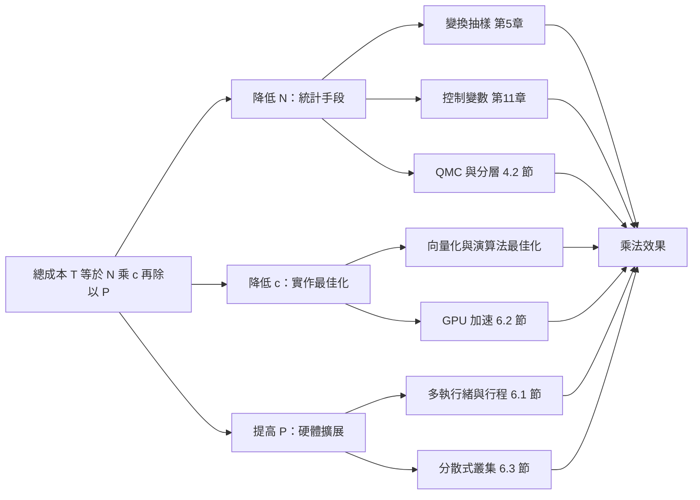

# 第6章　蒙地卡羅積分的高效實現

[上一章：第5章　變換抽樣法](05.0-變換抽樣法.md) | [下一章：第7章　隨機過程與模擬](07.0-隨機過程與模擬.md)

第4、5 章解決了「怎麼抽樣才準確」的問題，但留下了一個純粹工程的問題：**抽樣本身很貴**。若每個樣本的評估要花一分鐘，一百萬個樣本就要三個月。本章要處理的是效率的另一個面向——不改變估計的統計性質，而是讓同樣的精度以更少的時間（或更低的能耗）達成。

## 學習目標

完成本章後，你應該能夠：

1. 說明演算法複雜度與蒙地卡羅積分的「樣本數 × 每樣本成本」成本模型。
2. 說明硬體演進（多核、SIMT/GPU、分散式叢集）如何對應蒙地卡羅的計算特性。
3. 說明什麼是 embarrassingly parallel（易平行）以及蒙地卡羅積分為何屬於這一類。
4. 理解平行化帶來的新問題：可重現性（reproducibility）、隨機串流的分配、同步開銷。
5. 說明 GPU 的 SIMT 架構、warp、合併存取、occupancy 等概念如何影響蒙地卡羅的實作。
6. 理解分散式蒙地卡羅中的負相關抽樣與負相關點集（NCP）。
7. 建立一份可操作的效能優化清單。

## 6.1 效率方程

蒙地卡羅積分的總成本可以寫成

$$
T_{\text{total}} = N \times c_{\text{sample}} \times \frac{1}{P}
$$

其中 $`N`$ 是樣本數、 $`c_{\text{sample}}`$ 是單一樣本的評估成本、 $`P`$ 是有效並行度。三個因子分別對應本書的三個主題：

- **降低 $`N`$ **：變換抽樣（第5章）、控制變數（[第11章](11.0-蒙地卡羅方法的誤差分析與改進.md)）、QMC（[4.2 節](04.2-多維積分的蒙地卡羅方法.md)）。這是**統計**的改善。
- **降低 $`c_{\text{sample}}`$ **：演算法最佳化、向量化、GPU 化（[6.2 節](06.2-GPU加速與蒙地卡羅方法.md)）。這是**實作**的改善。
- **提高 $`P`$ **：多執行緒、多行程、多節點、GPU 裝置數（[6.1 節](06.1-基於並行計算的加速方法.md)、[6.3 節](06.3-分布式蒙地卡羅算法.md)）。這是**系統**的改善。

這個分解說明本章與第5章是**互補而非競爭**的：變換抽樣讓你「不需要那麼多樣本」，硬體加速讓你「樣本更便宜」。兩者相乘，效果遠大於各自單獨使用。

上圖呼應本章導論的核心論點：**效率優化是三個正交維度的乘法遊戲**，任何單獨一條路徑都會很快撞到天花板。也正因如此，蒙地卡羅的效能工程必須同時考慮統計設計、程式實作與系統架構。

## 6.2 為什麼蒙地卡羅特別適合並行

蒙地卡羅積分的樣本之間**在統計上是獨立的**。這意味著：

1. 沒有資料相依（no data dependency）需要等待：第 $`i`$ 個樣本的計算不需要第 $`i-1`$ 個完成。
2. 沒有共享可變狀態：每個 worker 可以完全獨立地工作。
3. 結果可以任意分割再合併：每個 worker 算出自己的部分和與平方和，最後相加。

這正是術語 **embarrassingly parallel（俗稱「 embarrassingly easy to parallelize」）** 的定義：除了最後的歸約之外，沒有任何並行化障礙。

相較之下，其他常見的數值方法都有「全域相依」：梯形法的求和雖可分割，但高精度求積的網格構造、代數求解器的迭代、以及有限元素法的稀疏解都難以簡單分割。

**Amdahl 定律的限制**：若某個程式有 $`s`$ 比例的串行部分，其加速比上限為

$$
\text{Speedup}(P) = \frac{1}{s + \frac{1-s}{P}}
$$

蒙地卡羅的串行部分極小（只有最後的歸約與樣本生成），因此即使 $`s = 1\%`$ ，在 $`P = 64`$ 時加速比也可達 $`62`$ 倍。但這是**理論上限**；實務中還有負載平衡、通訊、同步等開銷會進一步侵蝕加速比。

## 6.2 硬體演進與蒙地卡羅的契合

| 硬體世代 | 特性 | 對蒙地卡羅的意義 |
| --- | --- | --- |
| 純 CPU 序列 | 單核心、逐個算 | 基準線 |
| 多核 CPU | 數十核心，共享記憶體 | embarrassingly parallel 生效 |
| 多處理器主機 | 數百核心，NUMA | 需要注意記憶體親和性 |
| GPU（SIMT） | 數千條流處理器，massive parallelism | 適合「每樣本成本小、樣本數巨大」的場景 |
| 分散式叢集 | 數千節點，跨網路 | 需要處理通訊、同步、容錯 |
| 專用加速器 / TPU | 更大規模的張量並行 | 適用於機器學習型的蒙地卡羅 |

**關鍵判準**：GPU 擅長的是「大量簡單、規則、可並行的運算」，而不是「複雜分支與高度不規則的計算」。因此：

- **適合 GPU**：每個樣本的函數求值是簡單的向量運算（矩陣乘、逐元素函數、卷積）；樣本數巨大（ $`10^6`$ – $`10^9`$ ）。
- **不適合 GPU**：每個樣本需要複雜的分支、遞迴、或不規則的記憶體存取；樣本數很少。

## 6.3 本章的三節導覽

- **6.1　基於並行計算的加速方法**：執行緒／行程／程序池、Sobol 序列的並行化、批次分配、可重現性、Amdahl 定律、非同步與負相關抽樣。
- **6.2　GPU 加速與蒙地卡羅方法**：SIMT 架構、warp、合併存取、occupancy、原子累加與歸約、CUDA／ROCm 與 curand、PyTorch／JAX、隨機數在 GPU 的注意事項、效能分析與優化清單。
- **6.3　分布式蒙地卡羅算法**：MPI、隨機化 QMC、分散式 Metropolis、負相關點集（NCP）、叢集通訊成本、容錯、同步開銷、實務建議。

## 6.4 從本章通向全書

本章是「工程效率」的章節，之後的章節回到「應用」：

- [第7章](07.0-隨機過程與模擬)處理的隨機微分方程式求解，正是蒙地卡羅最典型的「每樣本成本高」場景，那裡的並行與 GPU 化有自己的限制。
- [第8章](08.0-蒙地卡羅方法在物理中的應用)的粒子方法需要大量粒子但每步計算複雜，是 GPU 化的難題。
- [第9章](09.0-蒙地卡羅方法在金融中的應用)則是 GPU 的最佳舞台之一：數百萬條路徑、每條路徑成本低、且需要低延遲的即時重估。
- [第14章](14.0-蒙地卡羅方法在機器學習中的應用)中，變分推論、哈密頓蒙特卡羅與 MCMC 都受益於並行與 GPU。

## 本章要點

- 效率成本模型為 $`T = N \cdot c_{\text{sample}} / P`$ ；降低 $`N`$ 、降低 $`c_{\text{sample}}`$ 、提高 $`P`$ 是三條正交且互補的改善路徑。
- 蒙地卡羅積分屬於 embarrassingly parallel：樣本獨立、無共享狀態、可任意分割合併。
- 硬體世代的演進方向（多核 → GPU → 分散式）與蒙地卡羅「樣本數巨大」的特性高度契合。
- GPU 適合「樣本數巨大、每樣本運算規則且簡單」；複雜分支型工作負載仍應留在 CPU。
- Amdahl 定律給出加速比的理論上限，實際還要扣除負載平衡、通訊與同步開銷。

## 延伸閱讀

- [6.1　基於並行計算的加速方法](06.1-基於並行計算的加速方法.md)、[6.2　GPU加速與蒙地卡羅方法](06.2-GPU加速與蒙地卡羅方法.md)、[6.3　分布式蒙地卡羅算法](06.3-分布式蒙地卡羅算法.md)
- [第5章：變換抽樣法](05.0-變換抽樣法.md)、[第4章：蒙地卡羅積分法](04.0-蒙地卡羅積分法.md)
- [第9章：蒙地卡羅方法在金融中的應用](09.0-蒙地卡羅方法在金融中的應用.md)——GPU 化的代表性應用。
- Hockney, R. W. & Eastwood, T. (2010). *Computer Graphics: A Programming Approach*.——GPU 架構與效能分析。
- Grama, A. et al. (2003). *Introduction to Parallel Computing*. Academic Press.——MPI 與平行演算法。
