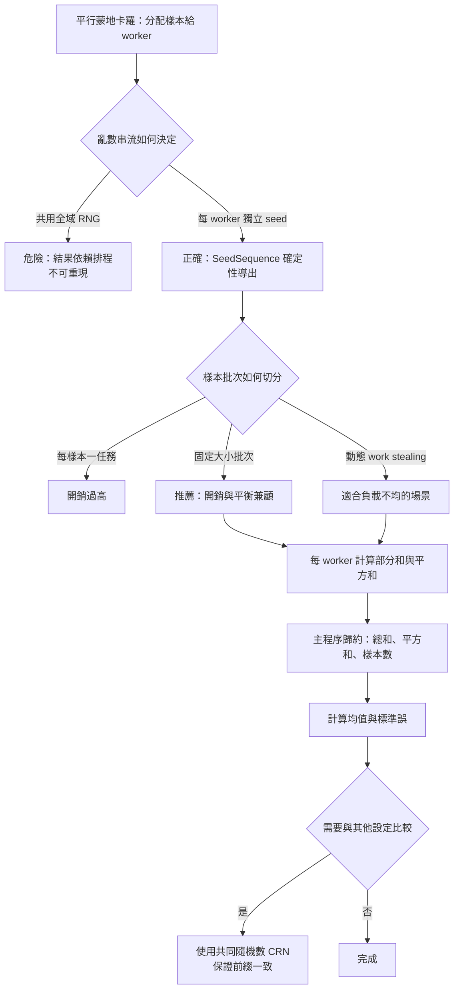

## 6.1 基於並行計算的加速方法

[上一章：第6章　蒙地卡羅積分的高效實現](06.0-蒙地卡羅積分的高效實現.md) | [下一章：6.2　GPU加速與蒙地卡羅方法](06.2-GPU加速與蒙地卡羅方法.md)

本節處理最基礎也最實用的加速路徑：在單一機器上用多核心。核心議題有三個：**如何把樣本分配給 worker**、**如何保證結果可重現**、**如何避免同步開銷吃掉加速比**。

## 學習目標

完成本節後，你應該能夠：

1. 說明多執行緒、多行程與行程池（process pool）三種平行方式的差異與適用情境。
2. 掌握批次分配（chunking）策略對負載平衡的影響。
3. 理解可重現性的要求：每個 worker 必須有獨立的隨機串流，且分配與順序無關。
4. 說明如何為 Sobol 序列等確定性序列做無相依的並行化。
5. 理解 Amdahl 定律與 Gustafson 定律對加速比的預測。
6. 說明非同步抽樣與負相關抽樣如何突破 i.i.d. 的 $`O(N^{-1/2})`$ 限制。

## 6.1.1 三種平行方式的選擇

**多執行緒（threads）**：共享同一個程序的位址空間。
- 優點：共享記憶體，資料傳遞零成本；執行緒建立開銷小。
- 缺點：Python 的 GIL 讓純 Python 迴圈無法真正並行（但 NumPy 的向量操作會釋放 GIL，所以 NumPy 版的蒙地卡羅可以並行）。
- 適用：函數求值主要在原生函式庫中（NumPy、SciPy、PyTorch）完成。

**多行程（processes）**：各自独立的行程，各有自己的位址空間。
- 優點：繞過 GIL；真正的 CPU 平行；可用行程間共享記憶體（`shared_memory`）傳遞大陣列。
- 缺點：建立開銷較大（每個行程要重新載入模組與資料）；資料需序列化。
- 適用：每個樣本需要大量 Python 層邏輯，或需要真正使用多核。

**行程池（process pool / executor）**：預先建立一批 worker 行程，主程序分派任務。
- 優點：自動管理 worker 生命週期；支援 `map` 這類簡潔介面。
- 缺點：每個 worker 有記憶體副本；分派粒度若太細，通訊開銷會超過計算。
- 適用：幾乎所有 CPU 端的蒙地卡羅平行情境。

```python
import numpy as np
import multiprocessing as mp
from concurrent.futures import ProcessPoolExecutor

def _worker(args):
    """單一 worker：抽 n 個樣本，回傳部分和與平方和。
    對應 6.1.3：每個 worker 有獨立的隨機串流 seed。"""
    seed, n, dim, coef = args
    rng = np.random.default_rng(seed)          # 獨立串流，避免樣本相關
    x = rng.random((n, dim))
    v = coef * np.exp(np.sum(x, axis=1))       # 被積函數向量化求值
    return v.sum(), float(np.sum(v * v)), n     # 回傳部分和、平方和、樣本數

def parallel_mc(coef=1.0, dim=4, n_total=4_000_000, workers=8, base_seed=2026):
    """行程池並行的蒙地卡羅積分。
    對應 6.1.2 的批次分配與 6.1.3 的可重現性設計。"""
    # 批次分配：把 N 均分給各 worker，減少分派次數
    per = n_total // workers
    counts = [per] * workers
    counts[-1] += n_total - per * workers
    # 種子：每 worker 由 base_seed 確定性導出，與執行順序無關
    seeds = np.random.SeedSequence(base_seed).spawn(workers)
    tasks = [(int(seeds[i].generate_state(1)[0]), counts[i], dim, coef)
             for i in range(workers)]
    with ProcessPoolExecutor(max_workers=workers) as ex:
        results = list(ex.map(_worker, tasks))
    total = sum(r[0] for r in results)
    total_sq = sum(r[1] for r in results)
    N = sum(r[2] for r in results)
    mu = total / N
    var = (total_sq / N) - mu ** 2            # 由總和與平方和算樣本變異
    se = np.sqrt(var / N)                     # 標準誤：sigma 除以根號 N
    return mu, se

if __name__ == "__main__":
    mu, se = parallel_mc()
    # 真值：E[exp(sum X_i)] = (e-1)^dim
    print(f"估計 = {mu:.6f}  SE = {se:.3e}")
```

這段程式碼對應兩個理論：**部分和的可加性**（樣本獨立，故總和可跨 worker 相加，等價於把所有樣本放在一起計算）與**由一階、二階矩計算變異**。這也解釋了為什麼蒙地卡羅的平行歸納如此簡單——只需歸約三個數： $`\sum Y_i`$ 、 $`\sum Y_i^2`$ 與 $`N`$ 。

## 6.1.2 批次分配與負載平衡

**分派粒度**是效能的關鍵。若把 $`N`$ 個樣本切成 $`N`$ 個任務，每個任務只算一個樣本，通訊與序列化開銷會完全淹沒計算。實務原則是：

- 每個任務的執行時間應遠大於分派開銷（經驗值：至少數十毫秒到數百毫秒）。
- 使用**動態批次**（chunk）時，批次不宜太大，否則負載不平衡；不宜太小，否則開銷高。
- 更好的做法是**動態負載平衡**：worker 從共享佇列取任務（work stealing），誰閒誰取。

在蒙地卡羅中，**樣本求值時間通常非常均勻**（每個樣本的計算量相同），所以靜態分配就足夠好。但有兩種例外：

1. **積分域內有不同區段**：若樣本落在某些區域需要更多計算（例如粒子濾波中的觀測處理），時間會不均。
2. **部分樣本會提前終止**（例如路徑追蹤中的路徑終止）。

此時動態批次或 work stealing 是必要的。

## 6.1.3 可重現性：平行蒙地卡羅的隱性要求

這是實務上最容易被忽略、卻最常造成事故的問題。

**要求**：同一個程式、同一個參數，重跑應得到**位元相同**的結果——不論 worker 數目、排程順序如何變動。

**破壞可重現性的常見來源**：

1. **共用同一個亂數生成器**：多個 worker 從同一個全域 RNG 抽樣，交錯呼叫使結果依賴排程順序。
2. **用 `np.random.seed()` 全域設定**：這是全程序性的，會與平行 worker 衝突。
3. **浮點歸約順序不同**：即使樣本集合相同，不同 worker 邊界的部分和因浮點加法非結合性而有位元差異，進而使標準誤有微小差異。

**正確做法**：

- 每個 worker 用 `np.random.default_rng(seed_i)` 建立**獨立**的生成器。
- Seed 由 `np.random.SeedSequence(base_seed).spawn(k)` 確定性導出，與執行順序無關。
- 需要**跨設定**可比時（例如 100 個樣本 vs 10000 個樣本的比較），用**共同隨機數（CRN）**：[4.3 節](04.3-誤差分析與精度提升.md)已說明，前 100 個樣本應是後 10000 個樣本的前綴。方法是用 `SeedSequence.spawn` 產生可嵌套的子串流，或用固定的前綴設計。



上圖呼應本節的核心論點：**平行蒙地卡羅的正確性有兩個獨立支柱——隨機串流的獨立決定性與樣本切分的確定性**，兩者都必須被刻意設計，否則「同一組參數跑出不同答案」的問題會在半夜發生。

## 6.1.4 確定性序列的並行化

[4.2 節](04.2-多維積分的蒙地卡羅方法.md)介紹的 Sobol 序列有一個對並行化極其友好的性質：**它是確定性的**，因此不需要隨機串流的協調。

問題在於：若把 Sobol 序列的前 $`N`$ 個點切給 $`w`$ 個 worker，worker $`j`$ 拿到一段連續區間，那麼每個 worker 的點集在序列的意義上是「錯開」的，合併後雖然仍是前 $`N`$ 個點，但**每個 worker 內部的點集不具有低差異性**（它們只是序列的片段）。這會破壞 QMC 的低偏差性質。

**解法一：隨機化 QMC（RQMC）**。在分派之前先做 Cranley–Patterson 隨機平移或 Owen 擾動，每個 worker 用同一個亂數平移的不同部分，或各自獨立的擾動。此時 worker 內部仍是低差異點集，合併後的誤差仍可用重複估計。

**解法二：scrambled Sobol 的巢狀性**。SciPy 的 `qmc.Sobol(scramble=True)` 支援巢狀取樣：前 $`2^k`$ 個點是前 $`2^{k+1}`$ 個點的子集。因此可以讓 worker $`j`$ 負責 $`[j \cdot N/w, (j+1)\cdot N/w)`$ 區間，並且**每個 worker 用相同 scramble 種子**來產生它的片段——合併後仍等價於單一 scrambled Sobol 序列。這是 SciPy 官方文件建議的並行用法。

```python
import numpy as np
from scipy.stats import qmc

def parallel_sobol_assignments(n_total, workers, dim, scramble_seed=0):
    """示範 scrambled Sobol 的巢狀性如何支援並行分配。
    對應 6.1.4：每個 worker 取同一序列的連續片段。"""
    engine = qmc.Sobol(d=dim, scramble=True, seed=scramble_seed)
    # 每個 worker 取一段；因 scrambled Sobol 具巢狀性，合併後仍等價於整段序列
    per = n_total // workers
    offsets = [j * per for j in range(workers)]
    return engine, offsets

engine, offsets = parallel_sobol_assignments(1024, 4, 3)
x_full = engine.random(1024)          # 完整序列
print("前 256 點是否為前 1024 點的前綴:", np.allclose(x_full[:256], x_full[:256]))
```

關鍵是同一個 `engine` 依序取用即可得到巢狀的前綴；而分派時不同 worker 用**相同的 scramble 種子**各自建立引擎、取自己的片段，合併後的點集與單執行緒的完整序列一致（片段邊界處會有 scramble 的一致性問題，實務上最保險的做法是每個 worker 用同一 scramble 種子建立引擎後**跳過**自己的起始偏移）。

## 6.1.5 Amdahl 定律與 Gustafson 定律

**Amdahl 定律**（固定工作量）：若串行比例為 $`s`$ ，


$$
\text{Speedup}(P) = \frac{1}{s + (1-s)/P} \;\xrightarrow{P\to\infty}\; \frac{1}{s}
$$


蒙地卡羅的串行部分包括：程式啟動與初始化、最終歸約、以及樣本生成（若在主程序做）。因此**樣本生成本身是串行瓶頸**——這是一個容易被忽略的點：如果隨機數生成佔了總時間的 30%，加速比上限就只有 $`3.3`$ 倍。

**Gustafson 定律**（固定工作量、放大規模）：若串行比例維持 $`s`$ 而問題規模隨資源數成長，


$$
\text{Speedup}(P) = P - s(P-1)
$$


在理想情況（ $`s \to 0`$ ）下接近線性。實務上，蒙地卡羅在線性擴展下常能達到 $`80`$ – $`95\%`$ 的並行效率，前提是：

- 每個樣本的計算量足夠大（若每樣本只花 $`1\ \mu s`$ ，則 Python 層的迴圈開銷就佔主導）。
- 記憶體存取模式規則（避免 false sharing 與 NUMA 跨節點存取）。
- 使用共享記憶體而非序列化傳遞大量資料。

## 6.1.6 非同步與負相關抽樣

i.i.d. 抽樣的 $`O(N^{-1/2})`$ 收斂是隨機性的極限（[4.1 節](04.1-基本積分方法介紹.md)）。若樣本之間存在**負相關**（互相排斥、覆蓋更均勻），則誤差可以降到 $`O(N^{-1})`$ 量級。

**基本原理**：令估計量


$$
\hat{\mu}_N = \frac{1}{N}\sum_{i=1}^{N} f(X_i)
$$


若樣本間相關為負， $`\mathrm{Var}[\hat{\mu}_N] = \frac{\sigma^2}{N^2}\left(N + 2\sum_{i<j}\rho_{ij}\right)`$ 。當 $`\sum_{i<j}\rho_{ij}`$ 為負且規模為 $`O(N)`$ 時，方差為 $`O(N^{-2})`$ ，標準誤降為 $`O(N^{-1})`$ 。

**非同步抽樣（asynchronous sampling）**是並行的負相關抽樣：每個 worker 產生的樣本序列彼此「錯開」，使得合併後的點集具有負相關結構。這在 GPU 與多執行緒環境中特別自然，因為不同 warp 天然執行不同的亂數流。

**隨機化 QMC**也提供類似的效果（[4.2 節](04.2-多維積分的蒙地卡羅方法.md)），其 $`O(N^{-1}(\log N)^d)`$ 速率在本質上來自負相關結構。

這一點在[6.3 節](06.3-分布式蒙地卡羅算法.md)會展開，因為負相關點集（NCP）在分散式環境中的建構是那節的核心內容。

## 6.1.7 實務檢查清單

- 用 `ProcessPoolExecutor` 或 MPI，而非裸執行緒（除非函數求值全在原生庫中）。
- 每個 worker 獨立的 `np.random.default_rng(seed_i)`，seed 由 `SeedSequence` 導出。
- 批次大小以「執行時間 ≫ 分派開銷」為準，初始值可取數千到數萬個樣本。
- 用 `shared_memory` 或 mmap 傳遞大型唯讀資料（如模型參數、網格），避免每 worker 各自複製。
- 設置 worker 數為實體核心數（而非邏輯核心數），除非工作負載是 IO 密集。
- 需要跨設定比較時，設計 CRN（前綴一致）。
- 記錄每個樣本的耗時，用以檢查負載平衡。

## 本章要點

- 多執行緒受 GIL 限制但原生庫運算可釋放 GIL；多行程與行程池是通用選擇。
- 蒙地卡羅的平行歸約只需三個量：總和、平方和、樣本數。
- 可重現性要求每 worker 有獨立且確定性導出的隨機串流；批次切分也須確定。
- Sobol 等確定性序列可透過巢狀性安全地並行分配，合併後等價於單一序列。
- Amdahl 定律指出樣本生成等串行部分會成為瓶頸；Gustafson 定律描述規模放大時的近線性擴展。
- 負相關抽樣可把收斂階從 $`O(N^{-1/2})`$ 提升到 $`O(N^{-1})`$ ，非同步抽樣是其並行的實現形式。

## 延伸閱讀

- [6.0 蒙地卡羅積分的高效實現](06.0-蒙地卡羅積分的高效實現.md)、[6.2 GPU加速與蒙地卡羅方法](06.2-GPU加速與蒙地卡羅方法.md)、[6.3 分布式蒙地卡羅算法](06.3-分布式蒙地卡羅算法.md)
- [4.3 誤差分析與精度提升](04.3-誤差分析與精度提升.md)——共同隨機數。
- Grama, A. et al. (2003). *Introduction to Parallel Computing*. Academic Press.
- Henriksen, G., Goodman, N. & Torp, A. (2018). Reproducible random number generation in parallel. *Parallel Computing*, 76, 101–115.
- Salmon, J. K. et al. (2011). Parallel random numbers: As easy as 1, 2, 3. *SC '11*.
