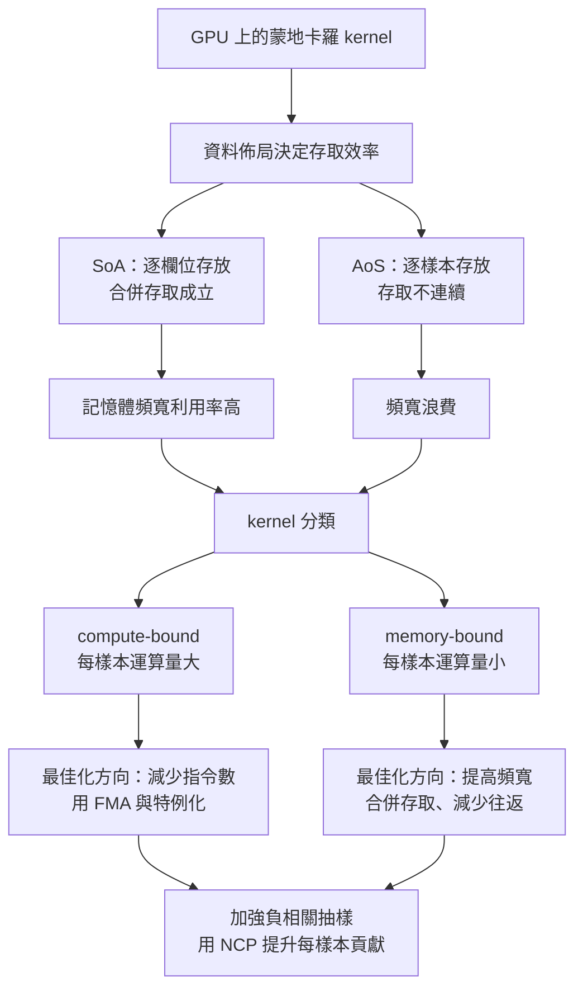

## 6.2 GPU 加速與蒙地卡羅方法

[上一章：6.1　基於並行計算的加速方法](06.1-基於並行計算的加速方法.md) | [下一章：6.3　分布式蒙地卡羅算法](06.3-分布式蒙地卡羅算法.md)

GPU 與 CPU 的差異不只是「核心數多」，而是**執行模型不同**。理解 SIMT（Single Instruction, Multiple Threads）、warp、合併存取與 occupancy 這幾個概念，是把蒙地卡羅有效地搬到 GPU 上的前提。本節以 CUDA 為主要參照，同時說明 ROCm（AMD）與 PyTorch／JAX 的高階用法。

## 學習目標

完成本節後，你應該能夠：

1. 說明 CPU 與 GPU 的執行模型差異，以及 SIMT 與 SIMD 的關係。
2. 解釋 warp、合併存取（coalescing）、occupancy 的意義與其對蒙地卡羅 kernel 的影響。
3. 說明在 GPU 上實作蒙地卡羅歸約（reduction）與原子累加（atomic accumulation）的作法與取捨。
4. 說明 curand 的亂數生成方式，以及為何 GPU 上的亂數需要特別設計。
5. 用 PyTorch 或 JAX 實作 GPU 版蒙地卡羅積分。
6. 區分 memory-bound 與 compute-bound，並給出效能優化清單。

## 6.2.1 執行模型：為什麼 GPU 適合蒙地卡羅

CPU 的核心是複雜的**通用**處理器：深入的分支預測、快取階層、out-of-order 執行。它的設計目標是讓**單執行緒**跑得快。

GPU 的核心是簡單的**大量複製**處理器：數千條流處理器，共享一條指令流。設計目標是讓**整體吞吐**高。

| 面向 | CPU | GPU |
| --- | --- | --- |
| 核心數 | 數十 | 數千到數萬 |
| 執行模型 | 多核心，各自執行不同指令 | SIMT，warp 內同指令、資料分歧 |
| 記憶體 | 大容量、低頻寬、高延遲的快取階層 | 容量小但頻寬極高（數百 GB/s 到數 TB/s） |
| 擅長 | 複雜分支、序列化、低延遲 | 大批量規則運算、算術密集 |
| 弱點 | 批次吞吐受限 | 分歧嚴重時浪費、互動式延遲高 |

**SIMT 與 SIMD 的差別**：SIMD（Single Instruction, Multiple Data）要求資料必須打包成向量（如 AVX 的 4 個 float 一起算）。SIMT 則讓每個執行緒有自己的執行緒索引，可以獨立處理資料，但以 warp 為單位鎖步執行；若同一 warp 內的執行緒走進不同分支（**warp divergence**），GPU 必須兩邊都執行，再掩蓋（mask）掉不需要的結果。

對蒙地卡羅而言，關鍵觀察是：**「每個樣本獨立做同樣的事」正是 SIMT 的理想型態**。金融的路徑模擬、物理的粒子演化、貝葉斯的後驗抽樣，都是大量結構相同的樣本處理。

**但也有例外**：如果每個樣本的計算含有複雜分支（例如路徑追蹤中的隨機終止），warp 內會出現分歧，效率大幅下降。這是判斷「是否適合 GPU 化」的關鍵。

## 6.2.2 warp、合併存取與 occupancy

**warp** 是 GPU 的排程單位，典型大小為 32 條執行緒（AMD 的 wavefront 為 64）。同一個 SM（streaming multiprocessor）上可有多個 warp 同時執行，藉此在分歧時互相填補空閒資源。

**合併存取（coalescing）**：若同一 warp 內的 32 條執行緒存取一段**連續**的記憶體（例如 `out[i]`，其中 $`i`$ 為 threadIdx.x），GPU 會把它們合併成少量（理想上 1–4 個）大型記憶體交易，達到峰值頻寬。若存取是跨 stride 的（例如 `out[i*1000]`），則每條執行緒觸發獨立的交易，頻寬利用率暴跌。

**這對蒙地卡羅的具體影響**：如果每個樣本的函數求值需要讀寫一個陣列，**用 AoS（array of structures，逐樣本存放）還是 SoA（structure of arrays，逐欄位存放）會差很多**。SoA 讓合併存取成立，是 GPU 版蒙地卡羅的標準做法。

**occupancy（佔用率）** 是 SM 上實際駐留的 warp 數與理論上限的比例。高 occupancy 有助於隱藏記憶體延遲（當一個 warp 在等記憶體時，其他 warp 繼續執行）。但 occupancy 不是越高越好——過高的 occupancy 會減少每個執行緒可用的暫存器與共享記憶體。



上圖呼應本節的核心論點：**GPU 效能優化必須先判斷 kernel 是 compute-bound 還是 memory-bound，方向才不會搞反**。實務上，蒙地卡羅的樣本生成常是 memory-bound（生成一組亂數要寫入大量記憶體），而樣本求值可能是 compute-bound——兩者需要不同的優化手段。

## 6.2.3 亂數生成：GPU 上的特殊考量

GPU 亂數不能沿用 CPU 的做法，原因有三：

1. **線程安全的亂數狀態**：CPU 的全域 RNG 在多執行緒下需要鎖。GPU 上每條執行緒有自己的狀態，天然避免此問題。
2. **大量亂數的吞吐量**：每秒產生數十億個亂數是可能的，但必須用**計算密集型**的演算法，而不是「一格一格填表」的方法。
3. **品質與速度的取捨**：便宜的 LCG 品質不足， Mersenne Twister 太慢。

**cuRand** 是 NVIDIA 的官方亂數庫，主要提供：
- **擬隨機（Philox / XORWOW）**：計數器型（counter-based）亂數生成器。每個亂數的「輸入」是 (seed, counter, subsequence)，不同執行緒只要 counter 不同就得到互不重疊的序列。**這天生適合 GPU 的並行模型**。
- **Sobol 序列**：cuRand 提供 Sobol 亂數生成器與 scrambler，支援在 GPU 上產生低差異序列並做隨機化擾動（對應[4.2 節](04.2-多維積分的蒙地卡羅方法.md)的 RQMC）。

**ROCm（AMD）** 提供 hipRAND，API 與 cuRand 幾乎對應，便於移植。

```cpp
// CUDA 核心函式：以 Philox 亂數生成一組樣本並做歸約
// 對應 6.2.3 的 counter-based RNG 與 6.2.4 的歸約設計
#include <curand_kernel.h>

__global__ void mc_kernel(double* out, unsigned long long seed,
                          int n, int dim, double coef) {
    // 以區塊與執行緒索引作為亂數計數器，確保每條執行緒的序列互不重疊
    unsigned long long idx = (unsigned long long)blockIdx.x * blockDim.x + threadIdx.x;
    unsigned long long sub = (unsigned long long)blockIdx.y;  // 每個區塊一個子序列
    if (idx >= (unsigned long long)n) return;

    curandStatePhilox4_32_10_t state;
    curand_init(seed, sub, 0, &state);

    double acc = 0.0;
    // 向量化的被積函數：exp(sum(x_i))，x_i 在 [0,1)
    float4 v = curand4(&state);
    double s = (v.x + v.y + v.z + v.w) * 0.25;
    acc = coef * exp(s);

    out[idx] = acc;
}

// 以兩階段歸約求和：先在區塊內用 shared memory 歸約，再寫出部分和
__global__ void reduce_blocks(const double* in, double* block_sums) {
    extern __shared__ double sdata[];
    unsigned int tid = threadIdx.x;
    unsigned int i = blockIdx.x * blockDim.x + threadIdx.x;
    sdata[tid] = (i < gridDim.x * blockDim.x) ? in[i] : 0.0;
    __syncthreads();
    for (unsigned int s = blockDim.x / 2; s > 0; s >>= 1) {
        if (tid < s) sdata[tid] += sdata[tid + s];
        __syncthreads();
    }
    if (tid == 0) block_sums[blockIdx.x] = sdata[0];
}
```

這段 CUDA 程式碼對應兩個理論重點：

- **Philox 的 counter-based 設計**：亂數由 (seed, subsequence, counter) 決定，因此 `blockIdx.y` 作為 subsequence 保證不同區塊的序列互不重疊，無需任何同步——這是 GPU 上亂數生成的正確做法。
- **兩階段歸約**：先用 shared memory 在區塊內歸約（warp 內可用 `__shfl_down_sync` 進一步最佳化），再對區塊部分和做第二階段。這避免了每條執行緒都做原子加載造成的競爭；原子累加（`atomicAdd`）雖然更簡單，但在浮點下**結果不可重現**（歸約順序隨機），這在需要可重現性的蒙地卡羅中是嚴重問題。

**可重現性的重要推論**：GPU 上若用原子加載做浮點歸約，同樣的種子在不同執行中可能得到位元不同的結果。要保證可重現，必須使用**固定順序的歸約**（例如兩階段 tree reduction，或在 CPU 上以固定順序合併部分和）。

## 6.2.4 高階框架：PyTorch 與 JAX

對多數應用而言，直接寫 CUDA 太耗時；用張量框架寫「批次化的蒙地卡羅」更實際。

**PyTorch 範例**：

```python
import torch

def gpu_mc_integrate(fn, dim, n_total, device="cuda", batch=1_048_576, seed=0):
    """在 GPU 上以批次方式做蒙地卡羅積分。
    對應 6.2.1 的 SIMT 型態：每個樣本獨立、規則的運算。"""
    dev = torch.device(device if torch.cuda.is_available() else "cpu")
    g = torch.Generator(device=dev); g.manual_seed(seed)

    total = 0.0
    total_sq = 0.0
    n_done = 0
    while n_done < n_total:
        m = min(batch, n_total - n_done)
        x = torch.rand((m, dim), device=dev, generator=g)      # 批次生成樣本
        v = fn(x)                                            # 向量化求值（GPU kernel）
        total += v.double().sum().item()
        total_sq += (v.double() ** 2).sum().item()
        n_done += m
    mu = total / n_total
    var = total_sq / n_total - mu ** 2
    return mu, var ** 0.5 / n_total ** 0.5

# 範例：估計 E[exp(sum_{i=1}^{3} X_i)]，X_i ~ U(0,1)，真值 (e-1)^3
def f(x):
    return torch.exp(x.sum(dim=1))

mu, se = gpu_mc_integrate(f, dim=3, n_total=8_000_000)
print(f"估計 = {mu:.6f}  SE = {se:.3e}   真值 = {(torch.e-1).item()**3:.6f}")
```

這段程式碼對應幾個要點：

- **批次大小**決定單次 GPU 呼叫的規模，太小則啟動開銷佔比高，太大則可能超出顯存。典型值是數十萬到數百萬。
- **歸約在 CPU 端以固定順序完成**：`.item()` 每次把部分和傳回主機，避免 GPU 端浮點原子歸約導致的不可重現。
- **抽樣在裝置上完成**：`torch.rand` 在 GPU 上產生亂數，其品質取決於框架的實作（PyTorch 使用 Philox 系的計數器型生成器），這正是 6.2.3 的設計。

**JAX** 的做法類似，但提供 `jax.random` 的三個隨機鍵（key）機制，讓 PRNG 顯式地作為參數傳遞，避免全域狀態——這在功能並行（`jax.vmap`）與 `jit` 編譯下特別重要，也是可重現性的最佳實踐。

```python
import jax, jax.numpy as jnp, numpy as np

# JAX 版：以三鍵 PRNG 保證可重現，並用 vmap 做功能並行
key_sample, key_eval, key_shuffle = jax.random.split(jax.random.PRNGKey(2026), 3)

@jax.jit
def mc_integrate_jax(dim, n, coef):
    k1, k2 = jax.random.split(key_sample)
    x = jax.random.uniform(k1, (n, dim))
    v = coef * jnp.exp(jnp.sum(x, axis=1))
    return jnp.mean(v), jnp.std(v) / jnp.sqrt(n)

mu, se = mc_integrate_jax(3, 4_000_000, 1.0)
print(f"JAX: {mu:.6f} ± {se:.3e}")
```

**框架層面的三個實務要點**：

1. **不要在 Python 迴圈裡呼叫 GPU**：每次 `.item()` 或 `float()` 都是同步點，會把管線打斷，效能暴跌。應盡量讓資料留在裝置上，只在最後取回。
2. **注意 dtype**：單精度（float32）的蒙地卡羅在累加百萬個樣本時會有累積誤差；建議在**歸約階段**升為 float64（PyTorch 用 `.double()`）。
3. **批次與裝置記憶體平衡**：把整個 $`10^8`$ 樣本放在 GPU 上通常不可行，正確做法是「生成一批 → 求值一批 → 歸約一批 → 釋放」。

## 6.2.5 Memory-bound 與 Compute-bound

這是 GPU 效能分析的第一個判斷。

**Memory-bound**：kernel 的執行時間主要由記憶體頻寬決定。典型症狀是：occupancy 很高、算術強度（arithmetic intensity，每 byte 執行的浮點運算數）低、加大資料量時效能線性下降。
- 蒙地卡羅的**亂數生成**通常是 memory-bound：寫出 $`10^8`$ 個亂數要大量記憶體流量。
- 優化方向：合併存取、減少中間陣列（融合 kernel）、使用低精度儲存（fp32 存放、大量運算用 fp32 但歸約用 fp64）。

**Compute-bound**：執行時間由算術單元決定。症狀是：occupancy 不高、算術強度高。
- 蒙地卡羅的**樣本求值**（如矩陣乘、深度網路前向傳播）通常是 compute-bound。
- 優化方向：使用融合乘加（FMA）、減少不必要的中間結果、提高 ILP。

**算術強度**的估計：


$$
I_{\text{intensity}} = \frac{\text{浮點運算次數}}{\text{記憶體存取位元組數}}
$$


GPU 的平衡點約在 10 FLOP/byte 量級。若樣本求值的強度高於此，則 compute-bound；若亂數生成的強度遠低於此，則 memory-bound。

**實務建議的量測方法**：用 `ncu`（Nsight Compute）取得 occupancy、achieved bandwidth、SM throughput 三個指標。SM throughput 高而 memory throughput 低 → compute-bound；反之 → memory-bound。

## 6.2.6 GPU 化是否值得：判準清單

GPU 化的成本包括：資料傳輸、kernel 撰寫與除錯、確定性（reproducibility）維護、以及**限制使用者的除錯能力**。判準如下：

| 條件 | 建議 |
| --- | --- |
| 樣本數 $`\ge 10^6`$ 且每樣本成本低 | 值得，預期數十到數百倍加速 |
| 樣本數小（ $`<10^4`$ ） | 不值得，啟動開銷佔比過高 |
| 每樣本含複雜分支／遞迴 | 謹慎，warp divergence 會吃掉收益 |
| 需要即時互動（毫秒級重估） | 值得，且 GPU 的高並行特別有利 |
| 必須位元級可重現 | 需特別設計固定順序歸約 |
| 每樣本是大矩陣運算 | 值得，可用 cuBLAS／Tensor Core |
| 每樣本是小而多的不規則操作 | 不值得，改用多核 CPU |

## 6.2.7 效能優化清單

1. **資料佈局用 SoA**：讓每條執行緒存取連續記憶體，達成合併存取。
2. **批次大小調校**：以數十萬到數百萬為起點，用 profiler 調整。
3. **減少 Python↔GPU 往返**：避免迴圈內 `.item()`、避免頻繁 `float()`。
4. **歸約用固定順序的 tree reduction**：兼顧效能與可重現性。
5. **歸約提升精度**：以 float32 計算、float64 累加。
6. **避免顯存峰值**：串流式地「生成→求值→歸約→釋放」。
7. **亂數用 Philox / Sobol + scramble**：兼顧速度、品質與可重現。
8. **預先編譯**：用 `torch.compile`、CuPy 的 `RawKernel`、或 Triton 降低 kernel 啟動開銷。
9. **profile 而非猜測**：用 `ncu` 與 `nsys` 量測 occupancy 與頻寬。
10. **保持 CPU 路徑**：提供 CPU 實作作為參考實作與小規模測試的基準，並用它驗證 GPU 結果的統計正確性。

## 本章要點

- GPU 的 SIMT 執行模型（warp 內鎖步、資料分歧掩蓋）適合「大量結構相同的樣本」，不利於複雜分支。
- 合併存取決定記憶體頻寬利用率，SoA 佈局是 GPU 版蒙地卡羅的標準做法；occupancy 影響延遲隱藏能力。
- GPU 亂數應採 counter-based 的 Philox，或用 Sobol + scramble；cuRand／hipRAND 提供官方實作。
- 浮點原子累加雖簡單但**破壞可重現性**；需要位元一致時應使用固定順序的 tree reduction。
- PyTorch／JAX 的高階做法：批次化、避免同步點、歸約升精度、明確管理 PRNG 鍵。
- memory-bound 與 compute-bound 的最佳化方向相反，必須先量測再最佳化。
- GPU 化的門檻是樣本數與每樣本成本的組合，並非一律適用。

## 延伸閱讀

- [6.1 基於並行計算的加速方法](06.1-基於並行計算的加速方法.md)、[6.3 分布式蒙地卡羅算法](06.3-分布式蒙地卡羅算法.md)
- [第9章：蒙地卡羅方法在金融中的應用](09.0-蒙地卡羅方法在金融中的應用.md)——GPU 的代表性應用領域。
- Nvidia CUDA Programming Guide（cuRAND、warp primitives、occupancy）——官方文件。
- Kirk, D. & Hwu, W. (2016). *Programming Massively Parallel Processors*, 3rd ed. Morgan Kaufmann.
- Garland, T. et al. (2018). *Parallel Random Numbers: As Easy as 1, 2, 3*.——Philox 與 GPU 亂數。
- Du, Y. et al. (2022). *Machine Learning with C++*, 2nd ed. O'Reilly.——實務工程取向。
