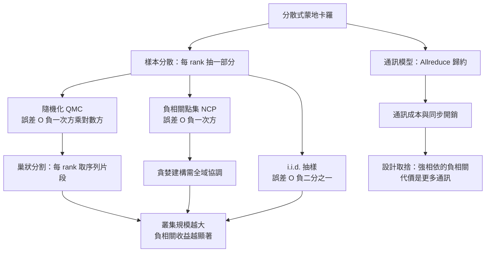

## 6.3 分布式蒙地卡羅算法

[上一章：6.2　GPU加速與蒙地卡羅方法](06.2-GPU加速與蒙地卡羅方法.md) | [下一章：第7章　隨機過程與模擬](07.0-隨機過程與模擬.md)

單機的多核與 GPU 最終都會撞到牆：核心數有限、記憶體有限、單一機房的電力與散熱有限。分散式叢集把問題推到了新的層級——但也帶來新的負擔：**節點之間如何通訊、如何協調、如何在節點失效時仍然正確**。本節的核心主題是：**在分散式環境中，如何不只是「把樣本分下去」，而是讓分散式抽樣比單機抽樣更好**。

## 學習目標

完成本節後，你應該能夠：

1. 說明 MPI 的基本通訊模型，以及分散式蒙地卡羅的歸約設計。
2. 說明隨機化 QMC 在分散式環境中的實施方式與優勢。
3. 解釋負相關抽樣（negative correlation sampling, NCS）與負相關點集（NCP）的原理。
4. 說明分散式 Metropolis-Hastings 的設計與其通訊需求。
5. 評估叢集通訊成本與同步開銷對演算法設計的影響。
6. 討論容錯、負載平衡與可重現性在分散式環境中的做法。
7. 給出分散式蒙地卡羅的實務建議。

## 6.3.1 分散式蒙地卡羅的結構

最簡單的分散式蒙地卡羅是「樣本分散、歸約集中」：

```
節點 0: 抽 N/w 個樣本 ──┐
節點 1: 抽 N/w 個樣本 ──┼── (Allreduce) ──> 每個節點都得到總和
節點 2: 抽 N/w 個樣本 ──┤
節點 3: 抽 N/w 個樣本 ──┘
```

MPI 的 **MPI_Allreduce** 是最合適的原語：它把每個行程的部分和歸約，並讓**所有**行程都得到結果。這比「收集到 rank 0 再廣播」更好，因為：每個節點都能獨立地繼續下一輪（例如 MCMC 的多鏈並行的共軛更新），且沒有單點瓶頸。

```cpp
// MPI 分散式蒙地卡羅積分
// 對應 6.3.1：Allreduce 歸約，以及每 rank 獨立亂數串流
#include <mpi.h>
#include <random>
#include <cmath>

int main(int argc, char** argv) {
    MPI_Init(&argc, &argv);
    int rank, size;
    MPI_Comm_rank(MPI_COMM_WORLD, &rank);
    MPI_Comm_size(MPI_COMM_WORLD, &size);

    long long n_total = 200000000LL;
    long long n_local  = n_total / size;

    // 每個 rank 使用獨立的隨機串流：seed 由 rank 決定，可重現
    std::mt19937_64 rng(20261118ULL + rank);
    std::uniform_real_distribution<double> unif(0.0, 1.0);

    double local_sum = 0.0, local_sq = 0.0;
    for (long long i = 0; i < n_local; ++i) {
        // 被積函數：exp(sum of 4 uniforms)，真值 (e-1)^4
        double s = unif(rng) + unif(rng) + unif(rng) + unif(rng);
        double v = std::exp(s);
        local_sum += v;
        local_sq  += v * v;
    }

    double sum = 0.0, sq = 0.0;
    long long n = 0;
    MPI_Allreduce(&local_sum, &sum,  1, MPI_DOUBLE, MPI_SUM, MPI_COMM_WORLD);
    MPI_Allreduce(&local_sq,  &sq,   1, MPI_DOUBLE, MPI_SUM, MPI_COMM_WORLD);
    MPI_Allreduce(&n_local,  &n,    1, MPI_LONG_LONG, MPI_SUM, MPI_COMM_WORLD);

    double mu = sum / n;
    double var = sq / n - mu * mu;
    double se = std::sqrt(var / n);
    if (rank == 0)
        std::printf("估計 = %.8f  SE = %.3e\n", mu, se);
    MPI_Finalize();
    return 0;
}
```

這段程式碼對應兩個理論重點：

- **MPI_SUM 的浮點歸約**：MPI 的歸約順序由實作決定，不同的行程數可能導致不同的位元結果。若需要嚴格可重現，應改用**固定順序的合併**（例如把各 rank 的部分和以 rank 編號排序後由 rank 0 逐一相加），代價是失去 Allreduce 的效率。
- **每 rank 獨立的亂數串流**：seed 由 `rank` 決定，保證與執行順序無關，且不同 rank 之間序列不重疊。

## 6.3.2 隨機化 QMC 的分散式

[4.2 節](04.2-多維積分的蒙地卡羅方法.md)的 RQMC 在分散式環境中有特別的優勢：**它是確定性的，因此不需要跨節點協調隨機串流**。

具體做法有兩種：

**做法一：巢狀分割（nested partition）**
每個 rank 處理 Sobol 序列的一個連續片段。由於 scrambled Sobol 具巢狀性，片段之間的關係是確定性的，合併後等價於完整的低差異序列。每個 rank 使用**相同的 scramble 種子**，但以 `fast_forward` 跳到自己的起點。

**做法二：獨立重複（independent replication）**
每個 rank 做 $`R`$ 次獨立的 Cranley–Patterson 平移，得到 $`R`$ 個估計，然後用 Allreduce 把這 $`R`$ 個估計彙總（跨 rank 與跨重複）。這裡的關鍵好處是：**誤差的來源被分解成「rank 間差異」與「重複間差異」**，可以分別估計。

**分散式 RQMC 的優勢**：相較於 i.i.d. 抽樣，RQMC 的誤差對「總樣本數」的依賴是 $`O(N^{-1}(\log N)^d)`$ ，而在叢集上把 $`N`$ 放大一個數量級（例如從 $`10^6`$ 到 $`10^9`$ ），這個優勢會被放大——因為 i.i.d. 抽樣在 $`10^9`$ 樣本下仍只有 $`10^{-4.5}`$ 的誤差，而 RQMC 可以到 $`10^{-2}`$ 甚至更好（視維度而定）。

## 6.3.3 負相關抽樣與負相關點集

這是本章最具理論深度的部分，也是分散式蒙地卡羅相對單機的**真正優勢**所在。

**為什麼需要負相關**：i.i.d. 抽樣中，隨機點之間會偶然聚集或留下空洞。負相關抽樣刻意構造樣本，使得任一區域內的點數**盡可能少超出**期望值，從而讓估計誤差顯著下降。

**負相關點集（NCP, negatively correlated points）**：給定一個「品質準則」（quality criterion），NCP 是在 $`[0,1)^d`$ 中構造 $`N`$ 個點，使任一盒子中的點數與其體積的乘積（期望點數）之差受到嚴格上界控制。

以二維為例，Best 與 Roberts（2005）證明存在 $`N`$ 個點，使得任何盒子 $`[0,a)\times[0,b)`$ 中的點數 $`\le`$ $`abN + 1`$ （即「extra points」上界為 1）。這比隨機抽樣的 $`\approx 2\sqrt{abN\log N}`$ 好得多。

**誤差改善**：若 $`f`$ 是 Lipschitz 連續（變化速率有界），則 NCP 的積分誤差界為 $`O(N^{-1})`$ ，相較 i.i.d. 的 $`O(N^{-1/2})`$ ——**整整一個冪次的提升**。

**分散式建構**：NCP 的建構通常是「貪婪式」的——每次加入一個點，最大化它到現有點集的最大距離（相當於最大化最小距離準則）。這種演算法**天然可分散**：各 rank 各自對不同區域做貪婪挑選，再用 Allgather 交換候選點並全域協調。代價是需要同步，而這正是下一小節要討論的成本。

**負相關抽樣（NCS）**：更一般的框架，針對特定的抽樣分佈（例如從一個已知分佈抽樣）構造具有負相關的樣本序列。常見的技巧：
- **隨機置換的 LHS**（[4.2 節](04.2-多維積分的蒙地卡羅方法.md)）本身具有弱負相關性質。
- **Lehmer／Owen 的置換方法**：以「逐維隨機置換 + 對角線配對」的方式產生負相關序列。



上圖呼應本節的核心論點：**分散式蒙地卡羅不只是「把工作分出去」，而是提供了一個 i.i.d. 抽樣在單機上得不到的機會——構造全局負相關的點集**。而這個機會的代價是通訊與同步，這正是分散式設計中真正困難的部分。

## 6.3.4 分散式 Metropolis-Hastings

[第8章](08.0-蒙地卡羅方法在物理中的應用.md)的 Metropolis-Hastings 演算法是另一類常見的分散式蒙地卡羅。它需要處理的是：**多條鏈如何共享資訊以加速收斂**。

**基本做法：多鏈並行**
啟動 $`P`$ 條獨立的鏈（每個 rank 一條或數條），各自迭代。歸納的樣本平均得到後驗的近似。

**加速策略一：資訊共享**
讓鏈之間偶爾交換狀態或接受資訊，例如：
- **跨鏈 proposal**：某個 rank 提出移動，決定是否接受時讓所有鏈投票。這把 $`P`$ 條鏈「合成」一個更長的有效鏈。
- **Replica exchange（副本交換）**：不同 rank 的鏈處於不同溫度（tempering ladder），定期嘗試交換狀態並以 Metropolis 比率接受。這能有效克服多峰後驗的緩慢混合。

**加速策略二：並行鏈的統計利用**
多鏈的歷史可用來估計 ESS 與自動調整鏈長（例如在 ESS 過低時延長迭代）。

**關鍵挑戰**：**鏈之間的同步需求與通訊成本**。跨鏈 proposal 每次迭代都要通訊，對於昂貴的目標密度而言，通訊開銷可能超過計算。實務上的折衷是：每 $`K`$ 次迭代做一次跨鏈通訊， $`K`$ 由實測決定。

## 6.3.5 叢集通訊成本與同步開銷

**通訊模型**（MPI 中最常見的兩種）：

| 模式 | 描述 | 延遲 | 頻寬 | 適合 |
| --- | --- | --- | --- | --- |
| Shared memory | 同一節點內多核心 | 極低（ns） | 極高（數百 GB/s） | 行程間共享資料 |
| MPI point-to-point | 節點間訊息傳遞 | 高（μs） | 中（數十 GB/s） | 點對點交換 |
| MPI Allreduce | 集合歸約 | 中高，受同步影響 | 中 | 樣本求和等歸約 |

**同步開銷**：MPI 的集合操作（如 Allreduce）必須等待所有 rank 參與。若各 rank 的工作量不均（負載不平衡），最快的 rank 也得等最慢的。這稱為 **straggler effect（落後者效應）**，在數百到數千節點的規模下是主要的效率殺手。

**緩解方式**：
- **非同步集合通訊**（MPI_Iallreduce）：啟動後立即返回，在需要結果前才等待。
- **負載平衡**：動態工作分配（每個 rank 領取任務佇列）。
- **分解通訊**：把歸約拆成多個較小的訊息，避免實作中的「同步點」擁堵。
- **避免每 iteration 通訊**：把多次迭代的統計量累積後再一次歸約。

**一個粗略的量級判斷**：若每次歸約的資料量是 $`B`$ 位元組、叢集互連頻寬是 $`W`$ GB/s、節點數是 $`P`$ ，則理想通訊時間為


$$
T_{\text{comm}} \approx \frac{P \cdot B}{W} \quad\text{（Allreduce 的 ring 演算法，理想情形）}
$$


若單次迭代的計算時間是 $`T_{\text{calc}}`$ ，則要求 $`T_{\text{comm}} \ll T_{\text{calc}}`$ ，否则效率會崩潰。實務上的量測方式是：分別執行「只有通訊」與「只有計算」的基準測試。

## 6.3.6 容錯與可重現性

**容錯（fault tolerance）**：數百節點的叢集中，硬體失效是常態（MTBF 隨節點數線性下降）。
- **檢查點（checkpointing）**：定期把狀態寫到共享儲存系統，失效時從最近的檢查點恢復。MCMC 演算法特別適合，因為其狀態很小（當前位置 + 亂數狀態）。
- **容錯訊息層（fault-tolerant MPI）**：如 ULFM（User Level Fault Tolerance），讓 MPI 程式能偵測並繞過失效節點。
- **任務層重啟**：若使用工作排程器（Slurm、K8s），讓失效的任務重新排程，而非讓整個作業崩潰。

**可重現性**：在分散式環境中，「同一組參數」可能因為節點數不同而得到不同結果。要定義清楚：
- **固定節點數的可重現性**：同樣的 rank 數、同樣的 seed 分配 → 結果一致（前提是歸約順序固定）。
- **與規模無關的可重現性**：節點數改變，結果也要一致。這需要「按樣本編號決定歸屬節點」的設計：每個樣本有全域唯一的編號，其 seed 由編號確定性導出；歸約時以固定順序（例如依編號）合併。

**這是一個實務上很重要但常被忽略的設計**：與規模無關的可重現性，使得「先用 10 個節點跑出結果，再用 1000 個節點重跑」能對照驗證，也讓逐步擴大規模的開發流程可行。

## 6.3.7 實務建議

1. **先用 MPI_Allreduce 取代 gather/scatter 模式**：每個 rank 都需要結果時，Allreduce 一次到位。
2. **每 rank 使用獨立的、與 rank 編號綁定的亂數串流**：這是重現性的基礎。
3. **浮點歸約注意順序**：需要位元一致時用固定順序合併；只求統計一致則用 MPI_SUM 即可。
4. **控制同步頻率**：把多次迭代的統計量累積後再一次歸約，不要每 iteration 通訊。
5. **設計負載平衡**：若每樣本成本不均，用動態任務分配；若成本均勻，靜態分配即可。
6. **高維或大樣本數時考慮 RQMC 或 NCP**：這是叢集規模帶來的最大統計收益。
7. **從 10 節點開始驗證正確性**，逐步擴大，並檢查效率變化。
8. **量測通訊佔比**：若通訊時間超過總時間的 10%，優先最佳化通訊模式。
9. **容錯設計要從一開始就考慮**：事後加檢查點往往比一開始就設計更貴。

## 本章要點

- 分散式蒙地卡羅的結構是「樣本分散 + Allreduce 歸約」，MPI 的集合操作比 gather/broadcast 模式更合適。
- RQMC 在分散式環境中特別有利：確定性使得片段分割不需要協調，且能獲得 $`O(N^{-1}(\log N)^d)`$ 的誤差優勢。
- 負相關點集（NCP）可把誤差從 $`O(N^{-1/2})`$ 降到 $`O(N^{-1})`$ ，這是叢集規模帶來的真實統計收益，但建構需要全域協調。
- 分散式 Metropolis-Hastings 以多鏈並行與資訊共享（replica exchange）加速收斂，代價是同步開銷。
- 落後者效應是大型叢集的主要效率殺手，應以非同步集合通訊與動態負載平衡緩解。
- 容錯靠檢查點與容錯 MPI；可重現性要求亂數串流與歸約順序都與排程無關，最好做到「與規模無關的可重現性」。
- 實務上應先量測通訊佔比，再決定是否投入更複雜的負相關設計。

## 延伸閱讀

- [6.0 蒙地卡羅積分的高效實現](06.0-蒙地卡羅積分的高效實現.md)、[6.1 基於並行計算的加速方法](06.1-基於並行計算的加速方法.md)、[6.2 GPU加速與蒙地卡羅方法](06.2-GPU加速與蒙地卡羅方法.md)
- [第8章：蒙地卡羅方法在物理中的應用](08.0-蒙地卡羅方法在物理中的應用.md)——Metropolis 與副本交換。
- [第14章：蒙地卡羅方法在機器學習中的應用](14.2-蒙地卡羅抽樣在貝葉斯推斷中的應用.md)——分散式後驗抽樣。
- Best, N. J. & Roberts, D. (2005). The size of weighted association tables for order 2 negative correlation. *J. Combin. Theory Ser. A*, 113(6), 944–956.
- Owen, A. (2013). *Monte Carlo Theory, Methods, and Examples*. Wiley.——負相關抽樣的處理。
- Gropp, W., Hoekstra, E., Thakur, R. & Singh, S. (2019). *Introduction to MPI*, 4th ed. O'Reilly.
- Fox, G. et al. (2017). *High Performance Parallel Processing*. Cambridge University Press.
