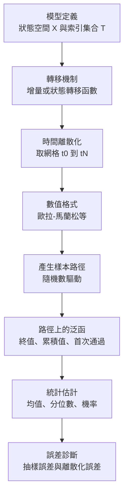
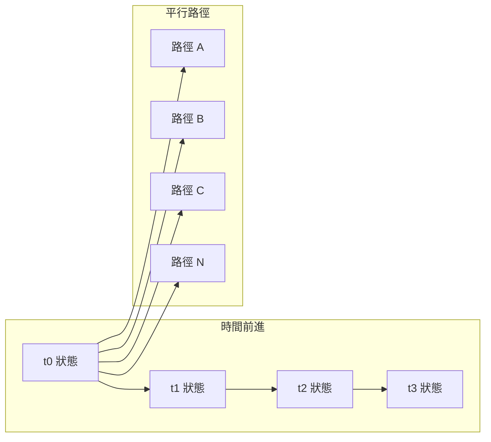

# 第7章　隨機過程與模擬

[上一章：第6章　蒙地卡羅積分的高效實現](06.0-蒙地卡羅積分的高效實現.md) | [下一章：7.1　隨機步行與布朗運動](07.1-隨機步行與布朗運動.md)

## 學習目標

完成本章後，讀者應該能夠：

1. 說明「隨機過程」相對於單一隨機變數的擴充意義，並理解它為何是描述「演化」的最小自然語言。
2. 掌握隨機過程的四個基本組成：狀態空間、索引集合（通常是時間）、轉移機制（增量或轉移函數）、以及樣本路徑。
3. 理解隨機過程與蒙地卡羅積分之間的雙向關係：固定時刻的橫截面是分佈抽樣，縱向則是一條時間序列。
4. 辨識「強解」與「弱解」、「樣本路徑」與「期望解」、「數值格式」與「精確解」之間的差異。
5. 說明為什麼隨機過程的蒙地卡羅模擬比靜態積分多出了「時間相依誤差」與「初始抽樣誤差」兩個新來源。
6. 掌握本章所介紹的最小可行工作流程：定義模型 → 選取時間離散 → 選取數值格式 → 產生路徑 → 統計估計 → 誤差診斷。

## 7.0.1 為什麼在蒙地卡羅法之後還需要「時間」

前六章的蒙地卡羅法都建立在同一個骨架上：給定一個固定的積分或期望

$$
\mathbb{E}[f(X)] = \int f(x)\,p(x)\,dx
$$


用大量獨立的樣本 $`X_1, X_2, \dots, X_N`$ 去逼近它。這個骨架非常強大，因為它把「計算」變成「抽樣」，而抽樣的誤差只隨 $`N^{-1/2}`$ 衰減，與積分區域的維度無關。第五章的變換抽樣、第六章的平行化與 GPU 加速，都是在這個骨架內不斷榨取效率。

然而，物理與金融的許多問題並不是「某個固定時刻的期望」，而是「一段時間內的演化」。股票價格、擴散粒子位置、氣體分子速率、熱能傳遞、量子波函數——它們都是**隨時間改變的隨機量**。若我們只在某個時刻抽樣，就會把整段歷史抹去；而許多感興趣的量（例如平均首次通過時間、期間的最大值、累積報酬、路徑相依衍生品的 payoff）**只在整條路徑上才有定義**。

於是，自然的推廣是：把一個隨機變數 $`X`$ 換成一族隨機變數 $`\{X_t\}_{t \ge 0}`$ 。這就是隨機過程（stochastic process）。

隨機過程的出現，帶來三個前六章沒有的問題：

- **問題一：如何定義「一個樣本」？** 靜態情形中樣本是單一數字；隨機過程中樣本是一條函數（路徑），是無限維的對象，「抽一個樣本」本身需要被定義清楚。
- **問題二：狀態之間如何關聯？** 必須給出「從 $`X_t`$ 如何走到 $`X_{t+dt}`$ 」的規則，也就是增量或轉移函數。
- **問題三：誤差從何而來？** 除了抽樣誤差，還有「離散化誤差」（用離散時間步近似連續過程）與「模型不確定性」（模型本身是否正確）。

這三個問題，正是本章 7.1、7.2、7.3 各自的主題。

## 7.0.2 隨機過程的四個要素

我們把一個隨機過程寫成 $`\{X_t\}_{t\in T}`$ ，並要求以下四件事。

**（一）狀態空間 $`\mathcal{X}`$ **： $`X_t`$ 取值的集合。例如一維布朗運動的狀態空間是 $`\mathbb{R}`$ ；Ising 模型的狀態空間是 $`\{-1,+1\}^{N_s}`$ ；金融定價中則是 $`\mathbb{R}^d`$ 。

**（二）索引集合 $`T`$ **：通常是 $`[0,\infty)`$ （連續時間），或是 $`\{0,1,2,\dots\}`$ （離散時間）。時間是隨機過程的舞台，也是「相依性」的來源。

**（三）轉移機制**：描述下一個狀態如何依賴當前狀態。最常用的兩種形式是

- **增量形式**： $`X_{t+dt} = X_t + \mu(X_t)\,dt + \sigma(X_t)\,dW_t`$ ，其中 $`dW_t`$ 為布朗增量；
- **狀態轉移形式**： $`X_{t+1} = f(X_t, \xi_{t+1})`$ ，其中 $`\xi`$ 是新抽出的隨機變數（見 [7.2](07.2-隨機微分方程的模擬.md)）。

**（四）樣本路徑 $`\{X_t(\omega)\}_{t\in T}`$ **：對每個樣本點 $`\omega`$ （即隨機實驗的一次實現），路徑是時間到狀態的一個函數。蒙地卡羅模擬產生的正是**一條條路徑**，而不是一個個數字。

下圖用流程圖說明這四個要素在一次模擬中的角色，以及它們如何對應到本章後續三節的主題。



流程圖呼應本章的核心論點：隨機過程的蒙地卡羅法不是「多抽幾次」而已，而是一條從**物理/金融模型**到**可信的數值結論**的完整推導鏈；任何一環斷裂，結論都不可靠。

### 7.0.3 路徑的思考方式：整條路徑都是隨機的

初學者最容易犯的錯誤，是把隨機過程的樣本路徑誤認為「一條有噪聲的確定性曲線」。事實上，樣本路徑與其期望 $`m(t)=\mathbb{E}[X_t]`$ 的關係，和單一隨機變數與其期望的關係是類比的，但有一個重要差異：**路徑本身在連續時間上是不可微的**（這正是布朗運動的特徵，見 [7.1](07.1-隨機步行與布朗運動.md)），因此「路徑的微分」並不存在，只能用「增量」來思考。

寫 SDE 時，正因為 $`dW_t`$ 平方是 $`dt`$ 量級、二次項不可忽略，才產生了 Itô 與 Stratonovich 兩種「不同的答案」這個著名的議題（見 [7.2](07.2-隨機微分方程的模擬.md)）。

## 7.0.4 與前六章的銜接

讓我們把隨機過程放回整本書的脈絡：

| 前置知識 | 來源章節 | 在本章中的角色 |
| --- | --- | --- |
| 期望、變數、獨立同分布抽樣 | [第2章](02.0-蒙地卡羅法的基本概念.md) | 路徑上每一個時間點的橫截面估計 |
| 均勻分佈、常態分佈、卜瓦松分佈 | [第3章](03.0-隨機數生成與統計分佈.md) | 生成增量 $`dW_t`$ 與 Poisson 事件 |
| 蒙地卡羅積分 | [第4章](04.0-蒙地卡羅積分法.md) | 把路徑泛函的期望化為積分再抽樣 |
| 變換抽樣 | [第5章](05.0-變換抽樣法.md) | 對增量做重要性抽樣、稀有事件加速 |
| 平行與 GPU 加速 | [第6章](06.0-蒙地卡羅積分的高效實現.md) | 路徑之間彼此獨立，天然高度可平行 |

下圖說明「一條路徑」在計算上的分解方式：橫向是路徑獨立性（可平行），縱向是時間相依性（必須順序推進）。這是隨機過程模擬與靜態蒙地卡羅最重要的結構差異。



這張圖說明：**時間方向上必須順序推進（因為下一個狀態依賴上一個狀態），但路徑方向上完全獨立（因為不同路徑由不同隨機數驅動）**。這個結構直接導出兩種標準化的加速策略：平行與 GPU 加速（第6章）、以及減少路徑數但增加每條路徑資訊量的變異數縮減（第11章）。

## 7.0.5 一個最小可運行的例子

為了讓抽象定義落地，我們先用一個最簡單的隨機過程——離散時間的幾何隨機步行——示範完整流程：定義模型、產生路徑、估計泛函。

```python
import numpy as np

def geometric_random_walk_paths(n_paths, n_steps, s0=100.0, mu=0.05, sigma=0.2):
    """產生幾何隨機步行（GBM）的模擬路徑。

    模型: dS/S = mu dt + sigma dW  的離散歐拉格式
    回傳形狀 (n_paths, n_steps+1)，第 0 欄為初始值 s0。
    """
    dt = 1.0 / n_steps
    # 標準常態增量，乘上 sqrt(dt) 得到布朗增量
    dW = np.sqrt(dt) * np.random.standard_normal((n_paths, n_steps))
    increments = (mu - 0.5 * sigma**2) * dt + sigma * dW
    paths = np.empty((n_paths, n_steps + 1))
    paths[:, 0] = s0
    # 沿時間軸累積；路徑之間彼此獨立，可整批向量化
    paths[:, 1:] = s0 * np.exp(np.cumsum(increments, axis=1))
    return paths

def estimate_call_price(paths, strike=100.0, r=0.03, T=1.0):
    """以蒙地卡羅估計看漲期權價格，並給出標準誤。"""
    st = paths[:, -1]
    payoff = np.maximum(st - strike, 0.0)
    disc = np.exp(-r * T)
    price = disc * payoff.mean()
    stderr = disc * payoff.std(ddof=1) / np.sqrt(len(payoff))
    return price, stderr

np.random.seed(2026)
paths = geometric_random_walk_paths(50000, 252)
price, se = estimate_call_price(paths)
print(f"價格 = {price:.4f}, 標準誤 = {se:.4f}, 95% CI = [{price-1.96*se:.4f}, {price+1.96*se:.4f}]")
```

這段程式碼示範了本章後續所有內容的原型。理論對應是：**大數法則保證 $`\hat{p}_N \to p`$ **，而 $`se = \sigma_{\text{payoff}}/\sqrt{N}`$ 給出抽樣誤差；而 $`\mu - \sigma^2/2`$ 的修正項則來自 Itô 引理（見 [7.2](07.2-隨機微分方程的模擬.md)），確保離散步長下的幾何布朗運動期望與連續版本一致。

## 7.0.6 本章地圖

本章安排如下：

- **[7.1 隨機步行與布朗運動](07.1-隨機步行與布朗運動.md)**：從最離散的 simple random walk 出發，展示「隨機步行在 $`\sqrt{n}`$ 尺度下趨近布朗運動」的熱極限（diffusive scaling），並引入 Donsker 定理——這是連續時間隨機過程的理論源頭，同時也說明隨機步行如何用來做蒙地卡羅積分的隨機化重表述。
- **[7.2 隨機微分方程的模擬](07.2-隨機微分方程的模擬.md)**：處理「有漂移、有擴散」的連續時間模型，比較 Itô 與 Stratonovich 兩種積分定義，介紹歐拉-馬蘭松格式、Milstein 格式與它們的強/弱收斂階，並說明 Fokker-Planck 方程與隨機過程的對偶關係。
- **[7.3 蒙地卡羅方法在隨機過程中的應用](07.3-蒙地卡羅方法在隨機過程中的應用.md)**：回到統計面，說明在隨機過程上做蒙地卡羅估計的統計性質（序列相依、自協方差時間），討論 stationary distribution、Poisson 過程與 first-passage 分析，以及不確定性如何沿時間傳遞。

## 本章要點

1. 隨機過程是把蒙地卡羅法從「估計一個固定的期望」推廣到「描述一段演化」的最小自然框架。
2. 隨機過程由四要素構成：狀態空間、索引集合（時間）、轉移機制、樣本路徑。
3. 路徑是無限維對象；連續時間路徑通常不可微，因此思考的基本單位是「增量」而非「導數」。
4. 隨機過程模擬的誤差有三大來源：抽樣誤差、離散化誤差、模型不確定性，三者必須分別診斷。
5. 隨機過程的計算結構是「時間上順序、路徑上平行」，這是所有加速策略的基礎。
6. 連續時間隨機過程的理論源頭是 simple random walk 的熱極限；帶漂移與擴散的模型則需要 SDE 與 Itô 積分來處理。

## 延伸閱讀

- Donsker, M. (1965). *Weak Convergence to Brownian Motion and the Functional Central Limit Theorem*. The Annals of Probability.
- Revuz, D. & Yor, M. (1999). *Continuous Martingales and Brownian Motion*. Cambridge University Press.
- Øksendal, B. (2010). *Applied Stochastic Differential Equations*. Springer.
- Kloeden, P. L. & Platen, E. (1992). *Numerical Solution of Stochastic Differential Equations*. Springer.
- [附錄A2：常見數學公式與定理](A2-常見數學公式與定理.md)
