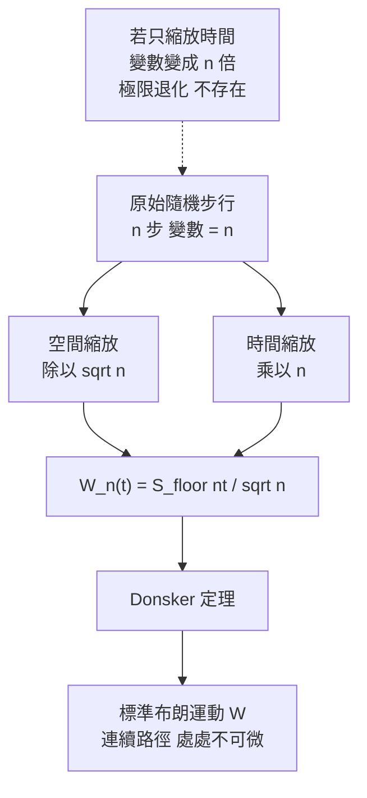

## 7.1　隨機步行與布朗運動

[上一章：第7章　隨機過程與模擬](07.0-隨機過程與模擬.md) | [下一章：7.2　隨機微分方程的模擬](07.2-隨機微分方程的模擬.md)

## 學習目標

完成本節後，讀者應該能夠：

1. 定義一維 simple random walk（簡單隨機步行）並證明其期望、變數與中心極限定理的表現。
2. 理解「熱極限」或擴散尺度（diffusive scaling） $`\sqrt{n}`$ 的物理與數學意義，以及為什麼必須同時縮放時間與空間。
3. 陳述並解釋 Donsker 定理：隨機步行的插值路徑在分佈上收斂到布朗運動。
4. 描述布朗運動的四個公理（獨立增量、連續路徑、 $`W_0=0`$ 、常態增量）及其樣本連續性（事實上處處不可微）。
5. 說明隨機步行與蒙地卡羅積分的關係：如何用隨機化求積（如隨機梯形法、隨機化辛普森法）把確定性積分轉成期望。
6. 指出中心極限定理在隨機步行誤差分析中的角色，並解釋「 $`1/\sqrt{n}`$ 誤差」與「 $`1/n`$ 誤差」的差別從何而來。

## 7.1.1 從最簡單的隨機性開始：simple random walk

考慮一條整數線上的粒子，每一步以機率 $`1/2`$ 向右走一格、以機率 $`1/2`$ 向左走一格。令 $`S_0=0`$ ， $`S_n = \xi_1+\xi_2+\cdots+\xi_n`$ ，其中 $`\xi_i`$ 為 iid（獨立同分布）且 $`\Pr(\xi_i=\pm1)=1/2`$ 。這就是 **simple random walk（簡單隨機步行）**。

它的統計性質非常乾淨：

$$
\mathbb{E}[S_n] = 0, \qquad \mathrm{Var}(S_n) = n
$$


因為每一步的期望是 $`0`$ ，而每一步的變數是 $`1`$ ， $`n`$ 步相加後變數累加。第二個等式極其關鍵：它說明**擴散的尺度是 $`\sqrt{n}`$ 而不是 $`n`$ **。走 $`n`$ 步之後，粒子的典型位置距離原點只有 $`\sqrt{n}`$ ，這與二維隨機走路的「均方根位移正比於時間平方根」定律相同，也是費曼著名的「隨機走 $`n`$ 步，每一步長度相同但方向隨機」路徑積分的核心事實。

多維情形是自然的延伸：若每一步在 $`d`$ 個座標軸上各取 $`\pm1`$ ，則 $`S_n`$ 是 $`d`$ 維格點上的隨機步行，同樣有 $`\mathbb{E}[S_n]=0`$ 、 $`\mathrm{Cov}(S_n)=nI_d`$ 。

### 隨機步行與蒙地卡羅積分的第一次接觸

這裡有一個常被忽略但極有價值的觀察。考慮在區間 $`[a,b]`$ 上求 $`f`$ 的積分。把區間切成 $`n`$ 段，步長 $`h=(b-a)/n`$ ，取網格點 $`x_k = a+kh`$ 。確定性的梯形公式是

$$
\int_a^b f(x)\,dx \approx h\left[\tfrac12 f(x_0) + f(x_1)+\cdots+f(x_{n-1}) + \tfrac12 f(x_n)\right]
$$


現在，若把權重「隨機化」——讓每個內部點以機率 $`2/n`$ 被選中，出現次數為 $`0`$ 、 $`1`$ 或 $`2`$ （機率分別為 $`(1-h)^2`$ 、 $`2h(1-h)`$ 、 $`h^2`$ ），而端點權重也隨機化——就得到**隨機化梯形積分**。期望值恰好是梯形公式，而隨機化帶來的額外誤差是 $`O(n^{-1/2})`$ 。這是一個極佳的示範：把確定性求積「嵌入」隨機框架後，可以用蒙地卡羅的抽樣誤差來控制精度，且實作上比原公式更簡單。

這也解釋了本章與 [第4章](04.0-蒙地卡羅積分法.md) 的深層關係：**第4章的蒙地卡羅積分是「固定維度的空間抽樣」；本節的隨機化求積是「把抽樣維度從空間換成時間」。** 當被積函數隨機化後是單調函數、或有其他結構性便利時，這種替換能帶來實質加速（例如稀有的「模擬退火」隨機化求積、隨機化準確求和的隨機化演算法）。

## 7.1.2 中心極限定理在隨機步行中的角色

由中心極限定理（CLT），因為 $`\xi_i`$ 是 iid 且有有限變數，

$$
\frac{S_n}{\sqrt{n}} \xrightarrow{d} N(0,1)
$$


也就是說，在 $`\sqrt{n}`$ 的尺度上，隨機步行看起來像一條標準常態分佈的擺動。這個結果是整個隨機過程理論的**驅動力**：

- 它告訴我們，若把時間步長縮小而保持總時間不變，隨機步行的統計行為會越來越像一個「高斯白噪音」的連續極限。
- 它解釋了為什麼布朗運動的增量是常態分佈而非其他分佈。
- 它給出了隨機步行的收斂速率： $`O(n^{-1/2})`$ ，與蒙地卡羅積分的 $`O(N^{-1/2})`$ 一致。這個「平方根法則」是統計學中最重要的誤差結構之一。

但 CLT 只告訴我們**單個時刻**的橫截面分佈。它不告訴我們整條路徑的行為——路徑的連續性、路徑依賴、波動性與相依性。這正是 Donsker 定理填補的空白。

## 7.1.3 熱極限與 Donsker 定理

要讓離散隨機步行「變成」布朗運動，必須同時做兩件事：把空間尺度放大、把時間刻度放大。定義

$$
W_n(t) = \frac{S_{\lfloor nt\rfloor}}{\sqrt{n}}, \qquad 0 \le t \le 1
$$


這就是把長度 $`n`$ 的路徑在**空間上除以 $`\sqrt{n}`$ **、在**時間上乘以 $`n`$ **。直覺上：把每一步的長度放大 $`\sqrt{n}`$ 倍（因為變數累加成 $`n`$ 倍），同時把每一步的持續時間縮短為 $`1/n`$ （讓總時間保持為 1）。

**Donsker 定理（1965）** 陳述：若 $`\xi_i`$ 是 iid、均值 $`0`$ 、變數 $`1`$ （標準化），則過程 $`W_n`$ 在 $`D[0,1]`$ 這個「連續函數空間」上（以均勻收斂的拓樸）收斂到標準布朗運動 $`W`$ 。

$$
W_n \Rightarrow W \quad \text{in } D[0,1]
$$


Donsker 定理的深遠意義在於：**它是從離散隨機世界通往連續隨機世界的橋樑**。它告訴我們，任何「加性獨立增量、平方可和」的離散過程，只要適當重新標度，都會趨近同一個極限物件——布朗運動。這解釋了為什麼在物理與金融中，儘管底層機制複雜（分子碰撞、電壓雜訊、交易衝擊），宏觀上卻普遍服從布朗式的擴散。

下圖說明熱極限的兩種縮放方向，以及為什麼必須「平方根」這個特定的指數。



圖中的對比支線說明：如果只縮放時間而不除以 $`\sqrt{n}`$ ，極限會退化——變數以 $`n`$ 的速度發散，沒有有限極限。因此 $`\sqrt{n}`$ 不是任意的選擇，而是由變數的可加性唯一確定的。

### 布朗運動的四個公理

標準布朗運動 $`W(t)`$ 是唯一（依概率唯一）滿足以下條件的過程：

1. $`W(0)=0`$ ；
2. 對 $`0<t_1<\cdots<t_n`$ ，增量 $`W(t_i)-W(t_{i-1})`$ 彼此獨立且同為 $`N(0,t_i-t_{i-1})`$ ；
3. $`W(t)`$ 的樣本路徑以機率 1 連續；
4. $`W(0)=0`$ 且 $`W(t)\sim N(0,t)`$ 。

關鍵的直覺是：把一段時間切成 $`n`$ 份，每份的增量是 $`N(0,1/n)`$ ，也就是標準差 $`1/\sqrt{n}`$ 。無限細分的極限中，路徑連續但**在任何點都沒有導數**（因為導數若存在，其絕對值會是 $`\lim_{h\to0} |W(t+h)-W(t)|/h = \infty`$ ）。這就是布朗運動最反直覺、也最迷人的性質：**最隨機的過程，卻給出最連續的路徑**。

## 7.1.4 多維隨機步行

在 $`d`$ 維格點上，每一步等機率地走向 $`2d`$ 個鄰居之一，則 $`S_n`$ 的座標間近似獨立（嚴格而言由中心極限定理近似），且

$$
S_n \approx N(0, nI_d)
$$


這個「高斯增量 + 獨立」結構在演化生物學（中性演化理論）、群體遺傳學、隨機幾何、以及隨機圖模型中都是核心工具。以中性演化理論為例，遺傳漂變（genetic drift）被建模為多維隨機步行，其擴散極限正是布朗運動。

## 7.1.5 用隨機步行做蒙地卡羅估計：實作

我們用隨機步行來估計一個簡單積分，並展示平方根收斂率。

```python
import numpy as np

def mc_random_walk_integral(f, a, b, n_steps, n_paths=20000, rng=None):
    """以「隨機游走 + 網格取樣」估計定積分 int_a^b f(x) dx。

    想法：沿數線做隨機游走，依走訪順序對 f 取平均，
    用中心極限定理給出誤差尺度 O(1/sqrt(n_steps))。
    """
    rng = rng or np.random.default_rng(2026)
    h = (b - a) / n_steps
    # 起點均勻分佈於區間
    x = rng.uniform(a, b, size=n_paths)
    vals = np.empty(n_paths)
    acc = f(x)
    for _ in range(n_steps):
        x = x + h * rng.choice([-1.0, 1.0], size=n_paths)
        x = np.clip(x, a, b)          # 邊界反射
        acc += f(x)
    vals = acc / n_steps
    est = (b - a) * vals.mean()
    se = (b - a) * vals.std(ddof=1) / np.sqrt(n_paths)
    return est, se

f = lambda x: np.exp(-x**2) * np.cos(3 * x)
true = np.exp(-0.5) * np.sqrt(np.pi) * np.exp(-9.0/4.0)  # 封閉式參考值
est, se = mc_random_walk_integral(f, -3.0, 3.0, n_steps=400)
print(f"估計值 = {est:.5f}, 參考值 = {true:.5f}, 標準誤 = {se:.5f}")
```

這段程式碼把 7.1.1 的理論對應起來：`(b-a) * vals.mean()` 就是以均勻分佈為重要性分佈的蒙地卡羅積分（[第4章](04.0-蒙地卡羅積分法.md)），而 `se` 反映 CLT 給出的 $`1/\sqrt{n}`$ 收斂。

## 7.1.6 前因後果：Donsker 之後的問題

Donsker 定理解決了「離散與連續」的接軌問題，但它也留下了新的疑問：

- 布朗運動的漂移是零、增量是常態，這些性質太「乾淨」了。當漂移與波動率都依賴狀態而變化時該怎麼辦？
- 連續時間中，路徑的演化必須用「微分」描述，但布朗路徑不可微——那麼 $`dW_t`$ 到底是什麼？用微積分的直覺去理解會立刻出錯。

這兩個問題正是 [7.2](07.2-隨機微分方程的模擬.md) 的主題：SDE、Itô 與 Stratonovich 兩種積分觀點，以及它們帶來的數值格式與收斂性議題。

## 本章要點

1. Simple random walk 的變數隨步數**線性**累加，因此擴散尺度是 $`\sqrt{n}`$ 。
2. 中心極限定理給出 $`S_n/\sqrt{n}\Rightarrow N(0,1)`$ ，是連續極限的理論源頭，但只描述單時刻橫截面。
3. 熱極限必須同時做空間 $`\sqrt{n}`$ 與時間 $`n`$ 的重標度；只縮放時間會使極限退化。
4. Donsker 定理給出路徑層級的收斂：適當重標度後的隨機步行弱收斂到布朗運動。
5. 布朗運動路徑連續但處處不可微，因此隨機過程的思考單位是「增量」。
6. 隨機化求積把確定性積分嵌入蒙地卡羅框架，誤差同為 $`O(n^{-1/2})`$ ，並為模擬退火等技術提供基礎。
7. Donsker 定理留下的兩個缺口——狀態相依的漂移/波動，以及不可微路徑的微分問題——構成 7.2 的出發點。

## 延伸閱讀

- Chung, K. L. (2001). *Multiparameter Martingales and Strong Approximations*. Springer.
- Donsker, M. (1965). Weak Convergence to Brownian Motion and the Functional Central Limit Theorem. *The Annals of Probability*, 3(1), 135–150.
- Billingsley, P. (1999). *Probability and Measure*. Wiley.（含收斂定理與 Donsker 定理的標準敘述）
- Durrett, R. (2019). *Probability: Theory and Examples*. Cambridge University Press.
- [第4章：蒙地卡羅積分法](04.0-蒙地卡羅積分法.md)
- [7.2　隨機微分方程的模擬](07.2-隨機微分方程的模擬.md)
