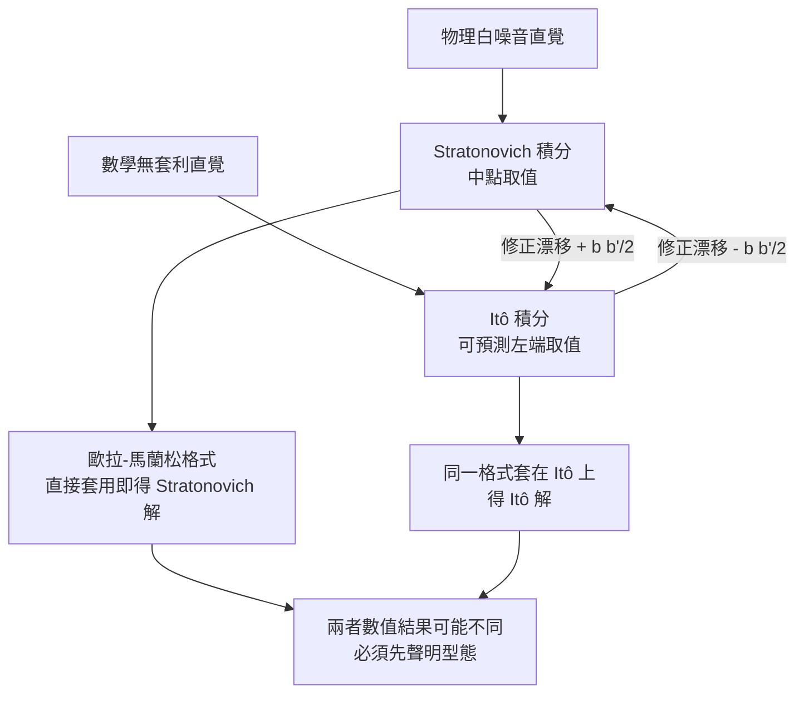
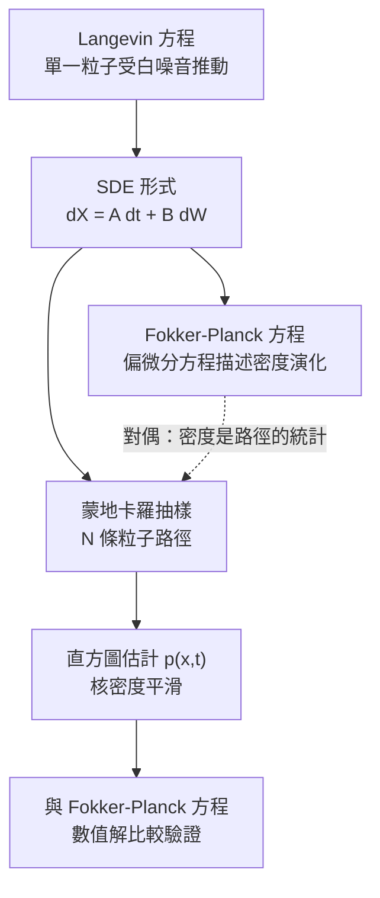

## 7.2　隨機微分方程的模擬

[上一章：7.1　隨機步行與布朗運動](07.1-隨機步行與布朗運動.md) | [下一章：7.3　蒙地卡羅方法在隨機過程中的應用](07.3-蒙地卡羅方法在隨機過程中的應用.md)

## 學習目標

完成本節後，讀者應該能夠：

1. 說明為什麼布朗運動的「微分」需要重新定義，並陳述 Itô 積分與 Stratonovich 積分的差異。
2. 判斷一個 SDE 給定的是 Itô 型態還是 Stratonovich 型態，並在兩者之間做正確的轉換。
3. 推導並實作歐拉-馬蘭松（Euler–Maruyama）格式，並理解其強收斂階為 $`1/2`$ 、弱收斂階為 $`1`$ 的意義。
4. 說明 Milstein 格式為何能提升強收斂階到 $`1`$ ，以及它在多維情形中面臨的「導數張量成本」難題。
5. 描述 Langevin 方程與 Fokker–Planck 方程，並解釋兩者作為「隨機」與「偏微分」兩種觀點的對偶關係。
6. 判斷在何種問題下關心強收斂（同一路徑比較）、何種問題下關心弱收斂（分佈比較），並據此選擇格式。

## 7.2.1 難題：不可微路徑的「微分」

[7.1](07.1-隨機步行與布朗運動.md) 告訴我們布朗路徑連續但處處不可微。那麼符號 $`dW_t`$ 究竟代表什麼？直覺上它代表「在極小時間 $`dt`$ 內的隨機位移」，量級是 $`O(\sqrt{dt})`$ 。但正是因為它是 $`O(\sqrt{dt})`$ 而不是 $`O(dt)`$ ，標準微積分中的乘積規則會失效：

$$
dW_t \cdot dW_t = dt \ne 0
$$


這正是 Itô 積分的出發點，也是 Itô 與 Stratonovich 分歧的根源。

在 Itô 積分中，積分點取在區間的**左端**（或依某種可預測性的約定）；在 Stratonovich 積分中，積分點取在**中點**，即

$$
\int_0^t f(W_s)\circ dW_s = \int_0^t f(W_s)\,dW_s + \tfrac12\int_0^t f'(W_s)\,ds
$$


兩種定義給出**不同的隨機過程**。對 SDE

$$
dX_t = a(X_t)\,dt + b(X_t)\,dW_t
$$


- **Itô 型態**解的是上式；
- **Stratonovich 型態**寫成 $`dX_t = a(X_t)\,dt + b(X_t)\circ dW_t`$ 。

兩者之間的轉換關係為：若 $`dX = a\,dt + b\circ dW`$ （Stratonovich），則其等價的 Itô 形式是

$$
dX = \left[a + \tfrac12 b b'\right]dt + b\,dW
$$


反之，若 Itô 形式為 $`dX = a\,dt + b\,dW`$ ，則等價的 Stratonovich 形式是 $`dX = \left[a - \tfrac12 b b'\right]dt + b\circ dW`$ 。

### 物理直覺：哪一種才對？

這是一個非常好的「前因後果」例子：Itô 是後來發展出來的、純粹由數學定義出來的積分；Stratonovich 則是為了**符合物理上自然的白噪音解釋**而被保留下來的。

物理學家說「布朗粒子受到白噪音力 $`\eta(t)`$ 推動」，寫成 $`dX = v\,dt + \sigma\,dW`$ 。但白噪音 $`\eta(t)`$ 在數學上沒有定義（因為它不是普通函數），只能理解為「 $`dW/dt`$ 」。而把白噪音解讀為「 $`dW/dt = \lim dW/dt`$ 」時，中點取值（Stratonovich）是更符合「在時刻 $`t`$ 的力作用於在時刻 $`t`$ 的速度」這個物理直覺的。

因此慣例是：

- **物理學（白噪音詮釋）** → Stratonovich；
- **數學金融（無套利詮釋）** → Itô。

以幾何布朗運動為例，若寫成 Stratonovich 形式 $`dS = \mu S \circ dW`$ ，轉成 Itô 後是 $`dS = \mu S\,dt + \sigma S\,dW`$ 。這個 $`\mu`$ （漂移）與 $`\sigma`$ （波動率）的語義差別，正是 [9.1](09.1-期權定價與風險管理.md) 中期權定價的關鍵。

下圖總結兩種積分定義的關係與轉換路徑。



這張圖表達本章最核心的論點：**同一個符號寫法在 Itô 與 Stratonovich 下代表不同的物理/金融過程**，所以任何 SDE 程式碼的第一行都應該聲明型態，否則數值結果會有系統性偏差。

## 7.2.2 歐拉-馬蘭松格式

考慮 Itô SDE

$$
dX_t = a(X_t)\,dt + b(X_t)\,dW_t, \qquad X_0 = x_0
$$


在等距時間網格 $`t_k = k\Delta t`$ 上，最直接的離散化就是「把導數換成增量」：

$$
X_{k+1} = X_k + a(X_k)\,\Delta t + b(X_k)\,\sqrt{\Delta t}\,Z_k, \qquad Z_k \sim N(0,1)\ \text{iid}
$$


這就是**歐拉-馬蘭松格式**。其直覺是：漂移項以 $`dt`$ 的速度累積，擴散項以 $`\sqrt{dt}`$ 的幅度跳動。注意 $`\sqrt{\Delta t}`$ 而不是 $`\Delta t`$ ——這正是布朗運動增量分佈 $`N(0,\Delta t)`$ 的要求。

### 強收斂與弱收斂

這兩個概念是本節最重要的區分：

- **強收斂**（strong convergence）：若用同一組隨機數 $`\{Z_k\}`$ 驅動數值解 $`\hat{X}`$ 與精確解 $`X`$ ，考察 $`\sup_k |\hat{X}_k - X_k|`$ 。強收斂的直覺是「我們的路徑幾乎就是真的那條路徑」。
- **弱收斂**（weak convergence）：考察數值解的**分佈**與精確解分佈的差距（用 Kolmogorov 距離或弱收斂）。直覺是「我們的路徑不是那條路徑，但統計上無法區分」。

歐拉-馬蘭松格式的收斂階為：

$$
\begin{array}{rl}
\text{強收斂} & : \mathbb{E}\left[\sup_k |\hat{X}_k - X_k|\right] = O(\Delta t^{1/2}) \\
\text{弱收斂} & : O(\Delta t)
\end{array}
$$


為什麼強收斂只有 $`1/2`$ ？因為局部截斷誤差的量級是 $`O(\Delta t)`$ （與 $`dt`$ 同階），但這些誤差是獨立的隨機累積，其平方和為 $`\Delta t \cdot \Delta t = \Delta t^2`$ ，開根號得 $`O(\Delta t^{1/2})`$ 。這就是隨機計算中特有的一個「平方根損失」。

這個區分有實務後果：
- **路徑相依的 payoff**（例如亞洲期權、最大回撤、障礙期權）需要**強**收斂，因為 payoff 直接依賴整條路徑的位置。
- **終點分佈的估計**（例如股價的價位分布、到期收益率曲線）只需**弱**收斂。

## 7.2.3 Milstein 格式：把強收斂提升到 1

歐拉-馬蘭松的 $`O(\Delta t^{1/2})`$ 弱點源自於它忽略了一個關鍵事實：布朗增量的高階矩。

對 Itô SDE，Itô 引理告訴我們 $`df(X_t) = f'(X_t)dX_t + \tfrac12 f''(X_t)b(X_t)^2 dt`$ 。反過來，當我們把 $`f(X_{k+1})`$ 與 $`f(X_k)`$ 精確展開到二階時，會出現 $`(\Delta W_k)^2`$ 項，其期望是 $`\Delta t`$ ，與漂移同階。因此在離散化中補上一個修正項，可以消除這個誤差來源：

$$
X_{k+1} = X_k + a(X_k)\Delta t + b(X_k)\Delta W_k + \tfrac12 b'(X_k)\left[(\Delta W_k)^2 - \Delta t\right]
$$


這就是 **Milstein 格式**，其強收斂階為 $`O(\Delta t)`$ 。在多維情形（擴散項為 $`b(X_t)\,dW_t`$ ，其中 $`b`$ 為矩陣），需要用到矩陣微分鏈規則，Milstein 項要寫成

$$
\sum_{j,k} \frac{\partial b_{i,j}}{\partial x_k} b_{k,l}\,\left[\Delta W_j \Delta W_l - \Delta t\,\delta_{jl}\right]
$$


這帶來昂貴的**導數張量**計算與儲存成本；當 $`d`$ 很大時（如數千個資產），完整的 Milstein 幾乎不可行，實務上常採用近似或只對部分維度使用。這個「精確但昂貴 vs 近似但便宜」的取捨，是本節引出的新問題，第 11 章會回到它。

## 7.2.4 Langevin 方程與 Fokker–Planck 方程

物理上，一個粒子在流體中受到隨機力，其運動方程寫成 **Langevin 方程**：

$$
m\ddot{X} = -\gamma \dot{X} + F(X) + \eta(t)
$$


其中 $`\eta(t)`$ 是白噪音力，滿足 $`\langle \eta(t)\eta(t')\rangle = 2\gamma k_B T\,\delta(t-t')`$ 。在過阻尼極限（黏性力主導，慣性可忽略）下，第一階化為

$$
dX_t = \left[-\frac{\nabla U(X_t)}{\gamma}\right]dt + \sqrt{\frac{2k_B T}{\gamma}}\,dW_t
$$


其中 $`U`$ 是位能， $`T`$ 是絕對溫度， $`k_B`$ 為玻茲曼常數。

另一方面，**Fokker–Planck 方程**描述同一件事的「概率密度版」：

$$
\frac{\partial p}{\partial t} = -\frac{\partial}{\partial x}\left[A(x)\,p\right] + \frac12\frac{\partial^2}{\partial x^2}\left[B(x)^2 p\right]
$$


其中 $`A`$ 是漂移、 $`B`$ 是擴散係數。兩者的關係是**對偶的**：給定 SDE，其解過程的概率密度滿足 Fokker–Planck 方程；反過來給定 Fokker–Planck 方程（在適當條件下）可構造出 SDE。

下圖說明這個對偶關係，以及它為什麼讓蒙地卡羅法在物理中特別有力。



這張圖的核心論點是：蒙地卡羅法把一個**偏微分方程問題**轉換成一個**抽樣問題**，而後者可以用第 6 章的平行與 GPU 加速大規模擴充。這正是統計力學中蒙地卡羅法能與解析解競爭的技術原因。

## 7.2.5 實作：歐拉-馬蘭松與 Milstein 的比較

```python
import numpy as np

def euler_maruyama(a, b, x0, T, n_steps, rng):
    """歐拉-馬蘭松格式求解 dX = a(X)dt + b(X)dW。"""
    dt = T / n_steps
    dW = np.sqrt(dt) * rng.standard_normal(n_steps)
    x = np.empty(n_steps + 1)
    x[0] = x0
    for k in range(n_steps):
        x[k+1] = x[k] + a(x[k]) * dt + b(x[k]) * dW[k]
    return x

def milstein(a, b, db, x0, T, n_steps, rng):
    """一維 Milstein 格式，db 為 b 的導數函式。"""
    dt = T / n_steps
    dW = np.sqrt(dt) * rng.standard_normal(n_steps)
    x = np.empty(n_steps + 1)
    x[0] = x0
    for k in range(n_steps):
        x[k+1] = (x[k] + a(x[k]) * dt + b(x[k]) * dW[k]
                  + 0.5 * db(x[k]) * (dW[k]**2 - dt))
    return x

# 測試方程：dX = X dW（幾何布朗運動的 Itô 形式，a=0, b=x）
a  = lambda x: 0.0
b  = lambda x: x
db = lambda x: 1.0
rng = np.random.default_rng(42)
T = 1.0
for n in (100, 400, 1600):
    # 共用同一組隨機數，才能做「同一條路徑」的強誤差比較
    r = np.random.default_rng(7)
    x_e = euler_maruyama(a, b, 1.0, T, n, r)
    r = np.random.default_rng(7)
    x_m = milstein(a, b, db, 1.0, T, n, r)
    print(f"n={n:5d}  EM 終點 = {x_e[-1]:.5f}   Milstein 終點 = {x_m[-1]:.5f}")
```

這段程式碼示範了**強誤差比較的正確做法**：兩種格式必須使用**相同的隨機數**，否則比較的是不同路徑，量到的是抽樣誤差而非離散化誤差。這一點在實務中常被忽略，會導致錯誤的精度判斷。

## 7.2.6 前因後果

Itô 與 Stratonovich 的區分，讓 SDE 有了明確的數學語義；歐拉-馬蘭松讓 SDE 可被模擬；Milstein 提升了路徑精度但帶來高維成本；而 Fokker–Planck 對偶則顯示，蒙地卡羅法可以替代偏微分方程求解。但這些都只解決了「如何產生路徑」的問題。還剩下兩個更根本的問題：

1. **產生的路徑代表什麼？** 在非平衡系統中，初始分佈如何影響長期行為？何時會出現 stationary distribution？
2. **統計量本身的誤差如何界定？** 路徑是序列相關的，不能把 $`N`$ 個時間點當作 $`N`$ 個獨立樣本。這正是 [7.3](07.3-蒙地卡羅方法在隨機過程中的應用.md) 的主題。

## 本章要點

1. 布朗路徑不可微， $`dW_t^2 = dt`$ ，這使得 Itô 與 Stratonovich 成為兩種不同的積分定義，對應不同的過程。
2. Itô 與 Stratonovich 之間以漂移修正項 $`\tfrac12 b b'`$ 互換；物理白噪音直覺偏向 Stratonovich，金融無套利偏向 Itô。
3. 歐拉-馬蘭松格式： $`X_{k+1} = X_k + a\Delta t + b\sqrt{\Delta t} Z_k`$ ，強收斂 $`O(\Delta t^{1/2})`$ 、弱收斂 $`O(\Delta t)`$ 。
4. 強收斂對應「同一條路徑」的比較，路徑相依 payoff 需要它；弱收斂對應分佈比較，終點估計只需它。
5. Milstein 格式補上 $`\tfrac12 b'[({\Delta W})^2 - \Delta t]`$ 修正項，強收斂提升為 $`O(\Delta t)`$ ，代價是高維的導數張量成本。
6. Langevin 方程是粒子觀點，Fokker–Planck 方程是密度觀點，兩者對偶；蒙地卡羅法把 PDE 問題轉成抽樣問題，因而可用平行與 GPU 加速。
7. 比較數值格式的強誤差時，必須固定使用同一組隨機數。

## 延伸閱讀

- Itô, K. (1950). On a problem of S. O. Rice. *Journal of Mathematical Analysis and Applications*, 1(2), 183–189.
- Øksendal, B. (2010). *Applied Stochastic Differential Equations*. Springer.
- Kloeden, P. L. & Platen, E. (1992). *Numerical Solution of Stochastic Differential Equations*. Springer.
- Kloeden, P. L. & Worsley, G. J. (1997). *Numerical Solution of SDEs*. Springer.
- Risken, H. (1989). *The Fokker-Planck Equation*. Springer.
- [7.3　蒙地卡羅方法在隨機過程中的應用](07.3-蒙地卡羅方法在隨機過程中的應用.md)
